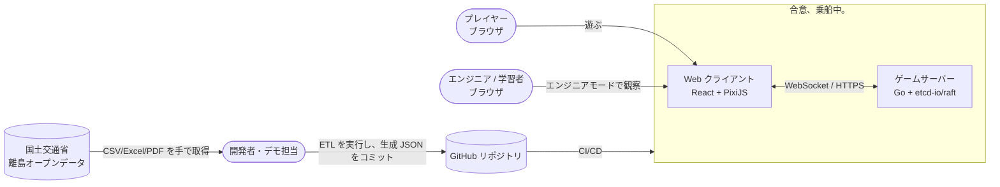
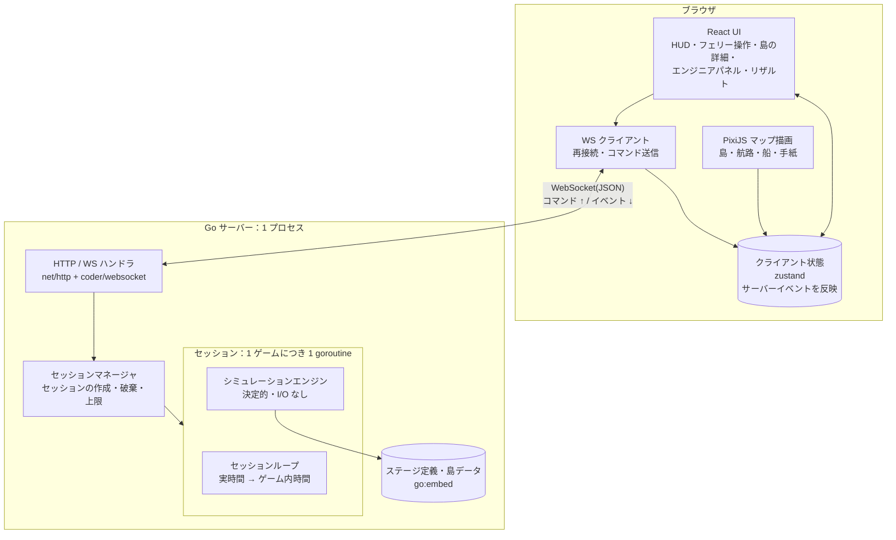
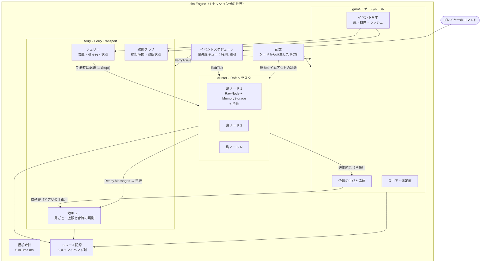
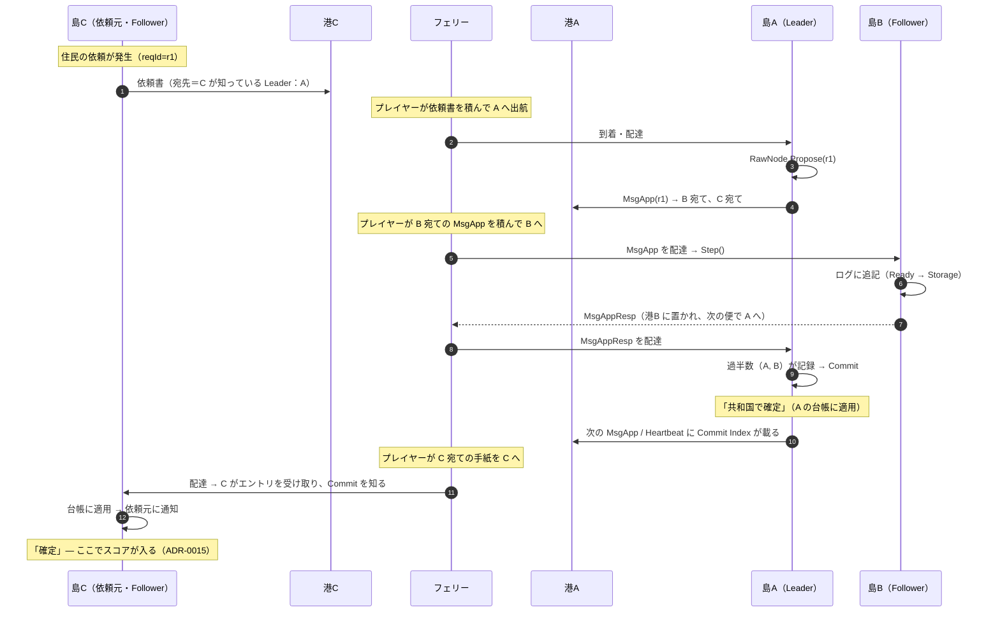
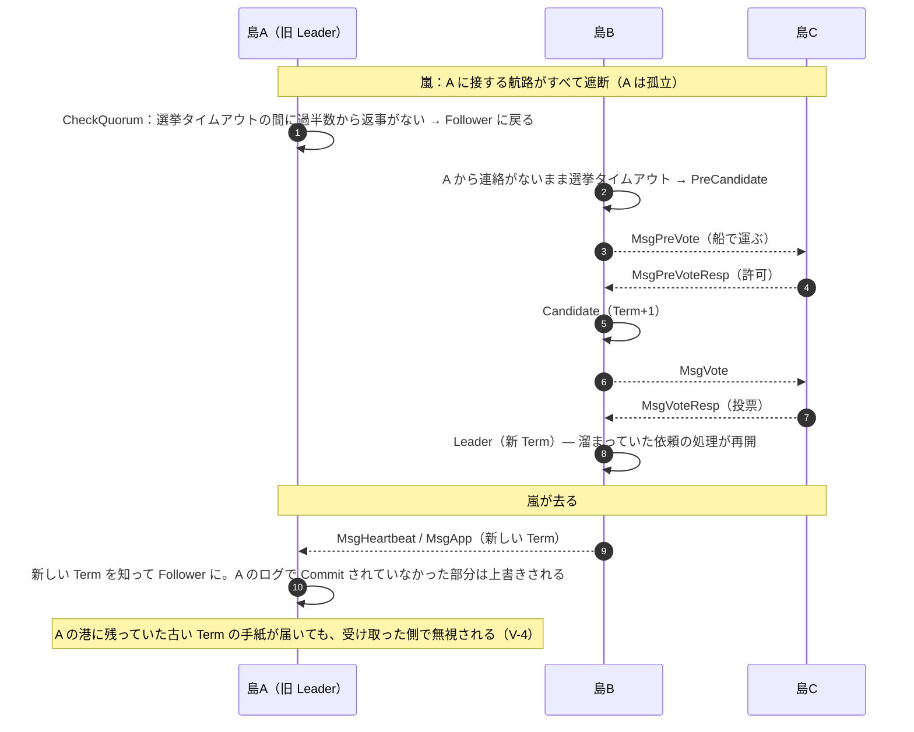
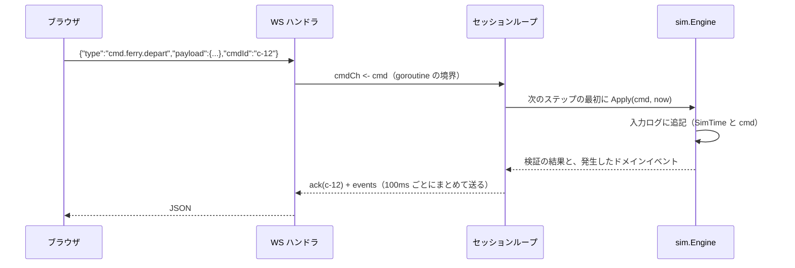
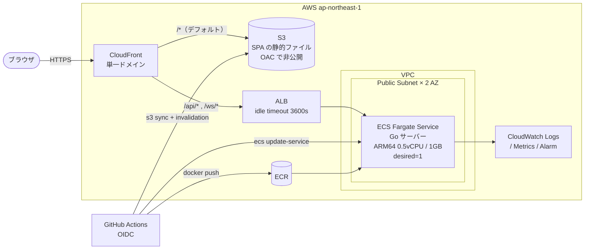
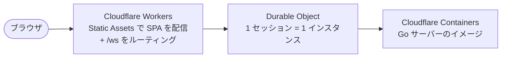

# アーキテクチャ

| 項目 | 内容 |
|---|---|
| 版 | v0.1（仮決め版） |
| 状態 | Draft |
| 関連 ADR | [0002](./adr/0002-use-etcd-raft.md) / [0003](./adr/0003-drive-rawnode-single-goroutine.md) / [0004](./adr/0004-virtual-time-discrete-event-simulation.md) / [0006](./adr/0006-ferry-transport-outside-raft.md) / [0009](./adr/0009-server-authoritative-simulation-over-websocket.md) / [0010](./adr/0010-frontend-react-pixijs.md) / [0011](./adr/0011-infrastructure-aws-ecs-fargate.md) / [0014](./adr/0014-monorepo-and-shared-types.md) |

図はすべて Mermaid で書いているので、GitHub 上でそのまま表示されます。

---

## 1. システムコンテキスト



ポイント:

- オープンデータは**ビルド時**に取り込みます（ETL を実行して JSON を生成し、コミットする）。実行中に外部 API は呼びません（[ADR-0013](./adr/0013-open-data-build-time-etl.md)）。
- プレイヤーは匿名です。ログインはありません。

---

## 2. 論理アーキテクチャ（コンテナ図）



- **サーバー権威型**: ゲームの状態とルールはすべてサーバーが持ちます。クライアントは描画と入力だけを担当します（[ADR-0009](./adr/0009-server-authoritative-simulation-over-websocket.md)）。
- **1 セッション = 1 goroutine**: セッション内部にはロックがありません。外部とのやり取りはチャネルだけで行います。
- **シミュレーションエンジンは I/O を持たない純粋なライブラリ**です。これにより、テスト・CLI での再生・将来の WASM 化（ブラウザ内実行）を同じコードで行えます。

---

## 3. シミュレーションエンジンのコンポーネント



| パッケージ | 責務 | 依存してよい先 |
|---|---|---|
| `internal/sim` | 仮想時計・スケジューラ・`Engine`（全体の組み立て）・不変条件の検査 | 下記すべて |
| `internal/cluster` | `RawNode` の生成・Ready ループ・台帳への適用 | `go.etcd.io/raft/v3`, `internal/ledger` |
| `internal/ferry` | 手紙・港キュー・フェリー・航路 | `raftpb`（メッセージを保持するため） |
| `internal/ledger` | 共有台帳の状態機械（花火・屋台・予算） | なし（純粋なロジック） |
| `internal/game` | 依頼・スコア・満足度・イベント台本 | `internal/ledger` |
| `internal/stage` | ステージ定義（YAML）と島データ（JSON）の読み込み・検証 | なし |
| `internal/protocol` | WebSocket メッセージの型（TS の型を生成する元） | なし |
| `internal/server` | HTTP / WS・セッション管理・レート制限 | `internal/sim`, `internal/protocol` |

依存の向きは「`server` → `sim` → (`cluster`, `ferry`, `game`) → (`ledger`, `stage`)」の一方向です。`cluster` と `ferry` はお互いを知りません（`sim` がつなぎます）。

---

## 4. 主要なシーケンス

### 4.1 依頼が確定するまで（3 島・Leader が島 A、依頼元が島 C）



このシーケンスが、企画書の「手紙の配送に成功したからといって、その場ですべての処理が完了するわけではない」をそのまま表しています。

### 4.2 嵐による分断と Leader の交代（デモの山場）



### 4.3 プレイヤーのコマンドの処理



---

## 5. デプロイ構成（AWS：仮決め）



| 要素 | 設定 | 理由 |
|---|---|---|
| CloudFront | `/ws/*` と `/api/*` を ALB へ（キャッシュなし・全ヘッダ転送）、それ以外は S3 へ | 同じオリジンにすることで CORS を不要にし、WebSocket も CloudFront を経由させる |
| ALB | idle timeout 3600 秒。ヘルスチェックは `/api/healthz` | WebSocket を長く保持するため。アプリ側でも 15 秒ごとに ping を送る |
| ECS Fargate | desired=1、最小限のタスクサイズ。public subnet + public IP（NAT Gateway なし） | ハッカソン規模ならタスク 1 つで足りる。NAT Gateway の費用を避ける |
| セッションの状態 | タスクのメモリ上にだけ持つ（DB なし） | [ADR-0012](./adr/0012-no-persistence-in-mvp.md)。再デプロイ時には遊んでいるセッションが切れる（デモの前はデプロイを止める） |
| IaC | Terraform（`infra/terraform`） | [ADR-0011](./adr/0011-infrastructure-aws-ecs-fargate.md) |

スケールアウトするとき（P2）: セッションはタスクに固定されるため、ALB のスティッキーセッション（Cookie）を使うか、決定性を活かして「入力ログを持って別のタスクで再構築する」方式にします。MVP では扱いません。

### 5.1 Cloudflare に差し替える場合

[ADR-0011](./adr/0011-infrastructure-aws-ecs-fargate.md) の「代替案 B」にあたります。



アプリケーションのコード（`server/`・`web/`）は変更不要です。変わるのは `infra/` と CI のデプロイ手順だけです。

---

## 6. ディレクトリ構成（モノレポ）

```text
raft-game/
├── README.md
├── CLAUDE.md                    # 実装エージェント・開発者向けの規約
├── docs/                        # 本ドキュメント群
├── server/                      # Go module: github.com/K-Kizuku/raft-game/server
│   ├── go.mod                   # go 1.26 / go.etcd.io/raft/v3 v3.7.0（replace でパッチ版を使う）
│   ├── cmd/
│   │   ├── server/              # 本番サーバー（HTTP + WS）
│   │   ├── simcli/              # ヘッドレス実行・入力ログの再生・ボット対戦
│   │   └── islandsdata/         # オープンデータの ETL
│   ├── internal/
│   │   ├── sim/                 # Engine・時計・スケジューラ・不変条件
│   │   ├── cluster/             # RawNode のラッパーと Ready ループ
│   │   ├── ferry/               # 手紙・港・フェリー・航路
│   │   ├── ledger/              # 台帳の状態機械
│   │   ├── game/                # 依頼・スコア・イベント
│   │   ├── stage/               # ステージと島データの読み込み
│   │   ├── protocol/            # WS メッセージの型（tygo で TS を生成）
│   │   └── server/              # HTTP / WS / セッション管理
│   └── third_party/
│       └── etcd-raft/           # v3.7.0 + 乱数を注入するパッチ（ADR-0005）
├── web/                         # Vite + React + TypeScript
│   ├── src/
│   │   ├── app/                 # ルーティング・画面
│   │   ├── game/                # PixiJS の描画（マップ・船・手紙）
│   │   ├── ui/                  # HUD・パネル類
│   │   ├── state/               # zustand ストアとイベントの反映（reducer）
│   │   ├── net/                 # WS クライアント
│   │   └── protocol/            # 生成された型（直接編集しない）
│   └── public/
├── data/
│   ├── raw/                     # 取得したオープンデータの原本と README（出典・取得日）
│   ├── curated/                 # 人手で抜き出した計画書の記述（出典ページ付き YAML）
│   ├── islands.json             # ETL が生成（コミットする）
│   └── stages/                  # ステージ定義 YAML（stage1.yaml ...）
├── infra/
│   └── terraform/
└── .github/workflows/           # ci.yml / deploy.yml
```

`data/` は `server/` から `go:embed` で取り込みます。Go の embed は親ディレクトリを参照できないため、ビルド時に `data/` を `server/internal/stage/embedded/` にコピーします（`make sync-data`）。コピー先は `.gitignore` に入れます。

---

## 7. 品質特性と、それを実現する仕組み

| 品質特性 | 仕組み |
|---|---|
| 正しさ（Raft の安全性） | Raft のアルゴリズムには手を入れない。輸送層だけを差し替える。不変条件を常に検査するシミュレーションテスト |
| 決定性 | 単一 goroutine・仮想時間・シードから派生する乱数・Raft の乱数源の注入・map の走査順に依存しない実装 |
| 応答性 | サーバーは 50ms ごとにステップを進め、100ms ごとにイベントをまとめて送る。船の位置はクライアントが補間する |
| 差し替えやすさ | シミュレーションエンジンは I/O なし。インフラは `infra/` に閉じる。プロトコルの型は 1 か所から生成する |
| 観測性 | トレース（ドメインイベント）を全て記録し、リザルトとエンジニアモードもここから作る |
