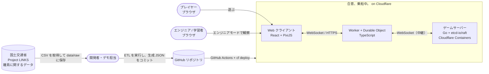
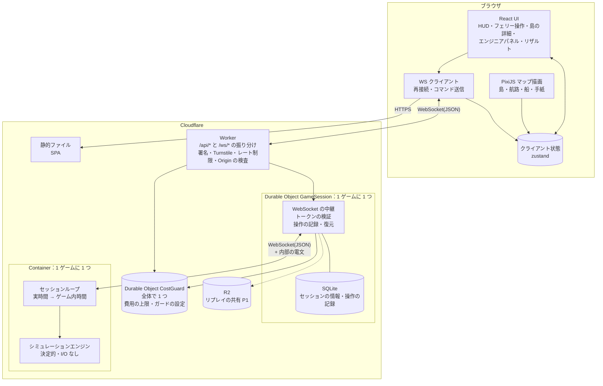
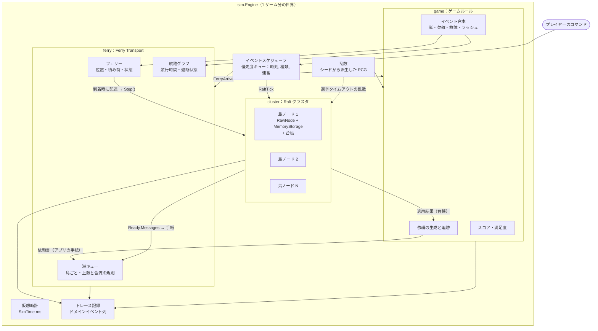
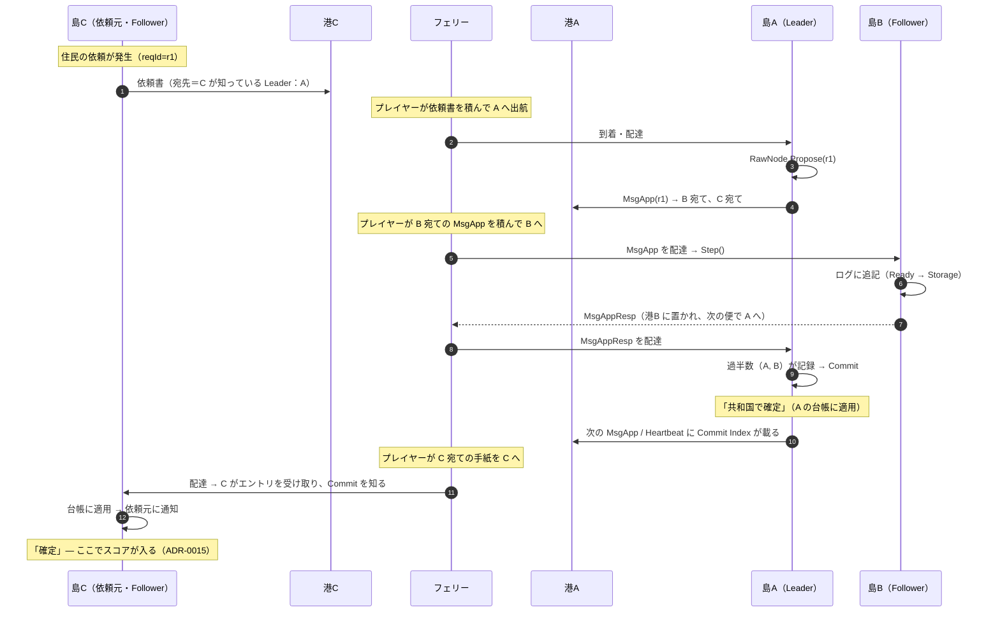
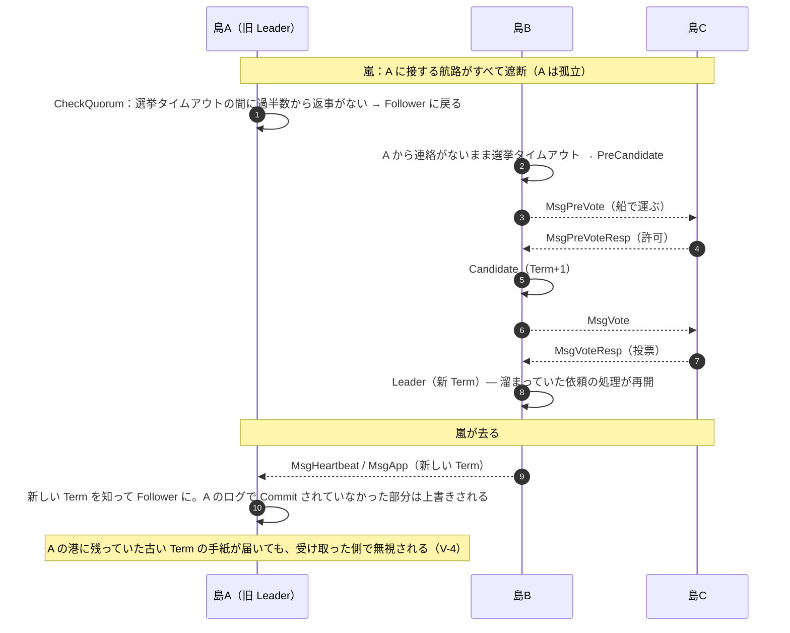
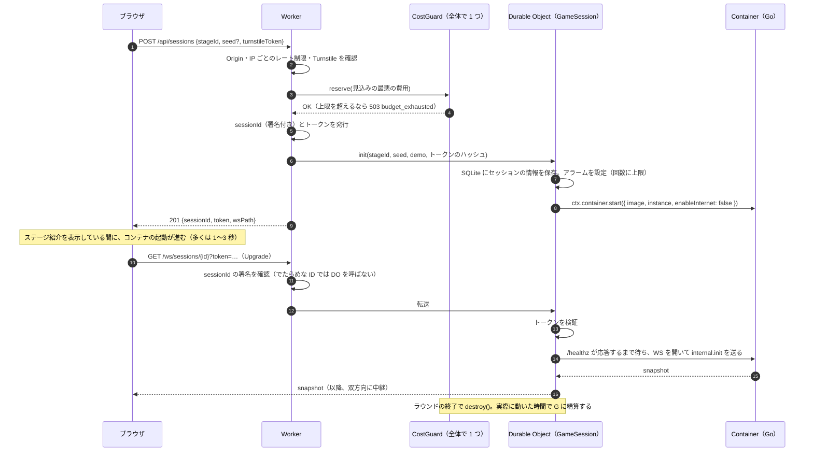
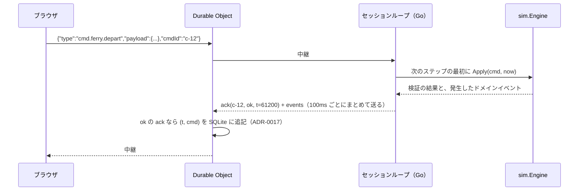
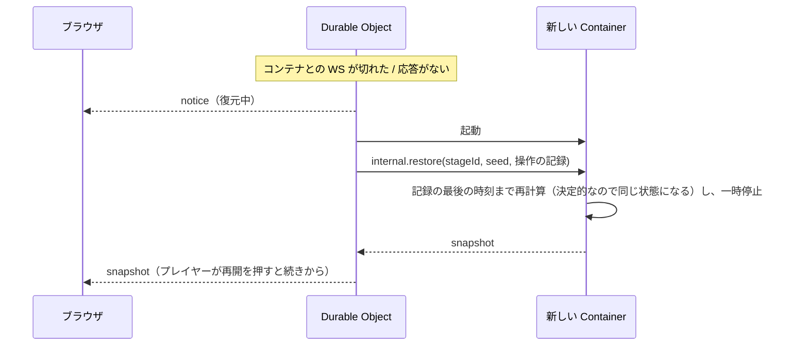
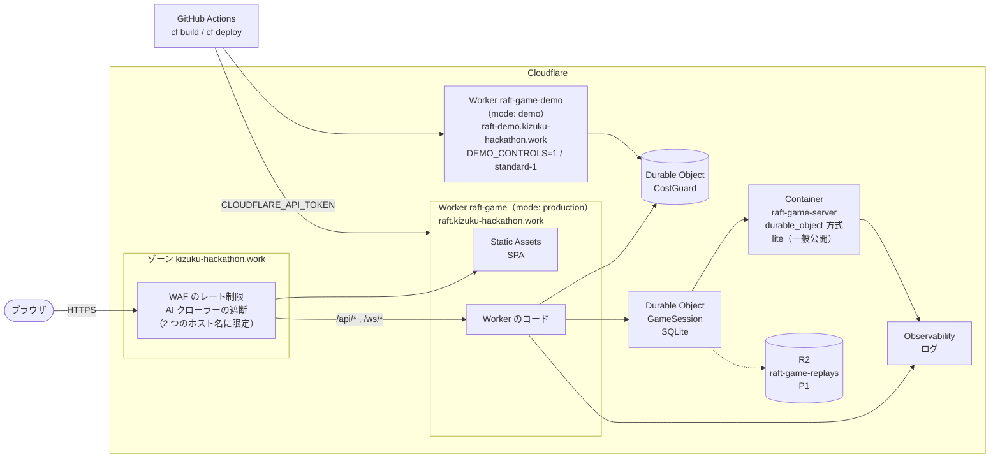

# アーキテクチャ

| 項目 | 内容 |
|---|---|
| 版 | v0.4 |
| 更新日 | 2026-11-08 |
| 状態 | レビュー済み（[判断の記録](./09-assumptions-and-open-questions.md)を反映） |
| 関連 ADR | [0002](./adr/0002-use-etcd-raft.md) / [0003](./adr/0003-drive-rawnode-single-goroutine.md) / [0004](./adr/0004-virtual-time-discrete-event-simulation.md) / [0006](./adr/0006-ferry-transport-outside-raft.md) / [0009](./adr/0009-server-authoritative-simulation-over-websocket.md) / [0010](./adr/0010-frontend-react-pixijs.md) / [0014](./adr/0014-monorepo-and-shared-types.md) / [0016](./adr/0016-infrastructure-cloudflare-with-cf-cli.md) / [0017](./adr/0017-persist-input-log-in-durable-object.md) / [0018](./adr/0018-cost-guard.md) / [0019](./adr/0019-parallel-local-development.md) |

図はすべて Mermaid で書いているので、GitHub 上でそのまま表示されます。

---

## 1. システムコンテキスト



ポイント:

- オープンデータは**ビルド時**に取り込みます（ETL を実行して JSON を生成し、コミットする）。実行中に外部のサイトは呼びません（[ADR-0013](./adr/0013-open-data-build-time-etl.md)）
- プレイヤーは匿名です。ログインはありません
- インフラの構成は Cloudflare CLI（`cf`）だけで管理します（[ADR-0016](./adr/0016-infrastructure-cloudflare-with-cf-cli.md)）

---

## 2. 論理アーキテクチャ（コンテナ図）



| 要素 | 実装 | 責務 |
|---|---|---|
| 静的ファイル | Vite でビルドした SPA | 画面の配信。存在しないパスは `index.html` を返す |
| Worker | TypeScript（`web/worker/index.ts`） | `/api/*` と `/ws/*` を受け、署名の確認・Turnstile・レート制限・`Origin` の検査をしてから、セッションの作成と Durable Object への振り分けを行う |
| Durable Object `CostGuard` | TypeScript（`web/worker/cost-guard.ts`） | 全体で 1 つ。ゲームごとの見込みの費用の合計、上限の判定、ガードの設定（管理用 API）を持つ（[ADR-0018](./adr/0018-cost-guard.md)） |
| Durable Object `GameSession` | TypeScript（`web/worker/game-session.ts`） | 1 ゲームに 1 つ。コンテナの起動（`ctx.container.start()`）と停止、ブラウザとコンテナの間の WebSocket の中継、トークンの検証、操作の記録（SQLite）、コンテナが止まったときの復元、ゲームの時間とアラームの回数の上限 |
| Container | Go（`server/`） | 1 ゲームに 1 つ。シミュレーションを動かすセッションループ。外部には直接公開せず、外部への通信も禁止する（`enableInternet: false`） |
| R2 | — | リプレイの共有（P1） |

- **サーバー権威型**: ゲームの状態とルールは、すべてコンテナの Go が持ちます。クライアントは描画と入力だけを担当します（[ADR-0009](./adr/0009-server-authoritative-simulation-over-websocket.md)）
- **1 ゲーム＝1 Durable Object＝1 コンテナ**: ゲームどうしは完全に分かれます。コンテナの中では、セッションループの goroutine だけがエンジンに触れます
- **シミュレーションエンジンは I/O を持たない純粋なライブラリ**です。テスト・CLI での再生・コンテナが止まったときの復元・将来の WASM 化を、同じコードで行えます
- **Go サーバーには 2 つの動かし方**があります。
  - `single` モード：本番。1 プロセス＝1 ゲームで、Durable Object からの接続だけを受ける
  - `standalone` モード：ローカル開発とデモの保険。1 プロセスで複数のゲームを持ち、ブラウザから直接接続できる（`make demo-local`）

---

## 3. シミュレーションエンジンのコンポーネント



| パッケージ | 責務 | 依存してよい先 |
|---|---|---|
| `internal/sim` | 仮想時計・スケジューラ・`Engine`（全体の組み立て）・不変条件の検査 | 下記すべて |
| `internal/cluster` | `RawNode` の生成・Ready ループ・台帳への適用 | `go.etcd.io/raft/v3`、`internal/ledger` |
| `internal/ferry` | 手紙・港キュー・フェリー・航路 | `raftpb`（メッセージを保持するため） |
| `internal/ledger` | 共有台帳の状態機械（花火・屋台・予算） | なし（純粋なロジック） |
| `internal/game` | 依頼・スコア・満足度・イベント台本 | `internal/ledger` |
| `internal/stage` | ステージ定義（YAML）と島データ（JSON）の読み込み・検証 | なし |
| `internal/protocol` | WebSocket の電文と公開 API の本文の型（TS の型を生成する元） | なし |
| `internal/protocol/simconv` | `sim` の型と `protocol` の型の変換 | `internal/sim`、`internal/protocol` |
| `internal/protocol/stageconv` | `stage` の型と `protocol` の型の変換 | `internal/stage`、`internal/protocol` |
| `internal/server` | HTTP / WS・セッションループ・`single` / `standalone` モード | `internal/sim`、`internal/protocol`、`internal/protocol/simconv`、`internal/stage`、`github.com/coder/websocket` |

依存の向きは「`server` → `sim` → (`cluster`, `ferry`, `game`) → (`ledger`, `stage`)」の一方向です。`cluster` と `ferry` はお互いを知りません（`sim` がつなぎます）。

---

## 4. 主要なシーケンス

### 4.1 依頼が確定するまで（3 島・代表が島 A、依頼元が島 C）

Stage 2（五島）なら、A＝福江島、B＝奈留島、C＝中通島です。



このシーケンスが、企画書の「手紙の配送に成功したからといって、その場ですべての処理が完了するわけではない」をそのまま表しています。

### 4.2 嵐による分断と Leader の交代（デモの山場）



### 4.3 セッションの作成と接続



### 4.4 プレイヤーのコマンドの処理と記録



### 4.5 コンテナが止まったときの復元



---

## 5. デプロイ構成（Cloudflare）



| 要素 | 設定 | 理由 |
|---|---|---|
| 設定ファイル | `web/cloudflare.config.ts` の 1 ファイル。ゾーンの設定は `scripts/cloudflare/` のスクリプト（`cf` の API コマンド） | `cf` だけで管理する（[ADR-0016](./adr/0016-infrastructure-cloudflare-with-cf-cli.md)） |
| URL | 一般公開 `raft.kizuku-hackathon.work`、デモ用 `raft-demo.kizuku-hackathon.work`。`workersDev: false`・`previewUrls: false` | 独自ドメインにすると、WAF などのゾーンの機能で bot を入り口で止められる |
| Worker | `assets.notFoundHandling: "single-page-application"`、`assets.runWorkerFirst: ["/api/*", "/ws/*"]`、`limits.cpuMs` | 画面と API を同じオリジンにして CORS を不要にする。静的ファイルは無料なので、Worker を通さない |
| Durable Object | `GameSession`（1 ゲームに 1 つ、SQLite）と `CostGuard`（全体で 1 つ。デモ用の Worker からも参照する） | 操作の記録（[ADR-0017](./adr/0017-persist-input-log-in-durable-object.md)）と費用の上限（[ADR-0018](./adr/0018-cost-guard.md)） |
| Container | `schedulingPolicy: "durable-object"`、イメージは `images.server`（Dockerfile から `linux/amd64` でビルド）。大きさは `start()` で指定し、一般公開は `lite`、デモ用は `standard-1` | 推奨の方式。`default` 方式は非推奨 |
| モード | `production`（一般公開）と `demo`（デモ操作を有効にした別の Worker） | デモ操作を一般の環境で使えないようにする |
| デプロイ | GitHub Actions（`.github/workflows/deploy.yml`）: `make sync-data` → `cf build --mode` → 検査 → PR は両方のモードで `cf deploy --prebuilt --dry-run`、`main` への push は `production` にデプロイ、手動の実行で `demo`（または `production` の再デプロイ）。シークレットは GitHub の Secrets から一時ファイルを作り `--secrets-file` で渡す（§5.2） | 公式の手順に沿う。プレビュー環境は使わない |
| ログ | `observability.logs` を有効にし、ダッシュボードで見る | `cf` はリアルタイムのログ表示に未対応（ベータ版） |

### 5.1 AWS に戻す場合

[ADR-0011](./adr/0011-infrastructure-aws-ecs-fargate.md)（置き換え済み）の構成です。Go サーバーを `standalone` モードで ECS Fargate に置き、CloudFront と S3 で画面を配信します。差し替えるのは Worker と Durable Object の部分（`web/worker/`）と CI です。操作の記録の保存先を別に用意する必要があります。

### 5.2 デプロイの流れ（`deploy.yml`）

ワークフロー `deploy`（T-603）がビルド・検査・デプロイを行います。正本は [`.github/workflow-sources/deploy.yml`](../.github/workflow-sources/deploy.yml) で、人が `scripts/github/install-workflows.sh` で `.github/workflows/` に取り込みます（AI は `.github/workflows/` を変更できない）。`ci`（チェック `ci-ok`）とは別のワークフローで、必須のチェックではありません。

| 契機 | ジョブ | すること |
|---|---|---|
| PR（`main` 向け。フォークを含む） | `dry-run`（`production`・`demo` の matrix） | `make sync-data` → `cf build --mode` → `check-build-output.ts` → `cf deploy --prebuilt --dry-run`。Secrets を参照しない（dry-run は認証が要らない） |
| `main` への push | `deploy`（`production`） | 下の 1〜12 |
| 手動の実行（`workflow_dispatch`。`main` だけ） | `deploy`（入力 `mode`。既定は `demo`、`production` も選べる） | 下の 1〜12 |

ジョブ `deploy` の手順（この順序。`scripts/tests/test_deploy_workflow.py` が確かめる）:

| # | 手順 | 説明 |
|---|---|---|
| 1 | checkout・Node・pnpm | `persist-credentials: false`。キャッシュを使わない（PR と `main` でキャッシュを共有しない） |
| 2 | 一般公開の確認（`demo` のときだけ） | `wait-healthz.ts` で `https://raft.kizuku-hackathon.work/api/healthz` が 200 か。違えば何もビルド・アップロードせずに止まる（`demo` の `COST_GUARD` が Worker `raft-game` の `CostGuard` を参照するため、`production` を先にデプロイする） |
| 3 | `make sync-data` | `server/Dockerfile` のビルドに要る（T-306） |
| 4 | `BUILD_ID` | `git:<commit の SHA の先頭 7 桁>` |
| 5 | `cf build --mode <モード>` | GitHub の Variables の `TURNSTILE_SITE_KEY` を `VITE_TURNSTILE_SITE_KEY` で渡す。空なら止まる（空のままでは `POST /api/sessions` が必ず `403 turnstile_failed` になる） |
| 6 | `check-build-output.ts --mode <モード>` | ビルドの出力がモードの決まりに合うか（T-601） |
| 7 | `cf deploy --prebuilt --dry-run --mode <モード>` | 反映せずに検査する |
| 8 | シークレットのファイル | `deploy-secrets.ts` が `$RUNNER_TEMP` に JSON を権限 0600 で作る。値を Worker と同じ規則で検査し、合わなければファイルを作らずに止まる。値を出力しない |
| 9 | `cf deploy --prebuilt --mode <モード> --secrets-file <ファイル>` | `--message` に `BUILD_ID` と実行の番号を入れる（T-604 で版を見分ける） |
| 10 | シークレットのファイルを消す | 成否にかかわらず（`if: always()`） |
| 11 | `/api/healthz` の確認 | `wait-healthz.ts` が 200 と `build` が手順 4 の値になるまで最大 10 分待つ |
| 12 | ジョブの要約 | モード・`BUILD_ID`・commit・URL（シークレットを書かない） |

同じジョブの中でビルドとデプロイを行います（`cf build` が作るイメージはランナーのローカルの Docker にあり、ジョブをまたいで渡せないため）。`concurrency` はモードごとで、実行中のデプロイを途中で止めません。

Secrets（リポジトリの Secrets。値はここに書かない）:

| Secret | 使うモード | 中身 |
|---|---|---|
| `CLOUDFLARE_API_TOKEN`・`CLOUDFLARE_ACCOUNT_ID` | 両方 | `cf deploy` の認証（手順 9 だけに渡す） |
| `SESSION_SIGNING_KEY` | `production` | sessionId の署名の鍵（32〜256 文字） |
| `DEMO_SESSION_SIGNING_KEY` | `demo` | 同上。一般公開と別の値（同じなら手順 8 で止まる） |
| `ADMIN_TOKEN` | `production` | 管理用 API のトークン（32〜256 文字） |
| `TURNSTILE_SECRET` | 両方 | Turnstile のシークレットキー |

`SESSION_SIGNING_KEY`・`DEMO_SESSION_SIGNING_KEY`・`ADMIN_TOKEN`・`TURNSTILE_SECRET` は手順 8 の環境変数だけに置きます。ほかに GitHub の Variables の `TURNSTILE_SITE_KEY`（公開の値）を使います。

設計書にない判断（T-603）:

- **`paths` の絞り込み**: `pull_request`・`push` は `web/**`・`server/**`・`data/**`・`package.json`・`pnpm-lock.yaml`・`pnpm-workspace.yaml`・`Makefile`・`.github/workflows/deploy.yml`・`.github/workflow-sources/deploy.yml` の変更だけで動きます。ドキュメントだけの変更ではデプロイしません（同じ Worker の版を作り直さないため）。`.github/workflows/deploy.yml` を含むので、人が取り込みの PR をマージした時点で最初の `production` のデプロイが走ります
- **`DEMO_SESSION_SIGNING_KEY` の名前**: GitHub の Environments の Secrets は、環境の Secret を登録し忘れるとリポジトリの Secret に黙って戻り、一般公開と同じ鍵になり得ます。そこで別の名前にし、Secrets はリポジトリに置きます。`environment:` はデプロイの履歴と URL のためだけに使います
- **`--containers-rollout` を付けない**: `cf` の既定に任せます（一般公開で遊んでいるゲームのコンテナを一度に入れ替えないため）。`--provision` は既定（有効）のままで、R2 のバケットを初回に作ります
- **手動の実行で `production` も選べる**: シークレットを変えたときなどに、一般公開を再デプロイするため
- **デプロイの後の `/api/healthz` の確認**: Worker が直接返し、Durable Object もコンテナも起こさない確認だけを行います

失敗したときの見方（どの手順で止まったか）:

- 手順 2: 一般公開が動いていない。`production` を先にデプロイする
- 手順 5〜7: ビルド・設定の誤り。何もアップロードしていない
- 手順 8: Secrets が未設定・規則に合わない・末尾に改行・デモと一般公開で同じ。誤りの文は変数名と規則だけで、値は出ない。何もアップロードしていない
- 手順 9: `cf deploy` の失敗（権限・R2・確認を求められた、など）。同じ commit で「Re-run jobs」すればやり直せる
- 手順 11: 証明書の発行待ち・DNS の衝突・Worker の起動の失敗・WAF での遮断など。最初のデプロイでは証明書の発行に時間がかかることがある

境界: このワークフローは失敗しても自動では前の版に戻しません。前の版に戻す手順と `cf` の版を上げる手順は T-604、本番でのスモークテスト（WS で 1 ラウンド遊ぶ・コンテナの起動時間・トークンなしで 403 など）は T-605 で行います。

---

## 6. ディレクトリ構成（モノレポ）

```text
raft-game/
├── README.md
├── CLAUDE.md                    # 開発者・実装エージェント向けの規約
├── docs/                        # 本ドキュメント群
├── server/                      # Go module: github.com/K-Kizuku/raft-game/server
│   ├── go.mod                   # go 1.26 / go.etcd.io/raft/v3 v3.7.0（replace でパッチ版を使う）
│   ├── Dockerfile               # Container のイメージ（single モード、linux/amd64、distroless。T-306）
│   ├── cmd/
│   │   ├── server/              # ゲームサーバー（--mode single | standalone）
│   │   ├── simcli/              # ヘッドレス実行・入力ログの再生・ボット対戦
│   │   ├── islandsdata/         # オープンデータの ETL
│   │   └── stagecatalog/        # /api/stages の一覧の JSON を作る
│   ├── internal/
│   │   ├── sim/                 # Engine・時計・スケジューラ・不変条件
│   │   ├── cluster/             # RawNode のラッパーと Ready ループ
│   │   ├── ferry/               # 手紙・港・フェリー・航路
│   │   ├── ledger/              # 台帳の状態機械
│   │   ├── bot/                 # ボット船長（random・greedy。simcli とテストが使う）
│   │   ├── game/                # 依頼・スコア・イベント
│   │   ├── stage/               # ステージと島データの読み込み
│   │   ├── protocol/            # WS の電文の型（tygo で TS を生成）
│   │   │   ├── simconv/         # sim の型と protocol の型の変換
│   │   │   └── stageconv/       # stage の型と protocol の型の変換（/api/stages の 1 行）
│   │   └── server/              # HTTP / WS / セッションループ
│   ├── tygo.yaml                # tygo の設定（make gen が使う）
│   └── third_party/
│       └── etcd-raft/           # v3.7.0 + 乱数を注入するパッチ（ADR-0005）
├── web/                         # Vite + React + TypeScript + Cloudflare（cf）
│   ├── package.json             # "type": "module"、devDependencies に cf（版を固定）と @cloudflare/vite-plugin
│   ├── cloudflare.config.ts     # Worker・Durable Object・Container・R2 の定義（インフラの正本）
│   ├── vite.config.ts           # @cloudflare/vite-plugin
│   ├── worker/                  # Worker と Durable Object（TypeScript）
│   │   ├── index.ts             # /api/* と /ws/* の振り分け、署名・Turnstile・レート制限
│   │   ├── game-session.ts      # Durable Object GameSession
│   │   ├── cost-guard.ts        # Durable Object CostGuard（ADR-0018）
│   │   └── routes/
│   │       └── stage-catalog.gen.json  # /api/stages の一覧（cmd/stagecatalog の生成物。コミットする）
│   ├── src/                     # SPA
│   │   ├── app/                 # ルーティング・画面
│   │   ├── game/                # PixiJS の描画（マップ・船・手紙）
│   │   ├── ui/                  # HUD・パネル類
│   │   ├── state/               # zustand ストアとイベントの反映（reducer）
│   │   ├── net/                 # WS クライアント
│   │   └── protocol/            # プロトコルの型（worker/ からも使う）
│   │       ├── protocol.gen.ts  # make gen の生成物（直接編集しない）
│   │       └── index.ts         # 入口（生成物と手書きのユニオン型 events.ts・messages.ts をまとめる）
│   └── public/
│       └── assets/              # 素材。generated/ に画像生成 AI の素材、CREDITS.md に出典
├── data/
│   ├── raw/                     # 提供されたオープンデータの CSV と README（出典・取得日・利用規約）
│   ├── curated/                 # 人手で抜き出した値（航路の所要時間など。出典の項目つき YAML）
│   ├── islands.json             # ETL が生成（コミットする）
│   └── stages/                  # ステージ定義 YAML（stage1.yaml … demo-izu.yaml, demo-goto.yaml）
├── scripts/
│   ├── cloudflare/              # ゾーンの設定（WAF・AI クローラーの遮断など）を cf で行うスクリプト
│   └── dev-slot.sh              # 並列開発のための DEV_SLOT の割り当て（ADR-0019）
├── LICENSE                      # Apache-2.0
├── NOTICE                       # 同梱する OSS・オープンデータ・生成した素材の表示
└── .github/workflows/           # ci.yml / deploy.yml
```

`make sync-data` で `data/` を `server/internal/stage/embedded/` にコピーし、`-tags embeddata` でビルドしたときだけ埋め込む（Go の embed は親ディレクトリを参照できない。コピー先は `.gitignore` に入れる）。タグなしのビルド（`make test`・CI）はコピーを要らない。`make dev` は `DATA_DIR` で作業ツリーの `data/` を読む（[ADR-0025](./adr/0025-stage-data-source.md)）。ステージの一覧（`/api/stages`）は、ビルド時に `data/stages/` から JSON を作り、Worker に同梱します。作るのは `server/cmd/stagecatalog`（`go -C server run ./cmd/stagecatalog --data ../data --out ../web/worker/routes/stage-catalog.gen.json`）で、生成物 `web/worker/routes/stage-catalog.gen.json` はコミットします。古ければ `go -C server test ./...` が失敗します（[プロトコル §2](./06-protocol.md)）。

コンテナのイメージは `server/Dockerfile` でビルドする。文脈は `server/` で、`data/` は文脈の外にあるので、先にリポジトリのルートで `make sync-data` を実行する（Dockerfile は `-tags embeddata` でステージ定義を埋め込み、コピーがなければ止まる）。ビルド引数 `BUILD_ID` が `/healthz` の `build` になる。手で確かめるときは `bash scripts/docker-smoke.sh`（`DEV_SLOT` が要る。ADR-0019 の名前を使い、`make clean-docker` で消える）。

---

## 7. 品質特性と、それを実現する仕組み

| 品質特性 | 仕組み |
|---|---|
| 正しさ（Raft の安全性） | Raft のアルゴリズムには手を入れない。輸送層だけを差し替える。不変条件を常に検査するシミュレーションテスト |
| 決定性 | 単一 goroutine・仮想時間・シードから派生する乱数・Raft の乱数源の注入・map の走査順に依存しない実装 |
| 耐障害性 | 操作の記録を Durable Object に保存し、コンテナが止まったら再計算で復元する |
| コストの抑制 | コストガード（費用の上限・時間の上限・署名・bot の遮断・CPU の上限・通知）（[ADR-0018](./adr/0018-cost-guard.md)） |
| 応答性 | サーバーは 50ms ごとにステップを進め、100ms ごとにイベントをまとめて送る。船の位置はクライアントが補間する。コンテナは APAC に置く |
| 差し替えやすさ | シミュレーションエンジンは I/O なし。インフラは `web/cloudflare.config.ts` と `web/worker/` に閉じる。プロトコルの型は 1 か所から生成する |
| 観測性 | トレース（ドメインイベント）をすべて記録し、リザルトとエンジニアモードもここから作る |
