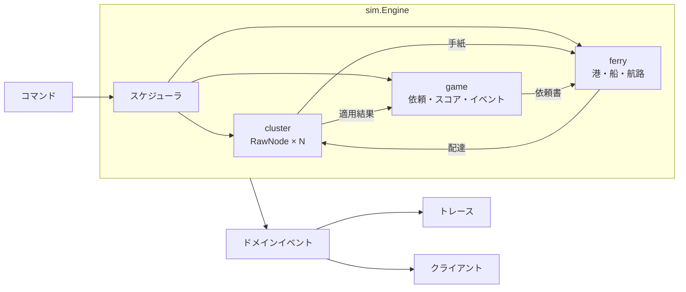
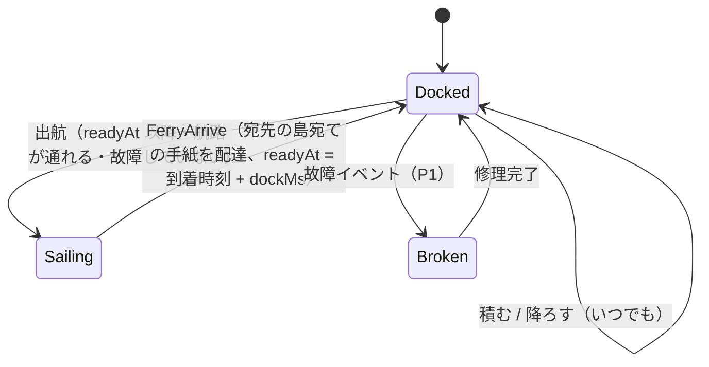

# DesignDoc — 合意、乗船中。

| 項目 | 内容 |
|---|---|
| 版 | v0.5 |
| 更新日 | 2026-11-07 |
| 状態 | レビュー済み（[判断の記録](./09-assumptions-and-open-questions.md)を反映） |
| 対象読者 | 実装者（サーバー・フロントエンド・インフラ）、レビュアー |
| 前提ドキュメント | [要件定義書](./01-requirements.md)、[アーキテクチャ](./02-architecture.md)、[ゲームデザイン仕様](./04-game-design.md) |

この文書は「どう作るか」を、実装に着手できる粒度まで具体化したものです。ゲームのルールや数値（何点入るか等）は [04-game-design.md](./04-game-design.md)、WebSocket の電文は [06-protocol.md](./06-protocol.md)、データ形式は [07-data-spec.md](./07-data-spec.md) に分けています。

---

## 1. 概要

### 1.1 一言で

`etcd-io/raft` の `RawNode` を島の数だけ 1 つの Go プロセス（Cloudflare Containers 上の、1 ゲーム専用のコンテナ）内に立て、それらの間のネットワークを「プレイヤーが操作するフェリー」に差し替えた、**決定的な離散イベントシミュレーション**を作る。ブラウザはその世界を WebSocket（Cloudflare の Worker と Durable Object が中継する）で受け取って描画し、プレイヤーの操作をコマンドとして送り返す。

### 1.2 ゴール

1. Raft のアルゴリズムには手を入れず、輸送（Transport）だけをゲームにする
2. 同じ入力からは必ず同じ結果になる（決定性）。これにより、テスト・リプレイ・デモでの再現ができる
3. ゲームとして遊べる時間感覚（1 ラウンド 3 分前後）に、Raft の時間（tick）を対応させる
4. 実装を「シミュレーションのコア」「サーバー」「クライアント」に分け、並行して開発できるようにする

### 1.3 非ゴール

- 実ネットワーク上での Raft（ノードを別プロセスやコンテナに分ける構成）。将来の拡張として、境界だけ用意しておく
- ログのコンパクション・スナップショット（ラウンドが短く、ログは数百エントリにしかならない）
- メンバー変更（ConfChange）
- 線形化可能な読み取り（ReadIndex）

---

## 2. 設計の全体像



- **世界はすべて `sim.Engine` の中にある**。`Engine` は I/O・goroutine・実時間を一切使わない
- 外から `Engine` を動かす方法は 2 つだけ: `Apply(cmd)`（操作）と `RunUntil(t)`（時間を進める）
- `Engine` の出力はドメインイベントの列だけ。クライアントへの送信・トレース・リザルト・エンジニアモードは、すべてこの列から作る

---

## 3. 時間モデル

### 3.1 2 種類の時間

| 名前 | 単位 | 意味 |
|---|---|---|
| 実時間 | — | 現実の時計。サーバーのセッションループだけが参照する |
| ゲーム内時間 `SimTime` | int64 ミリ秒 | シミュレーションの時計。0 = 航行開始。すべてのイベントはこの時刻で並ぶ |

`SimTime` の進み方は、セッションループが決めます（§12.2）。

- 通常: 実時間 1 秒 = ゲーム内 1 秒（`speed = 1.0`）
- 速度変更: 0.5x / 1x / 2x / 4x（P0）。デモ操作では 8x と「次の到着・出来事まで進める」も使える（A-17）。速度は千分率の整数で持ち、端数は次のステップに持ち越す。デモ操作が有効なセッションでは 8x を足す（T-303）
- 一時停止: 進まない

速度を変えても、`Engine` から見れば「`RunUntil` に渡される時刻の刻み方」が変わるだけです。イベントの時刻は実時間に依存しないので、**結果は変わりません**（コマンドが届いたゲーム内時刻だけは実時間に依存しますが、これは入力ログに記録されるので再現できます）。

### 3.2 Raft の tick との対応

`etcd-io/raft` は時間を知らず、`Tick()` が呼ばれた回数だけを数えます。そこで、ゲーム内時間の一定間隔ごとに全ノードの `Tick()` を呼びます。

| パラメータ | 既定値 | 意味 |
|---|---|---|
| `raft.tickMs` | 500 | ゲーム内 500ms ごとに 1 tick |
| `raft.heartbeatTick` | 2 | Leader は 1 秒ごとに定期連絡（Heartbeat）を出す |
| `raft.electionTick` | Stage 1: 120 / Stage 2 以降: 40 / デモ: 16 | 選挙タイムアウト。実際の値は `electionTick` 以上 `2×electionTick` 未満の乱数（Stage 1 なら 60〜120 秒、Stage 2 なら 20〜40 秒、デモなら 8〜16 秒） |

**調整の目安**: 選挙タイムアウト（`electionTick × tickMs`）は「Leader と、最も近い Follower の間をフェリーが往復する時間」の 2 倍以上にします。これより短いと、プレイヤーがどう頑張っても選挙が頻発します。逆に長すぎると、Stage 2 の学習目標（Heartbeat が途切れると選挙が始まる）が体験できません。Stage 1 は Log Replication に集中させつつ、終盤に「放っておかれた島が立候補の相談を始める」様子を軽く見せるため、長め（60〜120 秒）にしています。最終的な値はプレイテストで決めます（[A-07](./09-assumptions-and-open-questions.md#a-07)）。

### 3.3 Election Timeout の残り時間について

`etcd-io/raft` は各ノードの `electionElapsed` や乱数で決まったタイムアウト値を外部に公開していません。エンジニアモードで「選挙まであと何秒」を表示したい場合（FR-ENG-07、P2）は、ゲーム側で「最後に現在の Leader から手紙を受け取ってからの tick 数」を数えて、**推定値**として表示します。表示には必ず「推定」と書きます。

---

## 4. イベントスケジューラ

### 4.1 データ構造

```go
type SimTime int64 // ミリ秒

type Event struct {
    At    SimTime
    Class EventClass // 同じ時刻のイベントの処理順
    Seq   uint64     // 登録順。完全に同じ順序にするための最後の比較キー
    Kind  EventKind
    Data  any
}

// 優先度キュー（container/heap）の比較順: (At, Class, Seq)
```

### 4.2 イベントの種類と、同時刻のときの順番

同じ `SimTime` に複数のイベントがあるときは、`Class` の小さいものから処理します。

| Class | イベント | 内容 |
|---|---|---|
| 0 | `CommandApplied` | プレイヤーのコマンド（実際には `Apply` で即時に処理し、記録用にこのクラスを使う） |
| 1 | `FerryArrive` | 船が島に着く → その島宛ての手紙を配達 |
| 2 | `FerryReady` | 停泊時間が終わり、出航できるようになる |
| 3 | `RaftTick` | 全ノードの `Tick()`（ノード ID の昇順） |
| 4 | `WorldEvent` | 嵐の開始・終了、故障、漂流瓶など台本にあるイベント |
| 5 | `RequestSpawn` | 住民の依頼が発生 |
| 6 | `RequestRetry` | 依頼書を再送するかどうかの判定 |
| 7 | `GameTimer` | 満足度の減少判定・期限切れの判定・ラウンド終了 |

`WorldEvent`（Class 4）の今の中身は、台本の嵐の予報・開始・終わり（§6.4、T-204）です。同じ時刻では **予報 → 開始 → 終わり**（それぞれ台本の順）に処理します（`cmd.game.start` で、予報・開始・終わりの順に分けて積むため）。故障・漂流瓶などは P1 で足します。

各イベントの処理のあとで、**全ノードの Ready を ID の昇順で処理しきる**（§5.4）。Raft の出力（手紙）は港に置かれるだけで、配達は船の到着を待つので、この処理は必ず止まります。

### 4.3 `Engine` の公開 API

```go
package sim

type Engine struct { /* 非公開 */ }

// 設定（Config）・シードから Engine を作り、開会式（§5.3）まで計算する。Phase() は Intro、Now() は 0。
func New(cfg Config, seed uint64, opt Options) (*Engine, error)

func (e *Engine) Now() SimTime
func (e *Engine) Phase() Phase // Intro / Opening / Sailing / Ended

// コマンドを Now() の時刻で適用する。成功したコマンドだけが入力ログに記録される。
// 失敗したときは、状態・イベント・入力ログ・時刻のどれも変えない。
func (e *Engine) Apply(cmd Command) Ack

// t 以下の時刻のイベントをすべて処理し、Now() を t にする。航行中（Sailing）でなければ何もしない。
// ラウンド終了時刻を超える t を渡しても、終了時刻で止まる。
func (e *Engine) RunUntil(t SimTime)

// 前回呼んでから発生したドメインイベントを取り出す（呼ばなければ溜まり続ける）。
func (e *Engine) DrainEvents() []DomainEvent

func (e *Engine) InputLog() []InputEntry // 成功したコマンドと適用した時刻（§10.1）
func (e *Engine) TraceHash() [32]byte    // §10.2

// 今の状態（再接続時などに送る全体の状態のうち Engine が持つ分）。状態を変えない。T-301 が protocol.Snapshot に変換する。
func (e *Engine) Snapshot() Snapshot
// 次に「プレイヤーに見せたい出来事」が起きる時刻。船の到着・依頼の発生・嵐の予報・開始・終わり。
func (e *Engine) NextNotableAt() (SimTime, bool)

// 入力ログ（§10.1）から Engine を作り直す（復元とリプレイ）。stageHash はステージのハッシュ。
func Replay(cfg Config, stageHash string, in ReplayLog, opt Options) (*Engine, error)
```

- `Phase` の `Intro` は `cmd.game.start` を待つ間（ステージ紹介）。この間の `RunUntil` は時刻を進めない（開会式はゲーム内時間を使わないため）
- 開会式は `New` の中で計算し（決定的な計算なので結果は同じ）、そのイベント（`phase.changed`・`node.*`）は `cmd.game.start` を適用したときに出す。Leader が決まらないような設定の誤りは、`New` のエラーになる
- `stage`（T-201）と `protocol`（T-301）ができるまでは、`sim` の中で定義した型（`Config`・`Command`・`Ack`・`DomainEvent`・`InputEntry`）で受け、返す。`stage.Stage` → `Config` の変換は T-201 で作る。`sim` は自分の型のまま。`protocol` は同じ JSON の形の型を別に持ち、`protocol/simconv` が変換する。両者の JSON が一致することはテストで確かめる
- `Config` の `Requests`（`game.RequestConfig`）は依頼の設定（ステージ定義の `requests.*`）。ゼロ値は依頼なしで、そのときは依頼のイベントも乱数の消費もない（§8）
- `Snapshot` の `letters` は港と船の上の手紙だけ（ID の昇順）。`requests` は発生済みの依頼（ID の順。最後に出した `request.*` の値。`Intro` では空）。`nodes` は最後に出した `node.state` の値。`lastSeq` 以下のイベントを当てはめた状態と一致する
- `letter.stale` は、ノードの Term が上がったとき、そのノードが送信元で港と船にある Raft の手紙のうち、新しく古くなったものを ID の昇順に 1 回だけ出す。各ノードの出力の処理の中で、役割の変化の後・手紙の前に出す
- `cmd.ferry.autoload` は `Apply` のコマンドで、ゲームデザイン §3.4 の順に空きを埋める。入力ログには `{ferryId, to}` だけが入る（リプレイでも同じ手紙が選ばれる）
- `NextNotableAt` は、航行中の船の到着（`DurationMs` 以下）、まだ発生していない最初の依頼の時刻、まだ処理していない嵐の予報・開始・終わり（`DurationMs` 以下）のうち最も小さいもの。`FerryReady` を含めない。30 秒の上限と一時停止はセッションループ（§12.4）が持つ
- 後のタスクで次を足す: `NodeDetail(id)`（エンジニアモード用）は T-407、`Result()`（終了後のみ）は T-203
- Engine の誤り（`Process`・`PostRaft`・`Arrive`・`AdvanceTo`・`Push` のエラー、コードに対応しない `ferry` のエラー、台帳の結果の型の違い、テストモードの不変条件の違反）は panic する。正しく使えば起きない。セッションループ（T-303）が panic を回復し、そのセッションを `error`（`fatal`）で閉じる

---

## 5. Raft との統合（`internal/cluster`）

### 5.1 使うライブラリと版

- `go.etcd.io/raft/v3` **v3.7.0**（Go 1.26 が必要）
- v3.7 では `raftpb` が protobuf-go 製になり、メッセージは `*pb.Message`、フィールドはポインタ型（`m.GetTerm()` などのゲッターで読む）になっています。Web 上のサンプル（v3.5 以前、gogo-protobuf 製）とは書き方が違うので注意してください
- 乱数源を注入するための最小パッチを当てたものを `server/third_party/etcd-raft` に置き、`go.mod` の `replace` で使います（[ADR-0005](./adr/0005-deterministic-raft-rng-patch.md)）

### 5.2 `raft.Config`（既定値。ステージ定義で上書きできる）

| フィールド | 値 | 理由 |
|---|---|---|
| `ID` | 1..N（島の順） | — |
| `ElectionTick` / `HeartbeatTick` | §3.2 | — |
| `Storage` | `raft.NewMemoryStorage()` | 永続化しない（[ADR-0012](./adr/0012-no-persistence-in-mvp.md)） |
| `MaxSizePerMsg` | 4096 | 1 通の「記録して！」に数件のエントリをまとめる |
| `MaxInflightMsgs` | 4 | 1 つの Follower に対して、返事を待たずに送る「記録して！」は 4 通まで |
| `CheckQuorum` | true | 孤立した Leader が自分から退く（デモの見せ場）。[ADR-0007](./adr/0007-enable-prevote-and-checkquorum.md) |
| `PreVote` | true | 孤立していた島が復帰したときに、Term を無駄に上げて Leader を引きずり下ろすのを防ぐ。同 ADR |
| `DisableProposalForwarding` | true | 提案の転送は「依頼書」としてゲーム側で行う。[ADR-0008](./adr/0008-application-level-request-forwarding.md) |
| `AsyncStorageWrites` | false | 同期的な Ready ループにする |
| `RandIntn`（パッチで追加） | ノードごとの乱数源 | 決定性のため |
| `Logger` | トレースに流す独自の Logger | Raft の内部ログもエンジニアモードで見られるようにする（P1） |

### 5.3 起動と「開会式」

ゲーム開始直後は Leader がいません。ここで船を使った選挙から始めると、プレイヤーは何をすればよいか分からないまま時間が過ぎるので、**開会式フェーズ**を設けます。

1. 全ノードを `RawNode.Bootstrap(peers)` で同じメンバー構成で初期化する
2. **即時配達モード**（出てきたメッセージを船を使わず、FIFO で直接宛先に `Step()` する）で、Bootstrap の構成変更のエントリを全ノードで適用する。構成変更を適用する前の `Campaign()` は raft が無視するので、立候補より先に行う
3. ステージ定義の `initialLeader` の島で `Campaign()` を呼ぶ
4. 手紙がなくなるまで、FIFO で即時配達する（上限は開会式全体で 1,000 通。超えたらエラー）。条件を満たした時点で止めず、手紙がなくなるまで配達する。途中で止めると Follower の `MsgAppResp` が Leader に届かず、Leader の進捗の管理が古いまま航行が始まるため。Tick を呼ばないので、配達は必ず止まる
5. Leader がちょうど 1 人に決まり、全ノードがその Leader を知っていて、全ノードが Leader の最初の（空の）エントリまで適用したことを確かめる（満たさなければエラー）
6. 港は空のまま（開会式の手紙は港を通らない）、`SimTime = 0` で航行フェーズを始める

この手順は `cluster.Opening(nodes, initialLeader)` が行います（`sim.New` の中で呼ぶ）。開会式の間もドメインイベントは記録します。`Opening` が返す `RoleChange` の列を、`sim.Engine` が `cmd.game.start` の適用のときに `node.leader_elected`・`node.stepped_down`・`node.state` のイベントにするので、最初の選挙の結果も見られます。即時配達した手紙は港を通らず、手紙の ID もないので、手紙のイベントにはしません。画面上は「開会式：代表に〇〇島が選ばれました」という演出にします。

> **Leader を指定するのは「ゲーム側が Leader を決めない」（C-05）に反しないか？** `Campaign()` は「選挙タイムアウトが来た」のと同じ扱いで、立候補させるだけです。当選するかどうかは Raft の投票で決まります。実際に、開会式で他のノードが先に立候補していれば別の島が当選し得ます（決定的な乱数のもとでは毎回同じ結果になります）。

### 5.4 Ready ループ（V-5 の実装）

1 ノード分の処理です。この関数の外で Ready を扱うことは禁止します。

```go
// processReady は HasReady が false になるまで Ready を処理する。
// 戻り値の Messages は送信元の港に置かれる。エラーのときは途中までの結果を捨てて Output{}, err を返す。
func (n *Node) processReady() (Output, error) {
    var out Output
    for n.rn.HasReady() {
        rd := n.rn.Ready()

        // (1) 永続化：スナップショット → エントリ → HardState の順
        if rd.Snapshot != nil && !raft.IsEmptySnap(rd.Snapshot) {
            return Output{}, errUnexpectedSnapshot // コンパクションしないので来ない
        }
        if err := n.storage.Append(rd.Entries); err != nil { return Output{}, ... }
        if rd.HardState != nil && !raft.IsEmptyHardState(rd.HardState) {
            if err := n.storage.SetHardState(rd.HardState); err != nil { return Output{}, ... }
            n.term = rd.HardState.GetTerm()
        }

        // (2) 送信：永続化の後。Raft のバッファを共有しないよう複製する
        for _, m := range rd.Messages {
            out.Messages = append(out.Messages, proto.Clone(m).(*pb.Message))
        }

        // (3) 適用：Commit 済みのエントリを状態機械（台帳の複製）に順に適用する
        for _, ent := range rd.CommittedEntries {
            switch ent.GetType() {
            case pb.EntryNormal:
                if len(ent.GetData()) == 0 { break } // Leader 就任時の空エントリ。状態機械を呼ばない
                d := bytes.Clone(ent.GetData())
                res := n.sm.Apply(ent.GetIndex(), d)
                out.Applied = append(out.Applied, Applied{Index: ent.GetIndex(), Term: ent.GetTerm(), Data: d, Result: res})
            case pb.EntryConfChange, pb.EntryConfChangeV2:
                // Bootstrap 時のメンバー追加のみ。ゲーム中には発生しない。状態機械を呼ばない
                var cc pb.ConfChangeV2 /* デコード */
                n.rn.ApplyConfChange(cc)
            }
            n.applied = ent.GetIndex()
        }

        // (4) 次の Ready へ
        n.rn.Advance(rd)

        // ソフトステート（役割・Leader）が実際に変わっていればドメインイベントにする
        if ss := rd.SoftState; ss != nil && (ss.RaftState != n.role || ss.Lead != n.lead) {
            out.Events = append(out.Events, RoleChange{Node: n.id, Term: n.term,
                PrevRole: n.role, Role: ss.RaftState, PrevLead: n.lead, Lead: ss.Lead})
            n.role, n.lead = ss.RaftState, ss.Lead
        }
    }
    return out, nil
}
```

- 順序は「追記 → HardState 保存 → 送信 → 適用 → Advance」で固定（`etcd-io/raft` の README が求める順序を満たす）
- テストでは、`Storage` をラップして呼び出し順を記録し、この順序になっていることを確認します
- 公開の入口は `Process`（`processReady` を呼ぶだけ）。`sim.Engine` は各イベントの処理のあと、全ノードの `Process` を ID の昇順に呼ぶ。`RaftTick` では `Tick` を呼んでから `Process` を呼ぶ
- `cluster` は `sim` を import しない（docs/02-architecture.md §3 の依存の向き）。ドメインイベントは時刻を持たず、`sim.Engine` が `Process` を呼んだ時点の `Now()` を付ける
- 1 つの Ready の間に役割が 2 回変わったときは、Ready に入る最後の状態だけが見える（raft の仕様）
- 実際のコードでは API の細部（ゲッター名など）を v3.7.0 のソースに合わせてください

### 5.5 ノードがメッセージを受け取るとき

```go
func (n *Node) Deliver(m *pb.Message) error {
    err := n.rn.Step(m)
    // ErrStepLocalMsg / ErrStepPeerNotFound はゲームのバグなので、トレースに警告を出して続行
    return err
}
```

`Step()` が受け取らなかったメッセージ（古い Term の手紙など）も、エラーにはならず Raft の内部で無視されます。これが V-4 の安全性の根拠です。

### 5.6 1 ノードが持つもの

```go
// StateMachine は、このノードの状態機械（台帳の複製）。Commit 済みの通常のエントリのうち
// Data が空でないものを、index の昇順に 1 回ずつ受け取る。決定的でなければならない。
type StateMachine interface {
    Apply(index uint64, data []byte) any
}

type Node struct {
    id      uint64
    rn      *raft.RawNode
    storage nodeStorage    // raft.Storage＋Append・SetHardState（テストで記録用の包みに差し替える）
    sm      StateMachine   // このノード専用の台帳の複製（sim が *ledger.Ledger を包んで渡す）
    applied uint64         // 最後に適用したエントリの index（構成変更と空のエントリを含む）
    term    uint64         // 最後に保存した HardState の Term
    role    raft.StateType // 最後に観察した SoftState の役割（初期値 StateFollower）
    lead    uint64         // 最後に観察した SoftState の Leader（0 = 知らない）
}
```

`cluster` は `ledger` を import せず、`StateMachine` 越しに台帳を使います。`sim` が `*ledger.Ledger` を `StateMachine` に合わせる薄い包みを作って `NodeConfig.StateMachine` に渡します。台帳はノードごとに 1 つずつ持ちます（Raft の「状態機械の複製」そのもの）。V-2・V-3 の検査は、全ノードの台帳を比べて行います。

読み取り用の口として、`Status()` のほかに `Log() ([]LogEntry, error)` を持ちます。ストレージにあるエントリ（index 1 から LastIndex まで）の複製を返し、Raft の状態とストレージを変えません。不変条件の検査（§11）と、エンジニアモード（T-407）が使います。

---

## 6. Ferry Transport（`internal/ferry`）

### 6.1 手紙

```go
type LetterID uint64

type LetterKind uint8
const (
    LetterRaft    LetterKind = iota + 1 // Raft のメッセージ（0 は使わない）
    LetterRequest                       // 依頼書（アプリケーションの手紙）
)

type LocationKind uint8
const (
    LocPort      LocationKind = iota + 1 // 港（Island = その港の島 = 送信元）
    LocFerry                             // 船（Ferry）
    LocDelivered                         // 配達済み（Island = 宛先）
    LocDropped                           // 港の規則で破棄した
)

type Location struct {
    Kind   LocationKind
    Island uint64
    Ferry  FerryID
}

type Letter struct {
    ID        LetterID
    Kind      LetterKind
    From, To  uint64       // 島（= ノード）ID
    CreatedAt int64        // ミリ秒（sim.SimTime と同じ値。ferry は sim を import しない）
    Raft      *pb.Message  // Kind == LetterRaft のとき。生成後は変更しない
    Req       *RequestNote // Kind == LetterRequest のとき
    Location  Location
}
```

- 時刻は `int64`（ミリ秒、`sim.SimTime` と同じ値）。変換は `sim.Engine` が行う
- 中継倉庫（P1）の場所の種類は、まだ定義しない
- 手紙の ID はエンジン内の連番（1 から、決定的）
- `Raft` は Ready から取り出した時点で複製済み。以降は読み取り専用
- 手紙の内容（Raft メッセージ）は**一切書き換えない**（企画書 §5.3）

### 6.2 港キューと、その上限・合流の規則（V-7）

各島の港は、その島が**送信元**の手紙を、生成順に並べたリストとして持ちます。手紙を港に置くとき、次の規則を順に適用します。

| # | 対象 | 規則 | 破棄理由 |
|---|---|---|---|
| R1 | `MsgHeartbeat` / `MsgHeartbeatResp` | 同じ (種類, 送信元, 宛先) の手紙が港にあれば、古い方を破棄する | `superseded` |
| R2 | `MsgPreVote` / `MsgVote` / `MsgPreVoteResp` / `MsgVoteResp` | 同じ (種類, 送信元, 宛先) で、Term が新しい手紙以下のものを破棄する | `superseded` |
| R3 | `MsgAppResp`（`Reject=false`） | 同じ (送信元, 宛先) の拒否でない `MsgAppResp` を破棄する（新しい方が大きい index を伝えるため） | `superseded` |
| R4 | `MsgApp` | 同じ (送信元, 宛先) の `MsgApp` が `perLinkAppCap`（4）通を超えたら、最も古いものを破棄する | `overflow` |
| R5 | Raft の手紙全体 | 港にある Raft の手紙が `portCap`（24）通を超えたら、優先度が最も低い種類の、最も古いものを破棄する（優先度は低い順に Heartbeat 系 → AppResp → App → 選挙系） | `overflow` |
| R6 | 依頼書 | 同じ依頼 ID の依頼書が港にあれば、古い方を破棄する（再送で置き換わる） | `superseded` |

**なぜ破棄してよいのか**: Raft は「メッセージは失われ得る」前提で設計されています。破棄はネットワークでの欠落と同じで、Raft は後続の Heartbeat への応答などを契機に再送します（`etcd-io/raft` では、Heartbeat の応答を受けた Leader は、Follower のログが遅れていれば `MsgApp` を送り直します）。合流（R1〜R3）は「古い手紙を、同じ意味を持つ新しい手紙で置き換える」だけで、安全性には影響しません。

**上限の保証**: 港の Raft の手紙は `portCap` 以下、依頼書は「その島が依頼元で、まだ終わっていない依頼の数」以下、船の積み荷は積載量以下、中継倉庫（P1）は `relayCap`（12）以下。したがって手紙の総数は `島の数 × (portCap + 依頼の上限) + Σ積載量 + 島の数 × relayCap` で抑えられます。

**終わった手紙の片付け**: 配達済み・破棄した手紙は、`Transport.Reclaim` を呼ぶまで残り、`Letter` で引けます（ドメインイベントを作るため）。`sim.Engine` は、コマンド 1 つ・スケジューラのイベント 1 つの処理を終えてドメインイベントを作ったあとに `Reclaim` を呼びます。片付けの時点は操作の結果（手紙の ID・破棄・配達）に影響せず、手紙の ID は再利用しません。上の上限は、`Reclaim` の直後に `Transport` が持つ手紙の数にも当てはまります。

**古い手紙**: 送信元の今の Term より Term が古い手紙も、規則に当てはまらない限り港に残します（実際のネットワークでも古いパケットは残るため）。エンジニアモードでは「古い手紙」のタグを付けて表示します。送信元の Term が上がって古くなった手紙は、`letter.stale` で 1 回だけ知らせる（§4.3）。

### 6.3 フェリー



```go
type Ferry struct {
    ID            FerryID
    Name          string
    Capacity      int
    SpeedPermille int64      // 航行時間の倍率の千分率（1000 = 航路の標準時間、1200 = 1.2 倍の時間がかかる）
    State         FerryState // Docked / Sailing（Broken は P1 で足す）
    At            uint64     // Docked のときの島。Sailing のときは 0
    From, To      uint64     // Sailing のとき。Docked のときは 0
    DepartAt      int64      // Sailing のとき（ミリ秒、sim.SimTime と同じ値）
    ArriveAt      int64      // Sailing のとき
    ReadyAt       int64      // Docked のとき、この時刻から出航できる
    Cargo         []LetterID // 積んだ順
}
```

- 航行時間 = `(route.travelMs × ferry.SpeedPermille + 500) / 1000`（整数で四捨五入。1 未満なら 1）
- 出航の条件: `Docked` であること、`now ≥ ReadyAt`、行き先へ直接の航路があり、その航路が遮断されていないこと
- 故障（`Broken`）と中継倉庫は P1 で、まだ定義しない
- **到着時の処理**: 積み荷のうち、宛先がその島の手紙を、積んだ順に配達します。Raft の手紙は `Node.Deliver`（`proto.Clone` した複製を渡す）、依頼書はアプリケーション層（§8、T-202）へ渡します。配達のたびに、そのノードの Ready を処理します（返事がすぐにその島の港に並び、同じ船で持ち帰れる）
- 宛先が別の島の手紙は、そのまま積んでおきます（経由輸送、FR-FERRY-05）
- 航行中に嵐が来ても、船はそのまま進みます（[04-game-design.md §6](./04-game-design.md)）

### 6.4 航路

- 無向グラフ。辺は `travelMs` と `blockedUntil` を持つ
- 嵐は辺の集合を指定した時間だけ遮断する
- 嵐の扱い（T-204）
  - 嵐の開始で `Transport.Block` を呼ぶ。`Block` は遮断の終わりを長いほうにそろえる（`blockedUntil = max(blockedUntil, 嵐の終わり)`）。航行中の船はそのまま進み、遮断は出航の条件だけを変える（§6.3）
  - `route.blocked` は遮断が延びた航路だけを、`route.unblocked` は遮断が本当に終わった航路だけを、1 回ずつ出す。嵐が重なっても、実際の遮断の変化だけを表す（ある嵐の終わりと別の嵐の開始が同じ時刻・同じ航路なら、開始が先に遮断を延ばすので途切れない）。`route.blocked` の `until` はこの時刻から出航できる時刻、`route.unblocked` の `until` は遮断が終わった時刻（= イベントの `t`）
  - 予報（`forecast`）は開始の `forecastMs` 前に出す（`forecastMs` が 0 なら出さない）。航路の ID は `routesState` と同じ形（`"A-B"`、`A < B`）で、台本に書いた順に並べる
  - 嵐はステージ定義とシードだけで決まる（`New` で全部の時刻を決める。§9.1）ので、入力ログから再現できる。デモの嵐（`demo.storm`）は T-305 が Engine のコマンドにして、非公開の入口 `raiseStorm` を呼ぶ（入力ログに残る）
  - `stage.SimConfig` は台本の嵐（`kind: storm`）を書いた順のまま `sim.Config.Storms` に入れる。`storm` 以外のイベント（P1）を誤りにするかは保留（#32 の報告。既存のテストと食い違うため）
- ネットワーク分断の状態（FR-ENG-08）は「遮断されていない辺だけでの連結成分」として計算する。ただし、これは「船が行き来できるか」を表すだけで、実際に通信できるかは船の運航次第です

### 6.5 中継倉庫（P1）

船から降ろした、その島宛てではない手紙を預かる場所です。預かった手紙は Raft では処理されません（企画書 §10.2）。別の船に積み直せます。

---

## 7. 共有台帳（`internal/ledger`）

### 7.1 コマンドの形式（Raft のエントリの `Data`）

```json
{
  "v": 1,
  "reqId": "s2-0007",
  "origin": 3,
  "kind": "firework.reserve",
  "resource": "firework:grand",
  "amount": 0
}
```

| `kind` | 内容 | 成功条件 | 優先 |
|---|---|---|---|
| `firework.reserve` | 花火の予約 | `resource` の花火がまだ誰にも予約されていない | P0 |
| `stall.reserve` | 屋台の出店枠 | 予約数が定員未満 | P0 |
| `budget.spend` | 共有予算からの支払い | 残高 ≥ `amount` | P1 |

エンコードは JSON（キーの順序は固定）。エンジニアモードでそのまま読めることを優先し、容量は気にしません。

### 7.2 適用の規則

```go
type Result struct {
    ReqID  string // Decode できないときと reqId が空のときは ""
    Status string // "ok" | "rejected" | "duplicate"
    Reason string // rejected のときだけ（下の一覧）。ほかは ""
}

func (l *Ledger) Apply(index uint64, data []byte) Result
```

- `Reason` の一覧: `already_reserved`（花火がすでに予約されている）・`full`（屋台の定員に達している）・`unknown_resource`・`resource_kind_mismatch`（`kind` と資源の種類が合わない）・`unknown_kind`・`unsupported_version`・`invalid_command`（Decode できない・`reqId` が空・`origin` が 0）
- `budget.spend` は P1 まで `unknown_kind` で `rejected` にする
- `index` が前回の `index` 以下（0 を含む）なら、プログラムの誤りとして panic する

1. `reqId` がすでに適用済みなら、何もせず `duplicate` を返す（再送による二重消費を防ぐ、FR-REQ-06）
2. `kind` ごとの成功条件を判定し、成功なら資源を消費して `ok`、失敗なら `rejected`
3. 結果を `reqId → Result` として記録する（`duplicate` の判定と、依頼元への通知に使う）

台帳は**決定的な純粋関数**です。同じ順序でエントリを適用すれば、すべてのノードで同じ状態になります（これが状態機械の複製の前提）。

### 7.3 不変条件（V-3）

- どの花火も、予約者は 0 件か 1 件
- どの屋台も、予約数は定員以下
- 予算の残高は 0 以上
- 同じ index まで適用した 2 つのノードの台帳は完全に一致する

---

## 8. 依頼の処理（アプリケーション層、`internal/game`）

依頼の処理は 2 つのパッケージに分けます（T-202）。

- `internal/game`: 状態を持たない純粋な型と関数だけ。役場の判断（`Decide`）、状態の判定（`Track.Status`）、ラウンドの依頼の計画（`PlanRequests`）。I/O・時刻・乱数の生成を持たず、乱数は `*rand.Rand` を引数で受けます
- `internal/sim`（`request.go`）: Engine の中で状態を持つ部分。依頼の帳簿・発生・`route`・再送・転送・適用の観察・状態の更新とイベント。提案（`propose`）・スケジューラ・港・ノードを Engine が持つためです

依存の向きは `stage` → `sim` → `game` → `ledger` で、逆向きはありません。`game` は `sim`・`cluster`・`ferry`・`stage`・`go.etcd.io/raft/v3` を import しません。

### 8.0 依頼の発生

ラウンドのすべての依頼は、`New` の中で `game.PlanRequests` が発生の前に決めます（台本とランダム。ランダムは [データ仕様 §4.2](./07-data-spec.md) の式と引く順序で、乱数は `Sub(seed, "requests")` の 1 本だけ）。発生の後には乱数を使いません。

- 台本の依頼（書いた順）の後ろにランダムな依頼（引いた順）を並べ、発生の時刻で安定に並べ替えます。同じ時刻なら台本が先です
- 並べた順に 1 から番号を振り、ID を `<stageId>-<連番4桁>` にします（ID の順 = 発生の順）
- 期限は、重要な資源（`resources[].critical`）なら `createdAt + deadlineMs.critical`、そうでなければ `createdAt + deadlineMs.normal` です
- `cmd.game.start` で、依頼の順に `RequestSpawn`（§4.2）を積みます。ラウンドの終わり（`durationMs`）ちょうどの依頼も、`GameTimer` より先に発生します

### 8.1 島ごとの「役場」

各島には、住民の依頼を代表の島へ届ける「役場」があります（ゲーム側のロジックで、Raft の外にあります）。役場が読むのは、そのノードの `Status()` の役割（`Role`）と知っている Leader（`Lead`）だけで、Leader や Commit を決めません。

```text
route(req, island):
    node = island のノード
    if node.role == Leader:
        err = node.rn.Propose(command(req))
        if err == nil:            req.status = 審議中
        if err == ErrProposalDropped: 次の RaftTick で route をやり直す
    else if node.lead != 0 (Leader を知っている):
        依頼書を作る（From = island, To = node.lead）→ island の港へ（規則 R6）
        req.status = 送付待ち
    else:
        req.status = 送付待ち（代表が分からない）→ 次の RaftTick で route をやり直す
```

役場の判断（`game.Decide`）は次の表のとおりです。

| 役割 | 知っている Leader（`Lead`） | 判断 |
|---|---|---|
| Leader | （どれでも） | `Propose` する。`ErrProposalDropped`（Leader の移譲中など）なら待つ |
| Leader でない | `0`（PreCandidate・Candidate・CheckQuorum で退いた直後など） | 待つ |
| Leader でない | 自分（ふつうは起きない） | 待つ |
| Leader でない | そのほか | `Lead` へ依頼書を書く |

- **依頼の発生時**: 依頼元の島で `route(req, origin)`
- **依頼書が島 X に届いたとき**: `route(req, X)`。X が Leader でなければ、X が知っている Leader へさらに転送する（X の港に新しい依頼書を作る）。今の依頼書でない（古い）依頼書が届いても同じです
- **待ち**: 待つときは、依頼書を作らず、再送のタイマーも積みません。(依頼, 島) の組を 1 つだけ覚え、RaftTick の処理の最後（全ノードの `Tick()` の後）に、覚えた順に `route` をやり直します
- **再送**: 依頼元の島で、最後に送ってから `retryMs`（25 秒）経っても依頼元の台帳に適用されていなければ、`route(req, origin)` をやり直す。同じ `reqId` なので、二重に適用されても台帳が `duplicate` として無視する
  - 「送る」は、**依頼元の島での** `Propose` の成功と依頼書の作成だけです。転送した島の送り出しでは、タイマーを積み直しません。待ちが解けて送ったときに積みます
  - 再送の条件は「依頼元の台帳に適用されていない」だけです。共和国で確定（`committed`）していても再送します
  - 再送で同じ港に同じ依頼の依頼書ができると、規則 R6 で古い方が `letter.dropped{superseded}` になります
- **`hops`**: 転送された回数です。依頼元が書く依頼書（発生・再送）は 0、島 X が転送する依頼書は「届いた依頼書の `hops` + 1」です
- 依頼元の台帳に適用された依頼は、配達・再送・待ちのやり直しのどれでも何もしません

> Leader が提案したあと Commit される前に交代すると、そのエントリは新しい Leader によって上書きされ、消えることがあります。この場合、依頼は再送によって救われます。役場はエントリが消えたことを判定しません。これも Raft の実際の振る舞いとして、エンジニアモードで観察できます。

### 8.2 依頼の状態の判定

依頼の状態は、エンジン全体を見渡して判定します（プレイヤーへの表示用）。

| 状態 | 判定 |
|---|---|
| 受付 | 発生した直後 |
| 送付待ち | 依頼書が港にある、または代表が分からず待っている |
| 輸送中 | 依頼書が船に積まれている |
| 審議中 | いずれかの Leader が `Propose` した |
| 共和国で確定 | いずれかのノードの台帳に、その `reqId` の最初のエントリが適用された（＝ Commit された） |
| 確定 / 予約失敗 | 依頼元のノードの台帳に適用され、結果が `ok` / `rejected` |
| 期限切れ | 期限を過ぎても「確定 / 予約失敗」になっていない（フラグとして重ねて表示。あとから確定もできる） |

判定の材料（`game.Track`）は、最後の `route` の結果（まだ・待ち・依頼書・提案）、今の依頼書が船の上にあるか、いずれかの台帳に適用されたか、依頼元の台帳の結果です。Engine は台帳への適用（`ledger.applied`。`duplicate` は見ない）と手紙の場所を観察するだけです。判定は次の表の上の行ほど優先します（`Track.Status`）。

| 条件 | 状態 |
|---|---|
| 依頼元の結果が `ok` | `succeeded`（確定） |
| 依頼元の結果がそのほか | `rejected`（予約失敗） |
| いずれかの台帳に適用された | `committed`（共和国で確定） |
| 最後の `route` が提案 | `proposed`（審議中） |
| 最後の `route` が依頼書で、今の依頼書が船の上 | `in_transit`（輸送中） |
| 最後の `route` が依頼書（港）か待ち | `waiting`（送付待ち） |
| まだ `route` していない | `received`（受付） |

- 「今の依頼書」は、その依頼について最後に作った依頼書です。船の上の古い依頼書と港の新しい依頼書が両方あるときも、今の依頼書の場所で `waiting`・`in_transit` を決めます
- 一度 `committed` になった依頼は、再送や転送の結果が変わっても前に戻りません。`succeeded`・`rejected` は最後の状態です。「審議中 → 送付待ち」は、再送で依頼書を書いたときに起きます
- 状態の変化は、ステップ（成功した `Apply`・スケジューラのイベント 1 つ）の後処理で、依頼の ID の順に `request.updated` にまとめて出します（同じステップの中の変化は 1 回）。依頼元より先にほかの島で適用され、同じステップで依頼元でも適用されたときは、`committed` を出さずに最後の状態だけを出します
- 受付は `request.created`（`status: "received"`）でだけ見えます。発生の直後に同じステップで `route` するので、同じ時刻に `request.updated`（審議中・送付待ちなど）が続きます
- 期限切れのフラグ（`expired`）の判定は T-203 です。今は常に `false` です

スコアは「確定」になった時点で入ります（[ADR-0015](./adr/0015-request-success-judged-at-origin-apply.md)）。

---

## 9. 乱数とシード

### 9.1 派生

ラウンドのシード（uint64）から、用途ごとに独立した乱数列を作ります。用途を足しても、他の用途の乱数列は変わりません。

```go
func Sub(seed uint64, name string) *rand.Rand {
    h := fnv64a(name)
    return rand.New(rand.NewPCG(seed, h)) // math/rand/v2
}
```

| 名前 | 用途 |
|---|---|
| `requests` | 依頼の発生時刻・種類（台本以外の部分） |
| `events` | 台本で「この時間帯のどこか」と指定されたイベントの時刻。台本の嵐で `window` に幅があるものだけ、定義の順に 1 回ずつ `Int64N(end − start + 1)` を引く（`New` の中） |
| `raft/<nodeID>` | ノードごとの選挙タイムアウトの乱数（パッチで注入） |
| `drift` | 漂流瓶で、どの過去の手紙を複製するか |
| `bot/<名前>` | ボット船長の選択（`bot/random`。`greedy` は引かない。`simcli` とテストだけで使い、ゲームの結果には入力ログを通してだけ効く） |

### 9.2 決定性を壊すもの（実装上の禁止事項）

`internal/sim` とその下のパッケージでは、次を禁止します。

- `time.Now` / `time.Since` などの実時間
- goroutine・チャネル・`select`
- `map` の走査順に依存する処理（走査する場合はキーをソートしてから）
- グローバルな `math/rand`（上記の派生乱数以外）
- 浮動小数点の計算をスコアや判定に使うこと（スコアは整数で計算する）

ここでの「その下」は、`sim.Engine` が組み立てて動かす世界（`internal/sim`・`internal/cluster`・`internal/ferry`・`internal/ledger`・`internal/game`）を指します。ボット船長（`internal/bot`）は Engine の外にありますが、操作が入力ログを通して結果に効くので、同じ規則に従います。`stage`（YAML の小数を読む）・`protocol`・`server`（セッションループは実時間を使う）・`cmd` は対象外です。

CI と `make lint` では、golangci-lint の `forbidigo`（設定は `server/.golangci.yml`。テストのファイルも対象）で、上の 5 つのパッケージと `internal/bot` の 6 つについて次を検出します。

- 実時間の関数: `time.Now`・`Since`・`Until`・`Sleep`・`After`・`AfterFunc`・`Tick`・`NewTimer`・`NewTicker`（`time.Second` などの定数・型は使ってよい）
- `math/rand`（v1）のすべて（別名で import しても検出する）
- `math/rand/v2` のパッケージ全体で共有される乱数（`rand.IntN`・`rand.Shuffle` など）。`rand.New(rand.NewPCG(…))` と、その `*rand.Rand` のメソッドは使ってよい
- `float32`・`float64` を型として書くこと（フィールド・変数・変換）

`forbidigo` は識別子しか見ないので、goroutine・チャネル・`select`・`map` の走査順への依存・型を書かない浮動小数点（`x := 1.5`）は検出できません。これらはレビューと各タスクの AC で確かめます。

`etcd-io/raft` の内部は、進捗の管理（`tracker`）で ID 順に走査するので決定的です。乱数だけがパッチの対象です。

---

## 10. 記録・リプレイ

### 10.1 入力ログ

```json
{
  "format": 1,
  "build": "git:3f2c1ab",
  "stageId": "stage2",
  "stageHash": "sha256:…",
  "seed": 20261101,
  "commands": [
    {"t": 0,    "cmd": {"type": "cmd.game.start",   "payload": {}}},
    {"t": 0,    "cmd": {"type": "cmd.ferry.load",   "payload": {"ferryId": "f1", "letterIds": [12, 13]}}},
    {"t": 1200, "cmd": {"type": "cmd.ferry.depart", "payload": {"ferryId": "f1", "to": 2}}}
  ]
}
```

- `t` はコマンドを適用したゲーム内時刻
- Engine は成功したコマンドをすべて記録するので、最初のコマンドは `cmd.game.start` です（`Engine.InputLog()`）
- 一時停止・速度変更のコマンドも記録しますが、エンジンの結果には影響しません（記録はするがリプレイ時には無視してよい）
- `cmd.game.pause`・`cmd.game.speed`・`cmd.game.skip` はリプレイで無視します。そのほかの未知の `type`・未知のキーは誤りです
- `payload` の形はプロトコル（[06-protocol.md §4](./06-protocol.md)）のとおりで、キーは `type`・`payload` の順です（`cmd.game.start` は `{}`、`cmd.ferry.load`・`cmd.ferry.unload` は `ferryId`・`letterIds`、`cmd.ferry.depart`・`cmd.ferry.autoload` は `ferryId`・`to`）
- T-301（`protocol`）ができるまで、JSON との変換は `server/cmd/simcli`（`inputlog.go`）が持ちます。`simcli` は 1 行目にヘッダーと `"commands":[`、続けてコマンドを 1 件 1 行、最後の行に `]}` と書きます（件数が 0 なら 1 行）。読み込みは厳密で、必須のキー（`format`・`stageId`・`stageHash`・`seed`・`commands`、`payload` の各キー）がない・`t` が 0 以上の整数でない・JSON の後ろに余分なデータがあるときは、場所（例: `commands[3].cmd.payload.to`）を書いて誤りにします。`build` は読みますが使いません
- **保存先**: 入力ログは Durable Object の SQLite に保存します。コンテナはコマンドを適用したら `ack` に適用時刻 `t` を入れて返し、Durable Object が `(t, cmd)` を追記します（[ADR-0017](./adr/0017-persist-input-log-in-durable-object.md)）
- **復元**: コンテナが止まったら、Durable Object が新しいコンテナに入力ログを渡し、`Replay` で同じ状態に戻します
- **リプレイ** = 同じステージ・シードで `Engine` を作り、各コマンドの `t` まで `RunUntil` してから `Apply` することの繰り返し
- **`sim.Replay`** が受けるのは、`format`・`stageHash`・`seed`・コマンドの列（`ReplayLog`）です（`stageId`・`build` は受けない。JSON の読み書きとプロトコルの型からの変換は呼び出し側）
  - 検査の順序は、形式 → `stageHash` の照合 → 時刻の順です。`stageHash` は、空どうしでも一致とみなしません
  - 各コマンドが成功して同じ `t` で適用されなければ、失敗（記録と食い違った。`ErrReplayDiverged`）にします
  - セッションのコマンド（一時停止・速度・次の出来事まで）は、呼び出し側が除いてから渡します。`Replay` は知らない種類のコマンドを読み飛ばさず、失敗にします
  - 最後に `Until`（省略時は最後のコマンドの `t`）まで進めます
  - 返した Engine には `New` からの全イベントが残ります。セッションはそれを捨ててから `snapshot` を送ります（`lastSeq` 以下のイベントはスナップショットに含まれているため）

### 10.2 トレース

ドメインイベント（[06-protocol.md §5](./06-protocol.md) のイベントと同じ型）を、発生順に連番を付けて JSON Lines で並べたものです。

- **トレースのハッシュ** = 各イベントの JSON（`seq`・`t`・`type`、そのあと中身のフィールドの順に並べた平らなオブジェクト。`encoding/json` の出力で、余分な空白なし）の後ろに改行（`\n`）を 1 つ付けて、出した順に連結したものの SHA-256。最後のイベントの後ろにも改行を付ける。イベントが 0 件なら空のバイト列の SHA-256。`DrainEvents` で取り出したかどうかに関係なく、`New` からの全イベントが対象。決定性のテスト（V-6）に使います
- リザルトの統計（Leader の交代回数、平均 Commit Latency など）はトレースから計算します。トレースを持っていれば、あとから別の統計を足すこともできます

### 10.3 統計の定義

| 指標 | 定義 |
|---|---|
| Leader の交代回数 | 開会式のあとに、新しい Term で Leader が誕生した回数 |
| Commit Latency | 依頼が Leader に `Propose` されてから「共和国で確定」になるまでのゲーム内時間 |
| 平均 Commit Latency | 確定した依頼の Commit Latency の平均 |
| 最長の音信不通 | 各島について「手紙が 1 通も配達されなかった最長の時間」の最大値 |
| 配った手紙の数 | 配達した手紙の数（種類別にも集計） |

---

## 11. 不変条件の検査（`internal/sim/invariants`）

テストモード（`Options.CheckInvariants = true`）では、イベントを 1 つ処理するたびに次を検査し、違反したら即座に panic します（本番では無効）。

| # | 不変条件 | 対応 |
|---|---|---|
| I-1 | 1 つの Term に Leader は最大 1 人（観測した Leader の記録を Term ごとに持つ） | Election Safety |
| I-2 | 2 つのノードで同じ (index, term) のエントリがあれば、そこまでの全エントリが一致する | Log Matching |
| I-3 | 全ノードで、適用済みのエントリは index ごとに一致する | V-2 |
| I-4 | エントリが Commit された時点で、そのエントリは過半数のノードのストレージにある | V-1 |
| I-5 | 各ノードの Term・Commit・Applied は減らない | 単調性 |
| I-6 | 台帳の不変条件（§7.3） | V-3 |
| I-7 | 港・船・中継倉庫の手紙の数が上限以下 | V-7 |

検査のしかた（T-107）:

- **呼ぶ時点**: 1 ステップ（成功した `Apply`・スケジューラのイベント 1 つ）の後処理の最後、`Reclaim` の後。全ノードの `Process` が済み、未処理の Ready がない
- **読むもの**: 各ノードの `Status`・`Log`（§5.6）、各台帳の `AppliedIndex`・`Snapshot`・`CheckInvariants`、`Transport.CheckInvariants`、まだ取り出していないドメインイベント。どれも読むだけで、状態を変える呼び出しをしない。前回の検査で観測した値（Term ごとの Leader・各ノードの Term・Commit・Applied・見たイベントの Seq）だけを覚えておく
- **I-1**: 前回の検査より後に出た `node.leader_elected` と、今の `Status` で Leader のノードの両方で観測する（1 ステップの中で Leader になってすぐ退いたノードも見逃さない）
- **I-2**: 2 つのログが初めて違った index より後に、Term の等しい index があれば違反。Index・Term・Type・Data を比べ、空のエントリと構成変更のエントリも対象にする
- **I-4**: 「Commit された時点で」より強い条件として、毎回 Commit 済みのすべての index を検査する（Commit 済みのエントリはどのログからも消えないので、正しい Raft では常に成り立つ）
- **I-5**: 補助の条件として「Applied ≤ Commit」も検査する
- **I-6**: 各台帳の `CheckInvariants` と「台帳の `AppliedIndex` ≤ ノードの Applied」を検査し、`AppliedIndex` が等しい台帳どうしの `Snapshot` を比べる（`AppliedIndex` はデータのあるエントリだけで進むので、ノードの Applied より小さいことがある）
- **I-7**: `Transport.CheckInvariants`（港の上限・同じ宛先の `MsgApp` の上限・合流・積載量）。依頼書の数の上限は T-202、中継倉庫の上限は P1 で足す
- **違反したとき**: 最初の 1 つで `panic("sim: invariant violated at t=<Now>: I-<n>: <説明>")` を出す（島の ID は 1 から）

---

## 12. サーバー（Go のゲームサーバーと、Cloudflare の Worker・Durable Object）

### 12.1 役割分担

| 層 | 実装 | 責務 |
|---|---|---|
| Worker | TypeScript（`web/worker/index.ts`） | 静的ファイルの配信（SPA）、`/api/*` と `/ws/*` の受付、署名の確認・Turnstile・レート制限・`Origin` の検査、セッションの作成、Durable Object への振り分け、管理用 API |
| Durable Object `CostGuard` | TypeScript（`web/worker/cost-guard.ts`） | 全体で 1 つ。費用の予約・精算・上限の判定、ガードの設定、切り替えの記録（[ADR-0018](./adr/0018-cost-guard.md)） |
| Durable Object `GameSession` | TypeScript（`web/worker/game-session.ts`） | 1 ゲームに 1 つ。コンテナの起動・停止、トークンの検証、ブラウザとコンテナの間の WebSocket の中継、入力ログの保存（SQLite）、コンテナが止まったときの復元、寿命の管理（アラーム） |
| Go サーバー `single` モード | Go（`server/cmd/server --mode single`）。コンテナの中で動く | 1 プロセス＝1 ゲーム。Durable Object からの WebSocket だけを受け、セッションループでシミュレーションを動かす |
| Go サーバー `standalone` モード | 同じバイナリ（`--mode standalone`） | ローカル開発とデモの保険（`make demo-local`）。1 プロセスで複数のゲームを持ち、§12.2 の公開 API を自分で提供する |

`single` は `/healthz` と `/ws` だけを持つ。`standalone` は §12.2 の公開 API と `/healthz` を持つ（署名・Turnstile・レート制限はしない）。

Go サーバーの起動の設定（`server/internal/server` の `ParseConfig`。フラグが環境変数より優先し、環境変数の空は未設定と同じ。T-302）:

| フラグ | 環境変数 | 既定 |
|---|---|---|
| `--mode` | `MODE` | なし（必須。`single` か `standalone`） |
| `--host` | `HOST` | `single` は `""`（すべてのアドレス）、`standalone` は `127.0.0.1` |
| `--port` | `PORT` | `8080` |
| `--data` | `DATA_DIR` | `""`（埋め込んだステージ定義。[ADR-0025](./adr/0025-stage-data-source.md)） |
| `--allowed-origins` | `ALLOWED_ORIGINS` | `""`（`standalone` だけ。規則はプロトコル §2 の「`Origin` の規則」） |
| `--demo-controls` | `DEMO_CONTROLS` | `false`（`standalone` だけ。環境変数は `1` だけが真） |
| `--max-sessions` | `MAX_SESSIONS` | `16`（`standalone` だけ。`1`〜`256`） |
| `--invariants` | `SIM_INVARIANTS` | `false`（`sim.Options.CheckInvariants`） |
| `--log-level` | `LOG_LEVEL` | `info` |

ビルドの識別子（`/healthz` の `build`・`snapshot` の `session.build`）は `go build -ldflags "-X main.build=git:3f2c1ab"` で入れる（なければ VCS の情報か `dev`）。終了コードは 0（シグナルで止めた）・1（起動の失敗）・2（使い方の誤り）。

インフラの構成は [ADR-0016](./adr/0016-infrastructure-cloudflare-with-cf-cli.md) を参照してください。

### 12.2 公開 API（Worker が受ける）

| メソッド | パス | 内容 |
|---|---|---|
| GET | `/api/healthz` | ヘルスチェック（Worker が直接返す） |
| GET | `/api/stages` | ステージ一覧（ビルド時に `data/stages/` から作った JSON を Worker に同梱） |
| POST | `/api/sessions` | セッションを作る（`{stageId, seed?, turnstileToken}` → `{sessionId, token}`）。Turnstile とレート制限を確認し、`CostGuard` で費用を予約してから、Durable Object を作り、コンテナの起動を始める |
| GET | `/ws/sessions/{id}?token=…` | WebSocket に切り替え。**sessionId の署名を確認してから** Durable Object に転送する |
| GET / PATCH | `/api/admin/guards` | コストガードの設定の確認と切り替え（`ADMIN_TOKEN` が必要） |

詳細は [06-protocol.md](./06-protocol.md)。Go 側の WebSocket ライブラリは `github.com/coder/websocket` を使います（`context` 対応で、依存が少ないため）。

### 12.3 Durable Object `GameSession`

1 ゲームに 1 つの Durable Object です（`idFromName(sessionId)`）。コンテナは、推奨の `durable_object` 方式で、Durable Object のコードから起動します（[ADR-0016](./adr/0016-infrastructure-cloudflare-with-cf-cli.md)）。`DurableObject` を継承せず、`fetch` のハンドラーで内部の API を受けます（[ADR-0023](./adr/0023-durable-object-fetch-handler.md)）。実装は `web/worker/game-session.ts`（薄いクラス）と `web/worker/session/`（`core.ts` が中身）。ブラウザのコマンドを入力ログに記録し、コンテナが止まったら次の `/connect` で起動し直して `internal.restore` で同じ局面から再開します（T-308b。下の「入力ログと復元」）。

```ts
// web/worker/game-session.ts（形だけ）
export class GameSession {
  constructor(ctx: GameSessionStateLike, env: Env, deps?: Partial<GameSessionDeps>);
  fetch(request: Request): Promise<Response>; // POST /init・GET /connect
  alarm(): Promise<void>;
}
// コンテナの起動（POST /init の中だけ）
ctx.container.start({
  image: ctx.container.images["server"],
  instance: containerInstanceOf(env),   // CostGuard が予約したマシンと同じ（CONTAINER_INSTANCE が "lite" なら lite、ほかは standard-1）
  enableInternet: false,                // 外部への通信は禁止（型もリテラル false）
  env: { MODE: "single", PORT: "8080" },
});
```

**内部の API**（Worker → `GameSession`。Worker 側は `session/client.ts` の `GameSessionClient` と `session/ports.ts` の `createSessionPorts`）

| メソッド | パス | 本文・ヘッダー | 応答 |
|---|---|---|---|
| `POST` | `/init` | `{ sessionId, stageId, seed, demo, tokenHash }`（JSON、4096 バイトまで。ほかのキーは不可） | `201 {}`・`200 {}`（同じ内容の 2 回目。起動し直さない）・`400 bad_request`・`409 conflict`（違う内容）・`500 start_failed` |
| `GET` | `/connect` | `Upgrade: websocket`・`X-Session-Token: <token>` | `101`・`404 not_found`・`426 upgrade_required` |

- ルーター（§12.2）は `reserve` が `ok` のときだけ `init` を呼び（G1）、`verifySessionId` が通ったときだけ `connect` を呼ぶ（G3）。`createSessionPorts` は呼ばれるまで `idFromName`・`get` を呼ばない
- トークンは URL ではなくヘッダー `X-Session-Token` で渡す（DO の要求の URL がログに残ってもトークンが出ないように）。DO はハッシュ（`token_hash`）だけを保存し、64 文字どうしを定数時間で比べる
- `POST /init` は、`view()` から `gameTime.maxMinutes`・`gameTime.maxAlarms` を 1 回だけ読み（読めないときは 30 分・20 回）、行を作り、**アラームを設定してから**コンテナを起動し、`monitor()` を見張って、`/healthz` を待たずに `201` を返す。アラームを設定できない（`setAlarm` が失敗した）ときは**コンテナを起動しない**（fail closed）。アラームを設定できない・起動に失敗したときは、行を `ended`（`start_failed`）にしてアラームを消し、`500` を返す（`settle` は呼ばない。ルーターが `cancel` する）
- `GET /connect` は、行がない・トークンがない・形が違う・違う・終わったセッションを区別せずに `404` にする（ソケットを作らず、コンテナに触れない）

**SQLite の表**（`session/store.ts`。`constructor` で `CREATE TABLE IF NOT EXISTS`）

- `session`（1 行だけ）: `session_id`・`stage_id`・`seed`・`demo`・`token_hash`・`state`・`created_at`・`deadline_at`（`created_at + maxMinutes` 分）・`max_alarms`・`alarm_count`・`alarm_at`・`idle_since`・`container_starts`・`container_started_at`・`ready_at`・`run_ms`・`stage_hash`・`build`・`last_clock_t`・`end_reason`・`ended_at`・`settled`・`result_json`・`result_at`
- `input_log`: `seq`（自動の連番）・`t`（`ack` の `t`）・`cmd`（`{"type":…,"payload":…}` の JSON）
- `stage_hash`・`build`・`last_clock_t`・`input_log` には T-308b が値を入れる。列の追加・削除は、T-601 で初めてデプロイする前なら `CREATE TABLE` を直すだけでよい

**状態の移り変わり**: `POST /init` で `starting` → コンテナへの WebSocket を開いて `internal.init` を送ったら `running` → 「終わり」で `ended`（戻らない）。

**コンテナへの接続**（`/connect` で `101` を返した後、非同期）

1. 「止まったときの処理」（下の「入力ログと復元」）が動いていれば、終わるのを待つ。見張りがない（DO が作り直された・`monitor()` が `running` のまま終わった）なら、`ctx.container.running` が真のときは `monitor()` を見張り直して続け、偽なら止まったと判断する（`not_running`）。止まっているなら、ここで起動し直す（`POST /init` と同じ引数。3 回まで）
2. `ready_at` がなければ、`getTcpPort(8080).fetch("http://container/healthz")` が `200` を返すまで 100ms ごとに試す（1 回の要求は 2 秒と残り時間の小さいほうで打ち切る）。期限は `container_started_at + CONTAINER_START_TIMEOUT_MS`。過ぎたら、`starting` なら「終わり」（`start_timeout`）、`running`（起動し直したコンテナ）なら止まったと判断する（`start_timeout`）。初めて `200` を受けたら `ready_at` を保存し、ログ `container.ready` に `startMs` を出す（§15 の起動時間）
3. コンテナの `/ws` を開く。開けなければブラウザを `1011` で閉じるだけ（終わりにしない。ブラウザがつなぎ直す）
4. 最初に、`stage_hash` があれば `internal.restore`、なければ `internal.init` を送る（ブラウザの接続ごとに 1 本のコンテナへの WebSocket を張り、**毎回**送る。生きているコンテナは同じ sessionId なら作り直さずにつなぎ直し、`internal.restore` の入力ログを使わない）。死活監視（`internal.ping`）を始め、準備の間に溜めたブラウザの電文（32 通まで）を、受けた順に送る
5. どの `await` の後でも、接続が置き換わった・ブラウザが閉じた・終わったなら、開いたソケットを閉じて終える（接続ごとの世代で見分ける）

同じセッションに 2 本目の接続が来たら、古いブラウザの接続を `4001`（`replaced`）、古いコンテナへのソケットを `1000` で閉じます。古いソケットから後で届いた電文は捨てます。ブラウザの接続が閉じたら、コンテナへのソケットを `1000` で閉じ（コンテナはこれで自動の一時停止をする）、`idle_since` を保存します。コンテナへのソケットだけが閉じたら、ブラウザを `1011` で閉じます（終わりにしない）。

**ブラウザからの電文**（上から順に判定する。`session/envelope.ts`）

1. バイナリ → ブラウザを `1003` で閉じる。UTF-8 で 16 KiB を超える → `1009` で閉じる（どちらも Go と同じコード）
2. 1 秒の枠（`Math.floor(now / 1000)`、DO に 1 つ）ごとに数え、31 通目からは捨てる（**返事はしない**。DO は `seq` を持たない電文を作れないため）
3. JSON のオブジェクトでない・キーに `v`・`type`・`cmdId`・`payload` 以外がある・`type` が文字列でない → 捨てる
4. `type` を小文字にして `internal.` で始まる → 捨てる
5. それ以外は、受けた文字列を**そのまま**コンテナに送る（書き換えない）

3 で**キーを限る**のは、Go の `encoding/json` が構造体のフィールド名を大文字・小文字を区別せずに読むためです（`{"type":"cmd.sync","Type":"internal.init"}` を JS は `cmd.sync`、Go は `internal.init` と読みうる）。DO が読んだ `type` と、コンテナが読む `type` を必ず一致させます。捨てた電文は種類ごとに数え、接続が閉じたときのログ `session.disconnect` に数だけを出します。

**コンテナからの電文**: `seq` を接続ごとの「最後の `seq`」として覚え、`internal.*` はブラウザに送りません（`internal.result` は「ラウンドの終わり」、`internal.ping` には `internal.pong` を返す）。それ以外は受けた文字列のままブラウザに送ります。置き換えた・ブラウザが閉じた接続のソケットから届いた電文は捨てますが、`internal.result` だけは別です。ブラウザは `round.result` を受けるとすぐ閉じるので、`internal.result` はブラウザが閉じた後に届きえます。同じコンテナの結果なので、保存して「終わり」（`round_ended`）にします。`fatal` の `error` のうち `stage_not_found`・`internal_error`・`restore_failed`・`session_mismatch` は、中継した後で「終わり」（`container_error`）にします。

**終わり**（何度呼んでも 1 回だけ動く）: `state = "ended"` を最初に保存 → ブラウザに知らせて閉じる → コンテナへのソケットを閉じる → `ctx.container.destroy()` → `run_ms`（実際に動いた時間）で `CostGuard.settle(sessionId, ceil(run_ms / 1000))` → `deleteAlarm()`。`settle` の失敗はログに出して**やり直さない**（帳簿は予約のまま＝最悪の費用で数えられる。安全側）。`internal.result` の payload（256 KiB まで）は `result_json` に上書きで保存します。

`destroy()` が失敗したら、停止を確かめられるまで**精算しません**。`container_started_at` を残し、帳簿は予約のまま（最悪の費用）にします。そして 30 秒後（`DESTROY_RETRY_MS`）にアラームを設定し、鳴ったら `destroy()` からやり直します（後始末のやり直し）。止まったら、そこまでの時間で精算してアラームを消します。やり直しのアラームも `max_alarms` の中で数えます。すでに設定してあるアラームが先に鳴るなら、そのアラームでやり直します（数を増やさない）。上限に達して設定できなければ、ログ（`session.error`、`op: "destroy"`・`error: "retry_exhausted"`）を 1 行出してあきらめます（予約のままなので、最悪の費用で数えられる）。後始末は同時に 2 つ動きません。

| 理由 | いつ | ブラウザに送るもの |
|---|---|---|
| `round_ended` | コンテナの `internal.result` | （`round.result` は中継済み）`close(1000)` |
| `time_limit` | `deadline_at` のアラーム | `error`（`session_ended`）→ `close(1000)` |
| `idle` | ブラウザの接続がないまま 5 分 | （接続がないので送らない） |
| `alarm_cap` | アラームの回数が `max_alarms` に達した後で、設定が要る | `error`（`session_ended`）→ `close(1000)` |
| `start_timeout` | 初回の `/healthz` が期限までに `200` にならない | `error`（`container_unavailable`）→ `close(1011)` |
| `container_lost` | 3 回目に起動したコンテナが止まった・`stage_hash` がないのに記録がある・起動し直せない（`ctx.container`・イメージがない・`start()` が例外・止めるための `destroy()` が失敗） | `error`（`container_unavailable`）→ `close(1011)` |
| `container_error` | コンテナの `fatal` の `error`（上の 4 つの `code`。`snapshot` を受ける前の `bad_request`・`not_initialized` も） | （コンテナの `error` を中継済み）`close(1011)` |

DO が送る `error` は `{"v":1,"type":"error","seq":<最後の seq + 1>,"payload":{"code":…,"message":…,"fatal":true}}` です（プロトコル §2）。DO が自分で作る電文は、この `error`・`internal.init`・`internal.restore`・`internal.ping`・`internal.pong` だけです。

**アラーム**（`session/alarm.ts` の `desiredAlarmAt`）

- 鳴らしたい時刻は、接続中なら `deadline_at`、接続がなければ `min(deadline_at, idle_since + 5 分)`（`idle_since` が NULL で接続もなければ、いまを `idle_since` とみなす）
- **早いほうにだけ動かす**: `alarm_at` が NULL か、鳴らしたい時刻が `alarm_at` より早いときだけ設定する（遅くしたいときはそのまま鳴らし、鳴ったときに決め直す。つなぎ直しを繰り返しても回数が増えにくい）
- 設定するたびに `alarm_count` を 1 増やし、`max_alarms`（既定 20）に達していたら設定せずに「終わり」（`alarm_cap`）。数は `setAlarm` の前に保存し、失敗しても戻さない。`setAlarm` が失敗したら、`alarm_at` を前の値に戻す（設定できていないアラームを「ある」と記録しない。前のアラームは残る）。`alarm()` の中で設定できなかったときは、例外を投げてランタイムに `alarm()` をやり直させる（やり直すたびに数えるので、`max_alarms` で `alarm_cap` になる）
- 設定するのは `POST /init` の 1 回（コンテナを起動する前）・接続が切れるたびに最大 1 回・鳴るたびに最大 1 回・後始末のやり直し（上の「終わり」）。`alarm()` は、終わったセッションでは、停止を確かめられていないコンテナ（`container_started_at` が NULL でない）の後始末のやり直しだけをする（ほかは何もせず、設定し直さない）。鳴ったら `deadline_at` を過ぎていれば `time_limit`、接続がないまま 5 分なら `idle`、それ以外は設定し直す

**入力ログと復元**（T-308b。FR-GAME-09・FR-LOG-01・NFR-06、[ADR-0017](./adr/0017-persist-input-log-in-durable-object.md)。上限は `session/limits.ts`、純粋な部分は `session/restore.ts`・`session/pending.ts`）

- **記録する種類**: `type` が `hello`・`ping`・`cmd.sync`・`sub.engineer` のどれでもなく、`cmdId` のキーがあるブラウザの電文。コンテナへ**送る直前**（溜めた電文はつながった後に送る直前）に、上から順に判定する
  1. 記録する種類でない → そのまま送る（覚えない）
  2. `cmdId` が 1〜128 文字の文字列でない → 捨てる（Go は 129 文字以上でも適用するので、覚えられない電文を送らない）
  3. 同じ `cmdId` が `ack` を待っている → 捨てる
  4. 待ちのうち 30 秒（`PENDING_COMMAND_TTL_MS`）を過ぎたものを捨て、それでも 256 件ある → 捨てる
  5. `cmd = JSON.stringify({type, payload})` の UTF-8 のバイト数を `b` として、`行数 + 待ちの件数 >= 10,000`、または `バイト数の合計 + 待ちのバイト数 + b > 512 KiB` → 捨てる（DO のインスタンスで初めてのときだけ `warn` のログ `input_log.full`）
  6. 送り、送れたら `cmd` を `cmdId` で覚える

  捨てるときは返事をしない（記録とコンテナの状態を食い違わせないため）。捨てた数は `session.disconnect` の `dropped`（`malformed`・`duplicate`・`pending_full`・`log_full`）に出す
- **`ack` の扱い**: 待ちは接続ごとではなく **DO に 1 つ**。コンテナの `ack`（`payload.cmdId` が文字列・`ok` が真偽値・`t` が 0 以上の整数）を受けたら、その `cmdId` を待ちから外し、`ok: true` なら `input_log` に `(t, cmd)` を追記する（`t` が最後に記録した `t` より小さければ記録せず `warn`）。置き換えた・ブラウザが閉じた接続のソケットから届いた `ack` も、いまのコンテナ（見張りの世代が同じ）のものなら記録に使う（Go は `ack` を「いまの接続」に送るので、どちらのソケットにも届きうる）。待っていない `cmdId` の `ack` は何もしない（中継はする）。行数・バイト数は DO のインスタンスで最初に要るときに SQLite から読み、以後はメモリで足す
- **保存するもの**: `stage_hash`・`build`（いまの接続の `snapshot` の `payload.session.stageHash`・`build`。1〜128 文字の文字列で、保存した値と違うときだけ上書きする。読めない値では消さない）。`last_clock_t`（いまの接続の `snapshot`・`events` の `payload.clock.t` をメモリに持ち、SQLite には前に書いてから 5 秒以上たったとき・ブラウザの接続が閉じたとき・止まったと判断したとき・「終わり」の最初にだけ書く。DO が作り直されたら `last_clock_t` から始める）
- **`internal.restore` の中身**: `{ sessionId, stageId, seed, demo, inputLog: { format: 1, build: build ?? "", stageId, stageHash: stage_hash, seed, commands: [{t, cmd}]（seq の順。cmd は保存した JSON をそのまま） }, until }`。`until = max(最後の clock.t ?? 0, 最後の input_log の t ?? 0)`、0 なら省く。送るたびにログ `session.restore`（`commands`・`until`・`bytes`）。最大の入力ログ（10,000 行・512 KiB）でも 1 MiB（Go の `single` の受信の上限）に収まる。`build` が違っても試す（T-302 が `warn` を出して続ける）
- **止まったと判断する場合**（`cause`）: `monitor`（見張っている `monitor()` が終わり、`running` が偽）・`socket_closed`（いまの接続のコンテナへのソケットが閉じ、`running` が偽。真ならブラウザを `1011` で閉じるだけ）・`ping_timeout`（下の死活監視）・`start_timeout`（起動し直したコンテナの `/healthz` の期限切れ）・`not_running`（`/connect` の後でコンテナが動いていない）。`monitor()` が終わっても `running` が真なら判断せず、`warn` のログ `container.monitor_ended` を出して見張りがない状態に戻す（DO が作り直されたときの `monitor()` の振る舞いはクラウドで未確認のため）。見張りの世代（`#watch()` のたびと、止まったと判断したときに 1 増やす）で、自分で `destroy()` した古いコンテナの `monitor()` の終わり・古いソケットからの知らせを無視する
- **止まったときの処理**（1 つずつ動く）: `last_clock_t` を書く → 試し直さない場合は「終わり」（`deadline_at` を過ぎた → `time_limit`、`container_starts >= 3` → `container_lost`、`stage_hash` がないのに記録がある → `container_lost`）→ ブラウザを `1011`（`"container restarting"`）で閉じる（`error` は送らない。ブラウザはつなぎ直す）→ 動いていれば `destroy()`（失敗したら `container_lost` で終わり、後始末のやり直しに任せる）→ `run_ms` に動いた時間を足し、`container_started_at`・`ready_at` を NULL にし、`ack` の待ちを捨てる → ログ `container.stopped`（`cause`・`containerStarts`）
- **起動し直す**のは、トークンを確かめた後の `/connect` の中（上の「コンテナへの接続」の 1）だけ。その場では起動しない（誰もつないでいなければ、切断から 5 分のアラームで `idle` になる）。1 セッションで起動は 3 回まで（最初の 1 回＋起動し直し 2 回）。`CostGuard` の予約はせず、`deadline_at` も変えない（コンテナは DO に 1 つなので同時に 2 つ動かず、`run_ms` は予約した時間を超えない）。精算は「終わり」で、動いた時間の合計で 1 回だけ。ログ `container.start` に `restart: true` を付ける
- **試し直さない失敗**: `restore_failed`・`stage_not_found`・`internal_error`・`session_mismatch`（`fatal`）と、`snapshot` を受ける前の `bad_request`・`not_initialized`（`fatal`。`internal.init`・`internal.restore` の誤りなので、つなぎ直しても同じ）→ 中継した後で `container_error`
- **死活監視**: コンテナへのソケットに最初の電文を送った後、5 秒ごとに `internal.ping` を送る。前の `internal.ping` に `internal.pong` がないまま 3 回続いたら止まったと判断する（`ping_timeout`）。`internal.pong` が届けば回数を 0 に戻す。接続が閉じた・置き換えた・「終わり」のときに止める

### 12.3.1 Durable Object `CostGuard`

全体で 1 つの Durable Object です（`idFromName("global")`。ほかの名前では作らない）。一般公開とデモ用の Worker が共有します（デモ用の Worker は、一般公開の Worker の `CostGuard` を参照する）。費用の予約・精算・上限の判定（G1）、受付の一括停止（G6）、ガードの設定の上書きと切り替えの記録を持ちます（[ADR-0018](./adr/0018-cost-guard.md)）。

`DurableObject` を継承せず、`fetch` のハンドラーで内部の API を受けます（RPC と `cloudflare:workers` を使わない。[ADR-0023](./adr/0023-durable-object-fetch-handler.md)）。中身は `web/worker/admin/ledger.ts` の `CostGuardCore`（SQLite の上の同期の処理だけ）で、Worker・`GameSession` からは `web/worker/admin/client.ts` の `CostGuardClient`（`getCostGuardClient(env)`）で呼びます。

| メソッド | パス | 本文 | 応答 |
|---|---|---|---|
| `POST` | `/reserve` | `{ sessionId, instance: "lite" \| "standard-1" }` | `200 { result: "ok" \| "budget_exhausted" \| "sessions_disabled" }` |
| `POST` | `/cancel` | `{ sessionId }` | `200 {}`。未精算の予約だけを取り消す（額 0） |
| `POST` | `/settle` | `{ sessionId, runSeconds }`（0〜86400 の整数） | `200 {}`。未精算の予約だけを、実際に動いた秒数で精算する |
| `GET` | `/view` | — | `200 GuardsView`（[プロトコル §2](./06-protocol.md) の `GET` の応答）・`503 guards_invalid` |
| `POST` | `/patch` | `{ change: 平らな形, reason, by }` | `200 GuardsView`・`400 bad_request`・`400 locked`・`503 guards_invalid` |

- URL のホストは何でもよい（クライアントは `https://cost-guard.internal/<op>` を使う）。知らないパスは 404、メソッドが違えば 405、本文が壊れている・型が違えば `400 bad_request`。`sessionId` は `^[A-Za-z0-9._-]{1,256}$`、`by` は 1〜64 文字
- `/patch` は、Worker を通らない呼び出しに備えて、`change` を管理用 API と同じ規則でもう一度確かめる
- アラームを使わない（`alarm()` を持たず、アラームを設定しない）。ログを出さない

SQLite の表（`constructor` で `CREATE TABLE IF NOT EXISTS`。`sql.exec` には 1 回に 1 つの文だけを渡す）:

```sql
CREATE TABLE IF NOT EXISTS ledger (
  session_id     TEXT PRIMARY KEY,
  instance       TEXT NOT NULL,          -- "lite" | "standard-1"
  rate_micro     INTEGER NOT NULL,       -- 予約したときの 30 分あたりの単価（µUSD）
  reserved_micro INTEGER NOT NULL,
  settled_micro  INTEGER,                -- NULL = 未精算
  status         TEXT NOT NULL,          -- "reserved" | "settled" | "cancelled"
  started_at     INTEGER NOT NULL,       -- 予約した時刻（UNIX ミリ秒）
  ended_at       INTEGER                 -- 精算・取り消しの時刻
);
CREATE INDEX IF NOT EXISTS ledger_started_at ON ledger (started_at);
CREATE TABLE IF NOT EXISTS settings (key TEXT PRIMARY KEY, value TEXT NOT NULL);  -- 上書き（値は JSON）
CREATE TABLE IF NOT EXISTS audit (
  id INTEGER PRIMARY KEY AUTOINCREMENT, at INTEGER NOT NULL, by TEXT NOT NULL,
  change TEXT NOT NULL, reason TEXT NOT NULL                                       -- change は JSON
);
```

費用の計算:

- 金額は内部で**マイクロ USD の整数**（1 USD = 1,000,000 µUSD）で持ち、SQLite にも整数で入れる（浮動小数点の足し算の誤差を貯めない）。USD → µUSD は `Math.round(usd × 1,000,000)`
- 単価 `unitCostUsd[instance]` は 30 分あたりの最悪の費用（`lite` 0.0065・`standard-1` 0.040 USD）
- 予約額 = `ceil(単価µ × maxMinutes / 30)`（今の設定の `gameTime.maxMinutes`）
- 精算額 = `ceil(単価µ × runSeconds / 1800)`。単価は予約したときの値（`rate_micro`）を使う。予約額を超えても上限で切らない
- 行ごとの額は、`cancelled` は 0、`settled` は精算額、`reserved` は予約額。1 日・1 か月は **UTC** の暦で区切り、今日（今月）の 0 時以降に**予約した**行の合計を使う

`reserve` の判定（確認と書き込みの間に `await` を挟まない。Durable Object の中で直列になる）:

1. 設定 `GUARDS` が不正 → `sessions_disabled`
2. 同じ `sessionId` の行がすでにある → 何も変えずに `ok`（冪等）
3. `acceptGames` が `false` → `sessions_disabled`（予算より先に判定。G6）
4. `budget.enabled` が `true` で、今日の合計 + 予約額 > `dailyUsd` か、今月の合計 + 予約額 > `monthlyUsd` → `budget_exhausted`（行を足さない。ちょうど上限は通す。G1）
5. 行を足す（`budget.enabled` が `false` でも足す）。`ok`

設定 `GUARDS`（一般公開の Worker の JSON のバインディング。`CostGuard` だけが読む。デモ用の Worker の `GUARDS` は `CostGuard` に届かない）:

```json
{
  "budget":      { "enabled": true, "monthlyUsd": 30, "dailyUsd": 1 },
  "gameTime":    { "maxMinutes": 30, "maxAlarms": 20 },
  "turnstile":   { "enabled": true },
  "rateLimit":   { "enabled": true, "perIpPerMinute": 10 },
  "cpuMs":       500,
  "acceptGames": true,
  "unitCostUsd": { "lite": 0.0065, "standard-1": 0.04 }
}
```

- すべての項目が必須で、未知のキーや `signature` のキーがあれば不正（G3 を設定でも外せない）。値の範囲: 金額の上限は 0〜1000、`maxMinutes` は 1〜60 の整数、`maxAlarms` は 1〜100 の整数、`perIpPerMinute` は 1〜1000 の整数、`cpuMs` は 1〜300000 の整数（表示だけ）、単価は 0 より大きく 10 以下。文字列で渡されたら `JSON.parse` してから確かめる
- **不正・未設定なら拒否する側に倒す**: `reserve` は `sessions_disabled`、`view`・`patch` は `guards_invalid`（管理用 API は `503 guards_invalid`）。`cancel`・`settle` は帳簿の行の値だけで動くので続けて動く
- 管理用 API の上書き（`settings`。金額は µUSD の整数）を重ねたものが今の設定。保存された上書きが今の規則で不正なら、その上書きだけを無視して既定値を使う。変更は次の要求からすぐに効く（キャッシュしない）
- `signature`・`cpuMs`・`gameTime.enabled`・`gameTime.maxAlarms` は上書きできない（`locked`）

片付け: `reserve` で行を足したとき、先月の 1 日（UTC）より前に予約した `ledger` の行を消す。`audit` は足したとき、新しい 1000 件だけを残す。

- 見込みの費用の単価・上限は `GUARDS`（`cloudflare.config.ts`）に既定値を持ち、管理用 API で上書きできる
- 呼ぶのはゲームの開始と終了のときだけなので、全体で 1 つでも負荷は小さい

### 12.4 セッションループ（Go）

```go
// 実時間はすべて loopClock から取る（time.Now・time.NewTicker を直接呼ばない。テストは偽の時計を渡す）。
func (s *session) run(ctx context.Context) {
    step := s.wall.NewTicker(50 * time.Millisecond)   // シミュレーションを進める間隔
    flush := s.wall.NewTicker(100 * time.Millisecond) // イベントをまとめて送る間隔
    s.lastStep = s.wall.Now()
    for {
        select {
        case <-ctx.Done(): return
        case a := <-s.attach: s.onAttach(a)  // 切断で止めていたら再開する
        case c := <-s.detach: s.onDetach(c)  // ラウンドの途中なら自動で一時停止
        case m := <-s.inbox:                 // WS の読み取り goroutine から
            if m.Type != "ping" && !s.bucket.allow(s.wall.Now()) {
                s.ackRateLimited(m)          // 30 回/秒を超えた（cmdId がなければ捨てる）
                continue
            }
            switch m.Type {
            case "cmd.game.pause": s.pause.set(m.Paused)
            case "cmd.game.speed": s.speedPermille = m.SpeedPermille // allowedSpeeds のどれか
            case "cmd.game.skip":  // デモ操作が有効なセッションだけ：次の出来事まで進めて一時停止
                if t, ok := skipTarget(s.engine.Now(), s.engine.NextNotableAt()); ok { // 30 秒まで
                    s.engine.RunUntil(t)
                }
                s.pause.hold()
            default:
                ack := s.engine.Apply(m.Cmd) // ack には適用時刻 t が入る（ADR-0017）
                s.send(ack)
            }
            s.flushNow(true)                 // 新しい clock を載せた events（イベントがなくても送る）
        case now := <-step.C():
            s.step(now)
        case now := <-flush.C():
            s.flushTick(now)                 // DrainEvents → 保留 → events か snapshot
        }
    }
}

func (s *session) step(now time.Time) {
    elapsed := now.Sub(s.lastStep)
    s.lastStep = now
    if s.pause.isPaused() || s.engine.Phase() != sim.PhaseSailing {
        s.rem = 0
        return
    }
    // 千分率の速度で、端数（ナノ秒 × 千分率）を次に持ち越す。1 回に進めるのは 1 秒まで（切ったら余りは捨てる）。
    adv, rem := advance(elapsed, s.speedPermille, s.rem)
    s.rem = rem
    s.engine.RunUntil(s.engine.Now() + adv) // 終わったら events → round.result の順に送る
}
```

- `Engine` に触れるのはこの goroutine だけ（ロック不要）
- 速度はセッションループの中だけの値で、エンジンの結果には影響しません。8 倍速でも、1 ステップで進めるのは 400ms（＜上限の 1 秒）です。再開・速度の変更・`skip` の後は、ステップの起点を今にします（止まっていた間の実時間を数えない）
- 一時停止の理由は 4 つ: プレイヤー（`cmd.game.pause`）・`cmd.game.skip`・復元（`internal.restore`）・切断。切断で止めたときだけ、つなぎ直したら自動で再開します。ほかの理由で止まったセッションは、つなぎ直しても止まったまま（プレイヤーが ▶ を送る）
- `cmd.game.skip` はデモ操作が有効なセッションだけで受け付けます。次の出来事が 30 秒より先（か、ない）なら、進めずに止めます
- `snapshot` を送る前に、保留のイベント（`DrainEvents` の残りを含む）を捨てます。`snapshot` は `lastSeq` までのイベントをすべて含むので、捨てないと二重に送ります。`standalone` では `hello` の `snapshot` まで `events` を送りません
- 送信キュー（容量 256）に 64 個以上あれば `events` を積まずに保留し、次回まとめて送ります（`ack` の入る余地を残すため）。保留が 1,000 件を超えたらイベント列を捨て、キューが空いたら代わりにスナップショットを送ります
- コマンドのレート制限（1 セッションあたり 30 回/秒、§12.5）は Go でも数えます。超えたコマンドには `rate_limited` の `ack` を返し、`cmdId` のない電文は捨てます。どちらかで弾かれたコマンドは `ok: true` の `ack` を受けないので、入力ログは食い違いません
- `single` の自動一時停止は、Durable Object がコンテナへの接続を閉じたときに働きます（ブラウザが切れたことを、Go はその接続の切断で知る）
- `internal.restore` を受けたら、`sim.Replay` で入力ログの最後の時刻（`until` があればその時刻）まで一気に進め、`Replay` の Engine に残ったイベントを捨て、一時停止の状態で `snapshot`（`session.restored: true`）を返します。入力ログの `build` が違っても復元を試みます（食い違えば `restore_failed`。T-302。検査の順序は[プロトコル §9](./06-protocol.md#9-内部の電文durable-object--コンテナ)）

### 12.5 寿命と上限

| 項目 | 値 | どこで守るか |
|---|---|---|
| 費用の上限 | 1 か月 30 USD・1 日 1 USD（見込みの費用の合計） | `CostGuard`（コストガード G1） |
| 同時に遊べるゲームの数 | 上限なし（R-01） | — |
| 1 ゲームの最長時間 | `gameTime.maxMinutes`（既定 30 分。init のときに読む） | Durable Object のアラーム（G2） |
| アラームの再設定の回数 | `gameTime.maxAlarms`（既定 20 回）。超えるときはゲームを終える | Durable Object（G2） |
| 切断されてからの保持時間 | 5 分（その間は自動で一時停止） | Durable Object のアラーム |
| ラウンド終了後 | すぐにコンテナを止める。入力ログと結果は Durable Object に残る | Durable Object |
| セッション作成のレート制限 | 1 IP（IPv6 は /64）あたり 10 回/分 ＋ Turnstile | Worker（G4。Rate Limiting の束縛 `SESSION_RATE_LIMIT`、拠点ごとの近似の値。[ADR-0024](./adr/0024-worker-rate-limit-binding.md)） |
| sessionId の有効期限 | 発行 + `gameTime.maxMinutes` + 5 分（期限は sessionId に入れて署名する） | Worker（G2・G3。期限を過ぎた sessionId は Durable Object を呼ばずに `404`） |
| コマンドのレート制限 | 1 セッションあたり 30 回/秒。DO は 1 秒の枠で 30 通を超えた電文を捨てる（返事はしない）。Go は超えたコマンドに `rate_limited` の `ack` を返す（`ping` は数えない。§12.4） | Durable Object と Go の両方 |
| コンテナの起動を待つ上限 | `CONTAINER_START_TIMEOUT_MS` (T-007 の設定候補は 10 秒。本体の T-605 で再確認) | Durable Object（`/healthz` が `200` を返すまで） |
| WS の受信メッセージの最大サイズ | 16 KiB | Durable Object と Go の両方 |
| Worker 1 回あたりの CPU 時間 | `limits.cpuMs`（仮 50。T-007 で見直す。§12.6） | Cloudflare（G5） |

### 12.6 Cloudflare の構成（`web/cloudflare.config.ts`）

インフラの構成の正本は `web/cloudflare.config.ts` です（[ADR-0016](./adr/0016-infrastructure-cloudflare-with-cf-cli.md)）。`defineConfig((ctx) => …)` で `ctx.mode`（`cf build --mode …`）を見て、一般公開・デモ・ローカルの構成を切り替えます。ビルドの出力は `web/scripts/check-build-output.ts` が、このファイルとは別に書いた表で検査します。

#### モード

| `ctx.mode` | 使う場面 | 扱い |
|---|---|---|
| `"production"`・`undefined` | `cf build --mode production` → `cf deploy --prebuilt --mode production`（T-603）。`--mode` なしの `cf build` は Vite の既定の `production` | 一般公開 |
| `"demo"` | `cf build --mode demo` → `cf deploy --prebuilt --mode demo`（手動の実行） | デモ |
| `"development"` | `make dev`・`vite`・`cf dev`（Vite の開発サーバーの既定） | ローカル。コンテナを含めない（Docker なしで動く） |
| `"local-container"` | `cf dev --mode local-container` | ローカル。コンテナあり（Docker と `make sync-data` が要る） |
| ほか・プレビュー（`ctx.isPreview`） | 誤り | `throw`（`cf build` が失敗する） |

- `undefined` を `production` にするのは、`--mode` なしで評価する `cf` のコマンドが一般公開の構成を見るため。デプロイのワークフローは必ず `--mode` を付ける（`cf deploy --prebuilt` は、ビルドしたときと違うモードを拒否する）

#### モードごとの値

| 項目 | `production` | `demo` | `development` | `local-container` |
|---|---|---|---|---|
| Worker の `name` | `raft-game` | `raft-game-demo` | `raft-game-dev` | `raft-game-dev` |
| `domains` | `["raft.kizuku-hackathon.work"]` | `["raft-demo.kizuku-hackathon.work"]` | 書かない | 書かない |
| `workersDev`・`previewUrls` | `false`・`false` | `false`・`false` | `false`・`false` | `false`・`false` |
| `limits.cpuMs` | 50（仮。T-007（#15）で見直す） | 同じ | 同じ | 同じ |
| コンテナの `name` | `raft-game-server` | `raft-game-demo-server` | なし | `raft-game-dev-server` |
| `exports.GameSession` | `storage: "sqlite"`・コンテナ付き | 同じ | なし | 同じ |
| `exports.CostGuard` | `storage: "sqlite"` | なし（一般公開のものを使う） | `storage: "sqlite"` | `storage: "sqlite"` |
| `GAME_SESSION` | 自分の `GameSession` | 自分の `GameSession` | なし | 自分の `GameSession` |
| `COST_GUARD` | 自分の `CostGuard` | `raft-game` の `CostGuard` | 自分の `CostGuard` | 自分の `CostGuard` |
| `GUARDS` | 既定値（§12.3.1。`cpuMs` は `limits.cpuMs` と同じ値） | なし | 既定値 | 既定値 |
| `DEMO_CONTROLS` | `"0"` | `"1"` | `"1"` | `"1"` |
| `CONTAINER_INSTANCE` | `"lite"`（仮。T-007（#15）で見直す） | `"standard-1"` | `"lite"` | `"lite"` |
| `ALLOWED_ORIGINS` | `"https://raft.kizuku-hackathon.work"` | `"https://raft-demo.kizuku-hackathon.work"` | 書かない（同じオリジンだけ） | 書かない |
| `BUILD_ID` | ビルドの時の環境変数 `BUILD_ID`（未設定・空なら `"dev"`） | 同じ | 同じ | 同じ |
| `SESSION_SIGNING_KEY`・`TURNSTILE_SECRET` | シークレット | シークレット | シークレット | シークレット |
| `ADMIN_TOKEN` | シークレット | なし（管理用 API は 404） | シークレット | シークレット |
| `SESSION_RATE_LIMIT` | `namespace: "1001"`（仮。#130 で決め直す） | `"1002"`（仮） | `"1003"`（仮） | `"1003"`（仮） |
| `REPLAYS` | R2 `raft-game-replays`（P1。まだ誰も読まない） | 同じ | 同じ（ローカルは模擬） | 同じ |

- 見直す値は、`web/cloudflare.config.ts` の先頭の定数（`CPU_MS`・`PRODUCTION_INSTANCE`・`DEMO_INSTANCE`・`SESSION_RATE_LIMIT_PER_MINUTE`）と、モードの表の `rateLimitNamespace` にまとめてある。`CPU_MS` は `GUARDS.cpuMs`（表示用）にも入り、`SESSION_RATE_LIMIT_PER_MINUTE` は `SESSION_RATE_LIMIT` の `simple.limit` と `GUARDS.rateLimit.perIpPerMinute` に入る。変えたら `web/scripts/check-build-output.ts` の表も直す
- **コンテナはモードごとに別の名前にする**。Containers のアプリケーションは 1 つの Durable Object のクラスに結び付くので、一般公開とデモで同じ名前を使うと、後からデプロイした方に付け替わる。ADR-0016 の設定例（一般公開とデモで同じ `raft-game-server`）とは違う（設定例は T-007 の結果を足すときに直す）
- **デモ用の Worker は `CostGuard`・`GUARDS`・`ADMIN_TOKEN` を持たない**。`COST_GUARD` は一般公開の Worker の `CostGuard` を指す（§12.3.1）。`CostGuard` は自分の Worker の `env` から `GUARDS` を読むので、デモ用の Worker に置いても効かない。共有の `CostGuard` を切り替える入り口は一般公開の `/api/admin/guards` の 1 つだけにする（緊急停止はデモにも効く）。`web/worker/index.ts` は `CostGuard` のクラスも export するが、`exports` に宣言しないので Durable Object にはならない
- **`development` は `GameSession`・コンテナを持たない**。`POST /api/sessions` は `503`、`/ws/sessions/{id}` は `404` になる。画面の開発は `make dev` の Go（`standalone`）を使う
- **`observability.redactQueryString: true`**。WS の接続の URL の `?token=`（§12.2）を Workers Logs に残さない。`logs.headSamplingRate` は 1（ログの量が課金に響くようなら T-605 の後に見直す）
- ゾーンに対しては `domains` の 1 つのホスト名だけを使う。`triggers`（ルート）・ワイルドカードを書かない
- コンテナは `schedulingPolicy: "durable-object"`、イメージの名前は `server`（`GameSession` の `ctx.container.images.server`）で、`server/Dockerfile` を文脈 `server/` でビルドする。`BUILD_ID` は `buildVars` で Docker のビルド引数にも渡し、コンテナの `/healthz` の `build` と Worker の `/api/healthz` の `build` を揃える。マシンの大きさは設定ファイルではなく `start()` の `instance`（`CONTAINER_INSTANCE`）で決まる
- `BUILD_ID` は `^[A-Za-z0-9._:-]{1,64}$`（T-306 の Dockerfile と同じ規則）。合わなければ `throw`（`cf build` が失敗する）

#### ビルドとデプロイの手順（T-603）

```bash
make sync-data                                                        # server/Dockerfile が要る（T-306）
BUILD_ID=git:<SHA の先頭 7 桁> pnpm -C web exec cf build --mode production
node web/scripts/check-build-output.ts --mode production web/.cloudflare/output/v0
pnpm -C web exec cf deploy --prebuilt --mode production --secrets-file <ファイル>
# demo も同じ手順（--mode demo）。必ず production を先にデプロイする
```

- **`production` を先にデプロイする**。`demo` の `COST_GUARD` が `raft-game` の `CostGuard` を参照するので、一般公開の Worker がないと `demo` のデプロイが失敗する
- シークレット（`--secrets-file`）: `production` は `SESSION_SIGNING_KEY`・`TURNSTILE_SECRET`・`ADMIN_TOKEN`、`demo` は `SESSION_SIGNING_KEY`・`TURNSTILE_SECRET`
- `check-build-output.ts` は、成功なら `{"ok":true,"mode":…,"worker":…,"images":[…]}` を出して 0、違反があれば項目名で始まる理由を 1 行ずつ標準エラーに出して 1、引数の誤り・出力を読めないときは 2 で終わる
- Durable Object のクラスの改名・削除は前の版に戻せない（ADR-0016）。`exports` のキー（`GameSession`・`CostGuard`）を変えない

#### ローカル

- `make dev`（`development`）: Docker を使わない。`cf dev` は `web/.dev.vars` を読む（`web/.gitignore` で `.dev.vars`・`.dev.vars.*` を無視する）。なくても起動する（足りないシークレットを警告するだけ。`SESSION_SIGNING_KEY` がなければ `POST /api/sessions` は `503`）。値の例（作り物の値と Cloudflare のテスト用のキーだけ。本物の値を書かない）:

  ```text
  SESSION_SIGNING_KEY=local-dev-signing-key-not-a-secret-0000
  TURNSTILE_SECRET=1x0000000000000000000000000000000AA
  ADMIN_TOKEN=local-dev-admin-token-not-a-secret-00000
  ```

- `cf dev --mode local-container`: コンテナまで手元で動かす。Docker と `make sync-data` が要る。Docker Desktop（macOS）では `DOCKER_HOST="$(docker context inspect --format '{{.Endpoints.docker.Host}}')"` を付ける（`cf dev` は Docker の context を見ない。スパイクで分かったこと）
- `cf build`・`cf dev` が作る Docker のイメージ（`cloudflare-build/<ハッシュ>/<コンテナの名前>-server:<タグ>`・`cloudflare-dev/…`）と、`cf dev` が作る中継のコンテナ（`workerd-raft-game-dev-…-proxy`）の名前は `cf` が決めるので、ADR-0019 の名前の規則（`make clean-docker`）の外になる。消し方はスパイクの [README の「後片付け」](../spike/README.md#後片付け)と同じ（`prune` せず、名前を指定して `docker rmi`・`docker rm`）

#### 確認

```bash
DEV_SLOT=<n> bash web/scripts/check-cloudflare.sh   # Docker が要る。すべて成功 0・失敗 1・Docker がない 2
```

`make sync-data` → `production`・`demo`・`local-container`・`development` の順に `cf build` と検査 → イメージが `linux/amd64` → `production` のイメージの `/healthz` の `build` が `git:chk0001` → `production`・`demo` の `cf deploy --prebuilt --dry-run`（反映しない） → `cf build --mode staging` が失敗する、を一度に行います。残る `web/.cloudflare/output` は最後にビルドしたモード（`development`）のものです。

---

## 13. フロントエンド（`web/`）

### 13.1 構成

| 層 | 技術 | 責務 |
|---|---|---|
| 画面・パネル | React 19 + TypeScript | HUD、フェリー操作、島の詳細、通知、エンジニアパネル、リザルト |
| マップの描画 | PixiJS v8（React の外で命令的に使う） | 海・島・航路・船・手紙の山・嵐のエフェクト |
| 状態 | zustand | サーバーのスナップショットとイベントを反映した世界の状態 |
| ドラッグ＆ドロップ | dnd-kit（`@dnd-kit/core` 6.3.1） | 港 → 船への積み込み |
| ビルド | Vite | — |
| テスト | Vitest / Playwright | — |

[ADR-0010](./adr/0010-frontend-react-pixijs.md) を参照。

### 13.2 状態の反映

T-403 で決めた、世界の状態（`web/src/state/`）です。型は `web/src/protocol/index.ts`（T-301）のものを使います。ストアは届いた値を写すだけで、Leader や Commit の結果を決めません（[ADR-0009](./adr/0009-server-authoritative-simulation-over-websocket.md)）。

```ts
// web/src/state/world.ts（Readonly は省略）
type ClockView = { simTime; speed; paused; endsAt; allowedSpeeds; receivedAt }; // receivedAt は performance.now()
type StageStatic = {                     // snapshot.stage から作る。イベントでは変わらない
  title; islands: Record<number, Island>; islandIds; routes: Record<string, Route>; routeIds; resources;
};
type FerryView = Ferry & { brokenUntil: number | null };
type World = {
  session; phase; clock: ClockView; stage: StageStatic;
  islandStates: Record<number, IslandState>;  // 満足度など（stage に無い ID でも持つ）
  routeStates: Record<string, RouteState>;    // 嵐（stage に無い ID でも持つ）
  ferries: Record<string, FerryView>; ferryIds;
  letters: Record<number, Letter>;            // 港・船・中継倉庫にある手紙だけ
  requests: Record<string, Request>; requestIds; // requestIds は出てきた順
  nodes: Record<number, NodeSummary>;
  score: Score;
  forecasts: ForecastView[];       // 嵐の予報（4 つの一覧はどれも古い順）
  notices: NoticeView[];           // notice の key・params をそのまま持つ
  letterExits: LetterExit[];       // 配達・破棄で消えた手紙（消える直前の値）
  leaderChanges: LeaderChange[];   // node.leader_elected・node.stepped_down
  lastEventSeq: number;            // 最後に当てはめたイベントの seq
};

// web/src/state/applyEvent.ts（純粋な関数。Vitest でテストする）
function worldFromSnapshot(snapshot: Snapshot, receivedAt: number): World;
function applyEvent(world: World, event: ServerEvent): World;
function applyEvents(world: World, events: readonly ServerEvent[]): World;
function withClock(world: World, clock: Clock, receivedAt: number): World;
```

- `snapshot` を受け取ったら `worldFromSnapshot` で丸ごと置き換える（`lastEventSeq = lastSeq`。前より `lastSeq` が小さくても置き換える）。`letters` には `delivered`・`dropped` の手紙を入れない。同じ ID は後の値を使う
- `events` を受け取ったら `applyEvents` で順に当てはめ、時計は `withClock` で入れる（`allowedSpeeds` は snapshot の値を保つ）。`seq <= lastEventSeq` のイベントは読み飛ばし、同じオブジェクトを返す（重複・再接続でもう一度流れてくる分）
- `seq` の抜けの検出と `cmd.sync` は WS クライアント（T-402・[06-protocol.md §10](./06-protocol.md)）の役目で、`applyEvent` は抜けがあってもそのまま当てはめる
- 知らない `type`（[06-protocol.md §8](./06-protocol.md)）と、無い手紙・船・依頼を指すイベントは、`lastEventSeq` だけを進める（例外を投げない）
- **構造の共有**: 引数を書き換えず、変わらなかった部分は前と同じオブジェクトを返す。変わった `Record`・配列・要素だけを作り直す（zustand のセレクターが関係のない変化で描き直さないため。NFR-01）
- 一覧は末尾に足し、`WORLD_LIMITS`（`forecasts` 20・`notices` 50・`letterExits` 50・`leaderChanges` 20。画面のための値）を超えたら古いものから捨てる

| イベント | 当てはめ方 |
|---|---|
| `phase.changed` | `phase` を入れる |
| `letter.created` | `letters` に入れる（`delivered`・`dropped` なら入れない）。船の上なら `cargo` の末尾に足す |
| `letter.moved` | `loc` を入れる。前が船の上なら `cargo` から外し、新しく船の上なら末尾に足す。`delivered`・`dropped` なら `letters` から消す |
| `letter.delivered`・`letter.dropped` | `letters` から消し（船の上なら `cargo` からも外す）、`letterExits` に足す |
| `letter.stale` | `raft.stale = true`（依頼書・すでに古いものは無視） |
| `ferry.departed` | `sailing`・`from`・`to`・`departAt`・`arriveAt` を入れ、`islandId` を消す |
| `ferry.arrived` | `docked`・`islandId`・`readyAt` を入れ、`from`・`to` を消し、`departAt`・`arriveAt` を 0 にする（停泊中の船の snapshot と同じ形） |
| `ferry.broken`・`ferry.repaired` | `brokenUntil` を `until`・`null` にする |
| `route.blocked`・`route.unblocked` | `routeStates` の `blockedUntil` を `until`・`null` にする。`route.blocked` では `at <= t` の予報を消す |
| `forecast`・`notice`・`node.leader_elected`・`node.stepped_down` | それぞれの一覧に足す（役割は `node.state` で変わる） |
| `node.state`・`island.updated` | `nodes`・`islandStates` の要素を置き換える（無ければ足す） |
| `request.created`・`request.updated` | 依頼を入れる（初めての ID は `requestIds` の末尾に足す）・`status`・`expired`・`result` を入れる |
| `score.updated` | `total`・`successes`・`criticalSecured` を入れる（`target` は変えない） |
| `ledger.applied` | 無視（台帳の中身は `node.detail` で見る） |

- `cargo` は積んだ順で、`letter.*` のイベントから保つ（`cargo` を持つ船が無ければ手紙の `loc` だけを変える）
- 航行中の船の `readyAt` はイベントに無いので、到着の `ferry.arrived` まで出航前の値のまま。表示に使うのは停泊中だけにする

**ストア**（`web/src/state/store.ts`。zustand 5 の `createStore`、ミドルウェアは使わない）

- アプリに 1 つの `gameStore` と、React のフック `useGameStore(selector)`。テストは `createGameStore()` で自分のストアを作る
- 状態は `world`（snapshot を受けるまで `null`）・`roundResult`・`nodeDetail`・`selection`（`{ islandId, ferryId }`。マップ・島の詳細・フェリー操作が共有する選択）
- 操作の関数 `applySnapshot(snapshot, receivedAt)`・`applyEvents(clock, events, receivedAt)`・`setRoundResult`・`setNodeDetail`・`selectIsland`・`selectFerry`・`reset` は `this` を使わず、ストアの寿命の間同じ関数。WS クライアント（T-402）の `onSnapshot`・`onEvents` にそのまま渡せる
- `applyEvents` は `world` が `null` なら何もしない。そうでなければ 1 回の `set` にまとめる（イベントが 0 件でも時計は進める）。`applySnapshot` は、選んでいる島・船が新しい `world` に無ければ選択を外す。`selectIsland`・`selectFerry` は無い ID を無視し、同じ値では購読者に知らせない
- ストアは WS・コマンド・ブラウザの保存領域に触れない。画面ごとの UI の状態（エンジニアモードの表示など）と設定（§13.7）はストアに入れない

**選択の関数**（`web/src/state/selectors.ts`）

- `estimateSimTime(clock, now)`（§13.3）・`lettersAtPort`（ID の昇順）・`lettersOnFerry`（`cargo` の順）・`portPiles`（宛先ごとの山。`to` の昇順）・`leaderId`（`role` が `leader` のうち `term` が最大、同じなら ID の小さいもの）
- どれも呼ぶたびに新しい配列を返す。React では `useGameStore((s) => s.world)` で `world` を取り、`useMemo` の中で呼ぶ（セレクターの中で呼ぶと毎回違う値になり、描き直しが止まらない）。PixiJS は `gameStore.getState().world` で毎フレーム呼んでよい

### 13.3 描画とアニメーション

- 船の位置はサーバーから送られてこない。`departAt` / `arriveAt` と、クライアントで推定したゲーム内時刻から補間する
  - 推定ゲーム内時刻 = `clock.simTime + (performance.now() − clock.receivedAt) × speed`（一時停止中は進めない）。`estimateSimTime(clock, performance.now())`（`web/src/state/selectors.ts`）で求める
- PixiJS のティッカーは、毎フレーム zustand のストアを直接読む（`gameStore.getState()`（`web/src/state/store.ts`））。React の再描画は経由しない
- 手紙は島ごとに「宛先別の山」として描き、数をバッジで表示する。1 通ずつのアイコンは島のパネル（DOM）に出す
- 手紙の種類は**色と形の両方**で区別する（[04-game-design.md §2](./04-game-design.md)）

マップ（T-404、スロット `MapView`）の作りは次のとおりです。PixiJS は 8.22.0（`web/package.json` の `dependencies`、ADR-0010）。

- **2 つの層に分ける。** `buildMapScene(world, selection, simNow, size)`（`web/src/game/model/scene.ts`）が描くもの（`MapScene`: 島・航路・手紙の山・船。座標は画面の px）を作る純粋な関数で、`web/src/game/pixi/mapRenderer.ts` の `mountMap(host, { store, now })` が `MapScene` を PixiJS の表示物に写す。`pixi.js` を import するのは `web/src/game/pixi/` だけで、`MapView` が `world` を受けたときに動的 `import` で読み込む（最初の bundle に入れない）。`world` が `null` の間は「マップ（準備中）」だけを出して PixiJS を読み込まず、`reset()` されたら壊す。WebGL・WebGPU が使えず `init` が失敗したら、「このブラウザではマップを描けませんでした。」と島のボタンの列を出す
- **時刻。** 毎フレーム `estimateSimTime` の推定を `smoothSimTime`（`web/src/game/model/time.ts`）に通して表示に使う。推定が `timeHoldMs` 以内で戻ったら前の値で止めて待ち（船が後ろに跳ねない）、それより大きく戻ったら（スナップショットの置き換え・同期）跳ぶ
- **座標。** `fitIslands`（`web/src/game/model/viewport.ts`）が島の `layout` の外接矩形を、余白 `padding` を残して画面に収め、中心を画面の中心に置く（拡大率は `[minScale, maxScale]`。島が 1 つ・画面が余白より小さくても有限の値）
- **船。** 航行中は `from` と `to` の島を結ぶ直線の上を `(simNow − departAt) / (arriveAt − departAt)` で補間する。到着の時刻を過ぎても `ferry.arrived` が来なければ行き先の島で止まって待ち、`arriveAt ≤ departAt` なら行き先に置く。停泊中は、同じ島の船を `ferryIds` の順に、島の右上（中心から `(islandRadius + dockOffset + k·dockStep, −islandRadius)`）に並べる。積み荷の数「n/定員」・航行中の「あと m:ss」・故障の 🔧 を添える
- **手紙の山。** 港の手紙だけを `portPiles` で島ごと・宛先ごとの山にし（船の上の手紙は数えない）、島の中心から**宛先の島の方向**へ `pileOffset` の位置に、縁が宛先の島の色の封筒と通数のバッジで描く（色に頼らず宛先が分かる。NFR-10）。宛先の島がステージに無い山は島の真下に縦に並べる。依頼書を含む山には `★` を添える
- **嵐と予報。** `routeStates[id].blockedUntil > simNow` の航路は点線と雲（⛈）、そうでなく `at > simNow` の予報がある航路は薄い雲（☁）。時刻を過ぎたものは、`route.unblocked`・`route.blocked` が届く前でも描かない
- **代表のマーク。** `node.state` の `role` から、`leader` のうち `term` が最大のものに 👑、それより `term` が小さい `leader` に薄い 👑（嵐で孤立した古い代表。届いた値を見せるだけで、どちらが正しいかを決めない）、`candidate` に 📣、`pre_candidate` に 💭
- **選択と候補。** 選んでいる島は実線の輪、選んでいる船の行き先の候補（停泊中ならつながる航路のうち嵐で止まっていない先の島、航行中なら `to` の島）は破線の輪で、色だけでなく線の形でも区別する。候補は表示だけで、出航できるかの判定はサーバーとフェリー操作パネル（T-405）に任せる
- **入力。** キャンバスの `pointerdown` を、最後に描いた `MapScene` で `hitTest`（`web/src/game/model/hitTest.ts`。船を先に見る。海は選択を変えない）で判定し、ストアの `selectFerry`・`selectIsland` を呼ぶ（PixiJS の `eventMode` は使わない）。キーボードと支援技術のために、マップの左下に島を選ぶボタンの列（`<nav aria-label="島を選ぶ">`、`aria-pressed`）を置く。マップがストアに書くのは選択だけ
- **層と表示物。** 子の `Container` を下から `sea`・`routes`・`storms`・`islands`・`piles`・`ferries`・`effects` の順に置く。`effects` は空で、手紙の処分・差し替えのアニメーション（T-410）が使う。表示物は島・航路・船・山の ID ごとに作って使い回し（無くなったものだけ壊す）、`Graphics` の描き直しと `Text` の差し替えは値が変わったときだけ行う。表示物の数は手紙の数に比例しない（NFR-01）。描画の定数は `MAP_STYLE`（`web/src/game/model/style.ts`）にまとめる（画面のための値で、ステージ定義には置かない）

### 13.4 エンジニアパネル

- E キーで表示を切り替える。表示中は `sub.engineer` で購読し、選んだノードの詳細（ログの末尾 50 件、Progress）を 2 Hz で受け取る
- ノードの役割・Term・Commit などの軽い情報は、エンジニアモードかどうかに関係なく常に `node.state` イベントで届く（簡易表示に使う）

### 13.5 サーバーなしでの開発

`simcli` でボットに 1 ラウンド遊ばせ、送られるはずのイベント列をファイルに書き出せます（`go -C server run ./cmd/simcli record --data ../data --stage stage1 --bot greedy --seed 1 > web/src/fixtures/stage1.json`）。フロントエンドはこれを再生するモックの WS クライアントで、サーバーなしで開発できます。

`simcli`（`server/cmd/simcli`、T-108）は、サーバーなしで `sim.Engine` を動かすコマンドです。`server/` のモジュールの中にあるので、リポジトリの根からは `go -C server run ./cmd/simcli …` で動かします（`--data` は `server/` からの相対パス）。Engine はステージ定義から `stage.SimConfig`（T-202）で作り、ボットは `bot.New`・`bot.Play`（T-109）で動かします。

```
simcli run    --data DIR --stage ID [--bot NAME] --seeds LIST [--invariants=BOOL] [--determinism] [--inputs-dir DIR]
simcli replay --data DIR --input FILE [--invariants=BOOL] [--expect HASH]
simcli record --data DIR --stage ID [--bot NAME] --seed N [--invariants=BOOL] [--inputs-dir DIR]
simcli help
```

| サブコマンド | すること |
|---|---|
| `run` | ボットに、指定したシードの数だけラウンドを遊ばせ、書いた順に 1 シード 1 行の結果を出す。1 つのシードが失敗しても残りを回す。最後に `simcli run: <stageId> bot=<bot> seeds=<数> ok=<数> failed=<数>` を標準エラーに出す |
| `replay` | 入力ログ（§10.1）を最初から適用し直し、結果の行を 1 行出す。全部適用したあと航行中なら、ラウンドの終わりまで進める（`run` と同じハッシュになる）。`cmd.game.start` がなければ `intro` のまま |
| `record` | ボットに 1 ラウンド遊ばせ、記録（下の形式）を標準出力に書く。失敗したら何も書かない |

| フラグ | サブコマンド | 意味 |
|---|---|---|
| `--data DIR` | すべて（必須） | `DIR/islands.json` と `DIR/stages/*.yaml` を `stage.LoadDir` で読む |
| `--stage ID` | `run`・`record`（必須） | ステージの `id` |
| `--bot NAME` | `run`・`record` | ボットの名前（`bot.Names()`）。既定は `greedy` |
| `--seeds LIST` | `run`（必須） | `,` で区切った `N` か `A..B`（両端を含む）。10 進の `uint64`。書いた順に回す。空の要素・`A > B`・重複・100,000 個を超えるのは誤り |
| `--seed N` | `record`（必須） | シード 1 つ（10 進の `uint64`） |
| `--input FILE` | `replay`（必須） | 入力ログのファイル。`-` なら標準入力 |
| `--invariants=BOOL` | すべて | テストモード（`sim.Options.CheckInvariants`、§11）。既定は `true`。結果は変わらない |
| `--determinism` | `run` | 各シードを 2 回回し、トレースのハッシュと入力ログが一致することを確かめる（V-6） |
| `--expect HASH` | `replay` | `traceHash` が `HASH`（`sha256:` + 64 桁の 16 進の小文字）と違えば失敗 |
| `--inputs-dir DIR` | `run`・`record` | 入力ログを `DIR/<stageId>-<bot>-<seed>.json` に書く（失敗したシードも書く） |

終了コードは `0`（成功）・`1`（実行の失敗: ステージの読み込みの誤り・ステージがない・Engine を作れない・シードの失敗（panic・不変条件の違反・ラウンドが終わらない・決定性の不一致）・入力ログの誤り・再生の不一致・`--expect` の不一致・書き込みの失敗）・`2`（使い方の誤り: サブコマンドがない・未知のサブコマンドやフラグ・必須のフラグがない・余分な引数・`--seeds`・`--seed`・`--expect` の形式の誤り・未知のボット）です。エラーは `simcli` で始まる行で標準エラーに出し、panic のスタックトレースも標準エラーに出します。

`run`・`replay` の結果の行は JSON Lines で、キーは次の順です。実時間は出さないので、同じ引数なら標準出力は同じバイト列になります。

```json
{"seed":7,"ok":true,"phase":"ended","t":180000,"events":5321,"commands":88,"traceHash":"sha256:4f1c…"}
```

- `phase`・`t` は最後の `Phase()`・`Now()`、`events` は `New` から出たイベントの数、`commands` は入力ログの件数、`traceHash` は §10.2 のハッシュ
- 失敗のときだけ `error`（1 行）を付ける。Engine を作れなかったときは `seed`・`ok`・`error` だけ

記録の形式（`format: 1`）は、全体で 1 つの JSON の値です。

```
{"format":1,"kind":"simcli.record","build":"git:3f2c1ab","stageId":"stage1","stageHash":"sha256:…","seed":1,"bot":"greedy","durationMs":180000,"eventCount":5321,"traceHash":"sha256:…",
"snapshot":{"phase":"intro","t":0,"endsAt":180000,"ferries":[…],"routesState":[…],"letters":[],"nodes":[…],"lastSeq":0},
"events":[
{"seq":1,"t":0,"type":"phase.changed","phase":"opening"},
…
{"seq":5321,"t":180000,"type":"phase.changed","phase":"ended"}
]}
```

- 1 行目はヘッダー（キーはこの順）。`kind` は `"simcli.record"` に固定（ほかの JSON と取り違えないため）
- 2 行目の `snapshot` は、ボットを動かす前（`New` の直後）の `sim.Snapshot`（T-106b）。プロトコル §5.1 の `snapshot` のうち Engine が持つ分で、完全な形は T-301 の後に決まる
- `events` は `New` からの全イベントを 1 件 1 行（プロトコル §6 の 1 要素。最後以外は末尾に `,`）。各行の末尾の `,` を除いて改行を付けて連結した SHA-256 が `traceHash`（§10.2）で、同じステージ・シード・ボットの `run` の `traceHash` とも一致する
- 記録はイベントの平らな列です。エンベロープ（[06-protocol.md §3](./06-protocol.md)）と `events` のまとめ方（100ms ごと・`clock`）は、記録を再生するモック（T-402）が決めます

### 13.6 画面の遷移と URL

T-401 で決めた画面の骨組みです。画面の流れは [04-game-design.md §7.1](./04-game-design.md) に従います。ルートは `web/src/app/router/routes.ts`（純粋な関数 `parsePath`・`formatRoute`）、出し分けと転送は `web/src/app/App.tsx`、選んだステージと遊んでいるラウンドは `web/src/app/flow.ts`（純粋な reducer）が持ちます。

| パス | 画面 | 条件と転送 |
|---|---|---|
| `/` | タイトル（`TitleScreen`） | — |
| `/howto` | 遊び方（`HowToScreen`） | — |
| `/credits` | クレジット（`CreditsScreen`） | — |
| `/settings` | 設定（`SettingsScreen`。中身は T-412） | — |
| `/stages` | ステージ選択（`StageSelectScreen`） | — |
| `/stages/<stageId>` | ステージ紹介（`StageIntroScreen`） | 一覧の読み込み中・失敗はステージ選択と同じ表示。`stageId` が一覧に無ければ「ステージが見つかりません。」 |
| `/play` | ゲーム（`GameScreen`） | ラウンドが無ければ `/stages`、終わっていれば `/result` へ `replace` |
| `/result` | リザルト（`ResultScreen`。中身は T-408） | ラウンドが無ければ `/stages`、終わっていなければ `/play` へ `replace` |
| それ以外 | — | `/` へ `replace` |

- `<stageId>` は `^[a-z0-9][a-z0-9-]{0,31}$` に合うものだけ。末尾の `/` は 1 つだけ許し、大文字・小文字は区別し、パーセントエンコードは解かない。セグメントが余分なものは「それ以外」
- 転送の先はどれも転送しない画面なので、転送は繰り返されない。転送は描画の中ではなく effect の中で行う
- ステージの一覧（`GET /api/stages`）は、ステージ選択か紹介を最初に表示したときに 1 回だけ読み込み、以降はキャッシュする。失敗したときは「もう一度読み込む」だけが読み込み直す。形が 1 件でも違えば全体を失敗にする
- ルートが変わったら、新しい画面の `<h1>` にフォーカスを移す（最初の表示では移さない）

**`push`／`replace` の規則（終わったゲームに戻らない）**

| 操作 | 履歴 |
|---|---|
| タイトルからステージ選択・遊び方・クレジット・設定へ | `push` |
| ステージ選択で選ぶ → ステージ紹介 | `push` |
| ステージ紹介の「出航する」 → `/play` | `replace` |
| ゲームの終わり → `/result` | `replace` |
| リザルトの「同じ条件でもう一度」 → `/play` | `replace` |
| リザルトの「次のステージ」 → 次のステージの紹介・「ステージ選択」 → `/stages` | `push` |

タイトル → ステージ選択 → 紹介 → ゲーム → リザルトと進んだ後の履歴は `[/, /stages, /result]` になり、リザルトで戻ると `/stages` に戻ります。

**ゲーム画面のスロット**

`GameScreen` が各領域の要素（[04-game-design.md §7.2](./04-game-design.md) のレイアウト）を持ち、中に次のコンポーネントを置きます。スロットは props を取らず（`TutorialOverlay` を除く）、データはストア（T-403）から読みます（§13.3・[ADR-0010](./adr/0010-frontend-react-pixijs.md)）。後続のタスクは、ファイルのパスと export の名前を変えずに中身を書き換えます。

| 領域 | コンポーネント（ファイル） | 中身を書くタスク |
|---|---|---|
| 状況 | `HudBar`（`web/src/ui/hud/HudBar.tsx`） | T-406 |
| マップ | `MapView`（`web/src/game/MapView.tsx`） | T-404 |
| 島の詳細 | `IslandPanel`（`web/src/ui/island/IslandPanel.tsx`） | T-406 |
| フェリー操作 | `FerryPanel`（`web/src/ui/ferry/FerryPanel.tsx`） | T-405 |
| お知らせ（マップの隅に重ねる） | `Notifications`（`web/src/ui/hud/Notifications.tsx`） | T-406 |
| （重ねて表示） | `EngineerPanel`（`web/src/ui/engineer/EngineerPanel.tsx`） | T-407 |
| （重ねて表示） | `DemoKeys`（`web/src/ui/demo/DemoKeys.tsx`） | T-411 |
| （重ねて表示） | `TutorialOverlay`（`web/src/app/tutorial/TutorialOverlay.tsx`、`stageId` を受ける） | T-409 |

WS の接続（T-402 の `createGameConnection`）とストア（T-403 の `gameStore`）を `GameScreen` につなぎ、`round.result` で `onRoundEnd` を呼ぶのは、後続のタスクです。セッションの作成（`StageSelection.session` を入れること）は T-413 です。

**ルーターのライブラリを使わない理由**

ルートは 8 つで、ネストもデータの読み込みの仕組みも要らないので、History API と `useSyncExternalStore` の小さなルーター（`web/src/app/router/`）で足ります。依存を増やさずに済みます。ルーターのライブラリが必要になったら、ADR を書いて別の PR で入れます。

**セッションを URL に持たない**

`/play` と `/result` は URL にセッション（ID・トークン）を持たず、App の状態だけで持ちます。トークンが履歴や共有した URL に残らないようにするためです。再読み込みするとラウンドの状態は消え、`/stages` に転送されます（仕様）。

**島の紹介文**

ステージ紹介の島の紹介文と「学べること」のデータの出どころ（`/api/stages` に足すか、別の API か）は未定です（T-401 では「準備中」の表示）。

### 13.7 Raft の用語の併記

T-412 で決めた、設定「Raft の用語を併記する」（[FR-UI-10](./01-requirements.md)・[04-game-design.md §8](./04-game-design.md)・[Q-10](./09-assumptions-and-open-questions.md)）と、その表示の部品です。ファイルは `web/src/ui/terms/`（`preference.ts`・`glossary.ts`・`RaftTerm.tsx`）にあります。

**設定の持ち方**

設定は画面をまたいで使い、React の外（PixiJS のマップ）からも読むので、App の状態ではなく、ルーター（§13.6）と同じ「モジュールに 1 つの外部ストア＋`useSyncExternalStore`」で持ちます（`termsPreference`）。Provider が要らないので `App.tsx`・`main.tsx` を変えずに済み、ラウンドが消えても設定は残ります。ゲームの世界の状態ではないので、T-403 のストアには入れません。

- localStorage のキーは `raft-game.settings`、値は JSON の文字列 `{"v":1,"showRaftTerms":<boolean>}`（キーの順序はこのとおり）。既定はオフ（種明かしの驚きを守る）
- 読み込みは遅延し、最初の `getSnapshot()` で 1 回だけ読む。以降は値が変わるまで同じオブジェクトを返す
- 保存された値が壊れている・形が違う・`v` が 1 でないときはオフとして扱い、読んだだけでは書き戻さない（利用者が切り替えたときに上書きする。知らないキーは保たない）
- localStorage が使えない（`window` が無い・アクセスで `SecurityError`・`getItem` が投げる）ときや、`setItem` が投げる（容量の上限など）ときも、切り替えは画面にすぐ効く。そのときはスナップショットの `persistent` が `false` になり、設定画面に「このブラウザには設定を保存できませんでした。ページを閉じると元に戻ります。」を出す。例外は外に投げない
- 別のタブとの同期はしない（各タブは開いたときの値を読む）。`reload()` は読み込みをやり直すので、後で `storage` イベントにつなげられる
- [NFR-08](./01-requirements.md) との関係: 保存する値は真偽値 1 つだけで、サーバーには送らない。Cookie・sessionStorage は使わない。localStorage に触れるのは `preference.ts` の `openBrowserStorage` だけ

**部品の API**

| export | 使い方 |
|---|---|
| `RaftTerm`（`{ id: RaftTermId; children?: ReactNode }`） | 用語集の言葉。`children` を省くと `RAFT_TERMS[id].game` を出す。活用形などは `children` で渡す（例: `<RaftTerm id="commit">確定</RaftTerm>`） |
| `WithRaftTerm`（`{ raft: string \| null; children: ReactNode }`） | 任意の言葉（手紙の名前など）。`raft` が `null`・`""` なら何も添えない |
| `withRaftTerm(game, raft, show)` | 文字列が要るところ（PixiJS の文字・`aria-label`・`title`）。`show` で `raft` があれば「`game`（`raft`）」、なければ `game` |
| `letterRaftTerm(label)` | 手紙の `label`（[06-protocol.md §5.2](./06-protocol.md)）から添える用語。知らない `label` は `null`（§8） |
| `RAFT_TERMS`・`LETTER_RAFT_TERMS` | 下の表 |
| `useShowRaftTerms()`・`useTermsPreference()`・`setShowRaftTerms(value)` | React から読む・切り替える |
| `termsPreference` | 外部ストア（`getSnapshot`・`subscribe`・`setShowRaftTerms`・`reload`）。React の外から読む |

オフのとき（または `raft` が `null`・`""`）は `children` だけを返し、要素を足しません（レイアウトを変えない）。オンのときは後ろに `<small class="raft-term-note" data-raft-term="…">（<span lang="en">…</span>）</small>` を添えます（例:「代表（Leader）」）。括弧は部品と `withRaftTerm` が付けるので、表の `raft` には全角の括弧を含めません。

**`RAFT_TERMS`（ゲームの言葉 ⇔ Raft の用語。画面に出す文字列の正本）**

| `id` | `game` | `raft` |
|---|---|---|
| `leader` | 代表 | Leader |
| `follower` | 一般の島 | Follower |
| `preCandidate` | 立候補の相談中 | PreCandidate |
| `candidate` | 立候補中 | Candidate |
| `term` | 代表の任期 | Term |
| `ledger` | 共和国の台帳 | Log |
| `entry` | 記録 | Log Entry |
| `commit` | 共和国で確定 | Commit |
| `apply` | 確定 | Apply |
| `quorum` | 過半数 | Quorum |
| `node` | 島 | Node |
| `letter` | 手紙 | Message |
| `heartbeat` | 定期便 | Heartbeat |
| `vote` | 投票 | Vote |
| `electionTimeout` | 定期便が途切れる | Election Timeout |
| `checkQuorum` | 孤立した代表が退く | CheckQuorum |
| `partition` | 嵐 | Network Partition |
| `staleLetter` | 古い手紙 | 古い Term |

**`LETTER_RAFT_TERMS`（手紙の `label` ⇔ `Msg*`。[04-game-design.md §2.1](./04-game-design.md)）**

| `label` | 添える用語 |
|---|---|
| `heartbeat` | MsgHeartbeat |
| `heartbeat_resp` | MsgHeartbeatResp |
| `append`・`append_probe` | MsgApp |
| `append_resp` | MsgAppResp |
| `append_reject` | MsgAppResp・Reject |
| `prevote` | MsgPreVote |
| `prevote_resp` | MsgPreVoteResp |
| `vote` | MsgVote |
| `vote_resp` | MsgVoteResp |
| `request`・`other` | なし（住民の依頼書は Raft の手紙ではない） |

手紙のゲーム上の名前（「お元気ですか？」など）はこの表に持たず、表示する側（T-404・T-405・T-406）が §2.1 の名前を使い、`letterRaftTerm(label)` で添える用語を得ます。`LetterLabel` はローカルの型で、T-301 の生成された型ができたら置き換えます。

**使い分け**

- 通常画面と通知で、ゲームの言葉を出すところに使う。1 つの画面・パネルの中では、同じ言葉の**最初の 1 か所**にだけ付ける（毎回付けると読みにくい）
- エンジニアモード（T-407）とリザルトの解説（T-408）には使わない（設定に関係なく、常に Raft の用語で書く）
- React の外（PixiJS）では、`termsPreference.getSnapshot().showRaftTerms` を読み、`termsPreference.subscribe()` で変更を知って、`withRaftTerm` で文字列を作る
- 各画面に併記を付けるのは、それぞれのタスク（マップ T-404・フェリー操作 T-405・HUD／島の詳細／通知 T-406・チュートリアル T-409）。今は遊び方の画面の「手紙」「確定」に付けている
- export の名前・意味を変えるとき、`RAFT_TERMS` に項目を足すときは、この節も直す

### 13.8 フェリー操作パネル

T-405 で決めた、ゲーム画面の下のスロット「フェリー操作」（`FerryPanel`、[04-game-design.md §3.2](./04-game-design.md)・§7.2）です。ファイルは `web/src/ui/ferry/`（`FerryPanel.tsx`・`FerryPanel.css`・`ferryView.ts`・`ferryMessages.ts`・`dnd.ts`）にあります。送るコマンドは `cmd.ferry.load`・`cmd.ferry.unload`・`cmd.ferry.autoload`・`cmd.ferry.depart`（[06-protocol.md §4](./06-protocol.md)）で、送る関数は `useGameCommand()`（T-406。`GameCommandProvider` に `sendCommand` を渡すのは T-402b）から得ます。

**表示を作る純粋な関数**（`ferryView.ts`。引数を書き換えず、呼ぶたびに新しい配列を返すので `useMemo` の中で呼ぶ。時刻は引数の `simNow`）

| 関数 | 返すもの |
|---|---|
| `ferryTabs(world, selection, simNow)` | 船の一覧（`ferryIds` の順。状態・いる島か行き先の島・到着までの残り・積み荷の数・故障） |
| `ferryDetail(world, ferryId, simNow)` | 選んだ船の詳細。停泊中ならいる島の港の手紙（`portPiles` の山）・積み荷のスロット（手紙・不明な手紙・空き）・航路でつながる行き先（嵐・予報の印）・停泊の残り時間。船が無ければ `null` |
| `autoloadBlocker(detail, to)` | おまかせを押せない理由（航行中・行き先が無い）。嵐の航路でも積める（§3.4） |
| `departBlocker(detail, to)` | 出航を押せない理由（おまかせの理由に加え、停泊の時間中・嵐の航路。FR-FERRY-07） |

**ADR-0009 との関係**

- 表示（手紙の場所・船の状態）はストア（§13.2）の値だけで変え、コマンドを送っただけでは変えない（楽観的に動かさない）。成否はサーバーの `ack` で知り、`ferryResultMessage` の文を `role="status"` に出す
- 押せなくするのは「送っても明らかに失敗する」ものだけ（Provider の外・`phase` が `sailing` でない・航行中・行き先が無い・停泊の時間中・嵐の航路・違う島で生まれた手紙を降ろす）。満載・行き先宛ての手紙が無い・故障はボタンを止めず、サーバーの `capacity_exceeded`・`letter_not_here`・`ferry_broken` を文で知らせる（§3.4「積めない理由を返す」）
- 1 度に送るのは 1 つだけで、`ack` が返るまでパネルのすべての操作を押せなくする。`load`・`unload` が `ok` で返っても、`letter.moved` が届くまでは、その手紙を「反映待ち」にして押せなくする（同じ手紙を押して `letter_not_here` になるのを防ぐ）。送っている間にアンマウントされたら結果を捨てる
- おまかせの積む順（§3.4）はサーバーの `autoload` が決める。クライアントで並べ替えて `load` にしない

**行き先の持ち方**

行き先はパネルのコンポーネントの状態（`{ ferryId, islandId, to }`）に持ち、ストアには入れません（§13.2 の「画面ごとの UI の状態はストアに入れない」）。船と島が今と同じで、`to` が行き先の候補にあるときだけ使うので、出航した・別の島に着いた・別の船を選んだら選び直しになります。

**ドラッグ＆ドロップとキーボード**

- ドラッグ＆ドロップはパネルの中（港の手紙 → 積み荷・積み荷 → 港）で完結する（[ADR-0010](./adr/0010-frontend-react-pixijs.md)）。落とした先からコマンドを決めるのは純粋な関数 `dropCommand`（`dnd.ts`）で、同じ場所・パネルの外に落としたら何もしない
- センサーは `PointerSensor`（`activationConstraint: { distance: 6 }`）だけ。6 px 動かすまではドラッグを始めないので、クリックはクリックのまま
- `KeyboardSensor` は使わない。Enter・Space でドラッグを始めるので、ボタンの押下とぶつかるため。キーボードでは、手紙のボタンを Enter・Space で押すとクリックと同じに積む・降ろす。`useDraggable` の `attributes`（`aria-roledescription="draggable"` と英語の説明）は渡さず、ボタンのままの意味にする。`DndContext` の `accessibility` には日本語の `announcements` と `screenReaderInstructions` を渡す
- `@dnd-kit/core` を import するのは `web/src/ui/ferry/` だけ。`@dnd-kit/utilities`・`@dnd-kit/sortable`・`@dnd-kit/modifiers` は足さない

**押せないボタンとフォーカス**

- 押せないボタンは `disabled` にせず `aria-disabled="true"` にし、押されても送らない。`disabled` にすると、押した直後にフォーカスが外れ、キーボードで続けて操作できないため。押せない理由は文字でボタンの近くに出し、`aria-describedby` でつなぐ
- 手紙のボタンで積む・降ろした手紙が、イベントで一覧から消えたら、同じ一覧（港・積み荷）の同じ位置のボタン、無ければ 1 つ前、それも無ければその一覧の見出し（`<h3 tabIndex={-1}>`）にフォーカスを移す（`body` に落とさない）。フォーカスがパネルの外にあるときは動かさない

**`@dnd-kit/react` を使わない理由**

新しい `@dnd-kit/react`（0.x）は 1.0 の前で API が変わりうるので使わず、安定した `@dnd-kit/core` の 6 系を使います。版は `web/package.json` で固定します（6.3.1。ライセンスは MIT で、依存の `@dnd-kit/accessibility`・`@dnd-kit/utilities` も MIT、`tslib` は 0BSD）。

**後続のタスクとの境界**

- チュートリアル（T-409）は、`className` の `ferry-panel`・`ferry-panel__tabs`・`ferry-panel__port`・`ferry-panel__cargo`・`ferry-panel__destinations`・`ferry-panel__autoload`・`ferry-panel__depart`・`ferry-panel__status` を指す。これらを変えない
- 積み替え（`cmd.relay.load`、FR-FERRY-06）・寄港地の予約・キーボードショートカット（FR-UI-09）・故障の操作の制限（P1）は対象外

---

## 14. テスト戦略

| 種類 | 対象 | 方法 | CI |
|---|---|---|---|
| 単体テスト | スケジューラ、港の規則、台帳、スコア計算 | 表駆動テスト | 毎回 |
| Ready の順序 | `cluster` | Storage をラップして呼び出し順を検査（V-5） | 毎回 |
| シナリオテスト | 分断・復帰・古い手紙・再送 | 台本どおりに船を動かし、期待する状態を検査（V-1, V-2, V-4） | 毎回 |
| シミュレーションテスト | エンジン全体 | ランダムに動くボット船長 × ランダムな嵐・漂流瓶で多数のシードを回し、§11 の不変条件を常に検査 | PR は 200 シード、main は 1,000 シード |
| 決定性テスト | エンジン全体 | 同じ入力ログを 2 回実行してトレースのハッシュを比べる。`RunUntil` の刻み方を変えた実行（速度の違い・早送り・次の出来事まで進める）とも比べる（V-6） | 毎回 |
| 復元テスト | エンジン全体 | 途中まで遊んだエンジンと、その入力ログから `Replay` したエンジンの `Snapshot` が一致すること（FR-GAME-09） | 毎回 |
| Worker / Durable Object | `web/worker/` | Vitest。中継・入力ログの追記・`internal.*` の破棄・トークンの検証。コンテナはモックの WS で置き換える | 毎回 |
| ファジング | コマンド列 | `go test -fuzz`。不正なコマンドで panic しないこと、不変条件が保たれること | 夜間（P1） |
| パッチの検証 | `third_party/etcd-raft` | 上流との差分が乱数の部分だけであることをスクリプトで確認。上流のテストがすべて通ること | 毎回 |
| フロントの単体 | `applyEvent`、補間 | Vitest + 記録したイベント列 | 毎回 |
| E2E | 主要な操作の流れ | Playwright（ローカルでサーバーを起動し、Stage 1 で積む → 出航 → 配達まで） | 毎回（P1） |
| 負荷テスト | サーバー | Go 製のボットクライアントで 50 セッションを同時に動かし、tick の遅れを計測 | 手動 |

**ボット船長**: テスト用の自動プレイヤーです。`random`（ランダムに積んで出航）と `greedy`（優先度の高い手紙が多い島へ向かう）の 2 種類を用意します。`greedy` はステージの難易度調整（クリアできるか）にも使います。

- 置き場所は `internal/bot` です。`bot.New(name, seed)` で作り、`bot.Play(e, b)` で `cmd.game.start` からラウンドの終わりまで動かします（`simcli`・T-110・T-111・T-207・T-501 が使う。`sim` のテストからは `package sim_test` で使う）
- ボットは、プレイヤーと同じく `Snapshot`・`NextNotableAt` を見て `Apply` でコマンドを送るだけです。イベント・提案・内部の状態には触れず、`DrainEvents` を呼びません。操作はすべて入力ログに入り、ボットなしで再生できます
- 起きる時刻は、250ms ごと・船の到着（`NextNotableAt`）・停泊時間の終わりのうち最も早いものです。動けるのは停泊時間が終わった船だけです
- `random`: 1/4 で待ちます。1/10 で積み間違いを取り消します。それ以外は、通れる隣の島をランダムに選び、ランダムな手紙（または、おまかせ積み込み）を積んで出航します
- `greedy`: 乱数を使いません。通れる隣の島ごとに、そこで配達・経由できる手紙の重み（おまかせ積み込みの順位に対応。依頼書 100・選挙 30・記録して 10・記録した 5・お元気ですか 1、古い手紙は 1）を足し、最大の島へ向かいます。直行の手紙はおまかせ積み込み、経由の手紙は航路の数の最短経路で次に行く島へ `load` で積みます。どこにも運ぶものがなければ、手紙の多い島へ迎えに行きます

---

## 15. 観測性

- ログ: Go は `log/slog` の JSON 出力、Worker と Durable Object は `console.log` の JSON。セッション ID を必ず付ける
- 保存と閲覧: `cloudflare.config.ts` の `observability.logs` とコンテナの `observability` を有効にし、Cloudflare のダッシュボードで見る（`cf` はベータ版で、リアルタイムのログ表示に未対応）
- 記録する指標（ログの項目として出す）: セッションの作成数、コンテナの起動にかかった時間、1 ステップの処理時間の p99、送信キューの長さ、復元の回数、エラー数
- デモの前: 起動時間と復元の回数を確認する

---

## 16. セキュリティ

| 脅威 | 対策 |
|---|---|
| セッションの乗っ取り | セッション作成時に推測できないトークン（128 bit）を発行し、WS の接続時に検証する |
| 大量のセッション作成による資源の枯渇・課金の増加 | コストガード（[ADR-0018](./adr/0018-cost-guard.md)）：Turnstile、IP ごとのレート制限、ゾーンの WAF と AI クローラーの遮断、費用の上限 |
| でたらめな ID による Durable Object の大量作成 | sessionId に HMAC-SHA256 の署名を付け、Worker で検証してから Durable Object を呼ぶ（G3。**無効にしない**）。署名の対象にホスト名と有効期限を含め、別のホスト（一般公開とデモ用）で発行したもの・期限を過ぎたものも通さない。比較は定数時間（`crypto.subtle.verify`）で、検証は暗号の計算と時計だけで行う（Durable Object・`CostGuard`・ネットワークを使わない）。鍵 `SESSION_SIGNING_KEY` がない・不正なら、受付（`503`）と接続（`404`）を止める（署名なしで動く経路を作らない）。形式は [プロトコル §2](./06-protocol.md#post-apisessions) |
| 管理用 API の悪用 | `ADMIN_TOKEN`（`--secrets-file` で渡す）を必須にし、切り替えの記録を残す。合言葉は定期的に変える |
| シークレットの漏えい（公開リポジトリ） | `.env` などは `.gitignore` に入れ、CI でシークレットの検査（secret scanning）を行う |
| 巨大・大量のメッセージ | WS の受信サイズの上限、コマンドのレート制限、JSON のデコードは型を決めて行う |
| 他のサイトからの WS 接続 | Worker で `Origin` ヘッダーを許可リスト（`ALLOWED_ORIGINS`）と照合する |
| コンテナへの直接の接続 | コンテナは外部に公開しない。Durable Object からだけ接続する。ブラウザ由来の `internal.*` の電文は Durable Object が破棄する |
| デモ用の機能の悪用 | 嵐を起こす・8 倍速・次の出来事まで進める機能は、`demo` モードでデプロイした別の Worker（`DEMO_CONTROLS=1`）でだけ有効にする |
| 依存ライブラリの脆弱性 | Dependabot、`govulncheck`、`npm audit` を CI で実行する |

---

## 17. 検討した代替案（要約）

| 論点 | 採用 | 主な代替案 | ADR |
|---|---|---|---|
| Raft の実装 | etcd-io/raft | hashicorp/raft、自作 | [0002](./adr/0002-use-etcd-raft.md) |
| Raft の駆動方法 | `RawNode` を単一 goroutine で | `Node`（goroutine + チャネル） | [0003](./adr/0003-drive-rawnode-single-goroutine.md) |
| 時間 | 仮想時間の離散イベントシミュレーション | 実時間で動かす | [0004](./adr/0004-virtual-time-discrete-event-simulation.md) |
| 決定性 | Raft に乱数を注入する最小パッチ | 記録の再生のみ、時刻を外から制御 | [0005](./adr/0005-deterministic-raft-rng-patch.md) |
| 輸送 | Raft の外側に配送層を置く | Raft を改造する | [0006](./adr/0006-ferry-transport-outside-raft.md) |
| Raft の設定 | PreVote と CheckQuorum を有効 | 無効 | [0007](./adr/0007-enable-prevote-and-checkquorum.md) |
| 提案の転送 | アプリ層の依頼書 | Raft 標準の転送（`MsgProp`） | [0008](./adr/0008-application-level-request-forwarding.md) |
| 実行場所 | サーバーで実行し WS で配信 | Go を WASM にしてブラウザで実行 | [0009](./adr/0009-server-authoritative-simulation-over-websocket.md) |
| フロントエンド | React + PixiJS | Phaser、Canvas 直書き | [0010](./adr/0010-frontend-react-pixijs.md) |
| インフラ | Cloudflare（Workers ＋ Durable Objects ＋ Containers）、`cf` で管理 | AWS（ECS Fargate）、Wrangler、Terraform | [0016](./adr/0016-infrastructure-cloudflare-with-cf-cli.md)（[0011](./adr/0011-infrastructure-aws-ecs-fargate.md) を置き換え） |
| 永続化 | 入力ログを Durable Object に保存、リプレイの共有は R2 | 保存しない | [0017](./adr/0017-persist-input-log-in-durable-object.md)（[0012](./adr/0012-no-persistence-in-mvp.md) を置き換え） |
| オープンデータ | ビルド時の ETL | 実行時に取得 | [0013](./adr/0013-open-data-build-time-etl.md) |
| リポジトリ | モノレポ + 型の生成 | リポジトリを分ける、protobuf | [0014](./adr/0014-monorepo-and-shared-types.md) |
| 依頼の成功判定 | 依頼元の島で適用された時点 | Commit された時点 | [0015](./adr/0015-request-success-judged-at-origin-apply.md) |
| コストの抑制 | アプリ側のコストガード（費用の上限など 6 つ） | 予算アラートだけ、同時に動く数の上限 | [0018](./adr/0018-cost-guard.md) |
| ローカルの開発環境 | 作業ディレクトリごとに分けて並列に動かす | 別の PC、1 本ずつ順番に | [0019](./adr/0019-parallel-local-development.md) |
| 公開とライセンス | 公開・Apache-2.0 | MIT、ライセンスなし | [0020](./adr/0020-public-repository-apache-license.md) |

---

## 18. リスクと対策

| リスク | 影響 | 対策 |
|---|---|---|
| ゲームとして面白くならない（待ち時間が長い・選挙が頻発する） | 大 | 最初に `simcli` とボットでパラメータを探索し、早い段階で紙芝居レベルの画面でプレイテストする。パラメータはすべてステージ定義で変えられるようにする |
| 手紙が多すぎて画面が煩雑になる | 中 | 港の合流規則で数を抑える。宛先別の山とバッジで表示する。「おまかせ積み込み」 |
| etcd-io/raft v3.7 の API がサンプルと違い、実装に時間がかかる | 中 | M1（コアの実装）の最初に、3 ノードを即時配達で動かす最小の例を作る |
| 乱数のパッチが上流の更新で当たらなくなる | 小 | 版を v3.7.0 に固定する。パッチは 1 か所だけ。上流への提案も検討する |
| 本番でのデモ中に再デプロイやコンテナの再起動でゲームが切れる | 大 | 入力ログから復元する（FR-GAME-09）。デモの前はデプロイを凍結する。ローカルで起動する手順（`make demo-local`）を用意しておく |
| `cf` と `durable_object` 方式のコンテナがベータ版で、コマンドや設定の形式が変わる | 中 | `cf` の版を固定する。上げるときは専用の PR で `cf build` と `--dry-run` を確認する |
| bot のアクセスなどで課金が意図せず増える | 大 | コストガード（[ADR-0018](./adr/0018-cost-guard.md)）。予算アラートを 5 USD に設定する |
| コストガードがデモの最中に受付を止めてしまう | 中 | 管理用 API でその場で外せる。デモの前に 1 日の上限の残りを確かめる |
| `lite` では 8 倍速や復元が遅い | 中 | T-007 と負荷テストで測り、足りなければ `standard-1` に上げる（R-02） |
| コンテナの起動待ちがデモで目立つ | 中 | ステージ選択の時点で起動を始め、ステージ紹介と開会式の間に隠す。リハーサルで起動時間を計る |
| Durable Object とコンテナの API の細部が想定と違う | 中 | 実装計画 T-007（M0 のスパイク）で、最小の構成を実際にデプロイして確かめる |
| 計画書の記述が地域によって薄い（長崎県など） | 小 | 記述の薄い地域の航路は `creative` として扱い、画面で区別する。生成した JSON をコミットするので、ETL が間に合わなくても進められる |

---

## 19. 未解決の論点

[09-assumptions-and-open-questions.md](./09-assumptions-and-open-questions.md) の「未決事項」を参照してください。
