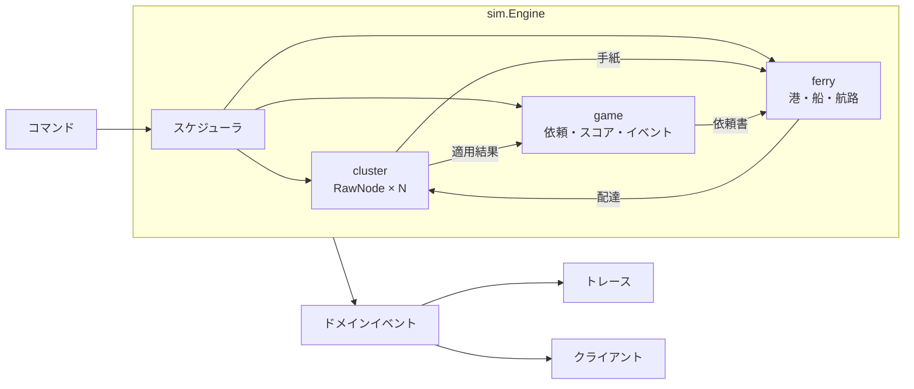
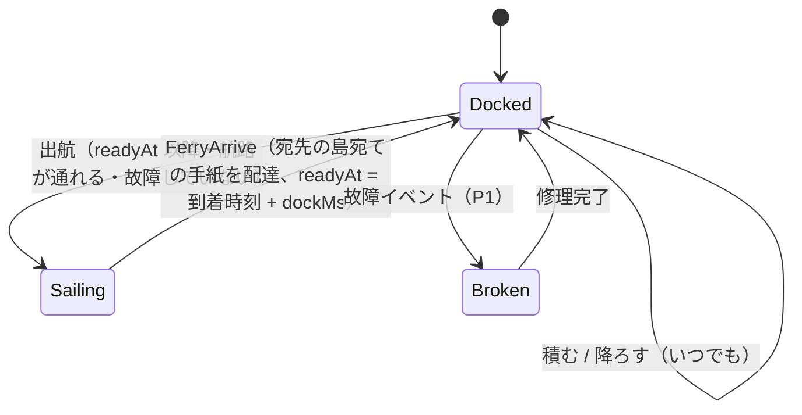

# DesignDoc — 合意、乗船中。

| 項目 | 内容 |
|---|---|
| 版 | v0.3 |
| 更新日 | 2026-11-06 |
| 状態 | レビュー済み（[判断の記録](./09-assumptions-and-open-questions.md)を反映） |
| 対象読者 | 実装者（サーバー・フロントエンド・インフラ）、レビュアー |
| 前提ドキュメント | [要件定義書](./01-requirements.md)、[アーキテクチャ](./02-architecture.md)、[ゲームデザイン仕様](./04-game-design.md) |

この文書は「どう作るか」を、実装に着手できる粒度まで具体化したものです。ゲームのルールや数値（何点入るか等）は [04-game-design.md](./04-game-design.md)、WebSocket の電文は [06-protocol.md](./06-protocol.md)、データ形式は [07-data-spec.md](./07-data-spec.md) に分けています。

---

## 1. 概要

### 1.1 一言で

`etcd-io/raft` の `RawNode` を島の数だけ 1 つの Go プロセス（Cloudflare Containers 上の、1 ゲーム専用のコンテナ）内に立て、それらの間のネットワークを「プレイヤーが操作するフェリー」に差し替えた、**決定的な離散イベントシミュレーション**を作る。ブラウザはその世界を WebSocket（Cloudflare の Worker と Durable Object が中継する）で受け取って描画し、プレイヤーの操作をコマンドとして送り返す。

### 1.2 ゴール

1. Raft のアルゴリズムには手を入れず、輸送（Transport）だけをゲームにする
2. 同じ入力からは必ず同じ結果になる（決定性）。これにより、テスト・リプレイ・デモでの再現ができる
3. ゲームとして遊べる時間感覚（1 ラウンド 3 分前後）に、Raft の時間（tick）を対応させる
4. 実装を「シミュレーションのコア」「サーバー」「クライアント」に分け、並行して開発できるようにする

### 1.3 非ゴール

- 実ネットワーク上での Raft（ノードを別プロセスやコンテナに分ける構成）。将来の拡張として、境界だけ用意しておく
- ログのコンパクション・スナップショット（ラウンドが短く、ログは数百エントリにしかならない）
- メンバー変更（ConfChange）
- 線形化可能な読み取り（ReadIndex）

---

## 2. 設計の全体像



- **世界はすべて `sim.Engine` の中にある**。`Engine` は I/O・goroutine・実時間を一切使わない
- 外から `Engine` を動かす方法は 2 つだけ: `Apply(cmd)`（操作）と `RunUntil(t)`（時間を進める）
- `Engine` の出力はドメインイベントの列だけ。クライアントへの送信・トレース・リザルト・エンジニアモードは、すべてこの列から作る

---

## 3. 時間モデル

### 3.1 2 種類の時間

| 名前 | 単位 | 意味 |
|---|---|---|
| 実時間 | — | 現実の時計。サーバーのセッションループだけが参照する |
| ゲーム内時間 `SimTime` | int64 ミリ秒 | シミュレーションの時計。0 = 航行開始。すべてのイベントはこの時刻で並ぶ |

`SimTime` の進み方は、セッションループが決めます（§12.2）。

- 通常: 実時間 1 秒 = ゲーム内 1 秒（`speed = 1.0`）
- 速度変更: 0.5x / 1x / 2x / 4x（P0）。デモ操作では 8x と「次の到着・出来事まで進める」も使える（A-17）
- 一時停止: 進まない

速度を変えても、`Engine` から見れば「`RunUntil` に渡される時刻の刻み方」が変わるだけです。イベントの時刻は実時間に依存しないので、**結果は変わりません**（コマンドが届いたゲーム内時刻だけは実時間に依存しますが、これは入力ログに記録されるので再現できます）。

### 3.2 Raft の tick との対応

`etcd-io/raft` は時間を知らず、`Tick()` が呼ばれた回数だけを数えます。そこで、ゲーム内時間の一定間隔ごとに全ノードの `Tick()` を呼びます。

| パラメータ | 既定値 | 意味 |
|---|---|---|
| `raft.tickMs` | 500 | ゲーム内 500ms ごとに 1 tick |
| `raft.heartbeatTick` | 2 | Leader は 1 秒ごとに定期連絡（Heartbeat）を出す |
| `raft.electionTick` | Stage 1: 120 / Stage 2 以降: 40 / デモ: 16 | 選挙タイムアウト。実際の値は `electionTick` 以上 `2×electionTick` 未満の乱数（Stage 1 なら 60〜120 秒、Stage 2 なら 20〜40 秒、デモなら 8〜16 秒） |

**調整の目安**: 選挙タイムアウト（`electionTick × tickMs`）は「Leader と、最も近い Follower の間をフェリーが往復する時間」の 2 倍以上にします。これより短いと、プレイヤーがどう頑張っても選挙が頻発します。逆に長すぎると、Stage 2 の学習目標（Heartbeat が途切れると選挙が始まる）が体験できません。Stage 1 は Log Replication に集中させつつ、終盤に「放っておかれた島が立候補の相談を始める」様子を軽く見せるため、長め（60〜120 秒）にしています。最終的な値はプレイテストで決めます（[A-07](./09-assumptions-and-open-questions.md#a-07)）。

### 3.3 Election Timeout の残り時間について

`etcd-io/raft` は各ノードの `electionElapsed` や乱数で決まったタイムアウト値を外部に公開していません。エンジニアモードで「選挙まであと何秒」を表示したい場合（FR-ENG-07、P2）は、ゲーム側で「最後に現在の Leader から手紙を受け取ってからの tick 数」を数えて、**推定値**として表示します。表示には必ず「推定」と書きます。

---

## 4. イベントスケジューラ

### 4.1 データ構造

```go
type SimTime int64 // ミリ秒

type Event struct {
    At    SimTime
    Class EventClass // 同じ時刻のイベントの処理順
    Seq   uint64     // 登録順。完全に同じ順序にするための最後の比較キー
    Kind  EventKind
    Data  any
}

// 優先度キュー（container/heap）の比較順: (At, Class, Seq)
```

### 4.2 イベントの種類と、同時刻のときの順番

同じ `SimTime` に複数のイベントがあるときは、`Class` の小さいものから処理します。

| Class | イベント | 内容 |
|---|---|---|
| 0 | `CommandApplied` | プレイヤーのコマンド（実際には `Apply` で即時に処理し、記録用にこのクラスを使う） |
| 1 | `FerryArrive` | 船が島に着く → その島宛ての手紙を配達 |
| 2 | `FerryReady` | 停泊時間が終わり、出航できるようになる |
| 3 | `RaftTick` | 全ノードの `Tick()`（ノード ID の昇順） |
| 4 | `WorldEvent` | 嵐の開始・終了、故障、漂流瓶など台本にあるイベント |
| 5 | `RequestSpawn` | 住民の依頼が発生 |
| 6 | `RequestRetry` | 依頼書を再送するかどうかの判定 |
| 7 | `GameTimer` | 満足度の減少判定・期限切れの判定・ラウンド終了 |

各イベントの処理のあとで、**全ノードの Ready を ID の昇順で処理しきる**（§5.4）。Raft の出力（手紙）は港に置かれるだけで、配達は船の到着を待つので、この処理は必ず止まります。

### 4.3 `Engine` の公開 API

```go
package sim

type Engine struct { /* 非公開 */ }

func New(st *stage.Stage, seed uint64, opt Options) (*Engine, error)

func (e *Engine) Now() SimTime
func (e *Engine) Phase() Phase // Opening / Sailing / Ended

// コマンドを Now() の時刻で適用する。入力ログに記録される。
func (e *Engine) Apply(cmd protocol.Command) protocol.Ack

// t 以下の時刻のイベントをすべて処理し、Now() を t にする。
// ラウンド終了時刻を超える t を渡しても、終了時刻で止まる。
func (e *Engine) RunUntil(t SimTime)

// 前回呼んでから発生したドメインイベントを取り出す。
func (e *Engine) DrainEvents() []protocol.Event

func (e *Engine) Snapshot() protocol.Snapshot          // 再接続時などに送る全体の状態
func (e *Engine) NodeDetail(id uint64) protocol.NodeDetail // エンジニアモード用
func (e *Engine) Result() (protocol.RoundResult, bool)   // 終了後のみ
func (e *Engine) InputLog() protocol.InputLog
func (e *Engine) TraceHash() [32]byte

// 次に「プレイヤーに見せたい出来事」（船の到着・台本のイベント・依頼の発生）が起きる時刻。
// デモ操作の「次の出来事まで進める」に使う。
func (e *Engine) NextNotableAt() (SimTime, bool)

// 入力ログを最初から適用し直して、同じ状態のエンジンを作る（コンテナが止まったときの復元、リプレイ）。
func Replay(st *stage.Stage, log protocol.InputLog, opt Options) (*Engine, error)
```

---

## 5. Raft との統合（`internal/cluster`）

### 5.1 使うライブラリと版

- `go.etcd.io/raft/v3` **v3.7.0**（Go 1.26 が必要）
- v3.7 では `raftpb` が protobuf-go 製になり、メッセージは `*pb.Message`、フィールドはポインタ型（`m.GetTerm()` などのゲッターで読む）になっています。Web 上のサンプル（v3.5 以前、gogo-protobuf 製）とは書き方が違うので注意してください
- 乱数源を注入するための最小パッチを当てたものを `server/third_party/etcd-raft` に置き、`go.mod` の `replace` で使います（[ADR-0005](./adr/0005-deterministic-raft-rng-patch.md)）

### 5.2 `raft.Config`（既定値。ステージ定義で上書きできる）

| フィールド | 値 | 理由 |
|---|---|---|
| `ID` | 1..N（島の順） | — |
| `ElectionTick` / `HeartbeatTick` | §3.2 | — |
| `Storage` | `raft.NewMemoryStorage()` | 永続化しない（[ADR-0012](./adr/0012-no-persistence-in-mvp.md)） |
| `MaxSizePerMsg` | 4096 | 1 通の「記録して！」に数件のエントリをまとめる |
| `MaxInflightMsgs` | 4 | 1 つの Follower に対して、返事を待たずに送る「記録して！」は 4 通まで |
| `CheckQuorum` | true | 孤立した Leader が自分から退く（デモの見せ場）。[ADR-0007](./adr/0007-enable-prevote-and-checkquorum.md) |
| `PreVote` | true | 孤立していた島が復帰したときに、Term を無駄に上げて Leader を引きずり下ろすのを防ぐ。同 ADR |
| `DisableProposalForwarding` | true | 提案の転送は「依頼書」としてゲーム側で行う。[ADR-0008](./adr/0008-application-level-request-forwarding.md) |
| `AsyncStorageWrites` | false | 同期的な Ready ループにする |
| `RandIntn`（パッチで追加） | ノードごとの乱数源 | 決定性のため |
| `Logger` | トレースに流す独自の Logger | Raft の内部ログもエンジニアモードで見られるようにする（P1） |

### 5.3 起動と「開会式」

ゲーム開始直後は Leader がいません。ここで船を使った選挙から始めると、プレイヤーは何をすればよいか分からないまま時間が過ぎるので、**開会式フェーズ**を設けます。

1. 全ノードを `RawNode.Bootstrap(peers)` で同じメンバー構成で初期化する
2. ステージ定義の `initialLeader` の島で `Campaign()` を呼ぶ
3. **即時配達モード**: 出てきたメッセージを船を使わず、FIFO で直接宛先に `Step()` する。これを「Leader が決まり、全ノードが Leader の最初の（空の）エントリまで適用する」まで繰り返す（上限 1,000 ステップ。超えたらエラー）
4. 港を空にして、`SimTime = 0` で航行フェーズを始める

開会式の間もドメインイベントは記録するので、エンジニアモードでは最初の選挙の様子も見られます。画面上は「開会式：代表に〇〇島が選ばれました」という演出にします。

> **Leader を指定するのは「ゲーム側が Leader を決めない」（C-05）に反しないか？** `Campaign()` は「選挙タイムアウトが来た」のと同じ扱いで、立候補させるだけです。当選するかどうかは Raft の投票で決まります。実際に、開会式で他のノードが先に立候補していれば別の島が当選し得ます（決定的な乱数のもとでは毎回同じ結果になります）。

### 5.4 Ready ループ（V-5 の実装）

1 ノード分の処理です。この関数の外で Ready を扱うことは禁止します。

```go
// processReady は HasReady が false になるまで Ready を処理する。
// 戻り値の Message は送信元の港に置かれる。
func (n *Node) processReady(now sim.SimTime) (out []*pb.Message, applied []Applied, err error) {
    for n.rn.HasReady() {
        rd := n.rn.Ready()

        // (1) 永続化：スナップショット → エントリ → HardState の順
        if rd.Snapshot != nil && !raft.IsEmptySnap(rd.Snapshot) {
            return nil, nil, errUnexpectedSnapshot // コンパクションしないので来ない
        }
        if err := n.storage.Append(rd.Entries); err != nil { return ... }
        if rd.HardState != nil && !raft.IsEmptyHardState(rd.HardState) {
            n.storage.SetHardState(rd.HardState)
        }

        // (2) 送信：永続化の後。Raft のバッファを共有しないよう複製する
        for _, m := range rd.Messages {
            out = append(out, proto.Clone(m).(*pb.Message))
        }

        // (3) 適用：Commit 済みのエントリを台帳に順に適用する
        for _, ent := range rd.CommittedEntries {
            switch ent.GetType() {
            case pb.EntryNormal:
                if len(ent.GetData()) == 0 { continue } // Leader 就任時の空エントリ
                res := n.ledger.Apply(ent.GetIndex(), ent.GetData())
                applied = append(applied, Applied{Index: ent.GetIndex(), Term: ent.GetTerm(), Result: res})
            case pb.EntryConfChange, pb.EntryConfChangeV2:
                // Bootstrap 時のメンバー追加のみ。ゲーム中には発生しない
                var cc pb.ConfChangeV2 /* デコード */ 
                n.rn.ApplyConfChange(cc)
            }
            n.applied = ent.GetIndex()
        }

        // (4) 次の Ready へ
        n.rn.Advance(rd)

        // ソフトステート（役割・Leader）が変わっていればドメインイベントにする
        if rd.SoftState != nil { n.emitRoleChange(now, rd.SoftState) }
    }
    return out, applied, nil
}
```

- 順序は「追記 → HardState 保存 → 送信 → 適用 → Advance」で固定（`etcd-io/raft` の README が求める順序を満たす）
- テストでは、`Storage` をラップして呼び出し順を記録し、この順序になっていることを確認します
- 実際のコードでは API の細部（ゲッター名など）を v3.7.0 のソースに合わせてください

### 5.5 ノードがメッセージを受け取るとき

```go
func (n *Node) Deliver(m *pb.Message) error {
    err := n.rn.Step(m)
    // ErrStepLocalMsg / ErrStepPeerNotFound はゲームのバグなので、トレースに警告を出して続行
    return err
}
```

`Step()` が受け取らなかったメッセージ（古い Term の手紙など）も、エラーにはならず Raft の内部で無視されます。これが V-4 の安全性の根拠です。

### 5.6 1 ノードが持つもの

```go
type Node struct {
    id      uint64
    rn      *raft.RawNode
    storage *raft.MemoryStorage
    ledger  *ledger.Ledger // このノード専用の台帳の複製
    applied uint64
    role    raft.StateType
    lead    uint64
}
```

台帳はノードごとに 1 つずつ持ちます（Raft の「状態機械の複製」そのもの）。V-2・V-3 の検査は、全ノードの台帳を比べて行います。

---

## 6. Ferry Transport（`internal/ferry`）

### 6.1 手紙

```go
type LetterID uint64

type LetterKind uint8
const (
    LetterRaft LetterKind = iota // Raft のメッセージ
    LetterRequest                // 依頼書（アプリケーションの手紙）
)

type Letter struct {
    ID        LetterID
    Kind      LetterKind
    From, To  uint64       // 島（= ノード）ID
    CreatedAt sim.SimTime
    Raft      *pb.Message  // Kind == LetterRaft のとき。生成後は変更しない
    Req       *RequestNote // Kind == LetterRequest のとき
    Location  Location     // 港 / 船 / 中継倉庫 / 配達済み / 破棄
}
```

- 手紙の ID はエンジン内の連番（決定的）
- `Raft` は Ready から取り出した時点で複製済み。以降は読み取り専用
- 手紙の内容（Raft メッセージ）は**一切書き換えない**（企画書 §5.3）

### 6.2 港キューと、その上限・合流の規則（V-7）

各島の港は、その島が**送信元**の手紙を、生成順に並べたリストとして持ちます。手紙を港に置くとき、次の規則を順に適用します。

| # | 対象 | 規則 | 破棄理由 |
|---|---|---|---|
| R1 | `MsgHeartbeat` / `MsgHeartbeatResp` | 同じ (種類, 送信元, 宛先) の手紙が港にあれば、古い方を破棄する | `superseded` |
| R2 | `MsgPreVote` / `MsgVote` / `MsgPreVoteResp` / `MsgVoteResp` | 同じ (種類, 送信元, 宛先) で、Term が新しい手紙以下のものを破棄する | `superseded` |
| R3 | `MsgAppResp`（`Reject=false`） | 同じ (送信元, 宛先) の拒否でない `MsgAppResp` を破棄する（新しい方が大きい index を伝えるため） | `superseded` |
| R4 | `MsgApp` | 同じ (送信元, 宛先) の `MsgApp` が `perLinkAppCap`（4）通を超えたら、最も古いものを破棄する | `overflow` |
| R5 | Raft の手紙全体 | 港にある Raft の手紙が `portCap`（24）通を超えたら、優先度が最も低い種類の、最も古いものを破棄する（優先度は低い順に Heartbeat 系 → AppResp → App → 選挙系） | `overflow` |
| R6 | 依頼書 | 同じ依頼 ID の依頼書が港にあれば、古い方を破棄する（再送で置き換わる） | `superseded` |

**なぜ破棄してよいのか**: Raft は「メッセージは失われ得る」前提で設計されています。破棄はネットワークでの欠落と同じで、Raft は後続の Heartbeat への応答などを契機に再送します（`etcd-io/raft` では、Heartbeat の応答を受けた Leader は、Follower のログが遅れていれば `MsgApp` を送り直します）。合流（R1〜R3）は「古い手紙を、同じ意味を持つ新しい手紙で置き換える」だけで、安全性には影響しません。

**上限の保証**: 港の Raft の手紙は `portCap` 以下、依頼書は「その島が依頼元で、まだ終わっていない依頼の数」以下、船の積み荷は積載量以下、中継倉庫（P1）は `relayCap`（12）以下。したがって手紙の総数は `島の数 × (portCap + 依頼の上限) + Σ積載量 + 島の数 × relayCap` で抑えられます。

**古い手紙**: 送信元の今の Term より Term が古い手紙も、規則に当てはまらない限り港に残します（実際のネットワークでも古いパケットは残るため）。エンジニアモードでは「古い手紙」のタグを付けて表示します。

### 6.3 フェリー



```go
type Ferry struct {
    ID       FerryID
    Name     string
    Capacity int
    Speed    float64 // 航行時間の倍率（1.0 = 航路の標準時間）
    State    FerryState // Docked / Sailing / Broken
    At       uint64     // Docked のときの島
    From, To uint64     // Sailing のとき
    DepartAt, ArriveAt sim.SimTime
    ReadyAt  sim.SimTime
    Cargo    []LetterID // 積んだ順
}
```

- 航行時間 = `round(route.travelMs × ferry.Speed)`
- 出航の条件: `Docked` であること、`now ≥ ReadyAt`、行き先へ直接の航路があり、その航路が遮断されていないこと
- **到着時の処理**: 積み荷のうち、宛先がその島の手紙を、積んだ順に配達します。Raft の手紙は `Node.Deliver`、依頼書はアプリケーション層（§8）へ渡します。配達のたびに、そのノードの Ready を処理します
- 宛先が別の島の手紙は、そのまま積んでおきます（経由輸送、FR-FERRY-05）
- 航行中に嵐が来ても、船はそのまま進みます（[04-game-design.md §6](./04-game-design.md)）

### 6.4 航路

- 無向グラフ。辺は `travelMs` と `blockedUntil` を持つ
- 嵐は辺の集合を指定した時間だけ遮断する
- ネットワーク分断の状態（FR-ENG-08）は「遮断されていない辺だけでの連結成分」として計算する。ただし、これは「船が行き来できるか」を表すだけで、実際に通信できるかは船の運航次第です

### 6.5 中継倉庫（P1）

船から降ろした、その島宛てではない手紙を預かる場所です。預かった手紙は Raft では処理されません（企画書 §10.2）。別の船に積み直せます。

---

## 7. 共有台帳（`internal/ledger`）

### 7.1 コマンドの形式（Raft のエントリの `Data`）

```json
{
  "v": 1,
  "reqId": "s2-0007",
  "origin": 3,
  "kind": "firework.reserve",
  "resource": "firework:grand",
  "amount": 0
}
```

| `kind` | 内容 | 成功条件 | 優先 |
|---|---|---|---|
| `firework.reserve` | 花火の予約 | `resource` の花火がまだ誰にも予約されていない | P0 |
| `stall.reserve` | 屋台の出店枠 | 予約数が定員未満 | P0 |
| `budget.spend` | 共有予算からの支払い | 残高 ≥ `amount` | P1 |

エンコードは JSON（キーの順序は固定）。エンジニアモードでそのまま読めることを優先し、容量は気にしません。

### 7.2 適用の規則

```go
type Result struct {
    Status string // "ok" | "rejected" | "duplicate"
    Reason string // "already_reserved" | "full" | "insufficient_budget" | ...
}

func (l *Ledger) Apply(index uint64, data []byte) Result
```

1. `reqId` がすでに適用済みなら、何もせず `duplicate` を返す（再送による二重消費を防ぐ、FR-REQ-06）
2. `kind` ごとの成功条件を判定し、成功なら資源を消費して `ok`、失敗なら `rejected`
3. 結果を `reqId → Result` として記録する（`duplicate` の判定と、依頼元への通知に使う）

台帳は**決定的な純粋関数**です。同じ順序でエントリを適用すれば、すべてのノードで同じ状態になります（これが状態機械の複製の前提）。

### 7.3 不変条件（V-3）

- どの花火も、予約者は 0 件か 1 件
- どの屋台も、予約数は定員以下
- 予算の残高は 0 以上
- 同じ index まで適用した 2 つのノードの台帳は完全に一致する

---

## 8. 依頼の処理（アプリケーション層、`internal/game`）

### 8.1 島ごとの「役場」

各島には、住民の依頼を代表の島へ届ける「役場」があります（ゲーム側のロジックで、Raft の外にあります）。

```text
route(req, island):
    node = island のノード
    if node.role == Leader:
        err = node.rn.Propose(command(req))
        if err == nil:            req.status = 審議中（初回のみ）
        if err == ErrProposalDropped: 次の RaftTick で route をやり直す
    else if node.lead != 0 (Leader を知っている):
        依頼書を作る（From = island, To = node.lead）→ island の港へ（規則 R6）
        req.status = 送付待ち
    else:
        req.status = 送付待ち（代表が分からない）→ 次の RaftTick で route をやり直す
```

- **依頼の発生時**: 依頼元の島で `route(req, origin)`
- **依頼書が島 X に届いたとき**: `route(req, X)`。X が Leader でなければ、X が知っている Leader へさらに転送する（X の港に新しい依頼書を作る）
- **再送**: 依頼元の島で、最後に送ってから `retryMs`（25 秒）経っても依頼元の台帳に適用されていなければ、`route(req, origin)` をやり直す。同じ `reqId` なので、二重に適用されても台帳が `duplicate` として無視する

> Leader が提案したあと Commit される前に交代すると、そのエントリは新しい Leader によって上書きされ、消えることがあります。この場合、依頼は再送によって救われます。これも Raft の実際の振る舞いとして、エンジニアモードで観察できます。

### 8.2 依頼の状態の判定

依頼の状態は、エンジン全体を見渡して判定します（プレイヤーへの表示用）。

| 状態 | 判定 |
|---|---|
| 受付 | 発生した直後 |
| 送付待ち | 依頼書が港にある、または代表が分からず待っている |
| 輸送中 | 依頼書が船に積まれている |
| 審議中 | いずれかの Leader が `Propose` した |
| 共和国で確定 | いずれかのノードの台帳に、その `reqId` の最初のエントリが適用された（＝ Commit された） |
| 確定 / 予約失敗 | 依頼元のノードの台帳に適用され、結果が `ok` / `rejected` |
| 期限切れ | 期限を過ぎても「確定 / 予約失敗」になっていない（フラグとして重ねて表示。あとから確定もできる） |

スコアは「確定」になった時点で入ります（[ADR-0015](./adr/0015-request-success-judged-at-origin-apply.md)）。

---

## 9. 乱数とシード

### 9.1 派生

ラウンドのシード（uint64）から、用途ごとに独立した乱数列を作ります。用途を足しても、他の用途の乱数列は変わりません。

```go
func Sub(seed uint64, name string) *rand.Rand {
    h := fnv64a(name)
    return rand.New(rand.NewPCG(seed, h)) // math/rand/v2
}
```

| 名前 | 用途 |
|---|---|
| `requests` | 依頼の発生時刻・種類（台本以外の部分） |
| `events` | 台本で「この時間帯のどこか」と指定されたイベントの時刻 |
| `raft/<nodeID>` | ノードごとの選挙タイムアウトの乱数（パッチで注入） |
| `drift` | 漂流瓶で、どの過去の手紙を複製するか |

### 9.2 決定性を壊すもの（実装上の禁止事項）

`internal/sim` とその下のパッケージでは、次を禁止します。CI では `forbidigo` で検出します。

- `time.Now` / `time.Since` などの実時間
- goroutine・チャネル・`select`
- `map` の走査順に依存する処理（走査する場合はキーをソートしてから）
- グローバルな `math/rand`（上記の派生乱数以外）
- 浮動小数点の計算をスコアや判定に使うこと（スコアは整数で計算する）

`etcd-io/raft` の内部は、進捗の管理（`tracker`）で ID 順に走査するので決定的です。乱数だけがパッチの対象です。

---

## 10. 記録・リプレイ

### 10.1 入力ログ

```json
{
  "format": 1,
  "build": "git:3f2c1ab",
  "stageId": "stage2",
  "stageHash": "sha256:…",
  "seed": 20261101,
  "commands": [
    {"t": 0,    "cmd": {"type": "cmd.ferry.load",   "payload": {"ferryId": "f1", "letterIds": [12, 13]}}},
    {"t": 1200, "cmd": {"type": "cmd.ferry.depart", "payload": {"ferryId": "f1", "to": 2}}}
  ]
}
```

- `t` はコマンドを適用したゲーム内時刻
- 一時停止・速度変更のコマンドも記録しますが、エンジンの結果には影響しません（記録はするがリプレイ時には無視してよい）
- **保存先**: 入力ログは Durable Object の SQLite に保存します。コンテナはコマンドを適用したら `ack` に適用時刻 `t` を入れて返し、Durable Object が `(t, cmd)` を追記します（[ADR-0017](./adr/0017-persist-input-log-in-durable-object.md)）
- **復元**: コンテナが止まったら、Durable Object が新しいコンテナに入力ログを渡し、`Replay` で同じ状態に戻します
- **リプレイ** = 同じステージ・シードで `Engine` を作り、各コマンドの `t` まで `RunUntil` してから `Apply` することの繰り返し

### 10.2 トレース

ドメインイベント（[06-protocol.md §5](./06-protocol.md) のイベントと同じ型）を、発生順に連番を付けて JSON Lines で並べたものです。

- **トレースのハッシュ** = 各イベントの正規化 JSON を改行区切りで連結した SHA-256。決定性のテスト（V-6）に使います
- リザルトの統計（Leader の交代回数、平均 Commit Latency など）はトレースから計算します。トレースを持っていれば、あとから別の統計を足すこともできます

### 10.3 統計の定義

| 指標 | 定義 |
|---|---|
| Leader の交代回数 | 開会式のあとに、新しい Term で Leader が誕生した回数 |
| Commit Latency | 依頼が Leader に `Propose` されてから「共和国で確定」になるまでのゲーム内時間 |
| 平均 Commit Latency | 確定した依頼の Commit Latency の平均 |
| 最長の音信不通 | 各島について「手紙が 1 通も配達されなかった最長の時間」の最大値 |
| 配った手紙の数 | 配達した手紙の数（種類別にも集計） |

---

## 11. 不変条件の検査（`internal/sim/invariants`）

テストモード（`Options.CheckInvariants = true`）では、イベントを 1 つ処理するたびに次を検査し、違反したら即座に panic します（本番では無効）。

| # | 不変条件 | 対応 |
|---|---|---|
| I-1 | 1 つの Term に Leader は最大 1 人（観測した Leader の記録を Term ごとに持つ） | Election Safety |
| I-2 | 2 つのノードで同じ (index, term) のエントリがあれば、そこまでの全エントリが一致する | Log Matching |
| I-3 | 全ノードで、適用済みのエントリは index ごとに一致する | V-2 |
| I-4 | エントリが Commit された時点で、そのエントリは過半数のノードのストレージにある | V-1 |
| I-5 | 各ノードの Term・Commit・Applied は減らない | 単調性 |
| I-6 | 台帳の不変条件（§7.3） | V-3 |
| I-7 | 港・船・中継倉庫の手紙の数が上限以下 | V-7 |

---

## 12. サーバー（Go のゲームサーバーと、Cloudflare の Worker・Durable Object）

### 12.1 役割分担

| 層 | 実装 | 責務 |
|---|---|---|
| Worker | TypeScript（`web/worker/index.ts`） | 静的ファイルの配信（SPA）、`/api/*` と `/ws/*` の受付、署名の確認・Turnstile・レート制限・`Origin` の検査、セッションの作成、Durable Object への振り分け、管理用 API |
| Durable Object `CostGuard` | TypeScript（`web/worker/cost-guard.ts`） | 全体で 1 つ。費用の予約・精算・上限の判定、ガードの設定、切り替えの記録（[ADR-0018](./adr/0018-cost-guard.md)） |
| Durable Object `GameSession` | TypeScript（`web/worker/game-session.ts`） | 1 ゲームに 1 つ。コンテナの起動・停止、トークンの検証、ブラウザとコンテナの間の WebSocket の中継、入力ログの保存（SQLite）、コンテナが止まったときの復元、寿命の管理（アラーム） |
| Go サーバー `single` モード | Go（`server/cmd/server --mode single`）。コンテナの中で動く | 1 プロセス＝1 ゲーム。Durable Object からの WebSocket だけを受け、セッションループでシミュレーションを動かす |
| Go サーバー `standalone` モード | 同じバイナリ（`--mode standalone`） | ローカル開発とデモの保険（`make demo-local`）。1 プロセスで複数のゲームを持ち、§12.2 の公開 API を自分で提供する |

インフラの構成は [ADR-0016](./adr/0016-infrastructure-cloudflare-with-cf-cli.md) を参照してください。

### 12.2 公開 API（Worker が受ける）

| メソッド | パス | 内容 |
|---|---|---|
| GET | `/api/healthz` | ヘルスチェック（Worker が直接返す） |
| GET | `/api/stages` | ステージ一覧（ビルド時に `data/stages/` から作った JSON を Worker に同梱） |
| POST | `/api/sessions` | セッションを作る（`{stageId, seed?, turnstileToken}` → `{sessionId, token}`）。Turnstile とレート制限を確認し、`CostGuard` で費用を予約してから、Durable Object を作り、コンテナの起動を始める |
| GET | `/ws/sessions/{id}?token=…` | WebSocket に切り替え。**sessionId の署名を確認してから** Durable Object に転送する |
| GET / PATCH | `/api/admin/guards` | コストガードの設定の確認と切り替え（`ADMIN_TOKEN` が必要） |

詳細は [06-protocol.md](./06-protocol.md)。Go 側の WebSocket ライブラリは `github.com/coder/websocket` を使います（`context` 対応で、依存が少ないため）。

### 12.3 Durable Object `GameSession`

コンテナは、推奨の `durable_object` 方式で、Durable Object のコードから起動します（[ADR-0016](./adr/0016-infrastructure-cloudflare-with-cf-cli.md)）。

```ts
// 概略。API は Cloudflare の Durable Object Container API（ctx.container）に従う。
export class GameSession extends DurableObject {
  async init(req: { stageId: string; seed: number; demo: boolean; tokenHash: string }) {
    // SQLite: session(stage_id, seed, demo, token_hash, state, created_at, alarm_count)
    this.ctx.container.start({
      image: this.ctx.container.images.server,
      instance: this.env.CONTAINER_INSTANCE,   // 一般公開 "lite" / デモ "standard-1"
      enableInternet: false,                   // 外部への通信は禁止
      env: { MODE: "single", PORT: "8080" },
    });
    // start() は準備完了の前に戻る。monitor() で起動の失敗を検知する
    // アラーム: 起動から 30 分で強制終了（コストガード G2）
  }
  async fetch(request: Request) {
    // 1. token を検証（ハッシュで比較）
    // 2. ブラウザとの WebSocket を受け付ける
    // 3. getTcpPort(8080).fetch("http://container/healthz") が成功するまで待つ
    // 4. コンテナの /ws に WebSocket を開き、最初に internal.init（または internal.restore）を送る
    // 5. 双方向に中継する。ブラウザ → コンテナの cmd.* は cmdId ごとに覚えておき、
    //    コンテナ → ブラウザの ack(ok=true, t) を見たら (t, cmd) を SQLite の input_log に追記する
    // 6. ブラウザ由来の internal.* は破棄する（内部の電文はこの Durable Object だけが送る）
  }
  async onContainerLost() {
    // 新しいコンテナを起動 → internal.restore(stageId, seed, input_log) → コンテナが snapshot を返す
  }
  async onRoundEnded() {
    // ctx.container.destroy() ですぐに止め、実際に動いた時間で CostGuard に精算する
  }
  async alarm() {
    // 切断から 5 分、起動から 30 分のいずれかでコンテナを止める
    // アラームの再設定は 1 ゲームで 20 回まで（繰り返しが止まらなくなるのを防ぐ。コストガード G2）
  }
}
```

### 12.3.1 Durable Object `CostGuard`

全体で 1 つの Durable Object です（`idFromName("global")`）。一般公開とデモ用の Worker が共有します。

```ts
export class CostGuard extends DurableObject {
  // SQLite: settings(key, value), ledger(session_id, reserved_usd, settled_usd, started_at, ended_at), audit(at, change)
  async reserve(sessionId: string, instance: "lite" | "standard-1"): Promise<"ok" | "budget_exhausted" | "sessions_disabled">
  async settle(sessionId: string, runSeconds: number): Promise<void>  // 予約した額を実際の時間で精算する
  async getGuards(): Promise<Guards>                                  // 設定ファイルの既定値に、保存した上書きを重ねたもの
  async patchGuards(change: Partial<Guards>, by: string): Promise<Guards> // G3 は変更できない
}
```

- 見込みの費用の単価・上限は `GUARDS`（`cloudflare.config.ts`）に既定値を持ち、管理用 API で上書きできる
- 呼ぶのはゲームの開始と終了のときだけなので、全体で 1 つでも負荷は小さい

### 12.4 セッションループ（Go）

```go
func (s *Session) run(ctx context.Context) {
    step := time.NewTicker(50 * time.Millisecond)  // シミュレーションを進める間隔
    flush := time.NewTicker(100 * time.Millisecond) // イベントをまとめて送る間隔
    last := time.Now()
    for {
        select {
        case <-ctx.Done(): return
        case c := <-s.cmdCh:          // WS の読み取り goroutine から
            switch c.Type {
            case "cmd.game.speed":    // 0.5 / 1 / 2 / 4（デモ操作では 8 も）
                s.speed = c.Speed
            case "cmd.game.skip":     // デモ操作のみ：次の出来事まで進めて一時停止
                if t, ok := s.engine.NextNotableAt(); ok && t-s.engine.Now() <= 30_000 {
                    s.engine.RunUntil(t)
                }
                s.paused = true
            }
            ack := s.engine.Apply(c)   // ack には適用時刻 t が入る（ADR-0017）
            s.out.enqueueAck(ack)
        case now := <-step.C:
            if !s.paused && s.engine.Phase() != sim.Ended {
                dt := now.Sub(last)
                adv := min(sim.SimTime(float64(dt.Milliseconds())*s.speed), 1000) // 1 回に進めるのは 1 秒まで
                s.engine.RunUntil(s.engine.Now() + adv)
            }
            last = now
        case <-flush.C:
            s.out.send(s.engine.DrainEvents(), s.clock())
        }
    }
}
```

- `Engine` に触れるのはこの goroutine だけ（ロック不要）
- 速度はセッションループの中だけの値で、エンジンの結果には影響しません。8 倍速でも、1 ステップで進めるのは 400ms（＜上限の 1 秒）です
- 送信キューが詰まった場合（クライアントが遅い）は、イベントを捨てずに次回まとめて送ります。一定量（1,000 件）を超えたらイベント列を捨て、代わりにスナップショットを送ります
- `internal.restore` を受けたら、`sim.Replay` で入力ログの最後の時刻まで一気に進め、一時停止の状態でスナップショットを返します

### 12.5 寿命と上限

| 項目 | 値 | どこで守るか |
|---|---|---|
| 費用の上限 | 1 か月 30 USD・1 日 1 USD（見込みの費用の合計） | `CostGuard`（コストガード G1） |
| 同時に遊べるゲームの数 | 上限なし（R-01） | — |
| 1 ゲームの最長時間 | 30 分 | Durable Object のアラーム（G2） |
| アラームの再設定の回数 | 1 ゲームで 20 回まで | Durable Object（G2） |
| 切断されてからの保持時間 | 5 分（その間は自動で一時停止） | Durable Object のアラーム |
| ラウンド終了後 | すぐにコンテナを止める。入力ログと結果は Durable Object に残る | Durable Object |
| セッション作成のレート制限 | 1 IP あたり 10 回/分 ＋ Turnstile | Worker（G4） |
| コマンドのレート制限 | 1 セッションあたり 30 回/秒 | Durable Object |
| WS の受信メッセージの最大サイズ | 16 KiB | Durable Object と Go の両方 |
| Worker 1 回あたりの CPU 時間 | `limits.cpuMs`（値は T-007 で測って決める） | Cloudflare（G5） |

---

## 13. フロントエンド（`web/`）

### 13.1 構成

| 層 | 技術 | 責務 |
|---|---|---|
| 画面・パネル | React 19 + TypeScript | HUD、フェリー操作、島の詳細、通知、エンジニアパネル、リザルト |
| マップの描画 | PixiJS v8（React の外で命令的に使う） | 海・島・航路・船・手紙の山・嵐のエフェクト |
| 状態 | zustand | サーバーのスナップショットとイベントを反映した世界の状態 |
| ドラッグ＆ドロップ | dnd-kit | 港 → 船への積み込み |
| ビルド | Vite | — |
| テスト | Vitest / Playwright | — |

[ADR-0010](./adr/0010-frontend-react-pixijs.md) を参照。

### 13.2 状態の反映

```ts
type World = {
  stage: StageMeta;
  clock: { simTime: number; speed: number; paused: boolean; receivedAt: number };
  islands: Record<IslandId, IslandView>;
  routes: Record<RouteId, RouteView>;
  ferries: Record<FerryId, FerryView>;
  letters: Record<LetterId, LetterView>;
  requests: Record<RequestId, RequestView>;
  nodes: Record<IslandId, NodeView>;
  score: ScoreView;
};

function applyEvent(w: World, ev: ServerEvent): World // 純粋関数。Vitest でテストする
```

- `snapshot` を受け取ったら丸ごと置き換え、`events` を受け取ったら順に `applyEvent` する
- イベントの `seq` に抜けがあれば、サーバーにスナップショットを要求する（`cmd.sync`）

### 13.3 描画とアニメーション

- 船の位置はサーバーから送られてこない。`departAt` / `arriveAt` と、クライアントで推定したゲーム内時刻から補間する
  - 推定ゲーム内時刻 = `clock.simTime + (performance.now() − clock.receivedAt) × speed`（一時停止中は進めない）
- PixiJS のティッカーは、毎フレーム zustand のストアを直接読む（`useStore.getState()`）。React の再描画は経由しない
- 手紙は島ごとに「宛先別の山」として描き、数をバッジで表示する。1 通ずつのアイコンは島のパネル（DOM）に出す
- 手紙の種類は**色と形の両方**で区別する（[04-game-design.md §2](./04-game-design.md)）

### 13.4 エンジニアパネル

- E キーで表示を切り替える。表示中は `sub.engineer` で購読し、選んだノードの詳細（ログの末尾 50 件、Progress）を 2 Hz で受け取る
- ノードの役割・Term・Commit などの軽い情報は、エンジニアモードかどうかに関係なく常に `node.state` イベントで届く（簡易表示に使う）

### 13.5 サーバーなしでの開発

`simcli` でボットに 1 ラウンド遊ばせ、送られるはずのイベント列をファイルに書き出せます（`simcli record --stage stage1 --seed 1 --bot greedy > web/src/fixtures/stage1.json`）。フロントエンドはこれを再生するモックの WS クライアントで、サーバーなしで開発できます。

---

## 14. テスト戦略

| 種類 | 対象 | 方法 | CI |
|---|---|---|---|
| 単体テスト | スケジューラ、港の規則、台帳、スコア計算 | 表駆動テスト | 毎回 |
| Ready の順序 | `cluster` | Storage をラップして呼び出し順を検査（V-5） | 毎回 |
| シナリオテスト | 分断・復帰・古い手紙・再送 | 台本どおりに船を動かし、期待する状態を検査（V-1, V-2, V-4） | 毎回 |
| シミュレーションテスト | エンジン全体 | ランダムに動くボット船長 × ランダムな嵐・漂流瓶で多数のシードを回し、§11 の不変条件を常に検査 | PR は 200 シード、main は 1,000 シード |
| 決定性テスト | エンジン全体 | 同じ入力ログを 2 回実行してトレースのハッシュを比べる。`RunUntil` の刻み方を変えた実行（速度の違い・早送り・次の出来事まで進める）とも比べる（V-6） | 毎回 |
| 復元テスト | エンジン全体 | 途中まで遊んだエンジンと、その入力ログから `Replay` したエンジンの `Snapshot` が一致すること（FR-GAME-09） | 毎回 |
| Worker / Durable Object | `web/worker/` | Vitest。中継・入力ログの追記・`internal.*` の破棄・トークンの検証。コンテナはモックの WS で置き換える | 毎回 |
| ファジング | コマンド列 | `go test -fuzz`。不正なコマンドで panic しないこと、不変条件が保たれること | 夜間（P1） |
| パッチの検証 | `third_party/etcd-raft` | 上流との差分が乱数の部分だけであることをスクリプトで確認。上流のテストがすべて通ること | 毎回 |
| フロントの単体 | `applyEvent`、補間 | Vitest + 記録したイベント列 | 毎回 |
| E2E | 主要な操作の流れ | Playwright（ローカルでサーバーを起動し、Stage 1 で積む → 出航 → 配達まで） | 毎回（P1） |
| 負荷テスト | サーバー | Go 製のボットクライアントで 50 セッションを同時に動かし、tick の遅れを計測 | 手動 |

**ボット船長**: テスト用の自動プレイヤーです。`random`（ランダムに積んで出航）と `greedy`（優先度の高い手紙が多い島へ向かう）の 2 種類を用意します。`greedy` はステージの難易度調整（クリアできるか）にも使います。

---

## 15. 観測性

- ログ: Go は `log/slog` の JSON 出力、Worker と Durable Object は `console.log` の JSON。セッション ID を必ず付ける
- 保存と閲覧: `cloudflare.config.ts` の `observability.logs` とコンテナの `observability` を有効にし、Cloudflare のダッシュボードで見る（`cf` はベータ版で、リアルタイムのログ表示に未対応）
- 記録する指標（ログの項目として出す）: セッションの作成数、コンテナの起動にかかった時間、1 ステップの処理時間の p99、送信キューの長さ、復元の回数、エラー数
- デモの前: 起動時間と復元の回数を確認する

---

## 16. セキュリティ

| 脅威 | 対策 |
|---|---|
| セッションの乗っ取り | セッション作成時に推測できないトークン（128 bit）を発行し、WS の接続時に検証する |
| 大量のセッション作成による資源の枯渇・課金の増加 | コストガード（[ADR-0018](./adr/0018-cost-guard.md)）：Turnstile、IP ごとのレート制限、ゾーンの WAF と AI クローラーの遮断、費用の上限 |
| でたらめな ID による Durable Object の大量作成 | sessionId に HMAC の署名を付け、Worker で検証してから Durable Object を呼ぶ（G3。**無効にしない**） |
| 管理用 API の悪用 | `ADMIN_TOKEN`（`--secrets-file` で渡す）を必須にし、切り替えの記録を残す。合言葉は定期的に変える |
| シークレットの漏えい（公開リポジトリ） | `.env` などは `.gitignore` に入れ、CI でシークレットの検査（secret scanning）を行う |
| 巨大・大量のメッセージ | WS の受信サイズの上限、コマンドのレート制限、JSON のデコードは型を決めて行う |
| 他のサイトからの WS 接続 | Worker で `Origin` ヘッダーを許可リスト（`ALLOWED_ORIGINS`）と照合する |
| コンテナへの直接の接続 | コンテナは外部に公開しない。Durable Object からだけ接続する。ブラウザ由来の `internal.*` の電文は Durable Object が破棄する |
| デモ用の機能の悪用 | 嵐を起こす・8 倍速・次の出来事まで進める機能は、`demo` モードでデプロイした別の Worker（`DEMO_CONTROLS=1`）でだけ有効にする |
| 依存ライブラリの脆弱性 | Dependabot、`govulncheck`、`npm audit` を CI で実行する |

---

## 17. 検討した代替案（要約）

| 論点 | 採用 | 主な代替案 | ADR |
|---|---|---|---|
| Raft の実装 | etcd-io/raft | hashicorp/raft、自作 | [0002](./adr/0002-use-etcd-raft.md) |
| Raft の駆動方法 | `RawNode` を単一 goroutine で | `Node`（goroutine + チャネル） | [0003](./adr/0003-drive-rawnode-single-goroutine.md) |
| 時間 | 仮想時間の離散イベントシミュレーション | 実時間で動かす | [0004](./adr/0004-virtual-time-discrete-event-simulation.md) |
| 決定性 | Raft に乱数を注入する最小パッチ | 記録の再生のみ、時刻を外から制御 | [0005](./adr/0005-deterministic-raft-rng-patch.md) |
| 輸送 | Raft の外側に配送層を置く | Raft を改造する | [0006](./adr/0006-ferry-transport-outside-raft.md) |
| Raft の設定 | PreVote と CheckQuorum を有効 | 無効 | [0007](./adr/0007-enable-prevote-and-checkquorum.md) |
| 提案の転送 | アプリ層の依頼書 | Raft 標準の転送（`MsgProp`） | [0008](./adr/0008-application-level-request-forwarding.md) |
| 実行場所 | サーバーで実行し WS で配信 | Go を WASM にしてブラウザで実行 | [0009](./adr/0009-server-authoritative-simulation-over-websocket.md) |
| フロントエンド | React + PixiJS | Phaser、Canvas 直書き | [0010](./adr/0010-frontend-react-pixijs.md) |
| インフラ | Cloudflare（Workers ＋ Durable Objects ＋ Containers）、`cf` で管理 | AWS（ECS Fargate）、Wrangler、Terraform | [0016](./adr/0016-infrastructure-cloudflare-with-cf-cli.md)（[0011](./adr/0011-infrastructure-aws-ecs-fargate.md) を置き換え） |
| 永続化 | 入力ログを Durable Object に保存、リプレイの共有は R2 | 保存しない | [0017](./adr/0017-persist-input-log-in-durable-object.md)（[0012](./adr/0012-no-persistence-in-mvp.md) を置き換え） |
| オープンデータ | ビルド時の ETL | 実行時に取得 | [0013](./adr/0013-open-data-build-time-etl.md) |
| リポジトリ | モノレポ + 型の生成 | リポジトリを分ける、protobuf | [0014](./adr/0014-monorepo-and-shared-types.md) |
| 依頼の成功判定 | 依頼元の島で適用された時点 | Commit された時点 | [0015](./adr/0015-request-success-judged-at-origin-apply.md) |
| コストの抑制 | アプリ側のコストガード（費用の上限など 6 つ） | 予算アラートだけ、同時に動く数の上限 | [0018](./adr/0018-cost-guard.md) |
| ローカルの開発環境 | 作業ディレクトリごとに分けて並列に動かす | 別の PC、1 本ずつ順番に | [0019](./adr/0019-parallel-local-development.md) |
| 公開とライセンス | 公開・Apache-2.0 | MIT、ライセンスなし | [0020](./adr/0020-public-repository-apache-license.md) |

---

## 18. リスクと対策

| リスク | 影響 | 対策 |
|---|---|---|
| ゲームとして面白くならない（待ち時間が長い・選挙が頻発する） | 大 | 最初に `simcli` とボットでパラメータを探索し、早い段階で紙芝居レベルの画面でプレイテストする。パラメータはすべてステージ定義で変えられるようにする |
| 手紙が多すぎて画面が煩雑になる | 中 | 港の合流規則で数を抑える。宛先別の山とバッジで表示する。「おまかせ積み込み」 |
| etcd-io/raft v3.7 の API がサンプルと違い、実装に時間がかかる | 中 | M1（コアの実装）の最初に、3 ノードを即時配達で動かす最小の例を作る |
| 乱数のパッチが上流の更新で当たらなくなる | 小 | 版を v3.7.0 に固定する。パッチは 1 か所だけ。上流への提案も検討する |
| 本番でのデモ中に再デプロイやコンテナの再起動でゲームが切れる | 大 | 入力ログから復元する（FR-GAME-09）。デモの前はデプロイを凍結する。ローカルで起動する手順（`make demo-local`）を用意しておく |
| `cf` と `durable_object` 方式のコンテナがベータ版で、コマンドや設定の形式が変わる | 中 | `cf` の版を固定する。上げるときは専用の PR で `cf build` と `--dry-run` を確認する |
| bot のアクセスなどで課金が意図せず増える | 大 | コストガード（[ADR-0018](./adr/0018-cost-guard.md)）。予算アラートを 5 USD に設定する |
| コストガードがデモの最中に受付を止めてしまう | 中 | 管理用 API でその場で外せる。デモの前に 1 日の上限の残りを確かめる |
| `lite` では 8 倍速や復元が遅い | 中 | T-007 と負荷テストで測り、足りなければ `standard-1` に上げる（R-02） |
| コンテナの起動待ちがデモで目立つ | 中 | ステージ選択の時点で起動を始め、ステージ紹介と開会式の間に隠す。リハーサルで起動時間を計る |
| Durable Object とコンテナの API の細部が想定と違う | 中 | 実装計画 T-007（M0 のスパイク）で、最小の構成を実際にデプロイして確かめる |
| 計画書の記述が地域によって薄い（長崎県など） | 小 | 記述の薄い地域の航路は `creative` として扱い、画面で区別する。生成した JSON をコミットするので、ETL が間に合わなくても進められる |

---

## 19. 未解決の論点

[09-assumptions-and-open-questions.md](./09-assumptions-and-open-questions.md) の「未決事項」を参照してください。
