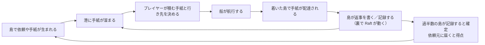
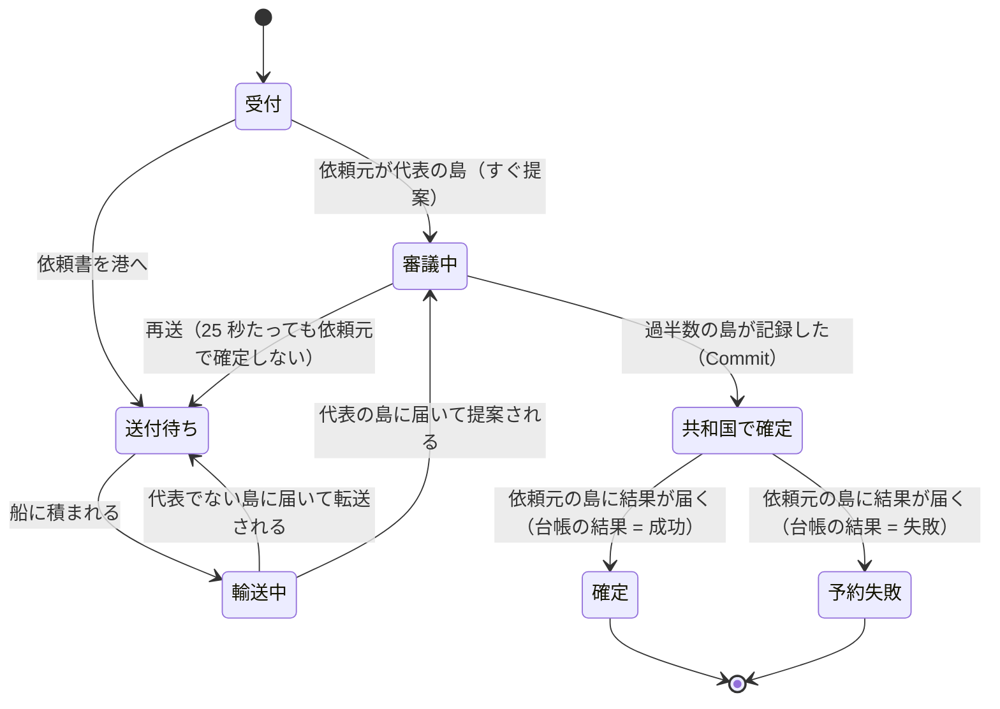
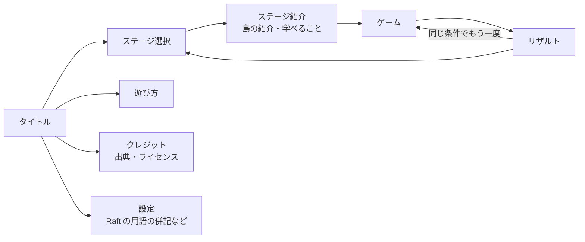

# ゲームデザイン仕様

| 項目 | 内容 |
|---|---|
| 版 | v0.3 |
| 更新日 | 2026-11-07 |
| 状態 | レビュー済み。数値はプレイテストで調整する前提の既定値です |
| 関連 | [進行表](./05-game-progression.md) / [DesignDoc](./03-design-doc.md) / [データ仕様](./07-data-spec.md) |

ゲームのルールと数値を定義します。数値はステージ定義ファイル（[07-data-spec.md §5](./07-data-spec.md)）で上書きでき、ここに書いた値は既定値です。

---

## 1. コアループ



プレイヤーが考えること:

1. **どの船を、どこへ行かせるか**（船の数 < 島の組み合わせの数）
2. **どの手紙を積むか**（積載量 < 港の手紙の数）
3. **どの島を後回しにするか**（多数派だけで確定は進むが、少数派の島の満足度は下がり、選挙も起きる）

---

## 2. 手紙

### 2.1 種類と見た目

色だけに頼らず、**形**でも区別します（NFR-10）。

| ゲーム上の名前 | 色 / 形 | 中身の Raft メッセージ | 意味（遊び方のヘルプに出す説明） |
|---|---|---|---|
| お元気ですか？ | 灰 / ● 丸 | `MsgHeartbeat` | 代表の島からの定期便。届かないと、島は「代表がいなくなった？」と不安になる |
| 元気です！ | 灰 / ◉ 丸に点 | `MsgHeartbeatResp` | 定期便への返事。代表は、この返事で「みんなとつながっている」と確認する |
| この内容を記録して！ | 青 / ■ 四角（記録の件数バッジ） | `MsgApp`（エントリあり） | 代表から、共和国の台帳に書く内容が届く |
| 記録の確認 | 青 / □ 四角（白抜き） | `MsgApp`（エントリなし） | 「ここまで記録できてる？」の確認 |
| 記録したよ！ | 青 / ■✓ | `MsgAppResp`（`Reject=false`） | 記録できたという返事。過半数から届くと確定する |
| 記録が合わないよ… | 青 / ■× | `MsgAppResp`（`Reject=true`） | 手元の記録と食い違っているという返事。代表は、もっと前から送り直す |
| 立候補してもいいかな？ | 赤 / △ 三角（破線） | `MsgPreVote` | 代表と連絡が取れない島からの、立候補前の相談 |
| いいよ！ / まだ代表は元気だよ | 赤 / ▲ 三角（破線）✓ / × | `MsgPreVoteResp` | 相談への返事 |
| 代表に立候補します！ | 赤 / ▲ 三角 | `MsgVote` | 正式な立候補。過半数の票が集まると新しい代表になる |
| あなたに投票します！ / 投票できません | 赤 / ▲✓ / ▲× | `MsgVoteResp` | 投票の返事 |
| 住民の依頼書 | 金 / ★ 星 | （Raft ではない。アプリケーションの手紙） | 住民の依頼を代表の島に届ける |
| その他の手紙 | 白 / ◆ ひし形 | 上記以外 | 通常は発生しない（発生したらサーバーが警告を記録する） |

- 通常画面には「ゲーム上の名前」だけを出します。Raft の用語はエンジニアモードとリザルトの解説にだけ出します
- 手紙には差出人の島と宛先の島が書いてあります（アイコンの縁の色が宛先の島の色）
- 送信元の今の Term より古い Term の手紙は、エンジニアモードでだけ「古い手紙」と表示します
- 「立候補してもいいかな？」「代表に立候補します！」への返事の ✓ / × は、手紙の区分（`label`）に賛否が無いので、通常の画面では描かず、返事の印（↩）で示します。名前は「いいよ！ / まだ代表は元気だよ」のように両方を並べます。賛否はエンジニアモードで見ます
- 色を除いた形・塗り（塗りつぶし / 白抜き）・破線・印（点・✓・×・↩）の組は 12 種類すべてで違います（色が見分けられなくても区別できる。NFR-10）。1 通ずつのアイコンは島の詳細などのパネルに出し、マップには宛先別の山と数だけを描きます

### 2.2 手紙はどこから生まれるか

- **Raft の手紙**: 各島の Raft ノードが出力したメッセージが、そのままその島の港に置かれます。ゲーム側で勝手に作ったり書き換えたりはしません
- **依頼書**: 住民の依頼が発生した島が、代表だと思っている島に宛てて書きます（代表が自分なら書かずに直接記録の提案をします）

### 2.3 港があふれないための規則

港の手紙が増え続けないように、[DesignDoc §6.2](./03-design-doc.md) の規則で古い手紙を処分します。プレイヤーへの見え方は次のとおりです。

- 同じ相手への「お元気ですか？」は、港に 1 通だけ（新しいものに差し替わる）
- 同じ相手への「この内容を記録して！」は 4 通まで。それ以上溜まると古いものから処分される
- 港の手紙（依頼書を除く）は 24 通まで
- **処分と差し替えはアニメーションで見せる（P0、A-12）**
  - 処分された手紙は、港から「海に流れていく」動きで消える（小さく「古い手紙を処分しました」と添える）
  - 差し替えられた手紙は、古い手紙が新しい手紙に入れ替わる動きで見せる（「新しい手紙に差し替わりました」）
  - エンジニアモードでは、処分の理由（`superseded` / `overflow`）も表示する

> 手紙を処分しても、ゲームが壊れることはありません。代表は返事が来なければ、また送り直します（Raft の性質）。

---

## 3. フェリー

### 3.1 パラメータ（既定値）

| 項目 | 既定値 | 備考 |
|---|---|---|
| 積載量 | 4 通 | ステージ・船ごとに設定 |
| 速度の倍率 | 1.0 | 航行時間 = 航路の標準時間 × 倍率 |
| 停泊時間 | 1.5 秒 | 着いてから出航できるまで |
| 運航コスト | 2 秒の航行ごとに 1 点 | §5 |

### 3.2 操作

| 操作 | 条件 | 結果 |
|---|---|---|
| 船を選ぶ | いつでも | 下のフェリー操作パネルにその船が表示される。マップ上で行き先の候補が光る |
| 手紙を積む | 船が港にいる | 港の手紙を空いている積み荷スロットにドラッグ（またはクリック） |
| 手紙を降ろす | 船が港にいる | 積み荷スロットから港へドラッグ。**宛先がその島なら配達、違えば元の港に戻す（同じ島の場合）／中継倉庫に預ける（P1）** |
| おまかせ積み込み | 船が港にいて、行き先を選んでいる | §3.4 の優先度で空きスロットを埋める |
| 出航 | 停泊時間が終わっている、航路が通れる | 行き先へ出発。航行中は操作できない |

降ろす操作の補足: MVP では、積んだ手紙をその港に戻すことだけができます（積み間違いの取り消し）。別の島の港に降ろして預ける「積み替え」は P1 です。

フェリー操作パネルの補足（T-405・[DesignDoc §13.8](./03-design-doc.md)）:

- 行き先は、船のいる島と航路でつながる島から選びます。嵐で止まっている航路も選べ、おまかせ積み込みはできますが、出航はできません
- 停泊の時間が終わるまでは、パネルに「出航まで あと m:ss」と出し、出航のボタンは押せません
- 降ろせるのは、その島で生まれた手紙だけです（MVP。経由して運んできた手紙は降ろせません）
- キーボードでは、手紙のボタンを Enter・Space で押すと積む・降ろすことができます（ドラッグと同じ結果）
- 積めない・出航できないときは、サーバーの理由（積み荷がいっぱい・行き先宛ての手紙がない・嵐など）をパネルに文で出します

### 3.3 到着時

- 積み荷のうち、その島宛ての手紙が自動で配達されます（積んだ順）
- 配達した手紙に対して島が返事を書けば、その返事はすぐにその島の港に並びます。**同じ船で持ち帰れる**のがポイントです（停泊時間の間に積める）
- その島宛てでない手紙は積んだままになります（経由輸送）

### 3.4 おまかせ積み込みの優先度

行き先 D を選んだ状態で押すと、港の手紙のうち D 宛てのものを次の順で積みます。

1. 住民の依頼書
2. 選挙の手紙（立候補・投票とその返事）
3. この内容を記録して！（古い順）
4. 記録したよ！ / 記録が合わないよ…
5. お元気ですか？ / 元気です！

- 同じ順位の中は古い順に積む
- 「記録の確認」（エントリのない `MsgApp`）は 3 に含める
- 「その他の手紙」は最後に積む
- 空きの数まで積み、行き先宛ての手紙がないとき・満載のときは、積めない理由を返す
- すでに積んでいる手紙はそのまま
- 嵐で航路が止まっていても積める

P1 で「D を経由して先の島へ行く手紙も積む」オプションを追加します。

---

## 4. 依頼

### 4.1 種類

| 種類 | 資源 | 成功条件 | 重要度 | 優先 |
|---|---|---|---|---|
| 特別な花火の予約 | ステージに 1〜2 発（各 1 回だけ予約できる） | まだ予約されていない | **重要** | P0 |
| 屋台の出店枠 | 定員つき（例: 3 枠） | 定員に空きがある | 通常 | P0 |
| 共有予算からの支払い | 予算の残高 | 残高が足りる | 通常 | P1 |
| お祭りの予定の更新 | — | 常に成功（後勝ち） | 通常 | P2 |

**重要な依頼**: フェスに欠かせない資源（花火）の予約です。★2 の条件は「すべての重要な資源が予約で確定していること」で、**どの島が予約したかは問いません**。2 つの島が同じ花火を同時に予約しようとすると、先に台帳に適用された 1 件だけが成功し、もう 1 件は「予約失敗」になります（企画書 §5.5 の「1 発しかない花火」を体験させる場面）。

### 4.2 発生

- 各ステージの台本で決めた依頼（決まった時刻・島・種類）と、人口に応じてランダムに発生する依頼の 2 種類
- ランダムな依頼の発生率は島の人口に応じて決まります（式は [07-data-spec.md §4](./07-data-spec.md)）
- 期限: 通常 60 秒、重要 90 秒（発生から）

### 4.3 状態



- 「期限切れ」は状態ではなくフラグです。期限を過ぎても確定はでき、少しだけ得点が入ります
- 島の詳細パネルでは、その島の依頼の状態をアイコンで並べて表示します

---

## 5. スコア

### 5.1 計算式（整数）

```text
スコア = Σ 依頼の得点
       − Σ 期限切れの減点
       − 運航コスト
       + 公平ボーナス（ラウンド終了時）
```

| 項目 | 点数 |
|---|---|
| 通常の依頼が期限内に確定 | +100 |
| 重要な依頼が期限内に確定 | +300 |
| 期限を過ぎてから確定 | +30 |
| 予約失敗（台帳が正しく断った） | 0 |
| 期限切れ（期限の時点で未確定。1 件につき 1 回） | −50 |
| 運航コスト | 1 回の航行ごとに `ceil(航行時間[秒] ÷ 2)` 点 |
| 公平ボーナス | `5 × 全島の満足度の最小値`（最大 +500） |

- 表の点数・係数は Stage 1 の例で、実際の値はステージ定義の `scoring.*`（[データ仕様 §5.2](./07-data-spec.md)）に書きます（`points.normal`・`critical`・`late`・`rejected`・`expiredPenalty`・`ferryCostMsPerPoint`・`fairnessPerSatisfaction`。減点も正の数で書いて引きます）
- 「期限内」は、確定（依頼元の台帳への適用。ADR-0015）の時刻が期限以下（ちょうどを含む）であることです。期限がラウンドの終わり以降の依頼は、期限切れになりません
- 運航コストは出航のときに引きます。1 回の航行ごとに `ceil(航行時間[ms] ÷ ferryCostMsPerPoint)` 点で、航行時間は船の速度を入れた実際の時間です。積み荷が空でも 1 回の航行として数え、出航に失敗した操作では引きません
- 公平ボーナスはラウンドの終わりに 1 回だけ足します
- リザルトの内訳（依頼の得点・期限切れの減点・運航コスト・公平ボーナス）の合計がスコアです

### 5.2 島の満足度

各島に 0〜100 の満足度があり、初期値は 60 です。

| きっかけ | 変化 |
|---|---|
| その島の依頼が確定 | +10 |
| その島の依頼が予約失敗 | −3 |
| その島の依頼が期限切れ | −10 |
| 音信不通（その島に 30 秒間、手紙が 1 通も配達されない） | 以後 10 秒ごとに −2（配達されたら止まる） |

- 増減の値と時間はステージ定義の `satisfaction.*`（`initial`・`succeeded`・`rejectedPenalty`・`expiredPenalty`・`silenceAfterMs`・`silencePenalty`）に書きます。満足度は 0〜100 に丸めます
- 「配達」は、船がその島で、その島宛ての手紙を 1 通以上降ろしたことです。手紙の種類（Raft の手紙か依頼書か）と、島が受け付けたかどうかは問いません。開会式で全島に配達したものとして、最初は時刻 0 から数えます
- 音信不通の減点の時刻は「最後の配達 + `silenceAfterMs`」（1 回目）と、その後 `silencePenalty.everyMs` ごとです（例: 30 秒の時点で −2、40 秒・50 秒…で −2）

**意図**: Raft では多数派の島だけで確定は進みます。それだけだと「少数派の島は放っておく」のが最適解になってしまう（企画書 §7）ため、公平ボーナスを**満足度の最小値**で計算し、どの島も見捨てない運航に価値を持たせます。

### 5.3 クリア条件

| 段階 | 条件 | 演出 |
|---|---|---|
| ★1 クリア | 確定した依頼の数 ≥ ステージの目標数 | 次のステージが解放される |
| ★2 | ★1 ＋ 重要な資源（花火）がすべて確定 | **花火大会**の演出 |
| ★3 | ★2 ＋ スコア ≥ ステージの高得点目標 | 特別な称号 |

★1 に届かなくても、ラウンドは制限時間まで続きます（企画書 §6.4）。

- 「確定した依頼の数」は、期限を過ぎてから確定したものを含み、予約失敗を含みません
- ★はラウンドの終わりの値（公平ボーナスを足した後のスコア）で判定します
- 重要な資源がないステージは、★2 の条件（重要な資源がすべて確定）を満たしたものとします

### 5.4 画面上部の「フェス準備度」

`min(確定した依頼の数 ÷ 目標数, 1)` をゲージで表示し、その横に重要な資源（花火）のアイコンを並べて、確定したものから点灯させます。

---

## 6. イベント

| イベント | 効果 | Raft への影響 | 予告 | 優先 |
|---|---|---|---|---|
| 嵐 | 指定した航路を一定時間、出航できなくする。すでに航行中の船はそのまま進む | 分断が起きる。少数派の側では確定が止まり、孤立した代表は退く | 10 秒前に島のキャラクターが予報 | P0 |
| 欠航 | 計画書の欠航率（利島 17% など）に応じて、その島に接する航路を短時間（10 秒）出航できなくする（[データ仕様 §4.4](./07-data-spec.md)） | 通信が途切れがちな島になる | なし（発生時に、その島の郵便局長が通知 `route.cancelled` で知らせる。§7.3） | P1（Stage 3） |
| 船の故障 | 1 隻を一定時間、出航できなくする（港にいるときに発生し、その場で止まる。港での積み下ろしはできる。発生の時刻に航行中なら、着いたときに壊れ、長さは着いた時刻から数える） | 通信の頻度が落ちて、選挙が起きやすくなる | なし（発生時に通知） | P1 |
| 注文ラッシュ | 複数の島で一斉に依頼が発生する（依頼の数・時刻はステージの台本。島は依頼の島の重み（人口から決めた重み）に比例して、まだ選んでいない島から選び、全部の島を選んだらまた全部の島から選ぶ。種類はランダムな依頼と同じ重み） | ログが一度に伸び、記録の手紙が増える | 5 秒前に通知 | P1 |
| 漂流瓶 | 過去に配達された Raft の手紙の複製が、ある島に流れ着く（その島の港に宛先付きで置かれる。置く港は元の送り主の島で、宛先は元のまま。台本の時刻に、`minAgeMs` 以上前に配達した手紙から、最大 `letters` 通をシードで選ぶ。港の規則で処分されることもある） | 古い Term の手紙・重複した手紙が届いても安全性が保たれることを示す | なし | P1 |
| 代表交代の通知 | Raft の Leader が替わったら、新しい代表の島のキャラクターが挨拶する | なし（Raft の結果を伝える演出だけ） | — | P0 |

嵐の時刻と対象の航路はステージの台本で決めます。「この時間帯のどこか」と幅を持たせた場合は、シードで決まります。

---

## 7. 画面

### 7.1 画面の流れ



### 7.2 メイン画面のレイアウト

```text
┌──────────────────────────────────────────────────────────────────┐
│ ⏱ 2:31   スコア 1,240   確定 5/8   フェス準備 ■■■■□□ 🎆🎆   ⏸ ◀1x▶ [E]│  ← 上部：状況
├────────────────────────────────────────────────┬─────────────────┤
│                                                │ 福江島 👑代表     │
│              マップ（PixiJS）                  │ 満足度 ████░ 72  │
│     海・島・航路・船・手紙の山・嵐の雲         │ ─ 港の手紙 ─     │
│                                                │ → 奈留島 ●■■★     │
│   💬「花火の予約、まだかなあ」（通知）         │ → 中通島 ●▲      │
│                                                │ ─ 依頼 ─         │
│                                                │ ★花火 審議中 0:42│  ← 右：島の詳細
├────────────────────────────────────────────────┴─────────────────┤
│ [⛴ ごとう丸 ⚓福江島 停泊中]  [⛴ しまかぜ → 奈留島 あと 0:04]            │
│ 積み荷 [■ 奈留島][★ 奈留島][  ][  ]   行き先 (奈留島)(中通島)  [おまかせ] [出航] │  ← 下：フェリー操作
└──────────────────────────────────────────────────────────────────┘
```

- 画面上部の `◀1x▶` で速度を 0.5 / 1 / 2 / 4 倍に切り替えます（A-17）。デモ操作が有効なときは、F（押している間 4 倍、Shift で 8 倍）と N（次の出来事まで進める）も使えます
- 島のアイコンの上に、代表（👑）・立候補中（📣）を表示します（Raft の役割を、用語を使わずに見せる）
- 港に溜まっている手紙の数は、島の横のバッジで表示します
- 嵐が来ている航路は、点線と雲で表示します
- 上部の状況には、左から次を並べます
  - 残り時間（秒に切り上げ。残り 2:30.4 は「2:31」。一時停止中は進まない）
  - スコア（負の値もそのまま）
  - 確定した依頼の数 / 目標数（目標数が 0 なら数だけ）
  - フェス準備度（§5.4。ゲージと百分率）と重要な資源（花火）のアイコン。確定したものは点灯し、まだのものは薄く（灰色に）表示します
  - 一時停止（⏸ 一時停止 / ▶ 再開）と速度（`◀ 1x ▶`）のボタン
- 一時停止と速度のボタンは、押すとサーバーにコマンドを送るだけで、表示はサーバーの時計が変わってから変わります（サーバーが正）。押せるのは航行中だけで、送っている間とサーバーにつながっていないときは押せません。断られたときは理由を表示します
- 右の島の詳細には、マップで選んだ島について、上から次を出します（島を選んでいないときは案内の文）
  - 島の名前と自治体名
  - 役割（👑 代表・📣 立候補中・💭 立候補の相談中・一般の島。届いた役割をそのまま出す）
  - 満足度（§5.2。ゲージと数）
  - 港の手紙: 宛先の島ごとの行に、通数と 1 通ずつのアイコン（縁の色が宛先の島の色。10 通まで出し、残りは「+k」）
  - 依頼: 進行中の依頼すべてと、終わった依頼の最後の 3 件。重要なものは ★。資源の名前・状態のアイコンと言葉・残り時間（進行中で期限内のとき）
- 依頼の状態は、アイコンと言葉を必ず両方出します（§4.3）

| アイコン | 言葉 | 状態 |
|---|---|---|
| 📝 | 受付 | `received` |
| 📮 | 送付待ち | `waiting` |
| ⛴ | 輸送中 | `in_transit` |
| 🗳 | 審議中 | `proposed` |
| 📜 | 共和国で確定 | `committed` |
| ✅ | 確定 | `succeeded` |
| ❌ | 予約失敗 | `rejected` |
| ⌛ | 期限切れ | `expired` のフラグ（状態と並べて出す） |

### 7.3 通知（島のキャラクター）

各島に「郵便局長」のオリジナルのキャラクターがいて、出来事を話し言葉で知らせます（Q-08）。

- 名前と口調は、計画書の観光などの記述にちなみます（例：小豆島の「オリーブ局長」、八丈島の「フルーツレモン局長」。どちらも計画書の「オリーブ製品」「八丈フルーツレモン」という記述から）
- 絵は画像生成 AI で作ります（§9）
- 実在のご当地キャラクターは使いません
- 名前・口調・絵のファイルは、ステージ定義の `islands[].postmaster` に持たせます

文言の例:

| きっかけ | セリフの例 |
|---|---|
| 依頼の発生 | 「花火の予約をお願いしたいんだ！」 |
| 確定 | 「やった！ 屋台の枠が取れたよ！」 |
| 予約失敗 | 「えっ、花火はもう他の島が予約してたの？」 |
| 音信不通 | 「最近、だれからも手紙が来ないなあ…」 |
| 立候補 | 「代表と連絡がつかない…わたしが代表に立候補します！」 |
| 代表交代 | 「これからは〇〇島が代表です。よろしく！」 |
| 嵐の予報 | 「10 秒後に〇〇沖が荒れるぞ！」 |
| 孤立した代表が退く | 「みんなの返事が来ない…いったん代表をおります」 |

#### 通知のキー

サーバーの `notice` イベント（[プロトコル §6](./06-protocol.md)）の `key` は、次の表から選びます。セリフはクライアントが `key` と `params` から組み立てます。

| `key` | `params` | セリフ |
|---|---|---|
| `request.created` | `reqId` | 「{資源}の予約をお願いしたいんだ！」 |
| `request.succeeded` | `reqId` | 「やった！ {資源}が取れたよ！」 |
| `request.rejected` | `reqId` | 「えっ、{資源}はもう他の島が予約してたの？」 |
| `request.expired` | `reqId` | 「{資源}、間に合わなかったなあ…」 |
| `island.silent` | なし | 「最近、だれからも手紙が来ないなあ…」 |
| `node.campaign` | なし | 「{代表}と連絡がつかない…わたしが代表に立候補します！」 |
| `leader.elected` | なし | 「これからは{島}が{代表}です。よろしく！」 |
| `leader.stepped_down` | なし | 「みんなの返事が来ない…いったん{代表}をおります」 |
| `storm.forecast` | `routeIds`・`at` | 「{n} 秒後に{海域}が荒れるぞ！」 |
| `rush.forecast` | `at` | 「{n} 秒後に、あちこちの島から注文がどっと来るぞ！」 |
| `ferry.broken` | `ferryId`・`until` | 「{船}が故障してしまった…{n} 秒は港から出られないよ」（{船} は `ferryId` の船の名前で、分からなければ「船」。{n} は `until` から通知の時刻を引いて秒に切り上げたもの（1 以上）で、`until` が無ければ「{n} 秒」を「しばらく」にする） |
| `route.cancelled` | `routeIds`・`until` | 「{海域}の船は欠航だって…{n} 秒は出られないよ」（{海域} は `storm.forecast` と同じく `routeIds` から作る。{n} は `ferry.broken` と同じく `until` から作り、`until` が無ければ「{n} 秒」を「しばらく」にする） |

- {資源}: `reqId` の依頼の資源の名前。分からなければ「依頼」
- {島}: 通知を出した島（`islandId`）の名前
- {代表}: 「代表」。Raft の用語の併記がオンなら、1 つのセリフの中で最初の 1 か所だけ「代表（Leader）」にします
- {n}: `at` から通知の時刻を引いて秒に切り上げたもの（1 以上）。`at` が無ければ、文の頭を「まもなく」にします
- {海域}: 航路ごとに「〇〇島と△△島の間」を「、」でつなぎます。分からなければ「どこかの海」
- 知らない `key` の通知は表示しません。形の違う `params` は上の既定の言葉で埋めます
- 表示は新しい 3 件までで、ゲーム内の 10 秒たつと消えます（一時停止中は消えない）
- 話し手は、島に `postmaster`（`snapshot` の `stage.islands[].postmaster`）があれば「〇〇島の{名前}」（例：「小豆島のオリーブ局長」）、無い・名前が空白だけのときは「〇〇島の郵便局長」です。絵が届くまでは（T-414）、絵の代わりに島の色の丸に島の名前の頭文字を出します
- セリフの言い回しは、郵便局長の口調（`tone`）で変えます（下の「口調ごとのセリフ」）。`postmaster` が無い島と、知らない `tone` は `casual` です
- サーバー（セッション）が出すきっかけ: Engine のイベントを観察して作り、きっかけのイベントの直後に入れます（Engine には何も返しません）
  - `request.created`: `request.created`（話すのは依頼元。`request.*` の 4 つは同じ）。`request.succeeded`・`request.rejected`: `request.updated` の `status` が `succeeded`・`rejected` になった。`request.expired`: `request.updated` の `expired` が真になった（確定と同じイベントなら期限切れを先に出す）
  - `island.silent`: `island.updated` の時刻が `lastDeliveredAt` から `satisfaction.silenceAfterMs` 以上たっている（話すのはその島）
  - `node.campaign`: `node.state` の `role` が `candidate` になった（話すのはその島）。開会式の間と `pre_candidate` では出さず、`candidate` のまま Term が上がっても出さない
  - `leader.elected`: `node.leader_elected`（開会式の最初の代表も出す）。`leader.stepped_down`: `node.stepped_down` の `reason` が `check_quorum`（`higher_term` は新しい代表の `leader.elected` が出るので出さない）
  - `storm.forecast`: `forecast` の `event` が `storm`（話すのは、嵐の航路 `A-B` の `A` のうち最小の島）
  - `rush.forecast`: `forecast` の `event` が `rush`（話すのは、`islandIds` のうち最小の島。無ければ出さない）
  - `ferry.broken`: `ferry.broken`（話すのは、その船が停泊している島。分からなければ出さない）。同じ船の故障が延びた 2 回目の `ferry.broken` でも出す
  - `route.cancelled`: `route.blocked` の `cause` が `cancellation`（話すのは `islandId` の島。範囲の外なら出さない）。同じ島の欠航が延びた 2 回目の `route.blocked` でも出す。嵐で既にもっと長く止まっていて `route.blocked` が出なかったときは出さない。嵐の `route.blocked` では出さない
  - 同じ出来事で 2 回出しません（同じ依頼の確定・期限切れ、同じ音信不通の間）。つなぎ直した後（`snapshot` を送った後）は、それより前の出来事の通知を出しません

#### 口調ごとのセリフ

郵便局長の口調のキーは `casual`（くだけた話し方）・`polite`（です・ます）・`elder`（年配の話し方。「〜じゃ」「〜のう」）の 3 つです（データ仕様 §5.4 の `islands[].postmaster.tone`。T-406c）。`casual` は上の「通知のキー」の表のセリフと同じです。{資源}・{島}・{代表}・{n}・{海域} の作り方は上と同じで、{代表} の併記はどの口調でも最初の 1 か所だけです。`{lead}` は「{n} 秒後に」か「まもなく」です。方言の口調は、実在の地域の言葉を正しく書けるかを確かめる手段がないため作りません。

| `key` | `casual` | `polite` | `elder` |
|---|---|---|---|
| `request.created` | {資源}の予約をお願いしたいんだ！ | {資源}の予約をお願いします！ | {資源}の予約を頼みたいんじゃ！ |
| `request.succeeded` | やった！ {資源}が取れたよ！ | やりました！ {資源}が取れました！ | やったのう！ {資源}が取れたぞい！ |
| `request.rejected` | えっ、{資源}はもう他の島が予約してたの？ | えっ、{資源}はもう他の島が予約していたのですか？ | なんと、{資源}はもう他の島が予約しておったのか？ |
| `request.expired` | {資源}、間に合わなかったなあ… | {資源}、間に合いませんでした… | {資源}、間に合わなんだのう… |
| `island.silent` | 最近、だれからも手紙が来ないなあ… | 最近、だれからも手紙が来ません… | 近ごろ、だれからも手紙が来んのう… |
| `node.campaign` | {代表}と連絡がつかない…わたしが代表に立候補します！ | {代表}と連絡がつきません…わたくしが代表に立候補いたします！ | {代表}と連絡がつかん…わしが代表に立候補するぞい！ |
| `leader.elected` | これからは{島}が{代表}です。よろしく！ | これからは{島}が{代表}です。よろしくお願いします！ | これからは{島}が{代表}じゃ。よろしく頼むぞい！ |
| `leader.stepped_down` | みんなの返事が来ない…いったん{代表}をおります | 皆さんの返事が来ません…いったん{代表}をおります | みなの返事が来ん…いったん{代表}をおりるとしよう |
| `storm.forecast` | {lead}{海域}が荒れるぞ！ | {lead}{海域}が荒れます！ | {lead}{海域}が荒れるぞい！ |
| `rush.forecast` | {lead}、あちこちの島から注文がどっと来るぞ！ | {lead}、あちこちの島から注文がどっと来ます！ | {lead}、あちこちの島から注文がどっと来るぞい！ |
| `ferry.broken` | {船}が故障してしまった…{n} 秒は港から出られないよ | {船}が故障してしまいました…{n} 秒は港から出られません | {船}が故障してしもうた…{n} 秒は港から出られんのう |
| `route.cancelled` | {海域}の船は欠航だって…{n} 秒は出られないよ | {海域}の船は欠航です…{n} 秒は出られません | {海域}の船は欠航じゃ…{n} 秒は出られんのう |

リポジトリのステージの郵便局長（`data/stages/*.yaml`）は、小豆島の「オリーブ局長」と八丈島の「フルーツレモン局長」だけが計画書の記述にちなむ名前（`derived`）で、ほかの島は海や空の言葉からの創作（`creative`。例：豊島の「しおさい局長」）です。同じ島は、どのステージでも同じ郵便局長です。

### 7.4 エンジニアモード

E キーで切り替えます。通常画面の上に重ねて表示します。

| 表示 | 内容 | 優先 |
|---|---|---|
| ノード一覧 | 島ごとに 役割 / Term / Vote / Lead / Commit / Applied / Last Index | P0 |
| 手紙の詳細 | 手紙をクリックすると、Raft メッセージの全フィールド | P0 |
| メッセージ種別の重ね書き | マップ上の手紙や船に `MsgApp` などの種別を表示 | P1 |
| ログの表示 | 選んだノードのログ（index・term・内容）。Commit 済み／未 Commit を色分け | P1 |
| Progress | Leader から見た各 Follower の Match / Next / 状態（Probe・Replicate） | P1 |
| 分断の表示 | 嵐で航路が止まり、島がいくつかのグループに分かれている間は、エンジニアモードに関係なくマップにグループ（A・B…）の縁取りと、隅に凡例（グループの島・島の数・過半数の島がつながっているか）を出す。グループはいま通れる航路から求めた連結成分（FR-ENG-08） | P1 |
| タイムライン | Term の変化・Leader の交代・Commit の時系列 | P1 |
| 選挙タイムアウトの推定 | 「あと何秒で選挙を始めそうか」（推定値） | P2 |

P0 の表示の決まり（T-407）:

- 切り替えは E キーと画面の隅のボタン。入力欄にフォーカスがあるとき・修飾キー（Ctrl / Cmd / Alt）と一緒のとき・押しっぱなし・IME の変換中は、E で切り替えません。開いてもゲームは止まりません（フォーカスも動かさない）
- ノード一覧の値は `node.state` のまま出します（Leader を 1 つに絞らない。嵐の間は Leader が 2 行ありえます）。**Vote は、選んでいるノードの `node.detail` が届いたときだけ表示し、ほかのノードは「—」**です（`node.state` に Vote が無いため）。Vote・Lead が 0（None）は「—」
- 詳細を見るノードは、島の詳細と共有の選択（選んでいる島）です。選んでいなければ Leader、いなければ ID の最も小さいノード。パネルを開いている間だけ `sub.engineer` で購読し、閉じたら購読をやめます（古い `node.detail` も消す）
- 手紙の詳細は、パネルの中に並べた「選んだ島の港」「選んだ船の積み荷」の手紙から選びます。欄（Type / From / To / Term / LogTerm / Index / Commit / Reject / RejectHint / Entries / Stale）と、配達・処分された後も消える直前の値を出します。「古い手紙」の印（stale）はここでだけ出します（§2.1）
- エンジニアパネルは「Raft の用語を併記する」の設定に関係なく、常に Raft の用語で出します（§8）

P1 の表示の決まり（メッセージ種別の重ね書き）:

- エンジニアモードを開いている間だけ、港の手紙の山と船の下に、中の手紙のメッセージ種別と数の札を出します（`MsgApp ×3` など。依頼書は「依頼書」）。種類は 3 行まで、残りは「+n 種」
- 古い手紙（stale）の数も札に出します（§2.1 の「古い手紙」の印は、エンジニアモードの中でだけ出す）
- 札はサーバーの手紙の値（`raft.type`・`raft.stale`）のままで、クリックでは選べません（選ぶのは島と船）

### 7.5 リザルト画面

- スコアと★、内訳（依頼の得点・期限切れ・運航コスト・公平ボーナス）
- 技術的な結果: 確定した依頼の数 / 配った手紙の数（種類別）/ Leader の交代回数 / 平均 Commit Latency / 最長の音信不通 / 各島の最終ログ（index・term の帯で表示）
- **「今日のプレイで起こった分散システムの出来事」**: トレースから、決まった型の文章を組み立てます（MVP は台本型）
  - 例: 「1:12 に嵐で福江島が孤立しました。福江島は過半数と連絡が取れなくなったので、自分から代表を降りました（CheckQuorum）。1:31 に奈留島が Term 3 の新しい代表に選ばれました（Leader Election）。福江島に残っていた古い Term の手紙は、届いても無視されました。」
  - 文はサーバーが次の型から組み立てる（T-208）。`{島}` は島の名前、`{資源}` は資源の表示名（ステージ定義の `resources[].label`）。各項目には時刻（`t`）と、文に出てくる Raft の概念（`concepts`）を付ける

    | 出来事 | 条件 | 文 | concepts |
    |---|---|---|---|
    | 嵐（`storm`） | すべての航路が止まった島がある | 嵐で{孤立した島を「・」でつないだもの}が孤立しました。 | `["Network Partition"]` |
    | 嵐（`storm`） | すべての航路が止まった島が無い | 嵐で{航路ごとの「{A}と{B}の間」を「、」でつないだもの}の航路が止まりました。 | `["Network Partition"]` |
    | 代表が退いた（`stepped_down`） | 理由が `check_quorum` | {島}は過半数の島と連絡が取れなくなったので、自分から代表を降りました。 | `["CheckQuorum"]` |
    | 代表が退いた（`stepped_down`） | 理由が `higher_term` | {島}は、もっと新しい任期（Term）の手紙を受け取ったので、代表を降りました。 | `["Term"]` |
    | 新しい代表（`leader_elected`。開会式の後） | — | {島}が Term {Term} の新しい代表に選ばれました。 | `["Leader Election"]` |
    | 最初に確定した依頼（`first_commit`） | — | {島}の{資源}の依頼が過半数の島の台帳に記録され、共和国で確定しました。 | `["Log Replication", "Commit", "Quorum"]` |
    | 最初の予約失敗（`rejected`） | 理由が `already_reserved` | {島}の{資源}の予約は、先に別の予約が確定していたので取れませんでした。どの島の台帳も同じ順に記録するので、結果はどの島でも同じです。 | `["Replicated State Machine"]` |
    | 最初の予約失敗（`rejected`） | 理由が `full` | {島}の{資源}の予約は、先に確定した予約で枠が埋まっていたので取れませんでした。どの島の台帳も同じ順に記録するので、結果はどの島でも同じです。 | `["Replicated State Machine"]` |
    | 最初の重複した記録（`duplicate`） | — | {島}の役場が{資源}の依頼を送り直したので、同じ依頼が台帳に 2 回記録されました。2 回目は処理済みとして扱われ、二重に予約されませんでした。 | `["Idempotency"]` |
    | 最初に届いた古い任期の手紙（`stale_ignored`） | — | {島}が出した古い任期（Term {Term}）の手紙が届きましたが、受け取った島は無視しました。 | `["Term"]` |
    | 最初に断られた立候補の相談（`prevote_rejected`） | — | {島}は代表と連絡が取れず、立候補してよいかほかの島に相談しましたが、断られました。 | `["PreVote"]` |
    | 最長の音信不通（`silence`） | 採点するステージで、最長の音信不通が音信不通の判定の時間以上 | {島}には {秒（切り捨て）} 秒のあいだ、手紙が 1 通も届きませんでした。 | `["Heartbeat", "Election Timeout"]` |

  - 時刻の昇順に並べる（同じ時刻は起こった順。最長の音信不通はその時刻の最後）
  - 種類ごとの上限: 嵐・代表が退いた・新しい代表は 2 件、ほかは 1 件（時刻の早いものから。合計は最大 12 件）。リザルト画面を読める長さにするための表示の決まりで、ゲームの調整値ではない
  - 名前が無いときは、島は「島 {ID}」、資源は資源の ID のまま。文にできない出来事（上の表にない理由の予約失敗など）は出さない
- ボタン: 同じ条件でもう一度 / 次のステージ / ステージ選択 / 記録をダウンロード（P1）

### 7.6 デモ操作のキー

キーと動きの表は [進行表 §8](./05-game-progression.md) の「デモ操作」が正本です（D 嵐・F 早送り・N 次の出来事まで進める・Space 一時停止）。ここには、画面での細かい動きを書きます（T-411）。

- **デモのセッションだけで有効**: `demo` モードの Worker で始めたゲーム（`snapshot` の `session.demo` が真）だけでキーを受け付け、画面の左下の隅に操作の一覧（D・F・N・Space とその説明）を重ねます。デモでないセッションでは一覧を出さず、キーも受けません（Space の一時停止は、デモでないセッションでも §7.7 のショートカットで使えます）
- **航行中だけ使える**: 開会式の前・終了の後や、サーバーにつながっていないときは送らず、一覧を薄く表示します
- **F（早送り）**: 押したときの速度を覚え、押している間は 4 倍速、Shift を押している間は 8 倍速にします（F → Shift の順に押しても 8 倍速になり、Shift を離すと 4 倍速に戻ります）。F を離すと（ウィンドウのフォーカスが外れたときも）押したときの速度に戻します。押している間に HUD のボタンで速度を変えても、離すと押したときの速度に戻ります。押したときすでに 4 倍速なら、押しても離しても送りません。8 倍速を選べないサーバーでは Shift+F も 4 倍速です。押している間は「早送り中 ×4」「早送り中 ×8」と出します
- **N（次の出来事まで進める）**: 次の到着・出来事まで進めると、サーバーが一時停止にします。続けて Space を押すと再開します
- **Space（一時停止・再開）**: いまの状態の逆を送ります。表示は、サーバーの時計が変わってから変わります
- **受けないとき**: 入力欄にフォーカスがあるとき・Ctrl / Cmd / Alt と一緒のとき・押しっぱなし（キーの繰り返し）・IME の変換中は、どのキーも受けません。ボタンなどにフォーカスがあるときの Space は、デモ操作にせずボタンを押します（D・N・F は受けます）。D・N・Space は、前の結果が届くまで次の押下を無視します
- **操作できなかったとき**: 一覧の下に理由を出します（「いまは嵐を起こせません。」「操作が多すぎます。少し待ってください。」「次の出来事まで進められませんでした。」「サーバーにつながっていないため、一時停止・再開できませんでした。」など）。次に操作が成功すると消えます

### 7.7 キーボードショートカット

ゲーム画面では、デモでないセッションでも次のキーが使えます（FR-UI-09・T-702）。キーは押した位置（`event.code`）で判定し、キーボードの配列・IME のオン・CapsLock に左右されません。

| キー | 動き | 使えるとき |
|---|---|---|
| Space | 一時停止・再開（いまの状態の逆を送る） | 航行中だけ。デモのセッションでは §7.6 のデモ操作が受ける |
| 1〜4（テンキーを含む） | 船を選ぶ（フェリー操作パネルの左から順） | どのフェーズでも。デモのセッションでも |
| E | エンジニアモードを開く・閉じる | いつでも |

- **受けないとき**: 入力欄にフォーカスがあるとき・Ctrl / Cmd / Alt と一緒のとき・押しっぱなし（キーの繰り返し）・IME の変換中は、どのショートカットも効きません。Shift は見ません（Shift+1 も船 1）。ボタンなどにフォーカスがあるときの Space は、一時停止にせずボタンを押します（1〜4 は効きます）
- **デモのセッションの Space**: §7.6 のデモ操作が受け、このショートカットは受けません（同じ押下で 2 回切り替えないため）
- **Space（一時停止・再開）**: 航行中で、サーバーにつながっているときだけ送ります。開会式の前・終了の後・サーバーにつながっていないときは送らず、ページの既定の動きのままにします。前の結果が届くまで次の押下を無視します。表示は、サーバーの時計が変わってから変わります。操作できなかったときは、HUD のボタンと同じ文（「いまは一時停止・再開できません。」など）を支援技術向けに読み上げます
- **1〜4（船を選ぶ）**: 選ぶだけで、サーバーには送りません。その番号の船が無ければ何もしません（船が 2 隻なら 3・4 は無視）。5 隻目以降はタブかマップで選びます。すでに選んでいる船の番号を押しても、選んだままです。選んだ船の名前を「{船の名前}を選びました」と読み上げます
- フォーカスは動かしません。キーの一覧は遊び方の画面に書きます

---

## 8. 用語の出し分け

| 場面 | 使う言葉 |
|---|---|
| 通常画面・通知（既定） | 代表、立候補、投票、記録、確定、手紙、定期便 |
| 通常画面・通知（設定で「Raft の用語を併記する」をオン） | 「代表（Leader）」「記録したよ！（MsgAppResp）」のように、Raft の用語を小さく併記する |
| ヘルプ（遊び方） | 上記 ＋ ステージをクリアした後に「実はこれは…」という一言の種明かしを解放する |
| エンジニアモード・リザルトの解説 | Leader / Follower / Candidate、Term、Log、Commit、Quorum、Heartbeat、Election Timeout、各 `Msg*` |

- 既定は Raft の用語を隠し、種明かしの驚きを大事にします（企画書 §16 ④）
- 設定画面の「Raft の用語を併記する」は、学習目的の人や 2 回目以降に遊ぶ人のためのものです。設定はブラウザ（localStorage）に保存します（Q-10）

対応表は [10-glossary.md](./10-glossary.md)。

---

## 9. 素材（画像・音）

| 対象 | 作り方 |
|---|---|
| 手紙・船・代表のマーク・嵐など、遊ぶうえで意味を持つもの | PixiJS の図形と絵文字。色と形の両方で区別する（§2.1） |
| 島の郵便局長、タイトル画面、ステージ紹介の背景などの装飾 | 画像生成 AI |
| 効果音（出航・到着・確定・処分・嵐・花火） | 生成ツールなどで作る |
| BGM | MVP では使わない |

素材は後から差し替えられる作りにします。出典とクレジットの扱いは [データ仕様 §7](./07-data-spec.md) にあります。PLATEAU の 3D 都市モデルは、今回の島に整備されていないため使いません（[R-09](./09-assumptions-and-open-questions.md#r-09)）。

