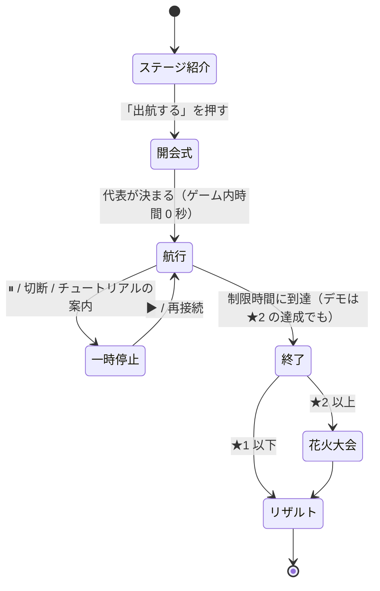

# ゲームの進行表

| 項目 | 内容 |
|---|---|
| 版 | v0.4 |
| 更新日 | 2026-11-07 |
| 状態 | レビュー済み。時刻はプレイテスト前の見込みです |
| 関連 | [ゲームデザイン仕様](./04-game-design.md) / [データ仕様（ステージ定義）](./07-data-spec.md) / [判断の記録 A-05・A-07・A-17](./09-assumptions-and-open-questions.md) |

この文書は「プレイヤーがどの順番で何を体験するか」を、ステージ単位とラウンド内の時刻単位で決めたものです。各表の「裏側（Raft）」の列は、その時点で Raft の内部で起きていると想定していることです。実装後は `simcli` とボット船長で想定どおりになるかを確かめ、ずれたらパラメータか表のほうを直します。

時刻はすべて**ゲーム内時間**です。早送り（A-17）をしても、ゲーム内時間で見た展開は変わりません。

---

## 1. 全体の進行（ステージ一覧）

| | Stage 1 | Stage 2 | Stage 3 | Stage 4 |
|---|---|---|---|---|
| タイトル | はじめての郵便船 | 島から返事が来ない！ | 嵐の離島共和国 | 全国しまじま大作戦 |
| 優先度 | **P0** | **P0** | P1 | P2 |
| 舞台 | 瀬戸内（香川県） | 五島列島（長崎県） | 伊豆諸島（東京都） | 全国 |
| 島（最初の代表を先頭に） | 小豆島・豊島・直島 | 福江島・奈留島・中通島 | 大島・利島・三宅島・御蔵島・八丈島・青ヶ島 | 佐渡島・利尻島・島後・八丈島・直島・対馬島・福江島 |
| 島の数 / 過半数 | 3 / 2 | 3 / 2 | 6 / 4 | 7 / 4 |
| 航路の形 | 一直線（小豆島—豊島—直島） | 三角形 | フルメッシュ（6 島のすべての組。[ゲームデザイン §3.5](./04-game-design.md)。T-718 #300） | 全国を結ぶ架空の航路網 |
| フェリー | 1 隻 | 2 隻 | 6 隻（計画書に載っている船名。各島に 1 隻） | 4 隻 |
| 制限時間 | 180 秒 | 210 秒 | 240 秒 | 240 秒 |
| 選挙タイムアウト | 60〜120 秒 | 20〜40 秒 | 25〜50 秒 | 20〜40 秒 |
| データの使い方 | 航行時間を計画書の所要時間から換算 | 人口の差、「台風等の自然災害」の記述 | 欠航率（利島 17%・御蔵島 41%・青ヶ島 41%）、島どうしのつながり、船の名前、台風の被害の記録 | 人口の大きな差（10 倍以上） |
| 新しく登場する要素 | 船の操作、積み込み、往復、確定、経由輸送、立候補の相談（終盤） | 2 隻の使い分け、選挙、嵐、花火の取り合い | 6 島（偶数）、分断（多数派と少数派）、欠航、積み替え（P1） | 7 島、故障、注文ラッシュ、漂流瓶、人口による負荷の偏り |
| 裏側で学べること | Log Replication、Commit、Quorum、（PreVote） | Heartbeat、Election Timeout、Leader Election、CheckQuorum | Network Partition、Quorum、可用性、偶数台のクラスタの弱点 | 運用、障害復旧、通信と合意のトレードオフ |
| ★1（確定数） | 3 | 2 | 3 | 10 |
| ★2 | 花火 1 発が確定 | 花火 2 発が確定 | 花火 2 発が確定 | 花火 3 発が確定 |
| ★3（スコア） | 1,150 | 1,400 | 480 | 2,800 |
| 解放条件 | 最初から | Stage 1 で★1 | Stage 2 で★1 | Stage 3 で★1 |

デモ用のステージは、五島版（`demo-goto`、メイン）と伊豆版（`demo-izu`、サブ）の 2 つを用意します（§8）。

---

## 2. ラウンドの流れ（全ステージ共通）

| フェーズ | 長さ | 画面 | サーバー |
|---|---|---|---|
| ステージ紹介 | プレイヤー次第 | 島の紹介（出典区分つき）、学べること（Stage 1 は伏せる）、フェリーの数 | セッションを作り、**コンテナの起動を始める**（A-03 補足。起動待ちをこの間に隠す） |
| 開会式 | 約 3 秒の演出 | 「代表に〇〇島が選ばれました」 | Bootstrap → `Campaign()` → 即時配達で選挙を完了（ゲーム内時間は進めない）。[DesignDoc §5.3](./03-design-doc.md) |
| 航行 | 制限時間 | メイン画面。速度は 0.5 / 1 / 2 / 4 倍を選べる | 50ms ごとに `RunUntil` |
| 終了 | — | 操作を止め、「終了！」 | ラウンド終了のイベント。統計を計算し、Durable Object に結果を保存 |
| 花火大会 | 約 8 秒の演出 | 確定した花火が順に打ち上がる | — |
| リザルト | プレイヤー次第 | [04-game-design.md §7.5](./04-game-design.md) | `Result()` |

切断で止まったときだけ、つなぎ直すと自動で再開する。プレイヤーが止めたとき・次の出来事まで進めたとき（デモ）・コンテナから復元したときは、▶ を押すまで止まったまま（T-303。[DesignDoc §12.4](./03-design-doc.md#124-セッションループgo)）。

---

## 3. Stage 1「はじめての郵便船」（瀬戸内）— 進行表

**ねらい**:
- 手紙は「届けて終わり」ではなく、**返事を持ち帰って初めて確定する**ことを体感させる
- 3 島のうち 1 島から返事をもらえば確定する（過半数）ことに気づかせる
- 遠い島（直島）には、近い島（豊島）を**経由して**手紙を運ぶ
- 終盤、放っておかれた島が「立候補してもいいかな？」と相談を始める様子を軽く見せる（A-07）

**配置**:
- 小豆島（代表・フェリー「せとうち丸」の母港）、豊島、直島
- 航路は 2 本で、計画書の所要時間から換算した値です（[データ仕様 §4.3](./07-data-spec.md)）
  - 小豆島–豊島：3.75 秒
  - 豊島–直島：5.25 秒
- 小豆島と直島の間に直接の航路はありません
- せとうち丸の積載量は 6 通です（T-501i #350 で 4 通から増やした）
- 依頼の期限は、通常 90 秒・重要 120 秒です（ほかのステージの 60 秒・90 秒より長い。T-501i #350）

| ゲーム内時刻 | 出来事（画面） | 裏側（Raft） | プレイヤーに期待する操作 | チュートリアル / 通知 |
|---|---|---|---|---|
| 開会式 | 「小豆島が代表に選ばれました」 | 小豆島が `Campaign()` → 当選。空のエントリを全ノードに複製 | — | T1「あなたは郵便船の船長です」 |
| 0:00 | 小豆島の港に「お元気ですか？」が 2 通 | Leader が Heartbeat を出し始める（1 秒ごと。港では相手ごとに 1 通に合流） | — | — |
| 0:05 | 小豆島で「屋台の予約」の依頼 | 小豆島は Leader なので直接 `Propose` → `MsgApp` が豊島宛て・直島宛てに 1 通ずつ | 「記録して！」（豊島宛て）を積んで豊島へ | T2「港の手紙を船にドラッグしよう」→ T3「行き先を選んで出航」 |
| 0:09 頃 | 豊島に到着・配達 | 豊島がログに追記 → `MsgAppResp` を小豆島宛てに出す | 「記録したよ！」を積んで小豆島へ戻る | T4a「返事を代表まで運び返さないと確定しないよ」・T4「返事が出たよ。通り道の島でも積んでから出航しよう」 |
| 0:14 頃 | 小豆島に到着 → **確定！**（初めての得点） | 小豆島と豊島の 2/3 が記録 → Commit → 小豆島の台帳に適用。依頼元が小豆島なので、すぐに「確定」 | — | T5「3 つの島のうち 2 つが記録すれば決まるよ」（過半数のヒント） |
| 0:30 | 直島で「花火の予約」（**重要**） | 直島は Follower なので、依頼書を小豆島宛てに書く | 豊島を経由して直島へ行き、依頼書を受け取って小豆島へ | T6「依頼書は代表（👑）の島へ。直島へは豊島を経由して行こう」 |
| 0:55 頃 | 依頼書が小豆島に届く → 審議中 | 小豆島が `Propose` → 豊島宛て・直島宛ての `MsgApp` が新たに出る | 豊島へ「記録して！」を運び、返事を持ち帰る | — |
| 1:05 頃 | 小豆島で「共和国で確定」。ただし直島ではまだ「審議中」のまま | Commit されたが、直島は Commit Index をまだ知らない | 直島へ手紙（定期便か記録）を届ける | T7「依頼した島に結果を届けるまでが仕事だよ」 |
| 1:20 頃 | 直島で**確定**、花火のアイコンが点灯 | 直島が Commit Index を知り、台帳に適用 | — | — |
| 1:00〜2:30 | 豊島・小豆島・直島で通常の依頼が 4 件（台本） | 同上の繰り返し | 小豆島⇄豊島の往復に、ときどき直島までの便を混ぜる | T8（任意）「近い豊島を経由すると、直島への手紙も一緒に運べるよ」 |
| 1:30 頃〜 | 直島に 30 秒、手紙が届いていなければ満足度が下がり始める | — | — | 「最近、だれからも手紙が来ないなあ…」 |
| 直島を 60〜120 秒放置したとき（任意の時刻） | 直島の港に「立候補してもいいかな？」が出る | 直島が選挙タイムアウト → PreCandidate → `MsgPreVote`。届けても、代表と連絡が取れている小豆島・豊島は断る（リース） | 直島にも定期便を届ける | T9「直島が代表と連絡がつかなくて不安になっています。定期便も届けてあげよう」 |
| 3:00 | 終了 | — | — | — |

**依頼の台本（Stage 1）**:

| 時刻 | 島 | 依頼 |
|---|---|---|
| 0:05 | 小豆島 | 屋台 |
| 0:30 | 直島 | 花火（重要） |
| 1:00 | 豊島 | 屋台 |
| 1:20 | 小豆島 | 屋台 |
| 1:45 | 直島 | 屋台 |
| 2:10 | 豊島 | 屋台 |

- ランダムな依頼はありません
- 屋台の定員は 5 です（Stage 1 では予約失敗を出さない）

**クリアの見込み**: 初めて遊ぶ人がクリアできる難しさにします（T-501f #311）。値は、上手な人の代わりのボット `greedy` ではなく、初心者の代わりのボット `novice`（[ゲームデザイン §5.5](./04-game-design.md#55-ステージの難しさの決め方)）で決めます。シード 1〜200 で次を満たすことを、ビルドタグ `balance` のテスト（`server/internal/stage/repo_greedy_balance_test.go`）で確かめます。

| ボット | 条件 | 結果（目標 3 件・★3 1,150・積載 6 通・期限 90 秒／重要 120 秒） |
|---|---|---|
| `novice`（初心者） | ★1 の割合が 80% 以上 | 200 / 200（確定はどのシードも 3 件・スコア 440） |
| `random`（ランダム） | ★1 の割合が 30% 以上 | 114 / 200（★2 が 42。★3 は 0） |
| `greedy`（上手な人） | ★3 に届く割合が 90% 以下（伸びしろを残す） | 0 / 200（★2 が 200。確定はどのシードも 6 件・スコア 1,114） |
| `steady` | （参考） | ★2 が 200 / 200（スコア 1,114） |

- T-501i（#350）で、オーナーの指示により Stage 1 だけを易しくしました。積載量を 4 → 6 通、依頼の期限を通常 60 → 90 秒・重要 90 → 120 秒に延ばしました。やり直しの間隔（25 秒）・制限時間（180 秒）・★1 の目標（3 件）・港の上限は変えていません
- 積載と期限を変えると `greedy` のスコアが 346 → 1,114 に上がり、★3 900 では 200 / 200 が★3 に届いたため、★3 を 900 → 1,150 に上げました（`greedy` より運航を減らすか満足度を高く保てば届く）
- 変更の前（積載 4 通・期限 60 秒／重要 90 秒・★3 900）は、`novice` の★1 が 200 / 200（スコア 220）、`random` の★1 が 91 / 200、`greedy`・`steady` は★2 が 200 / 200（スコア 346）でした
- T-501f（#311）では★1 の目標を 4 → 3 件に下げました。目標 4 件のとき、`novice` の★1 は 0 / 200、`random` は 24 / 200 でした
- `novice` は経由の手紙を積まないので、直島の依頼（依頼書を豊島経由で小豆島へ運ぶ）は確定しません。チュートリアル（T6・T8）で経由の運び方を覚えれば、4 件以上に届きます

---

## 4. Stage 2「島から返事が来ない！」（五島列島）— 進行表

**ねらい**:
- 定期便が途切れると、島が立候補を始めることを体験させる
- 代表が孤立すると自分から退き、残った過半数で新しい代表が選ばれることを体験させる
- 花火の取り合いで「1 つの資源は 1 回しか確定しない」ことを見せる

**配置**:
- 島：福江島（代表）、奈留島（福江島に近い）、中通島（福江島から遠い）
- 航路（ゲーム上の設定）
  - 福江島–奈留島：4 秒
  - 奈留島–中通島：6 秒
  - 福江島–中通島：9 秒
- フェリー

  | 船 | 母港 | 積載量 | 速度 |
  |---|---|---|---|
  | ごとう丸 | 福江島 | 4 通 | 1.0 |
  | しまかぜ | 奈留島 | 3 通 | 0.8（速い） |

- 選挙タイムアウト：20〜40 秒

| ゲーム内時刻 | 出来事（画面） | 裏側（Raft） | プレイヤーに期待する操作 | 通知 |
|---|---|---|---|---|
| 開会式 | 福江島が代表に | — | — | — |
| 0:10 | 中通島・屋台 | 依頼書 → 福江島 | 2 隻で分担（例: ごとう丸は福江島⇄奈留島、しまかぜは奈留島⇄中通島） | — |
| 0:20 | 福江島・**花火 A**（重要） | 福江島が `Propose` | — | — |
| 0:35 | 奈留島・屋台 | — | — | — |
| 0:45 | 中通島・**花火 A**（取り合い） | 2 件目の花火 A の提案。先に適用されたほうだけ成功 | — | 後から適用されたほうは「えっ、花火はもう他の島が…」 |
| 0:50 | **嵐の予報**「10 秒後に福江島のまわりが荒れるぞ！」 | — | 福江島にいる船を逃がすか、手紙を持たせて出しておく | 予報（題材は計画書の「台風等の自然災害の影響を受けやすい」） |
| 1:00 | **嵐**：福江島に接する 2 本の航路が 40 秒間出航できない | 福江島が孤立。福江島の Heartbeat が届かなくなる | 奈留島⇄中通島の間で船を動かし続ける | 「福江島に行けない！」 |
| 1:00〜1:20 | 福江島の代表マーク（👑）が消える | 福江島（Leader）は `CheckQuorum` で、選挙タイムアウトの間に過半数から返事がないので Follower に戻る | — | 「みんなの返事が来ない…いったん代表をおります」 |
| 1:20〜1:40 | 奈留島か中通島に 📣 | 選挙タイムアウト → `MsgPreVote` → `MsgVote`。**投票の手紙も船で運ぶ必要がある** | 立候補・投票の手紙を奈留島⇄中通島で運ぶ | 「代表と連絡がつかない…立候補します！」 |
| 1:25〜1:45 | 新しい代表が誕生 | 新しい Term の Leader。滞っていた依頼が再送されて動き出す | 依頼書を新しい代表へ | 「これからは〇〇島が代表です」 |
| 1:40 | 嵐が去る | — | 福江島へ新しい代表の手紙を届ける | — |
| 1:45〜 | 福江島が「代表ではない」状態に落ち着く | 福江島は新しい Term を知って Follower に。Commit されていなかった部分は上書きされる。福江島の港に残っていた古い Term の手紙は、届いても無視される | — | — |
| 1:50 | 奈留島・**花火 B**（重要） | — | ★2 に向けて最優先 | — |
| 2:00〜3:20 | 通常の依頼 4 件、ランダムな依頼 | — | 全島の満足度を意識して巡回 | — |
| 3:30 | 終了 | — | — | — |

**依頼の台本（Stage 2）**:
- 上の表のものに加えて、次の 4 件があります

  | 時刻 | 島 | 依頼 |
  |---|---|---|
  | 2:00 | 中通島 | 屋台 |
  | 2:20 | 福江島 | 屋台 |
  | 2:40 | 奈留島 | 屋台 |
  | 3:00 | 中通島 | 屋台 |

- 屋台の定員は 3 です（予約失敗が出る）
- ランダムな依頼は、合計で毎分 0.5 件です。人口の重みで島に割り振ります（福江島 511‰、中通島 363‰、奈留島 126‰）

**クリアの見込み**: Stage 1 と同じく、初心者の代わりのボット `novice` で★1 の目標を決めます（T-501g #332）。シード 1〜200 で次を満たすことを、ビルドタグ `balance` のテスト（`server/internal/stage/repo_greedy_balance_test.go`）で確かめます。

| ボット | 条件 | 結果（目標 2 件・★3 1,400） |
|---|---|---|
| `novice`（初心者） | ★1 の割合が 50% 以上 | 195 / 200 |
| `random`（ランダム） | （参考） | ★1 51 / 200 |
| `greedy`（上手な人） | ★3 に届く割合が 90% 以下（伸びしろを残す） | 0 / 200（★1 が 40・★2 が 160） |
| `steady` | （参考） | ★1 16 / 200・★2 184 / 200 |

- 変えたのは★1 の目標（5 → 2 件）だけです。期限（60 秒・重要 90 秒）・やり直しの間隔（25 秒）・制限時間（210 秒）・積載量・港の上限は変えていません
- 目標を「目標 → 依頼の期限 → 制限時間 → 船の積載」の順に振りました。目標 5 件では `novice` の★1 は 0 / 200（確定の平均は約 2 件）、目標 3 件では 36 / 200 でした。目標 3 件のまま、期限を 90 秒・重要 120 秒に延ばしても 36 / 200、制限時間を 240 秒にしても 36 / 200、船の積載を各 1 通増やしても 38 / 200 で、50% に届きませんでした
- `novice` は嵐のあとの選挙で投票の手紙を狙って運ばないので、新しい代表がなかなか決まらず、確定が 2 件前後で止まります。★2（花火 2 発）には、嵐のあいだの選挙を進める運び方が要ります

---

## 5. Stage 3「嵐の離島共和国」（伊豆諸島）— 進行表（P1）

**ねらい**:
- 6 島の過半数は 4 島。嵐で 2 島と 4 島に分かれると、**2 島の側ではどうやっても確定できない**ことを体験させる
- 欠航の多い島（御蔵島・青ヶ島は 41%）では、実データの欠航率に応じて航路が止まる。「通信が不安定なノード」を体験させる
- 島の数が偶数（6）なので、3 島ずつに分かれるとどちらの側も確定できない。「なぜ分散システムは奇数台で組むことが多いのか」に気づかせる

**配置**:
- 島: **大島（代表）**・利島・三宅島・御蔵島・八丈島・青ヶ島
- つながりは、[ゲームデザイン §3.5](./04-game-design.md) の原則（フルメッシュ）で 6 島のすべての組（15 本）に航路を引きます（T-718 #300。ヘリコミューターの区間はつながりの根拠に使わない）
- 航行時間（ゲーム上の設定）は demo-izu と同じで、65 ms ＋ 配置の距離 × 1.1 ms（0.19〜0.73 秒。[データ仕様 §4.5](./07-data-spec.md)）です
- フェリー（船名は計画書に載っている実在の船名。運航会社とは関係ありません）。demo-izu と同じく、各島に 1 隻を置きます（T-718）

  | 船 | 母港 |
  |---|---|
  | 橘丸 | 大島 |
  | 新さるびあ丸 | 利島 |
  | くろしお丸 | 三宅島 |
  | フェリーあぜりあ | 御蔵島 |
  | あおがしま丸 | 八丈島 |
  | セブンアイランド結 | 青ヶ島 |

- 嵐: 北（大島・利島）と南（三宅島・御蔵島・八丈島・青ヶ島）を結ぶ 8 本の航路を、1:10 から 50 秒間止めます（予報は 1:00）
- 欠航: 利島・御蔵島・青ヶ島に接する航路は、30 秒ごとに、その島の欠航率（17%・41%・41%）の確率で 10 秒間止まる（[データ仕様 §4.4](./07-data-spec.md)）

| ゲーム内時刻 | 出来事 | 裏側（Raft） | プレイヤーに期待する操作 |
|---|---|---|---|
| 0:00〜1:00 | 6 島に依頼が発生（大島・八丈島に多い）。御蔵島・青ヶ島の航路がたびたび欠航する | 大島が Leader。過半数（4 島）の記録が必要 | 大島の近く（利島・三宅島）と、もう 1 島から返事を集める運航を見つける。欠航中は別の島を回る |
| 1:00 | 嵐の予報（北の 2 島と南の 4 島の間） | — | 南側に船を 2 隻以上残しておく |
| 1:10〜2:00 | 嵐：北（大島・利島）と南（三宅島・御蔵島・八丈島・青ヶ島）に分断 | 北は 2/6 で過半数に届かず、Commit できない（V-1）。大島は CheckQuorum で退く。南の 4 島で選挙が起き、新しい Leader が生まれる（4 票がそろえば当選） | 南の 4 島の間で選挙の手紙と依頼書を運ぶ。欠航で票が届かない島が出ると選挙が長引く |
| 2:00 | 嵐が去る | 北の 2 島は新しい Term を知って Follower に戻り、ログが揃う（V-2） | 北の島へ新しい代表の手紙を届けて合流させる |
| 2:00〜4:00 | 北の島の満足度の回復 | — | 溜まった依頼書の再送を運ぶ |

嵐の題材には、計画書の台風の被害の記録（平成 25 年の台風 26 号による大島町の被害）を使います。

**値の調整（T-718 #300）**: ボット `novice`・`steady`・`greedy`、シード 1〜100 で★の分布を数えた（`simcli run`）。島・人口・紹介文と出典の引用・船の名前・欠航率（オープンデータ由来の値）は変えていない。目標は、初心者の代わりの `novice` の★1 が 30% 以上、`greedy` の★3 が 8 割以下（オーナーとの方針の話し合い、2026-11-08）。

| 値 | ★の分布（novice / steady / greedy。★0〜★3 の順） |
|---|---|
| 最初の案（一直線の 5 本・航行 3〜10 秒・船 4 隻・選挙タイムアウト 20〜40 秒・★1 は 7） | すべて ★0 が 100 |
| フルメッシュ・航行 65 ms ＋ 距離 × 1.1 ms・船 4 隻・★1 は 7 | すべて ★0 が 100（屋台の定員 3 では確定できる依頼が最大 5 件で、7 件に届かない） |
| 上の値で選挙タイムアウト 25〜50 秒・★1 は 3・★3 は 480（船 4 隻のまま） | 95/5/0/0 ／ 0/0/2/98 ／ 0/1/5/94 |
| さらに船を各島に 1 隻（6 隻）にする（今の値） | 60/40/0/0 ／ 0/0/43/57 ／ 0/0/41/59 |

- `novice`（チュートリアルのとおりに島を順に回り、行き先宛ての手紙だけを積む）は、6 島では代表が過半数の返事をそろえにくく、確定数は 2〜4 件にとどまる。そのため★1 の確定数を 3 にした（Stage 1 と同じ考え方。T-501f）
- 航行時間を長くする（例: 1 秒 ＋ 距離 × 15 ms、3〜10 秒。船 6 隻）と、`novice` の★1 は選挙タイムアウト 30〜60 秒（`electionTick` 60）で 0/100、60〜120 秒（120）でも 2/100 だった。30〜60 秒では `steady`・`greedy` も 99/100 が★1 どまり（代表がおりて花火が確定しない）
- 今の値で選挙タイムアウトだけを変えると、20〜40 秒（`electionTick` 40）では `novice` の★1 が 29/100、25〜50 秒（50）で 40/100、30〜60 秒（60）で 44/100

## 6. Stage 4「全国しまじま大作戦」（全国）— 進行表（P2）

**ねらい**:
- 人口の多い島（佐渡島・福江島・対馬島）に依頼が集中する中で、故障・嵐・注文ラッシュ・漂流瓶が重なる
- 運用としての優先順位付けを体験させる
- 航路は、全国の島を 1 つの共和国としてつなぐ架空の航路網です（ゲーム上の設定）

| ゲーム内時刻 | 出来事 | 裏側（Raft） |
|---|---|---|
| 0:00〜 | 佐渡島が代表。人口に応じて佐渡島・福江島・対馬島に依頼が多い | 7 島で過半数は 4 島 |
| 0:40 | 船の故障（1 隻が 30 秒停止） | 通信の頻度が落ちる |
| 1:00〜1:30 | 嵐 1（九州の島々の周辺） | 分断 |
| 1:45 | 注文ラッシュ（4 島で同時に依頼） | ログが一気に伸び、`MsgApp` が増える（港の上限の規則が効く） |
| 2:10 | 漂流瓶（古い Term の手紙が 3 通流れ着く） | 古い手紙が届いても無視される（V-4） |
| 2:30〜3:00 | 嵐 2（日本海側の島々の周辺） | 分断と Leader の交代 |
| 4:00 | 終了 | — |

---

## 7. Stage 1 のチュートリアル台本

チュートリアルは「条件を満たしたら次に進む」吹き出しです。条件はクライアントで判定し、サーバーは関与しません（ゲームの結果に影響しないため）。

| ID | 表示する条件 | 文言 | 次に進む条件 | 強調する UI |
|---|---|---|---|---|
| T1 | 開会式の後 | 「あなたは離島Raft共和国の郵便船の船長です。島どうしの手紙を運んで、しまじまフェスを成功させましょう」 | クリック | — |
| T2 | 最初の依頼が出た後 | 「小豆島の港に手紙が出ました。船『せとうち丸』に積んでみましょう（ドラッグ）」 | 手紙を 1 通積む | 港の手紙・積み荷スロット |
| T3 | T2 の後 | 「行き先に豊島を選んで、出航！ 行き先は、下の「行き先」のボタンか、マップで隣の島を押して選べます。隣でない島あての手紙は、隣の島を経由して運びます（おまかせなら、経由の手紙も一緒に積みます）」 | 出航する | 行き先ボタン・出航ボタン |
| T4a | 豊島に初めて着いた後（着いたのを見逃したら、豊島から返事を積んで出航した後） | 「確定させるには、代表の小豆島が出す『この内容を記録して！』をみんなに届けて、『記録したよ！』の返事を代表まで運び返す必要があります」 | クリック | 小豆島・豊島 |
| T4 | 豊島に着いた後（T4a の後） | 「豊島が返事を書きました。小豆島へ持ち帰りましょう。通り道の島（豊島）にも返事の手紙がたまります。寄った港では、おまかせで積んでから出航しましょう」 | 返事を積んで出航 | 豊島の港・おまかせボタン |
| T5 | 最初の確定 | 「確定！ 3 つの島のうち 2 つが記録すれば、正式に決まります」 | クリック | スコア |
| T6 | 直島で依頼が出た後 | 「直島から依頼書（★）が出ています。依頼書は代表（👑）の島へ届けましょう。直島へは豊島を経由して行けます」 | 依頼書を小豆島で配達 | 直島・👑・航路 |
| T7 | 依頼元以外で確定した後 | 「共和国では決まったけど、直島はまだ知りません。結果を届けるまでが仕事です」 | 直島で確定 | 依頼の状態 |
| T8 | 任意（2:00 以降、一度だけ） | 「近い豊島を経由すると、直島への手紙も一緒に運べるよ」 | クリック | 航路 |
| T9 | 任意（直島が初めて「立候補してもいいかな？」を出したとき） | 「直島が代表と連絡がつかなくて不安になっています。定期便も届けてあげましょう。ほかの島は代表と連絡が取れているので、相談を断ります」 | クリック | 直島の港 |

設定の「Raft の用語を併記する」がオンのときは、吹き出しの中で最初の 1 か所に Raft の用語を添えます（例: T4a の「代表（Leader）」「記録したよ！（MsgAppResp）」）。

チュートリアルの吹き出しが出ている間は、ゲーム内時間を自動で一時停止します（Stage 1 のみ）。移動が要る案内（T2・T3・T4・T6・T7）は「わかった」で畳むと再開し、畳んだまま条件を満たすと次に進みます。プレイヤーが ▶ で再開したら、その吹き出しの間は止め直しません。プレイヤーが自分で止めた一時停止は解きません。「チュートリアルを終える」で、そのラウンドの吹き出しを出さなくなります。進み具合は保存せず、ラウンドごとに最初から出します。

---

## 8. デモ台本（3 分、企画書 §13 に対応）

デモ専用のステージを 2 つ用意します。**五島版がメイン**、伊豆版がサブです（[R-07](./09-assumptions-and-open-questions.md#r-07)。2026-11-08 に入れ替えた。当時は伊豆版が台本どおりに進まなかったため。T-501e で航路をフルメッシュに作り直し、伊豆版も台本どおりに進むようになった）。どちらでも同じ台本で進められるようにします。

**2 つのデモ用ステージ**

| | 伊豆版 `demo-izu`（サブ） | 五島版 `demo-goto`（メイン） |
|---|---|---|
| 島（最初の代表を先頭に） | 大島・利島・三宅島・御蔵島・八丈島・青ヶ島（Stage 3 と同じ 6 島） | 福江島・奈留島・中通島 |
| 航路（ゲーム上の設定） | フルメッシュ（6 島のすべての組・15 本。[ゲームデザイン §3.5](./04-game-design.md)）。航行時間は 65 ms ＋ 配置の距離 × 1.1 ms（0.19〜0.73 秒。[データ仕様 §4.5](./07-data-spec.md)） | 福江島–奈留島 2.4 秒、奈留島–中通島 1.8 秒、福江島–中通島 5.4 秒 |
| フェリー | 各島に 1 隻（計画書の 6 つの船名）: 橘丸（大島）、新さるびあ丸（利島）、くろしお丸（三宅島）、フェリーあぜりあ（御蔵島）、あおがしま丸（八丈島）、セブンアイランド結（青ヶ島） | ごとう丸（福江島）、しまかぜ（奈留島）、なかどおり丸（中通島） |
| 選挙タイムアウト | 19.5〜39 秒（`electionTick` 39。T-501h #333） | 16〜32 秒（`electionTick` 32） |
| 嵐で分かれる島 | 代表の大島（1 島。大島に接する 5 本の航路を止める）と残りの 5 島 | 福江島（1 島）と残りの 2 島 |
| デモの嵐（D キー）の長さ | 50 秒（T-501h #333） | 40 秒 |
| 嵐の題材 | 計画書「平成 25 年台風 26 号による大島町の被害」 | 計画書「台風等の自然災害の影響を受けやすい」 |
| 紹介で使うデータ | 欠航率（利島 17%・御蔵島 41%・青ヶ島 41%）、ヘリコミューターでつながる島々、計画書に載っている船名 | 人口の差、世界遺産（潜伏キリシタン関連遺産） |
| 欠航のイベント | 止める（展開を台本どおりにするため。欠航率は紹介の文で見せる） | — |

**依頼の台本（デモ）**:

| ゲーム内時刻 | 伊豆版 | 五島版 | 依頼 |
|---|---|---|---|
| 0:01 | 利島 | 奈留島 | 花火 A（重要） |
| 0:24 | 大島 | 福江島 | 屋台 |
| 0:26 | 利島 | — | 屋台 |
| 0:45 | 八丈島 | 中通島 | 花火 B（重要） |

**値の調整（T-501b）**: Raft のタイムアウトから順に、ゲームの設定（船の数・航路の時間・嵐の長さなど）まで振り、greedy のボット・シード 1〜50 で次の 3 つを確かめた。島・人口・つながり・紹介文と出典の引用・船の名前（オープンデータ由来の値）は変えていない。最終の値は、オーナーがプレイして T-501 で決める。

- (a) デモの嵐で代表が孤立したとき、代表がおりてから 20 秒以内に新しい代表が決まる
- (b) ラウンドの中で★2 の条件（`target.successes` 以上・重要な資源をすべて確保）に届くシードが 8 割以上
- (c) 嵐がないとき、CheckQuorum で代表がおりるシードが 1 割以下

デモの嵐（D キーのコマンド、T-305）は `simcli` からは起こせないので、ステージの写しの `events` に、`demo.storm` と同じ航路・長さの `kind: storm`（`at: 30000`、予報なし）を書いて再現した。

| | 伊豆版 | 五島版 |
|---|---|---|
| 結果 | 一直線の航路では (a)〜(c) を同時に満たす値は見つからなかった（T-501b・T-501c）。フルメッシュに作り直した上の表の値で満たした（T-501e。下の表） | 上の表の値で (a) 50/50・(b) 50/50・(c) 0/50 |
| 主な原因（一直線のとき） | 嵐の間に新しい代表を選ぶには、南の 4 島すべての票が要る。ボットの船では、青ヶ島などの端の島との投票の手紙の往復が嵐の間に終わらず、2 島が同時に立候補すると票が割れてやり直しになる。航路の形が「遅延がとても大きい多段のネットワーク」だったことが根本の原因（[ゲームデザイン §3.5](./04-game-design.md)） | — |

**伊豆版の再計測（T-501c）**: 手紙の優先度を状況で切り替えるボット `steady`（代表が健在なあいだは定期便を投票の手紙より先に運び、代表がいない・孤立したときは greedy と同じ。嵐の向こう側へ行く手紙は積まない）で、(a)〜(c) を測り直した。`electionTick` 60 にすると (c) は 0/50 になる（greedy では 50/50）が、嵐がなくても★2 に届かない。航路を今の 0.15〜0.2 倍に縮め、計画書の船名の船を 3 隻足し（フェリーあぜりあ＝御蔵島、新さるびあ丸＝利島、セブンアイランド結＝青ヶ島）、嵐を 60 秒にした案でも、(a) は 26/50・(b) は 26/50 までで、満たす値は見つからなかった。そのため値は変えていない。

**伊豆版の作り直し（T-501e #308）**: 航路を 6 島のすべての組（フルメッシュ）にし、上の表の値にした（このときは選挙タイムアウト 14〜28 秒（`electionTick` 28）・デモの嵐 40 秒。今の値は下の T-501h で変えた）。ボット `greedy`・`steady`、シード 1〜100、デモの嵐は 0:30（上と同じ方法で再現）。`raft.checkQuorum` は `true` のまま。島・人口・紹介文と出典の引用・船の名前・欠航率（オープンデータ由来の値）は変えていない。

| | `steady` | `greedy` |
|---|---|---|
| (a) 代表がおりてから 20 秒以内に新しい代表が決まる（おりる前に決まったものを含む） | 86/100 | 80/100 |
| （参考）嵐の間（0:30〜1:10）に新しい代表が決まる | 80/100 | 83/100 |
| （参考）嵐を起こしてから 20 秒以内に新しい代表が決まる | 0/100 | 0/100 |
| (b) 嵐があっても★2 に届く | 100/100 | 91/100 |
| （参考）嵐がないとき★2 に届く | 100/100 | 100/100 |
| (c) 嵐がないとき代表がおりる | 0/100 | 0/100 |

- 嵐を 0:25・0:35 に起こしても、(a) は 87〜97/100、(b) は 93〜100/100 だった
- 嵐を起こしてから 20 秒以内に新しい代表が決まることは、ほとんどない。CheckQuorum のもとでは、Follower は代表から最後に連絡を受けてから選挙タイムアウト（14 秒）の間は立候補の手紙を受け付けず（代表のリース）、そのあと立候補と投票の手紙を船で往復させるため。選挙タイムアウトを短くすると、嵐がなくても代表がおりる（(c) を満たさない）
- 試した値（伊豆版、steady・greedy）: 航行時間を距離に比例（1 px あたり 8・12 ms）・船 3 隻では、(a) 0〜1/50・(c) 50/50。船を 4〜6 隻・選挙タイムアウト（`electionTick` 16〜32）・嵐で分ける島（北の 2 島と南の 4 島／大島だけ）・嵐の長さ（30・40 秒）を順に振り、各島に 1 隻・大島だけを孤立させる形で (a)〜(c) を満たした。北の 2 島と南の 4 島に分ける形は、新しい代表に南の 4 島すべての票が要り、多くの値で大島だけを孤立させる形より (a) が低かった
- ボット `steady`・`greedy` の (a)〜(c) は `server/internal/stage/repo_greedy_izu_test.go` で確かめる（CI）

**伊豆版の難しさ（T-501h #333）**: Stage 1（T-501f #311）と同じく、初心者の代わりのボット `novice`（[ゲームデザイン §5.5](./04-game-design.md#55-ステージの難しさの決め方)）でも、嵐を起こさないラウンドの半分以上が★2 で終わるようにした。T-501e の値では `novice` の★2 は 0 / 200 だった（★1 が 200。花火 A と大島の屋台は確定するが、代表の大島が CheckQuorum でおり、花火 B が確定しない）。変えたのは選挙タイムアウト（`electionTick` 28 → 39、19.5〜39 秒）とデモの嵐の長さ（40 → 50 秒）だけで、`raft.checkQuorum` は `true` のまま。依頼の台本（時刻・島・順序）・期限・★の目標・制限時間・航路・船、島・人口・つながり・紹介文と出典の引用・船の名前・欠航率（オープンデータ由来の値）は変えていない。

シード 1〜200、嵐なし（`simcli run --stage demo-izu --seeds 1..200`）:

| ボット | T-501e の値（★0 / ★1 / ★2 / ★3） | 今の値（★0 / ★1 / ★2 / ★3） | ★2 以上 |
|---|---|---|---|
| `novice`（初心者） | 0 / 200 / 0 / 0 | 0 / 0 / 0 / 200 | 0 → 200 / 200 |
| `random`（ランダム） | 69 / 58 / 35 / 38 | 5 / 63 / 52 / 80 | 73 → 132 / 200 |
| `greedy`（上手な人） | 0 / 0 / 0 / 200 | 0 / 0 / 0 / 200 | 200 → 200 / 200 |
| `steady` | 0 / 0 / 0 / 200 | 0 / 0 / 0 / 200 | 200 → 200 / 200 |

嵐を 0:30 に起こしたときの (a)〜(c)（シード 1〜100。上と同じ方法）:

| | `steady` | `greedy` |
|---|---|---|
| (a) 代表がおりてから 20 秒以内に新しい代表が決まる（おりる前に決まったものを含む） | 85/100 | 85/100 |
| （参考）嵐の間（0:30〜1:20）に新しい代表が決まる | 88/100 | 88/100 |
| (b) 嵐があっても★2 に届く | 99/100 | 91/100 |
| (c) 嵐がないとき代表がおりる | 0/100 | 0/100 |

- 期限・★の目標を下げても `novice` の★2 は増えない。★2 には重要な花火 B の確定が要るが、届かない原因は期限ではなく、代表がおりて合意が止まることだから（花火 B の期限は 2:15 で、制限時間の 2:00 より後）。T-501e の値で、★1 の目標を 1 件・期限（通常・重要）を 30・45 秒や 90・120 秒にしても、★2 は 0 / 200 のままだった。制限時間を 150〜240 秒・船の積載量を 6〜10 通・`heartbeatTick` を 1・4 にしても、★2 は 0 / 100 のままだった
- `novice` は「来た島の次の島」へ順に回るので、代表と各島の間の手紙が 24〜30 秒あく。選挙タイムアウトが短いと、その間に代表がおりる。`electionTick` を 28〜44 で振ると、`novice` の★2 は 34〜41 で 200 / 200、33 以下と 42・44 で 0 / 200 だった。その帯の中ほどの 39 にした
- 選挙タイムアウトを延ばすと、嵐で代表がおりるのも新しい代表が決まるのも遅くなる。嵐が 40 秒のままだと、(a) は 84/100 だが、嵐の間に新しい代表が決まるのは 56〜57/100 に下がる。嵐を 50 秒にして、嵐のあいだに代表が交代する台本の流れを保った（嵐 45 秒では 74〜75/100）
- （参考）`novice` は嵐の向こうの手紙を運び分けないので、デモの嵐を起こすと★2 に届かない（0 / 100）。デモの嵐は発表者の操作で、一般公開の環境では起きない
- `novice` の★2 の割合はシード 1〜200 で `repo_greedy_balance_test.go`（ビルドタグ `balance`）、少ないシードで `repo_greedy_izu_test.go`（CI）で確かめる

**五島版の初心者の基準（T-501g #332）**: 初心者の代わりのボット `novice` でも★2 で終わる割合を 50% 以上にすることを目指し、嵐の時刻（0:30）・長さ（40 秒）・選挙タイムアウト（T-501b の値）を変えずに、依頼の期限と目標を振った。シード 1〜200、デモの嵐は上と同じ方法で再現。満たす値は見つからなかったので、値は変えていない。

| 試した値 | `novice` | `random` | `greedy` | `steady` |
|---|---|---|---|---|
| 今の値（嵐 0:30） | ★2 以上 67 / 200 | ★2 以上 23 / 200 | ★2 以上 197 / 200 | ★2 以上 200 / 200 |
| 今の値（嵐なし） | ★2 以上 200 / 200 | ★2 以上 175 / 200 | ★2 以上 200 / 200 | ★2 以上 200 / 200 |
| 目標 1 件・期限 120 秒（重要も 120 秒）（嵐 0:30） | ★2 以上 67 / 200 | — | — | — |
| （参考）制限時間 150・180 秒（嵐 0:30） | ★2 以上 67 / 200 | — | — | — |
| （参考）船の積載を各 2 通増やす（嵐 0:30） | ★2 以上 67 / 200 | — | — | — |
| （参考）嵐 0:25・0:35 | ★2 以上 0 / 200・0 / 200（0:35 は★1 が 200） | — | — | — |

- ★2 は「目標以上の確定」と「花火 2 発の成功」の両方が要る。`novice` で★2 に届かないのは、花火 B（0:45）が成功しないためで、期限を過ぎても成功は数える（遅れの点になる）ので、期限と目標では変わらない
- 嵐のあと、`novice` は島を順に回るだけで代表への返事を狙って運ばないので、新しい代表が CheckQuorum でまたおりて選挙をやり直すことがあり（シード 1 では新しい代表が 1:17 に決まり、1:33 におりた）、花火 B が 120 秒の中で確定しない

**両者に共通する設定**:
- 制限時間：120 秒
- ★2 を達成した時点でラウンドを終え、花火大会へ進む
- コンテナの大きさ：`standard-1`（[R-02](./09-assumptions-and-open-questions.md#r-02)）
- 資源：花火 A・花火 B（どちらも重要）、屋台の出店枠（定員 3）
- ランダムな依頼はない
- ★1 の目標は 2 件（★2 が「花火 2 発の確定」と同じになるように）。★3 は 700

**デモ操作**（`demo` モードでデプロイした Worker、つまり `raft-demo.kizuku-hackathon.work` だけで使える）:

| キー | 動き |
|---|---|
| D | 嵐を起こす |
| F を押している間 | 4 倍速（Shift を同時に押すと 8 倍速） |
| N | 次の到着・出来事まで進めて止まる |
| Space | 一時停止 |

下の台本の地名とゲーム内時刻は、五島版を上の表の値で動かしたときのものです（T-501b）。ゲーム内時刻は、0:30 に嵐を起こしたときの greedy のボット・シード 1〜50 の中央値で、括弧の中は最小〜最大です。嵐がなければ、花火 B は 1:03 に確定し、1:10 に中通島に届いて★2 になります。伊豆版で進めるときは、福江島 → 大島、奈留島 → 利島、中通島 → 八丈島（花火 B）、残りの 2 島 → 残りの 5 島と読み替え、時刻は下の「伊豆版の流れ」を使います。

Raft のメッセージは、ゲーム中に E キーで開くエンジニアモードで見せます。リザルトでは E キー（か「E エンジニアモード」のボタン）でタイムラインを開き、Term の変化・代表の交代・確定の移り変わりを振り返ります。

| 発表の時刻 | ゲーム内時刻 | 発表者の操作 | 画面 | 話すこと |
|---|---|---|---|---|
| 0:00 | （タイトル） | ステージ紹介を表示 | 3 島の紹介（人口は出典つき） | 「日本の離島を舞台に、フェリーで手紙を運ぶパズルゲームです。島の人口や島どうしのつながりは、国交省のオープンデータから作っています」 |
| 0:30 | 0:00 | 出航 → 奈留島の花火の依頼書を福江島へ、「記録して！」を奈留島・中通島へ。**航行中は F で早送り** | 手紙の往復 | 「手紙を届けて、返事を持ち帰ると予約が確定します。3 島のうち 2 島が記録すれば決まります」 |
| 0:45 | 0:10〜0:13 | **N で確定の直前まで進める** | 花火 A が 0:10 に**確定**、0:13 に奈留島に届いて成功 | 「花火の予約が決まりました」 |
| 0:55 | 0:30 | 福江島の屋台の依頼（0:24）が成功したあと、**D キー（嵐）** | 福江島のまわりに嵐（40 秒）。福江島の 👑 はまだ残る | 「嵐で福江島が切り離されました。代表の島に手紙が届かないので、お祭りの準備が止まります」 |
| 1:05 | 0:45〜1:00 | 中通島の花火 B の依頼（0:45）が「確認待ち」になるのを見せ、**F で早送り**。その間に **E キーでエンジニアモードを開く** | 奈留島・中通島に 📣（投票のお願い） | 「代表から連絡が来ない島は、自分が代表になろうとして、投票の手紙を出します」 |
| 1:20 | 1:04〜1:08（1:00〜1:19） | 投票の手紙（`MsgVote`）を 1 通クリックして中身を見せる。**届く瞬間は 1 倍速（必要なら 0.5 倍）** | 1:04 に福江島の 👑 が消え（CheckQuorum）、1:08 に奈留島か中通島に 👑。シードによっては、福江島がおりる前に新しい代表が決まる | 「実は、運んでいた手紙は全部 Raft のメッセージです。過半数の 2 島が票を入れたので、新しい代表が決まりました」 |
| 1:50 | 1:10〜1:33（★2 は 1:22〜1:45） | 1:10 に嵐が明ける。花火 B を確定させる（**F で早送り**） | 花火 B が 1:27 に確定、1:33 に中通島に届いて★2 達成 → **花火大会** | 「すべての重要な依頼が確定して、フェス成功です！」 |
| 2:10 | （リザルト） | リザルトの「今日の出来事」を見せ、E キーでタイムラインを開く | 代表の交代と依頼の確定を振り返る文・Term と代表の交代の時系列 | 「嵐のあいだに代表が交代して、残りの島だけでお祭りの準備を進められました」 |
| 2:40 | （リザルト） | 締め | リザルト | 「ゲームの通信は全部、本物の Raft の Transport を差し替えて動かしています。船を止めると、分散合意も止まります」 |

**伊豆版の流れ（T-501e、T-501h #333 で測り直した）**: 0:30 に嵐を起こしたときの greedy のボット・シード 1〜100 の中央値で、括弧の中は最小〜最大です（その出来事が起きたシードだけで数える）。嵐がなければ、利島の屋台は 0:35 に成功し、花火 B は 0:54 に確定、0:55 に八丈島に届いて★2 になります。

| ゲーム内時刻 | 起きること |
|---|---|
| 0:07・0:09 | 利島の花火 A が 0:07 に**確定**、0:09 に利島に届いて成功 |
| 0:28 | 大島の屋台（0:24）が成功 |
| 0:30 | **D キー（嵐）**。大島に接する 5 本の航路が止まり、大島が孤立する（50 秒）。大島の 👑 はまだ残る |
| 0:45 | 八丈島の花火 B の依頼。大島に届かないので「確認待ち」のまま |
| 0:59 | 大島の 👑 が消える（CheckQuorum。どのシードも同じ時刻） |
| 1:08（0:56〜1:56） | 残りの 5 島のどれかに 👑（自分を含めて過半数の 4 島が票を入れた）。シードによっては、大島がおりる前に決まる |
| 1:20 | 嵐が明ける |
| 1:25（1:05〜1:41） | 利島の屋台（0:26）が成功 |
| 1:28・1:31（★2 は 1:14〜1:44。91/100） | 花火 B が確定し、八丈島に届いて★2 達成 → **花火大会** |

**デモの保険**:

- デモ用のシードを固定し、リハーサルと同じ展開になるようにする（ボット船長で事前に検証）
- 本番環境が使えないときは、ノート PC で `make demo-local` を起動する（Go の `standalone` とデモ操作・Vite。`http://127.0.0.1:<DEV_WEB_PORT>/`、`DEV_SLOT` が未設定なら `http://127.0.0.1:15173/`）。前日までに、ネットワークのあるところで `pnpm install` と `make demo-local CHECK=1` を済ませる（会場でネットワークがなくても起動できるか確かめる）。Turnstile・コストガードは使わない
- 万一、操作ミスで展開が崩れたときのために、うまくいった回のリプレイ（Durable Object に保存した操作の記録）を再生できるようにしておく
- デモの前に、コストガード（[ADR-0018](./adr/0018-cost-guard.md)）の 1 日の上限に余裕があるかを確かめる。足りなければ管理用 API で一時的に外す（署名の確認は外さない）

---

## 9. 学習目標の到達確認

リザルトの「今日の出来事」と遊び方のヘルプで、各ステージの後に次のことを言葉にして示します。

| ステージ | プレイヤーが体験したこと | 種明かし（リザルト後に解放されるヘルプ） |
|---|---|---|
| 1 | 返事を持ち帰らないと確定しない。2/3 で決まる。放っておかれた島は相談を始めるが、ほかの島が断る | Log Replication、Commit、Quorum、PreVote |
| 2 | 定期便が途切れると立候補が始まる。孤立した代表は退く。花火は 1 回しか取れない | Heartbeat、Election Timeout、Leader Election、CheckQuorum、状態機械の複製 |
| 3 | 2 島の側ではどうやっても決まらない。嵐が去ると記録が揃う。欠航の多い島があると選挙が長引く | Network Partition、Quorum、可用性と一貫性、偶数台のクラスタの弱点 |
| 4 | 全部は運べない。何を優先するかが運用 | 運用・障害復旧のトレードオフ、メッセージの欠落・重複への耐性 |
