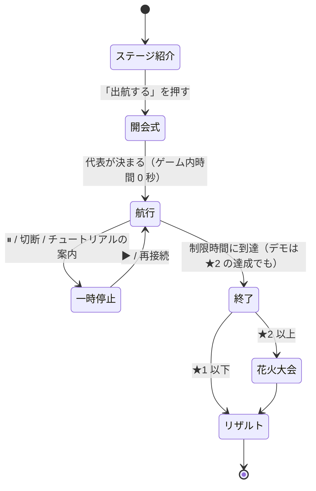

# ゲームの進行表

| 項目 | 内容 |
|---|---|
| 版 | v0.3 |
| 更新日 | 2026-11-06 |
| 状態 | レビュー済み。時刻はプレイテスト前の見込みです |
| 関連 | [ゲームデザイン仕様](./04-game-design.md) / [データ仕様（ステージ定義）](./07-data-spec.md) / [判断の記録 A-05・A-07・A-17](./09-assumptions-and-open-questions.md) |

この文書は「プレイヤーがどの順番で何を体験するか」を、ステージ単位とラウンド内の時刻単位で決めたものです。各表の「裏側（Raft）」の列は、その時点で Raft の内部で起きていると想定していることです。実装後は `simcli` とボット船長で想定どおりになるかを確かめ、ずれたらパラメータか表のほうを直します。

時刻はすべて**ゲーム内時間**です。早送り（A-17）をしても、ゲーム内時間で見た展開は変わりません。

---

## 1. 全体の進行（ステージ一覧）

| | Stage 1 | Stage 2 | Stage 3 | Stage 4 |
|---|---|---|---|---|
| タイトル | はじめての郵便船 | 島から返事が来ない！ | 嵐の離島共和国 | 全国しまじま大作戦 |
| 優先度 | **P0** | **P0** | P1 | P2 |
| 舞台 | 瀬戸内（香川県） | 五島列島（長崎県） | 伊豆諸島（東京都） | 全国 |
| 島（最初の代表を先頭に） | 小豆島・豊島・直島 | 福江島・奈留島・中通島 | 大島・利島・三宅島・御蔵島・八丈島・青ヶ島 | 佐渡島・利尻島・島後・八丈島・直島・対馬島・福江島 |
| 島の数 / 過半数 | 3 / 2 | 3 / 2 | 6 / 4 | 7 / 4 |
| 航路の形 | 一直線（小豆島—豊島—直島） | 三角形 | 一直線（利島—大島—三宅島—御蔵島—八丈島—青ヶ島。計画書のヘリコミューターの区間） | 全国を結ぶ架空の航路網 |
| フェリー | 1 隻 | 2 隻 | 4 隻（計画書に載っている船名） | 4 隻 |
| 制限時間 | 180 秒 | 210 秒 | 240 秒 | 240 秒 |
| 選挙タイムアウト | 60〜120 秒 | 20〜40 秒 | 20〜40 秒 | 20〜40 秒 |
| データの使い方 | 航行時間を計画書の所要時間から換算 | 人口の差、「台風等の自然災害」の記述 | 欠航率（利島 17%・御蔵島 41%・青ヶ島 41%）、島どうしのつながり、船の名前、台風の被害の記録 | 人口の大きな差（10 倍以上） |
| 新しく登場する要素 | 船の操作、積み込み、往復、確定、経由輸送、立候補の相談（終盤） | 2 隻の使い分け、選挙、嵐、花火の取り合い | 6 島（偶数）、分断（多数派と少数派）、欠航、積み替え（P1） | 7 島、故障、注文ラッシュ、漂流瓶、人口による負荷の偏り |
| 裏側で学べること | Log Replication、Commit、Quorum、（PreVote） | Heartbeat、Election Timeout、Leader Election、CheckQuorum | Network Partition、Quorum、可用性、偶数台のクラスタの弱点 | 運用、障害復旧、通信と合意のトレードオフ |
| ★1（確定数） | 4 | 5 | 7 | 10 |
| ★2 | 花火 1 発が確定 | 花火 2 発が確定 | 花火 2 発が確定 | 花火 3 発が確定 |
| ★3（スコア） | 900 | 1,400 | 2,000 | 2,800 |
| 解放条件 | 最初から | Stage 1 で★1 | Stage 2 で★1 | Stage 3 で★1 |

デモ用のステージは、伊豆版（`demo-izu`、メイン）と五島版（`demo-goto`、サブ）の 2 つを用意します（§8）。

---

## 2. ラウンドの流れ（全ステージ共通）

| フェーズ | 長さ | 画面 | サーバー |
|---|---|---|---|
| ステージ紹介 | プレイヤー次第 | 島の紹介（出典区分つき）、学べること（Stage 1 は伏せる）、フェリーの数 | セッションを作り、**コンテナの起動を始める**（A-03 補足。起動待ちをこの間に隠す） |
| 開会式 | 約 3 秒の演出 | 「代表に〇〇島が選ばれました」 | Bootstrap → `Campaign()` → 即時配達で選挙を完了（ゲーム内時間は進めない）。[DesignDoc §5.3](./03-design-doc.md) |
| 航行 | 制限時間 | メイン画面。速度は 0.5 / 1 / 2 / 4 倍を選べる | 50ms ごとに `RunUntil` |
| 終了 | — | 操作を止め、「終了！」 | ラウンド終了のイベント。統計を計算し、Durable Object に結果を保存 |
| 花火大会 | 約 8 秒の演出 | 確定した花火が順に打ち上がる | — |
| リザルト | プレイヤー次第 | [04-game-design.md §7.5](./04-game-design.md) | `Result()` |

---

## 3. Stage 1「はじめての郵便船」（瀬戸内）— 進行表

**ねらい**:
- 手紙は「届けて終わり」ではなく、**返事を持ち帰って初めて確定する**ことを体感させる
- 3 島のうち 1 島から返事をもらえば確定する（過半数）ことに気づかせる
- 遠い島（直島）には、近い島（豊島）を**経由して**手紙を運ぶ
- 終盤、放っておかれた島が「立候補してもいいかな？」と相談を始める様子を軽く見せる（A-07）

**配置**:
- 小豆島（代表・フェリー「せとうち丸」の母港）、豊島、直島
- 航路は 2 本で、計画書の所要時間から換算した値です（[データ仕様 §4.3](./07-data-spec.md)）
  - 小豆島–豊島：3.75 秒
  - 豊島–直島：5.25 秒
- 小豆島と直島の間に直接の航路はありません
- せとうち丸の積載量は 4 通です

| ゲーム内時刻 | 出来事（画面） | 裏側（Raft） | プレイヤーに期待する操作 | チュートリアル / 通知 |
|---|---|---|---|---|
| 開会式 | 「小豆島が代表に選ばれました」 | 小豆島が `Campaign()` → 当選。空のエントリを全ノードに複製 | — | T1「あなたは郵便船の船長です」 |
| 0:00 | 小豆島の港に「お元気ですか？」が 2 通 | Leader が Heartbeat を出し始める（1 秒ごと。港では相手ごとに 1 通に合流） | — | — |
| 0:05 | 小豆島で「屋台の予約」の依頼 | 小豆島は Leader なので直接 `Propose` → `MsgApp` が豊島宛て・直島宛てに 1 通ずつ | 「記録して！」（豊島宛て）を積んで豊島へ | T2「港の手紙を船にドラッグしよう」→ T3「行き先を選んで出航」 |
| 0:09 頃 | 豊島に到着・配達 | 豊島がログに追記 → `MsgAppResp` を小豆島宛てに出す | 「記録したよ！」を積んで小豆島へ戻る | T4「返事が出たよ。持ち帰ろう」 |
| 0:14 頃 | 小豆島に到着 → **確定！**（初めての得点） | 小豆島と豊島の 2/3 が記録 → Commit → 小豆島の台帳に適用。依頼元が小豆島なので、すぐに「確定」 | — | T5「3 つの島のうち 2 つが記録すれば決まるよ」（過半数のヒント） |
| 0:30 | 直島で「花火の予約」（**重要**） | 直島は Follower なので、依頼書を小豆島宛てに書く | 豊島を経由して直島へ行き、依頼書を受け取って小豆島へ | T6「依頼書は代表（👑）の島へ。直島へは豊島を経由して行こう」 |
| 0:55 頃 | 依頼書が小豆島に届く → 審議中 | 小豆島が `Propose` → 豊島宛て・直島宛ての `MsgApp` が新たに出る | 豊島へ「記録して！」を運び、返事を持ち帰る | — |
| 1:05 頃 | 小豆島で「共和国で確定」。ただし直島ではまだ「審議中」のまま | Commit されたが、直島は Commit Index をまだ知らない | 直島へ手紙（定期便か記録）を届ける | T7「依頼した島に結果を届けるまでが仕事だよ」 |
| 1:20 頃 | 直島で**確定**、花火のアイコンが点灯 | 直島が Commit Index を知り、台帳に適用 | — | — |
| 1:00〜2:30 | 豊島・小豆島・直島で通常の依頼が 4 件（台本） | 同上の繰り返し | 小豆島⇄豊島の往復に、ときどき直島までの便を混ぜる | T8（任意）「近い豊島を経由すると、直島への手紙も一緒に運べるよ」 |
| 1:30 頃〜 | 直島に 30 秒、手紙が届いていなければ満足度が下がり始める | — | — | 「最近、だれからも手紙が来ないなあ…」 |
| 直島を 60〜120 秒放置したとき（任意の時刻） | 直島の港に「立候補してもいいかな？」が出る | 直島が選挙タイムアウト → PreCandidate → `MsgPreVote`。届けても、代表と連絡が取れている小豆島・豊島は断る（リース） | 直島にも定期便を届ける | T9「直島が代表と連絡がつかなくて不安になっています。定期便も届けてあげよう」 |
| 3:00 | 終了 | — | — | — |

**依頼の台本（Stage 1）**:

| 時刻 | 島 | 依頼 |
|---|---|---|
| 0:05 | 小豆島 | 屋台 |
| 0:30 | 直島 | 花火（重要） |
| 1:00 | 豊島 | 屋台 |
| 1:20 | 小豆島 | 屋台 |
| 1:45 | 直島 | 屋台 |
| 2:10 | 豊島 | 屋台 |

- ランダムな依頼はありません
- 屋台の定員は 5 です（Stage 1 では予約失敗を出さない）

**クリアの見込み**: ボット船長（`greedy`）で★1 を安定して取れ、★3 は工夫が必要、という難易度を目標にします。

---

## 4. Stage 2「島から返事が来ない！」（五島列島）— 進行表

**ねらい**:
- 定期便が途切れると、島が立候補を始めることを体験させる
- 代表が孤立すると自分から退き、残った過半数で新しい代表が選ばれることを体験させる
- 花火の取り合いで「1 つの資源は 1 回しか確定しない」ことを見せる

**配置**:
- 島：福江島（代表）、奈留島（福江島に近い）、中通島（福江島から遠い）
- 航路（ゲーム上の設定）
  - 福江島–奈留島：4 秒
  - 奈留島–中通島：6 秒
  - 福江島–中通島：9 秒
- フェリー

  | 船 | 母港 | 積載量 | 速度 |
  |---|---|---|---|
  | ごとう丸 | 福江島 | 4 通 | 1.0 |
  | しまかぜ | 奈留島 | 3 通 | 0.8（速い） |

- 選挙タイムアウト：20〜40 秒

| ゲーム内時刻 | 出来事（画面） | 裏側（Raft） | プレイヤーに期待する操作 | 通知 |
|---|---|---|---|---|
| 開会式 | 福江島が代表に | — | — | — |
| 0:10 | 中通島・屋台 | 依頼書 → 福江島 | 2 隻で分担（例: ごとう丸は福江島⇄奈留島、しまかぜは奈留島⇄中通島） | — |
| 0:20 | 福江島・**花火 A**（重要） | 福江島が `Propose` | — | — |
| 0:35 | 奈留島・屋台 | — | — | — |
| 0:45 | 中通島・**花火 A**（取り合い） | 2 件目の花火 A の提案。先に適用されたほうだけ成功 | — | 後から適用されたほうは「えっ、花火はもう他の島が…」 |
| 0:50 | **嵐の予報**「10 秒後に福江島のまわりが荒れるぞ！」 | — | 福江島にいる船を逃がすか、手紙を持たせて出しておく | 予報（題材は計画書の「台風等の自然災害の影響を受けやすい」） |
| 1:00 | **嵐**：福江島に接する 2 本の航路が 40 秒間出航できない | 福江島が孤立。福江島の Heartbeat が届かなくなる | 奈留島⇄中通島の間で船を動かし続ける | 「福江島に行けない！」 |
| 1:00〜1:20 | 福江島の代表マーク（👑）が消える | 福江島（Leader）は `CheckQuorum` で、選挙タイムアウトの間に過半数から返事がないので Follower に戻る | — | 「みんなの返事が来ない…いったん代表をおります」 |
| 1:20〜1:40 | 奈留島か中通島に 📣 | 選挙タイムアウト → `MsgPreVote` → `MsgVote`。**投票の手紙も船で運ぶ必要がある** | 立候補・投票の手紙を奈留島⇄中通島で運ぶ | 「代表と連絡がつかない…立候補します！」 |
| 1:25〜1:45 | 新しい代表が誕生 | 新しい Term の Leader。滞っていた依頼が再送されて動き出す | 依頼書を新しい代表へ | 「これからは〇〇島が代表です」 |
| 1:40 | 嵐が去る | — | 福江島へ新しい代表の手紙を届ける | — |
| 1:45〜 | 福江島が「代表ではない」状態に落ち着く | 福江島は新しい Term を知って Follower に。Commit されていなかった部分は上書きされる。福江島の港に残っていた古い Term の手紙は、届いても無視される | — | — |
| 1:50 | 奈留島・**花火 B**（重要） | — | ★2 に向けて最優先 | — |
| 2:00〜3:20 | 通常の依頼 4 件、ランダムな依頼 | — | 全島の満足度を意識して巡回 | — |
| 3:30 | 終了 | — | — | — |

**依頼の台本（Stage 2）**:
- 上の表のものに加えて、次の 4 件があります

  | 時刻 | 島 | 依頼 |
  |---|---|---|
  | 2:00 | 中通島 | 屋台 |
  | 2:20 | 福江島 | 屋台 |
  | 2:40 | 奈留島 | 屋台 |
  | 3:00 | 中通島 | 屋台 |

- 屋台の定員は 3 です（予約失敗が出る）
- ランダムな依頼は、合計で毎分 0.5 件です。人口の重みで島に割り振ります（福江島 511‰、中通島 363‰、奈留島 126‰）

---

## 5. Stage 3「嵐の離島共和国」（伊豆諸島）— 進行表（P1）

**ねらい**:
- 6 島の過半数は 4 島。嵐で 2 島と 4 島に分かれると、**2 島の側ではどうやっても確定できない**ことを体験させる
- 欠航の多い島（御蔵島・青ヶ島は 41%）では、実データの欠航率に応じて航路が止まる。「通信が不安定なノード」を体験させる
- 島の数が偶数（6）なので、3 島ずつに分かれるとどちらの側も確定できない。「なぜ分散システムは奇数台で組むことが多いのか」に気づかせる

**配置**:
- 島（一直線につながる）: 利島 — **大島（代表）** — 三宅島 — 御蔵島 — 八丈島 — 青ヶ島
- つながりは、計画書のヘリコミューターの区間から決めています（[データ仕様 §4.5](./07-data-spec.md)）
- 航行時間（ゲーム上の設定）

  | 航路 | 航行時間 |
  |---|---|
  | 利島–大島 | 3 秒 |
  | 大島–三宅島 | 10 秒 |
  | 三宅島–御蔵島 | 4 秒 |
  | 御蔵島–八丈島 | 9 秒 |
  | 八丈島–青ヶ島 | 6 秒 |

- フェリー（船名は計画書に載っている実在の船名。運航会社とは関係ありません）

  | 船 | 母港 |
  |---|---|
  | 橘丸 | 大島 |
  | 新さるびあ丸 | 大島 |
  | くろしお丸 | 三宅島 |
  | あおがしま丸 | 八丈島 |

- 欠航: 利島・御蔵島・青ヶ島に接する航路は、30 秒ごとに、その島の欠航率（17%・41%・41%）の確率で 10 秒間止まる（[データ仕様 §4.4](./07-data-spec.md)）

| ゲーム内時刻 | 出来事 | 裏側（Raft） | プレイヤーに期待する操作 |
|---|---|---|---|
| 0:00〜1:00 | 6 島に依頼が発生（大島・八丈島に多い）。御蔵島・青ヶ島の航路がたびたび欠航する | 大島が Leader。過半数（4 島）の記録が必要 | 大島の近く（利島・三宅島）と、もう 1 島から返事を集める運航を見つける。欠航中は別の島を回る |
| 1:00 | 嵐の予報（大島–三宅島） | — | 南側に船を 2 隻以上残しておく |
| 1:10〜2:00 | 嵐：北（大島・利島）と南（三宅島・御蔵島・八丈島・青ヶ島）に分断 | 北は 2/6 で過半数に届かず、Commit できない（V-1）。大島は CheckQuorum で退く。南の 4 島で選挙が起き、新しい Leader が生まれる（4 票がそろえば当選） | 南の 4 島の間で選挙の手紙と依頼書を運ぶ。欠航で票が届かない島が出ると選挙が長引く |
| 2:00 | 嵐が去る | 北の 2 島は新しい Term を知って Follower に戻り、ログが揃う（V-2） | 北の島へ新しい代表の手紙を届けて合流させる |
| 2:00〜4:00 | 北の島の満足度の回復 | — | 溜まった依頼書の再送を運ぶ |

嵐の題材には、計画書の台風の被害の記録（平成 25 年の台風 26 号による大島町の被害）を使います。

## 6. Stage 4「全国しまじま大作戦」（全国）— 進行表（P2）

**ねらい**:
- 人口の多い島（佐渡島・福江島・対馬島）に依頼が集中する中で、故障・嵐・注文ラッシュ・漂流瓶が重なる
- 運用としての優先順位付けを体験させる
- 航路は、全国の島を 1 つの共和国としてつなぐ架空の航路網です（ゲーム上の設定）

| ゲーム内時刻 | 出来事 | 裏側（Raft） |
|---|---|---|
| 0:00〜 | 佐渡島が代表。人口に応じて佐渡島・福江島・対馬島に依頼が多い | 7 島で過半数は 4 島 |
| 0:40 | 船の故障（1 隻が 30 秒停止） | 通信の頻度が落ちる |
| 1:00〜1:30 | 嵐 1（九州の島々の周辺） | 分断 |
| 1:45 | 注文ラッシュ（4 島で同時に依頼） | ログが一気に伸び、`MsgApp` が増える（港の上限の規則が効く） |
| 2:10 | 漂流瓶（古い Term の手紙が 3 通流れ着く） | 古い手紙が届いても無視される（V-4） |
| 2:30〜3:00 | 嵐 2（日本海側の島々の周辺） | 分断と Leader の交代 |
| 4:00 | 終了 | — |

---

## 7. Stage 1 のチュートリアル台本

チュートリアルは「条件を満たしたら次に進む」吹き出しです。条件はクライアントで判定し、サーバーは関与しません（ゲームの結果に影響しないため）。

| ID | 表示する条件 | 文言 | 次に進む条件 | 強調する UI |
|---|---|---|---|---|
| T1 | 開会式の後 | 「あなたは離島Raft共和国の郵便船の船長です。島どうしの手紙を運んで、しまじまフェスを成功させましょう」 | クリック | — |
| T2 | 最初の依頼が出た後 | 「小豆島の港に手紙が出ました。船『せとうち丸』に積んでみましょう（ドラッグ）」 | 手紙を 1 通積む | 港の手紙・積み荷スロット |
| T3 | T2 の後 | 「行き先に豊島を選んで、出航！」 | 出航する | 行き先ボタン・出航ボタン |
| T4 | 豊島に着いた後 | 「豊島が返事を書きました。小豆島へ持ち帰りましょう」 | 返事を積んで出航 | 豊島の港 |
| T5 | 最初の確定 | 「確定！ 3 つの島のうち 2 つが記録すれば、正式に決まります」 | クリック | スコア |
| T6 | 直島で依頼が出た後 | 「直島から依頼書（★）が出ています。依頼書は代表（👑）の島へ届けましょう。直島へは豊島を経由して行けます」 | 依頼書を小豆島で配達 | 直島・👑・航路 |
| T7 | 依頼元以外で確定した後 | 「共和国では決まったけど、直島はまだ知りません。結果を届けるまでが仕事です」 | 直島で確定 | 依頼の状態 |
| T8 | 任意（2:00 以降、一度だけ） | 「近い豊島を経由すると、直島への手紙も一緒に運べるよ」 | クリック | 航路 |
| T9 | 任意（直島が初めて「立候補してもいいかな？」を出したとき） | 「直島が代表と連絡がつかなくて不安になっています。定期便も届けてあげましょう。ほかの島は代表と連絡が取れているので、相談を断ります」 | クリック | 直島の港 |

チュートリアルの吹き出しが出ている間は、ゲーム内時間を自動で一時停止します（Stage 1 のみ）。

---

## 8. デモ台本（3 分、企画書 §13 に対応）

デモ専用のステージを 2 つ用意します。**伊豆版がメイン**、五島版がサブです（[R-07](./09-assumptions-and-open-questions.md#r-07)）。どちらでも同じ台本で進められるようにします。

**2 つのデモ用ステージ**

| | 伊豆版 `demo-izu`（メイン） | 五島版 `demo-goto`（サブ） |
|---|---|---|
| 島（最初の代表を先頭に） | 大島・利島・三宅島・御蔵島・八丈島・青ヶ島（Stage 3 と同じ 6 島） | 福江島・奈留島・中通島 |
| 航路（ゲーム上の設定） | Stage 3 の 0.6 倍（利島–大島 1.8 秒、大島–三宅島 6 秒、三宅島–御蔵島 2.4 秒、御蔵島–八丈島 5.4 秒、八丈島–青ヶ島 3.6 秒） | 福江島–奈留島 2.4 秒、奈留島–中通島 3.6 秒、福江島–中通島 5.4 秒 |
| フェリー | 橘丸（大島）、くろしお丸（三宅島）、あおがしま丸（八丈島） | ごとう丸（福江島）、しまかぜ（奈留島） |
| 嵐で分かれる島 | 北の大島・利島（2 島）と南の 4 島 | 福江島（1 島）と残りの 2 島 |
| 嵐の題材 | 計画書「平成 25 年台風 26 号による大島町の被害」 | 計画書「台風等の自然災害の影響を受けやすい」 |
| 紹介で使うデータ | 欠航率（利島 17%・御蔵島 41%・青ヶ島 41%）、ヘリコミューターでつながる島々、計画書に載っている船名 | 人口の差、世界遺産（潜伏キリシタン関連遺産） |
| 欠航のイベント | 止める（展開を台本どおりにするため。欠航率は紹介の文で見せる） | — |

**両者に共通する設定**:
- 制限時間：120 秒
- 選挙タイムアウト：8〜16 秒
- ★2 を達成した時点でラウンドを終え、花火大会へ進む
- コンテナの大きさ：`standard-1`（[R-02](./09-assumptions-and-open-questions.md#r-02)）

**デモ操作**（`demo` モードでデプロイした Worker、つまり `raft-demo.kizuku-hackathon.work` だけで使える）:

| キー | 動き |
|---|---|
| D | 嵐を起こす |
| F を押している間 | 4 倍速（Shift を同時に押すと 8 倍速） |
| N | 次の到着・出来事まで進めて止まる |
| Space | 一時停止 |

下の台本の地名は伊豆版です。五島版では、北の大島・利島 → 福江島、南の 4 島 → 奈留島・中通島と読み替えてください。

| 発表の時刻 | ゲーム内時刻 | 発表者の操作 | 画面 | 話すこと |
|---|---|---|---|---|
| 0:00 | （タイトル） | ステージ紹介を表示 | 6 島の紹介（人口・欠航率は出典つき） | 「日本の離島を舞台に、フェリーで手紙を運ぶパズルゲームです。島の人口や欠航率、島どうしのつながりは、国交省のオープンデータから作っています」 |
| 0:30 | 0:00 | 出航 → 花火の依頼書を大島へ、「記録して！」を利島・三宅島・御蔵島へ。**航行中は F で早送り** | 手紙の往復 | 「手紙を届けて、返事を持ち帰ると予約が確定します。6 島のうち 4 島が記録すれば決まります」 |
| 0:50 | 0:20 | **N で確定の直前まで進める** | 花火 A が**確定** | 「花火の予約が決まりました」 |
| 1:00 | 0:30 | **D キー（嵐）** | 大島と三宅島の間に嵐。北の 2 島の依頼が「確認待ち」 | 「嵐で北の 2 島が切り離されました。2 島だけでは過半数に届かないので、お祭りの準備が止まります」 |
| 1:20 | 0:50 | くろしお丸・あおがしま丸で、南の 4 島の間に投票の手紙を運ぶ。**投票の手紙が届く瞬間は 1 倍速（必要なら 0.5 倍）** | 大島の 👑 が消え、御蔵島に 📣 → 👑 | 「別の船で残りの 4 島をつなぐと、新しい代表が選ばれて、溜まっていた依頼が動き出します」 |
| 1:50 | 1:20 | 花火 B を確定させる（**F で早送り**） | ★2 達成 → **花火大会** | 「すべての重要な依頼が確定して、フェス成功です！」 |
| 2:10 | （リザルト） | E キー → エンジニアモード / タイムライン | Term の変化、Leader Election、ログの複製の履歴 | 「実は、さっき運んでいた手紙は全部 Raft のメッセージです」 |
| 2:40 | （リザルト） | 手紙を 1 通クリックして `MsgVote` の中身を見せる | Raft メッセージの詳細 | 「ゲームの通信は全部、本物の Raft の Transport を差し替えて動かしています。船を止めると、分散合意も止まります」 |

**デモの保険**:

- デモ用のシードを固定し、リハーサルと同じ展開になるようにする（ボット船長で事前に検証）
- 本番環境が使えないときのために、ノート PC で `make demo-local`（Go サーバーの `standalone` モード）を起動できるようにしておく
- 万一、操作ミスで展開が崩れたときのために、うまくいった回のリプレイ（Durable Object に保存した操作の記録）を再生できるようにしておく
- デモの前に、コストガード（[ADR-0018](./adr/0018-cost-guard.md)）の 1 日の上限に余裕があるかを確かめる。足りなければ管理用 API で一時的に外す（署名の確認は外さない）

---

## 9. 学習目標の到達確認

リザルトの「今日の出来事」と遊び方のヘルプで、各ステージの後に次のことを言葉にして示します。

| ステージ | プレイヤーが体験したこと | 種明かし（リザルト後に解放されるヘルプ） |
|---|---|---|
| 1 | 返事を持ち帰らないと確定しない。2/3 で決まる。放っておかれた島は相談を始めるが、ほかの島が断る | Log Replication、Commit、Quorum、PreVote |
| 2 | 定期便が途切れると立候補が始まる。孤立した代表は退く。花火は 1 回しか取れない | Heartbeat、Election Timeout、Leader Election、CheckQuorum、状態機械の複製 |
| 3 | 2 島の側ではどうやっても決まらない。嵐が去ると記録が揃う。欠航の多い島があると選挙が長引く | Network Partition、Quorum、可用性と一貫性、偶数台のクラスタの弱点 |
| 4 | 全部は運べない。何を優先するかが運用 | 運用・障害復旧のトレードオフ、メッセージの欠落・重複への耐性 |
