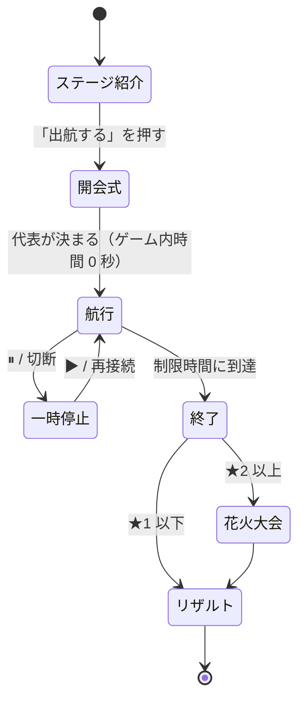

# ゲームの進行表

| 項目 | 内容 |
|---|---|
| 版 | v0.1（仮決め版） |
| 状態 | Draft。時刻・数値はプレイテスト前の仮の値です |
| 関連 | [ゲームデザイン仕様](./04-game-design.md) / [データ仕様（ステージ定義）](./07-data-spec.md) |

この文書は「プレイヤーがどの順番で何を体験するか」を、ステージ単位とラウンド内の時刻単位で決めたものです。各表の「裏側（Raft）」の列は、その時点で Raft の内部で起きていると想定していることです。実装後は `simcli` とボット船長で想定どおりになるかを確かめ、ずれたらパラメータか表のほうを直します。

---

## 1. 全体の進行（ステージ一覧）

| | Stage 1 | Stage 2 | Stage 3 | Stage 4 |
|---|---|---|---|---|
| タイトル | はじめての郵便船 | 島から返事が来ない！ | 嵐の離島共和国 | 全国しまじま大作戦 |
| 優先度 | **P0** | **P0（デモで使う）** | P1 | P2 |
| 舞台（実在の離島） | 隠岐諸島（島後・中ノ島・西ノ島） | 隠岐諸島（同じ 3 島・冬の海） | 伊豆諸島（大島・利島・新島・式根島・神津島） | 五島列島（福江島・久賀島・奈留島・若松島・中通島・小値賀島・宇久島） |
| 島の数 / 過半数 | 3 / 2 | 3 / 2 | 5 / 3 | 7 / 4 |
| フェリー | 1 隻 | 2 隻 | 3 隻 | 4 隻 |
| 制限時間 | 180 秒 | 210 秒 | 240 秒 | 240 秒 |
| 選挙タイムアウト | 600 秒（事実上起きない） | 20〜40 秒 | 20〜40 秒 | 20〜40 秒 |
| 新しく登場する要素 | 船の操作、積み込み、往復、確定 | 2 隻の使い分け、選挙、嵐、花火の取り合い | 5 島、分断（多数派と少数派）、積み替え（P1） | 7 島、故障、注文ラッシュ、漂流瓶、人口による負荷の偏り |
| 裏側で学べること | Log Replication、Commit、Quorum | Heartbeat、Election Timeout、Leader Election、CheckQuorum | Network Partition、Quorum、可用性 | 運用、障害復旧、通信と合意のトレードオフ |
| ★1（確定数） | 4 | 5 | 7 | 10 |
| ★2 | 花火 1 発が確定 | 花火 2 発が確定 | 花火 2 発が確定 | 花火 3 発が確定 |
| ★3（スコア） | 900 | 1,400 | 2,000 | 2,800 |
| 解放条件 | 最初から | Stage 1 で★1 | Stage 2 で★1 | Stage 3 で★1 |

舞台の選び方の理由と、Stage 2 に嵐を前倒しした理由は [仮決め一覧 A-01, A-05](./09-assumptions-and-open-questions.md) にあります。

---

## 2. ラウンドの流れ（全ステージ共通）

| フェーズ | 長さ | 画面 | サーバー（`sim.Engine`） |
|---|---|---|---|
| ステージ紹介 | プレイヤー次第 | 島の紹介（出典区分つき）、学べること（Stage 1 は伏せる）、フェリーの数 | まだセッションはない |
| 開会式 | 約 3 秒の演出 | 「代表に〇〇島が選ばれました」 | Bootstrap → `Campaign()` → 即時配達で選挙を完了（ゲーム内時間は進めない）。[DesignDoc §5.3](./03-design-doc.md) |
| 航行 | 制限時間 | メイン画面 | 50ms ごとに `RunUntil` |
| 終了 | — | 操作を止め、「終了！」 | ラウンド終了のイベント。統計を計算 |
| 花火大会 | 約 8 秒の演出 | 確定した花火が順に打ち上がる | — |
| リザルト | プレイヤー次第 | [04-game-design.md §7.5](./04-game-design.md) | `Result()` |

---

## 3. Stage 1「はじめての郵便船」— 進行表

**ねらい**: 手紙は「届けて終わり」ではなく、**返事を持ち帰って初めて確定する**ことを体感させる。そして、2 つの島のうち 1 つから返事をもらえば確定する（過半数）ことに気づかせる。

**配置**: 島後（代表・フェリー「おき丸」の母港）、中ノ島、西ノ島。航路: 島後–中ノ島 9 秒、島後–西ノ島 10 秒、中ノ島–西ノ島 4 秒。おき丸の積載量 4。

| ゲーム内時刻 | 出来事（画面） | 裏側（Raft） | プレイヤーに期待する操作 | チュートリアル / 通知 |
|---|---|---|---|---|
| 開会式 | 「島後が代表に選ばれました」 | 島後が `Campaign()` → 当選。空のエントリを全ノードに複製 | — | T1「あなたは郵便船の船長です」 |
| 0:00 | 島後の港に「お元気ですか？」が 2 通 | Leader が Heartbeat を出し始める（1 秒ごと。港では 1 通に合流） | — | — |
| 0:05 | 島後で「屋台の予約」の依頼 | 島後は Leader なので直接 `Propose` → `MsgApp` が中ノ島宛て・西ノ島宛てに 1 通ずつ | 「記録して！」（中ノ島宛て）を積んで中ノ島へ | T2「港の手紙を船にドラッグしよう」→ T3「行き先を選んで出航」 |
| 0:16 頃 | 中ノ島に到着・配達 | 中ノ島がログに追記 → `MsgAppResp` を島後宛てに出す | 「記録したよ！」を積んで島後へ戻る | T4「返事が出たよ。持ち帰ろう」 |
| 0:27 頃 | 島後に到着 → **確定！**（初めての得点） | 島後と中ノ島の 2/3 が記録 → Commit → 島後の台帳に適用。依頼元が島後なので、すぐに「確定」 | — | T5「3 つの島のうち 2 つが記録すれば決まるよ」（過半数のヒント） |
| 0:30 | 西ノ島で「花火の予約」（**重要**） | 西ノ島は Follower なので、依頼書を島後宛てに書く | 西ノ島へ行き、依頼書を受け取って島後へ | T6「依頼書は代表の島に届けよう」 |
| 0:50 頃 | 依頼書が島後に届く → 審議中 | 島後が `Propose` → 中ノ島宛て・西ノ島宛ての `MsgApp` が新たに 1 通ずつ（西ノ島宛ての 0:05 の分も港に残っている） | 中ノ島か西ノ島へ「記録して！」を運び、返事を持ち帰る | — |
| 1:10 頃 | 島後で「共和国で確定」。ただし西ノ島ではまだ「審議中」のまま | Commit されたが、西ノ島は Commit Index をまだ知らない | 西ノ島へ手紙（定期便か記録）を届ける | T7「依頼した島に結果を届けるまでが仕事だよ」 |
| 1:20 頃 | 西ノ島で**確定**、花火のアイコンが点灯 | 西ノ島が Commit Index を知り、台帳に適用 | — | — |
| 1:00〜2:30 | 中ノ島・島後・西ノ島で通常の依頼が 4 件（台本） | 同上の繰り返し | 経由輸送（中ノ島→西ノ島の短い航路）を使って効率化 | T8（任意）「近くの島をまとめて回ると早いよ」 |
| 1:40 | 西ノ島に 30 秒、手紙が届いていなければ満足度が下がり始める | — | — | 「最近、だれからも手紙が来ないなあ…」 |
| 3:00 | 終了 | — | — | — |

**依頼の台本（Stage 1）**: 0:05 島後・屋台 / 0:30 西ノ島・花火（重要） / 1:00 中ノ島・屋台 / 1:20 島後・屋台 / 1:45 西ノ島・屋台 / 2:10 中ノ島・屋台。ランダムな依頼はなし。屋台の定員 5（Stage 1 では予約失敗を出さない）。

**クリアの見込み**: ボット船長（`greedy`）で★1 を安定して取れ、★3 は工夫が必要、という難易度を目標にします。

---

## 4. Stage 2「島から返事が来ない！」— 進行表（デモで使う）

**ねらい**: 定期便が途切れると島が立候補を始めること、代表が孤立すると自分から退き、残った過半数で新しい代表が選ばれることを体験させる。花火の取り合いで「1 つの資源は 1 回しか確定しない」ことも見せる。

**配置**: Stage 1 と同じ 3 島。フェリー「おき丸」（島後、積載量 4、速度 1.0）、「しまかぜ」（中ノ島、積載量 3、速度 0.8 = 速い）。選挙タイムアウト 20〜40 秒。

| ゲーム内時刻 | 出来事（画面） | 裏側（Raft） | プレイヤーに期待する操作 | 通知 |
|---|---|---|---|---|
| 開会式 | 島後が代表に | — | — | — |
| 0:10 | 中ノ島・屋台 | 依頼書 → 島後 | 2 隻で分担（例: おき丸は島後⇄中ノ島、しまかぜは中ノ島⇄西ノ島） | — |
| 0:20 | 島後・**花火 A**（重要） | 島後が `Propose` | — | — |
| 0:35 | 西ノ島・屋台 | — | — | — |
| 0:45 | 中ノ島・**花火 A**（取り合い） | 2 件目の花火 A の提案。先に適用されたほうだけ成功 | — | 後から適用されたほうは「えっ、花火はもう他の島が…」 |
| 0:50 | **嵐の予報**「10 秒後に島後のまわりが荒れるぞ！」 | — | 島後にいる船を逃がすか、手紙を持たせて出しておく | 予報 |
| 1:00 | **嵐**：島後に接する 2 本の航路が 40 秒間出航できない | 島後が孤立。島後の Heartbeat が届かなくなる | 中ノ島⇄西ノ島の間で船を動かし続ける | 「島後に行けない！」 |
| 1:00〜1:20 | 島後の代表マーク（👑）が消える | 島後（Leader）は `CheckQuorum` で、選挙タイムアウトの間に過半数から返事がないので Follower に戻る | — | 「みんなの返事が来ない…いったん代表をおります」 |
| 1:20〜1:40 | 中ノ島か西ノ島に 📣 | 選挙タイムアウト → `MsgPreVote` → `MsgVote`。**投票の手紙も船で運ぶ必要がある** | 立候補・投票の手紙を中ノ島⇄西ノ島で運ぶ | 「代表と連絡がつかない…立候補します！」 |
| 1:25〜1:45 | 新しい代表が誕生 | 新しい Term の Leader。滞っていた依頼が再送されて動き出す | 依頼書を新しい代表へ | 「これからは〇〇島が代表です」 |
| 1:40 | 嵐が去る | — | 島後へ新しい代表の手紙を届ける | — |
| 1:45〜 | 島後が「代表ではない」状態に落ち着く | 島後は新しい Term を知って Follower に。島後のログのうち Commit されていなかった部分は上書きされる。島後の港に残っていた古い Term の手紙は、届いても無視される | — | — |
| 1:50 | 西ノ島・**花火 B**（重要） | — | ★2 に向けて最優先 | — |
| 2:00〜3:20 | 通常の依頼 4 件、ランダムな依頼 | — | 全島の満足度を意識して巡回 | — |
| 3:30 | 終了 | — | — | — |

**依頼の台本（Stage 2）**: 上表のもの ＋ 2:00 中ノ島・屋台 / 2:20 島後・屋台 / 2:40 西ノ島・屋台 / 3:00 中ノ島・屋台。屋台の定員 3（予約失敗が出る）。ランダムな依頼: 人口に応じて合計で毎分 0.5 件。

---

## 5. Stage 3「嵐の離島共和国」— 進行表（P1）

**ねらい**: 5 島の過半数は 3 島。嵐で 2 島と 3 島に分かれると、**2 島の側ではどうやっても確定できない**ことを体験させる。

**配置**: 大島（代表）、利島、新島、式根島、神津島。航路: 大島–利島 8 秒、利島–新島 7 秒、新島–式根島 3 秒、式根島–神津島 6 秒、新島–神津島 8 秒、大島–新島 13 秒。フェリー 3 隻。

| ゲーム内時刻 | 出来事 | 裏側（Raft） | プレイヤーに期待する操作 |
|---|---|---|---|
| 0:00〜1:00 | 5 島に依頼が分散して発生 | 大島が Leader。過半数（3 島）から返事が必要 | 近い島から 2 島分の返事を集める運航を見つける |
| 1:00 | 嵐の予報（利島–新島、大島–新島） | — | 南側に船を 2 隻以上残しておく |
| 1:10〜2:00 | 嵐：北（大島・利島）と南（新島・式根島・神津島）に分断 | 北は 2/5 で過半数に届かず、Commit できない（V-1）。南では選挙が起き、新しい Leader が生まれる | 南の 3 島の間で選挙の手紙と依頼書を運ぶ。北の依頼は「確認待ち」のまま |
| 2:00 | 嵐が去る | 北の 2 島は新しい Term を知って Follower に戻り、ログが揃う（V-2） | 北の島へ新しい代表の手紙を届けて合流させる |
| 2:00〜4:00 | 北の島の満足度の回復 | — | 溜まった依頼書の再送を運ぶ |

---

## 6. Stage 4「全国しまじま大作戦」— 進行表（P2）

**ねらい**: 人口の多い島（福江島・中通島）に依頼が集中する中で、故障・嵐・注文ラッシュ・漂流瓶が重なる。運用としての優先順位付けを体験させる。

| ゲーム内時刻 | 出来事 | 裏側（Raft） |
|---|---|---|
| 0:00〜 | 福江島が代表。人口に応じて福江島・中通島に依頼が多い | 7 島で過半数は 4 島 |
| 0:40 | 船の故障（1 隻が 30 秒停止） | 通信の頻度が落ちる |
| 1:00〜1:30 | 嵐 1（南部） | 分断 |
| 1:45 | 注文ラッシュ（4 島で同時に依頼） | ログが一気に伸び、`MsgApp` が増える（港の上限の規則が効く） |
| 2:10 | 漂流瓶（古い Term の手紙が 3 通流れ着く） | 古い手紙が届いても無視される（V-4） |
| 2:30〜3:00 | 嵐 2（北部） | 分断と Leader の交代 |
| 4:00 | 終了 | — |

---

## 7. Stage 1 のチュートリアル台本

チュートリアルは「条件を満たしたら次に進む」吹き出しです。条件はクライアントで判定し、サーバーは関与しません（ゲームの結果に影響しないため）。

| ID | 表示する条件 | 文言 | 次に進む条件 | 強調する UI |
|---|---|---|---|---|
| T1 | 開会式の後 | 「あなたは離島Raft共和国の郵便船の船長です。島どうしの手紙を運んで、しまじまフェスを成功させましょう」 | クリック | — |
| T2 | 最初の依頼が出た後 | 「島後の港に手紙が出ました。船『おき丸』に積んでみましょう（ドラッグ）」 | 手紙を 1 通積む | 港の手紙・積み荷スロット |
| T3 | T2 の後 | 「行き先に中ノ島を選んで、出航！」 | 出航する | 行き先ボタン・出航ボタン |
| T4 | 中ノ島に着いた後 | 「中ノ島が返事を書きました。島後へ持ち帰りましょう」 | 返事を積んで出航 | 中ノ島の港 |
| T5 | 最初の確定 | 「確定！ 3 つの島のうち 2 つが記録すれば、正式に決まります」 | クリック | スコア |
| T6 | 西ノ島で依頼が出た後 | 「西ノ島から依頼書（★）が出ています。依頼書は代表（👑）の島へ届けましょう」 | 依頼書を島後で配達 | 西ノ島・👑 |
| T7 | 依頼元以外で確定した後 | 「共和国では決まったけど、西ノ島はまだ知りません。結果を届けるまでが仕事です」 | 西ノ島で確定 | 依頼の状態 |
| T8 | 任意（2:00 以降、一度だけ） | 「近くの島をまとめて回ると早いよ。中ノ島と西ノ島はとても近い！」 | クリック | 航路 |

チュートリアルの吹き出しが出ている間は、ゲーム内時間を自動で一時停止します（Stage 1 のみ）。

---

## 8. デモ台本（3 分、企画書 §13 に対応）

デモ専用のステージ定義 `demo.yaml` を使います。Stage 2 と同じ 3 島ですが、時間を圧縮しています（制限時間 120 秒、航行時間は Stage 2 の約 0.6 倍、選挙タイムアウト 8〜16 秒、★2 を達成した時点でラウンドを終了して花火大会へ）。デモ操作（`DEMO_CONTROLS=1` かつ `?demo=1`）で、発表者が D キーを押したときに嵐を起こします。

| 発表の時刻 | ゲーム内時刻 | 発表者の操作 | 画面 | 話すこと |
|---|---|---|---|---|
| 0:00 | （タイトル） | ステージ紹介を表示 | 隠岐の 3 島の紹介（人口などは出典つき） | 「日本の離島を舞台に、フェリーで手紙を運ぶパズルゲームです。島のデータは国交省のオープンデータから作っています」 |
| 0:30 | 0:00 | 出航 → 花火の依頼書を島後へ、記録して！を中ノ島へ | 手紙の往復 | 「手紙を届けて、返事を持ち帰ると予約が確定します」 |
| 0:50 | 0:20 | — | 花火 A が**確定** | 「花火の予約が決まりました」 |
| 1:00 | 0:30 | **D キー（嵐）** | 島後のまわりに嵐。依頼が「確認待ち」 | 「嵐で島後に行けなくなりました。お祭りの準備が止まります」 |
| 1:20 | 0:50 | しまかぜで中ノ島⇄西ノ島に投票の手紙を運ぶ | 島後の 👑 が消え、中ノ島に 📣 → 👑 | 「別の船で残りの島をつなぐと、新しい代表が選ばれて、溜まっていた依頼が動き出します」 |
| 1:50 | 1:20 | 花火 B を確定させる | ★2 達成 → **花火大会** | 「すべての重要な依頼が確定して、フェス成功です！」 |
| 2:10 | （リザルト） | E キー → エンジニアモード / タイムライン | Term の変化、Leader Election、ログの複製の履歴 | 「実は、さっき運んでいた手紙は全部 Raft のメッセージです」 |
| 2:40 | （リザルト） | 手紙を 1 通クリックして `MsgVote` の中身を見せる | Raft メッセージの詳細 | 「ゲームの通信は全部、本物の Raft の Transport を差し替えて動かしています。船を止めると、分散合意も止まります」 |

**デモの保険**:

- デモ用のシードを固定し、リハーサルと同じ展開になるようにする（ボット船長で事前に検証）
- 本番環境が使えないときのために、ノート PC で `make demo-local` を起動できるようにしておく
- 万一、操作ミスで展開が崩れたときのために、リプレイ（P1）で「うまくいった回」を再生できるようにしておく

---

## 9. 学習目標の到達確認

リザルトの「今日の出来事」と遊び方のヘルプで、各ステージ後に次のことを言葉にして示します。

| ステージ | プレイヤーが体験したこと | 種明かし（リザルト後に解放されるヘルプ） |
|---|---|---|
| 1 | 返事を持ち帰らないと確定しない。2/3 で決まる | Log Replication、Commit、Quorum |
| 2 | 定期便が途切れると立候補が始まる。孤立した代表は退く。花火は 1 回しか取れない | Heartbeat、Election Timeout、Leader Election、CheckQuorum、状態機械の複製 |
| 3 | 2 島の側ではどうやっても決まらない。嵐が去ると記録が揃う | Network Partition、Quorum、可用性と一貫性 |
| 4 | 全部は運べない。何を優先するかが運用 | 運用・障害復旧のトレードオフ、メッセージの欠落・重複への耐性 |
