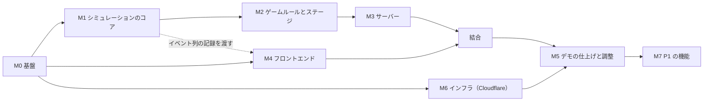

# 実装計画

| 項目 | 内容 |
|---|---|
| 版 | v0.3 |
| 更新日 | 2026-11-06 |
| 状態 | レビュー済み。**このドキュメントは GitHub の Issue に転記する元**です。日程はオーナーが調整するので書きません（Q-01） |

ドキュメントを読んだ人が、そのまま作業を始められるようにするための計画です。計画とタスクは GitHub の Issue で管理します（C-11）。各タスクは Issue にそのまま転記できる粒度にしています。§1 の図の枝分かれ（M1・M4・M6 など）が、AI エージェントに並列で割り振れる単位です。

---

## 1. マイルストーンと順番



- **クリティカルパス**: M0 → M1 → M2 → M3 → 結合 → M5
- チームは、人間 1 人が AI エージェントを並列に動かして開発します（R-03）。フロントエンド（M4）とインフラ（M6）は、M0 の後すぐ別のエージェントで並行して始められます。M4 は、M1 の途中で `simcli record` が出すイベント列の記録を使い、サーバーなしで開発します
- 人の判断が要る作業（Raft との統合と決定性の要の部分、遊んでみての難易度の調整、デモのリハーサル、コストガードの上限の見直し）は、並列にせず人が確認します
- 各タスクの「目安」は、作業量の比較のための目安です（日程ではありません）

---

## 2. マイルストーンごとの完了条件

| M | 完了条件（Definition of Done） |
|---|---|
| M0 | `make test` / `make lint` がローカルと CI で通る。パッチを当てた `etcd-raft` が `replace` で使われ、上流のテストが通る。`cf` で「Worker ＋ Durable Object ＋ コンテナ」の最小構成をデプロイでき、未確認だった事項（T-007）の結果が ADR-0016 に書かれている |
| M1 | `simcli run --stage stage1 --bot greedy --seeds 1..1000` が不変条件の違反なしで終わる。同じシードを 2 回実行してトレースのハッシュが一致する。分断シナリオのテスト（V-1, V-2, V-4）が通る |
| M2 | Stage 1・Stage 2・`demo-goto`・`demo-izu` のステージ定義が読み込める。`greedy` ボットで Stage 1 の★1 が 90% 以上のシードで取れる。`islands.json` が提供データの CSV から ETL で生成されている |
| M3 | Go のテストのクライアントから、`standalone` モードで 1 ラウンド遊び切れる。`cf dev`（またはデプロイした環境）で、Worker → Durable Object → コンテナを通して 1 ラウンド遊び切れる。コンテナを止めても入力ログから復元できる。TS の型が生成される |
| M4 | 記録したイベント列で、マップ・船の移動・港の手紙・HUD・リザルトが表示される。積む・出航の操作がモックの WS に正しいコマンドを送る |
| 結合 | 本物のサーバーにつないで Stage 1 をクリアできる |
| M5 | デモ台本（[05-game-progression.md §8](./05-game-progression.md)）を本番環境で 3 回連続で通せる。非エンジニア 3 名のテストプレイを実施 |
| M6 | `main` への push で `production` に自動デプロイされ、手動の実行で `demo` にデプロイされる。`/api/healthz` が 200 を返す |

---

## 3. タスク一覧

### M0 基盤

| ID | タスク | 関連 | 目安 |
|---|---|---|---|
| T-001 | モノレポの雛形（`server/` `web/` `data/`）、pnpm のワークスペース、`.gitignore`、`Makefile`（`test` `lint` `dev` `gen` `sync-data` `demo-local`） | ADR-0014 | 1h |
| T-002 | `server/go.mod`（Go 1.26、`go.etcd.io/raft/v3 v3.7.0`）。`third_party/etcd-raft` に v3.7.0 を取り込み、乱数を注入するパッチを当て、`PATCHES.md` と `replace` を書く | ADR-0005 | 2h |
| T-003 | パッチの検証スクリプト（上流との差分がパッチだけであることを確認）と、パッチのテスト（`RandIntn` が使われる） | ADR-0005 | 1h |
| T-004 | `web/` を Vite + React + TS で作り、`cf`（版を固定）と `@cloudflare/vite-plugin` を入れて `cloudflare.config.ts` を置く（`"type": "module"`）。ESLint、Prettier、Vitest | ADR-0010, ADR-0016 | 2h |
| T-005 | CI（`.github/workflows/ci.yml`）: Go の vet・`golangci-lint`（`forbidigo` で `time.Now` などを `internal/sim` 以下で禁止）・test、web の lint・typecheck・test | — | 2h |
| T-006 | `CLAUDE.md` / `CONTRIBUTING` の規約を実際の構成に合わせて更新 | — | 0.5h |
| T-007 | **スパイク: `cf` とコンテナの確認**。最小の Worker ＋ Durable Object（SQLite）＋ Go のコンテナ（`durable_object` 方式、WS のエコー）を `cf deploy` し、次を測って ADR-0016 に書く: コンテナの起動時間、`lite` での CPU の余裕（8 倍速・復元の速さ）、`limits.cpuMs` の適切な値、`cf dev` での動作 | ADR-0016, R-02 | 4h |
| T-008 | **並列開発の環境**: `Makefile` のポートの計算（`DEV_SLOT` を割り当てる `scripts/dev-slot.sh` は #5 で済み）、`cf` の `--persist-to` を作業ディレクトリの中に、Docker の名前に作業ディレクトリ名を付ける、`make clean-docker` | ADR-0019 | 2h |
| T-009 | CI にシークレットの検査（公開リポジトリのため）と、`LICENSE`・`NOTICE` の確認を入れる | ADR-0020 | 1h |

### M1 シミュレーションのコア（`server/internal/...`）

| ID | タスク | 関連 | 目安 |
|---|---|---|---|
| T-101 | **最初にやる**: 3 ノードの `RawNode` を即時配達で動かし、選挙 → Propose → Commit → 適用までを確かめる最小の例（`cluster` の土台） | DesignDoc §5 | 3h |
| T-102 | `sim`: `SimTime`、スケジューラ（`(At, Class, Seq)` の優先度キュー）、派生乱数 | §4, §9 | 2h |
| T-103 | `cluster`: `Node`（`RawNode` + `MemoryStorage` + 台帳）、Ready ループ（順序のテスト付き）、Bootstrap と開会式 | §5, V-5 | 4h |
| T-104 | `ledger`: コマンドの形式、適用（花火・屋台）、重複の判定、不変条件 | §7, V-3 | 2h |
| T-105 | `ferry`: 手紙、港キューと規則 R1〜R6、フェリーの状態遷移、航路と遮断 | §6, V-7 | 4h |
| T-106 | `sim.Engine`: 組み立て、`Apply` / `RunUntil` / `DrainEvents` / `Snapshot`、ドメインイベント、トレースとハッシュ | §4.3, §10 | 4h |
| T-107 | 不変条件 I-1〜I-7 の検査（テストモード） | §11 | 3h |
| T-108 | `simcli`: `run`（ボットで回す）、`replay`（入力ログを再生してハッシュを出す）、`record`（クライアント向けのイベント列を書き出す） | §13.5 | 3h |
| T-109 | ボット船長 `random` / `greedy` | §14 | 2h |
| T-110 | シナリオテスト: 分断で少数派が Commit できない / 復旧後にログが揃う / 古い手紙・重複した手紙 / 依頼の再送で二重に消費しない | V-1, V-2, V-4, FR-REQ-06 | 3h |
| T-111 | 決定性テスト（2 回実行・`RunUntil` の刻み方を変える） | V-6 | 1h |

### M2 ゲームルールとステージ

| ID | タスク | 関連 | 目安 |
|---|---|---|---|
| T-201 | `stage`: YAML の読み込みと検証、`islands.json` の読み込み、重みの計算 | データ仕様 §4, §5 | 3h |
| T-202 | `game`: 依頼の発生（台本・ランダム）、役場の `route`、再送、状態の判定 | DesignDoc §8 | 4h |
| T-203 | `game`: スコア・満足度・クリア判定・期限切れ | ゲームデザイン §5 | 2h |
| T-204 | `game`: 嵐（予報つき）。故障・ラッシュ・漂流瓶は P1 | ゲームデザイン §6 | 2h |
| T-205 | 提供データの CSV とデータ定義書を `data/raw/` に置き、`data/raw/README.md`（出典・利用規約）を書く。`islandsdata` ETL（最新の基準日・複数の自治体の合計・計画書の取り込み）と `islands-select.yaml` | データ仕様 §2, §3 | 3h |
| T-206 | `data/curated/` に、計画書から抜き出す値（瀬戸内の航路の所要時間、伊豆の欠航率など）を出典（地域・項目・引用）付きで書く | FR-DATA-03, FR-DATA-07 | 1h |
| T-207 | `stage1.yaml`（瀬戸内）/ `stage2.yaml`（五島）/ `demo-goto.yaml` / `demo-izu.yaml` を書き、`greedy` ボットで難易度とデモの展開を確認 | 進行表 §3, §4, §8 | 4h |
| T-208 | リザルトの統計と「今日の出来事」の文章（台本型） | DesignDoc §10.3 | 2h |

### M3 サーバー

| ID | タスク | 関連 | 目安 |
|---|---|---|---|
| T-301 | `protocol`: 型の定義と `tygo` による TS の生成（`make gen`） | プロトコル仕様 | 2h |
| T-302 | Go `server`: `single` モード（`/ws` と `/healthz`、`internal.init` / `internal.restore` / `internal.result`）と `standalone` モード（公開 API を自分で提供） | DesignDoc §12.1, プロトコル §9 | 3h |
| T-303 | セッションループ（ステップ・まとめて送信・一時停止・速度・次の出来事まで進める・切断時の自動一時停止・`ack` の `t`） | DesignDoc §12.4 | 3h |
| T-304 | `sim.Replay` と復元のテスト | ADR-0017 | 2h |
| T-305 | デモ操作（`DEMO_CONTROLS`：嵐・8 倍速・次の出来事まで） | FR-EVT-07 | 1h |
| T-306 | Dockerfile（マルチステージ、distroless、`--platform=linux/amd64`。`/healthz` を持つ） | ADR-0016 | 1h |
| T-307 | Worker（`web/worker/index.ts`）: `/api/*` の処理、`Origin` の検査、Durable Object への振り分け | DesignDoc §12.2 | 2h |
| T-308 | Durable Object `GameSession`: `ctx.container.start()`（`durable_object` 方式）と準備完了の確認、`destroy()`、トークンの検証、WS の中継、入力ログの保存、`internal.*` の破棄、復元、アラーム（回数の上限つき） | DesignDoc §12.3, ADR-0017 | 5h |
| T-309 | **コストガード（1）**: Durable Object `CostGuard`（費用の予約・精算・上限、設定の上書き、切り替えの記録）と管理用 API（`/api/admin/guards`、`ADMIN_TOKEN`、G3 は変更不可） | ADR-0018, FR-COST-01・06・07 | 4h |
| T-310 | **コストガード（2）**: sessionId の HMAC 署名と検証（G3）、Turnstile の検証、IP ごとのレート制限（G4）、30 分の上限（G2） | ADR-0018, FR-COST-02〜04 | 3h |

### M4 フロントエンド

| ID | タスク | 関連 | 目安 |
|---|---|---|---|
| T-401 | 画面の骨組み（タイトル・ステージ選択・ステージ紹介・ゲーム・リザルト・クレジット） | FR-UI-01〜07 | 3h |
| T-402 | WS クライアント（再接続・`seq` の抜けの検出・ping）と、記録を再生するモック | §13.2, §13.5 | 3h |
| T-403 | zustand ストアと `applyEvent`（Vitest で記録を流してテスト） | §13.2 | 3h |
| T-404 | PixiJS のマップ: 海・島・航路・船（補間）・手紙の山・嵐 | §13.3 | 6h |
| T-405 | フェリー操作パネル（積み荷スロット・行き先・おまかせ・出航）と dnd-kit | ゲームデザイン §3.2 | 4h |
| T-406 | 島の詳細パネル・HUD（速度の切り替えを含む）・通知 | ゲームデザイン §7.2, §7.3 | 3h |
| T-410 | 手紙の処分・差し替えのアニメーション（海に流れる・入れ替わる） | FR-MAIL-04 | 2h |
| T-411 | デモ操作のキー（D・F・Shift+F・N） | FR-EVT-07 | 1h |
| T-412 | 設定画面（「Raft の用語を併記する」の切り替え、ブラウザに保存）と、併記の表示 | FR-UI-10 | 2h |
| T-413 | ステージ選択での Turnstile のウィジェットと、`503 budget_exhausted` などのエラーの表示 | FR-COST-01・04 | 2h |
| T-414 | 素材: 郵便局長・タイトル・背景を画像生成 AI で作り、効果音をそろえ、`web/public/assets/CREDITS.md` を書く（利用規約の確認を含む） | FR-UI-11, データ仕様 §7 | 3h |
| T-407 | エンジニアパネル（ノード一覧・手紙の詳細） | FR-ENG-01〜03 | 3h |
| T-408 | リザルト画面と花火大会の演出 | ゲームデザイン §7.5 | 3h |
| T-409 | Stage 1 のチュートリアル | 進行表 §7 | 2h |

### M5 デモの仕上げと調整

| ID | タスク | 目安 |
|---|---|---|
| T-501 | パラメータの調整（`simcli` で多数のシードを回して★の取りやすさを確認 → 人がプレイして調整） | 4h |
| T-502 | デモ用のシードの選定とリハーサル（五島版・伊豆版の両方） | 3h |
| T-503 | 非エンジニアのテストプレイ（3 名）と修正 | 3h |
| T-504 | `make demo-local`（ノート PC で Go の `standalone` モードと Vite を起動する保険） | 1h |

### M6 インフラ（Cloudflare・`cf` だけで管理）

| ID | タスク | 目安 |
|---|---|---|
| T-601 | `web/cloudflare.config.ts` を完成させる: Worker（`domains`・`workersDev: false`・`previewUrls: false`・`assets`・`limits.cpuMs`・`env`（`GUARDS`・シークレット）・`exports`（`GameSession`・`CostGuard`）・`observability`）、`defineContainer`（`schedulingPolicy: "durable-object"`・`images`）、モード（`production` / `demo`）、R2 のバインディング（P1） | 3h |
| T-602 | Cloudflare の API トークン（必要な権限だけ）を作り、GitHub の `CLOUDFLARE_API_TOKEN`・`CLOUDFLARE_ACCOUNT_ID` に登録する | 0.5h |
| T-603 | `deploy.yml`: `pnpm install` → `cf build` → PR は `cf deploy --prebuilt --dry-run`、`main` は `cf deploy --prebuilt --mode production`、手動の実行で `--mode demo`。シークレット（`SESSION_SIGNING_KEY`・`ADMIN_TOKEN`・`TURNSTILE_SECRET`）は GitHub の Secrets から一時ファイルを作って `--secrets-file` で渡す。`CF_SEND_TELEMETRY=false` | 2h |
| T-604 | ロールバック手順（`cf workers deployments`）と、`cf` の版を上げる手順を `docs/` に書く | 1h |
| T-605 | 本番でのスモークテスト（`/api/healthz` と、WS で 1 ラウンド。コンテナの起動時間を記録） | 1h |
| T-606 | **コストガード（3）**: `scripts/cloudflare/` に、`kizuku-hackathon.work` のゾーンの設定（2 つのホスト名に限定した WAF のレート制限、AI クローラーの遮断）と、Turnstile のウィジェットの作成を `cf` で行うスクリプトを書く | 2h |
| T-607 | **コストガード（4）**: Cloudflare の予算アラートを 5 USD に設定する（`cf` で。G6）。緊急停止の手順（管理用 API）を `docs/` に書く | 1h |

### M7 P1（MVP の後）

Stage 3（伊豆諸島 6 島。欠航のイベントを含む）、**複数人の協力プレイ（FR-MULTI-01）**、積み替え（中継倉庫）、共有予算、故障・ラッシュ・漂流瓶、エンジニアモードのフル機能（ログ・Progress・分断・タイムライン）、リプレイの再生と記録のダウンロード、R2 でのリプレイの共有、ステージの解放の保存、E2E テスト、夜間のファジング。

---

## 4. 最初の 1 時間でやること（M0 の具体的な手順）

```bash
mkdir -p server data/{raw,curated,stages}
```

```bash
cd server && go mod init github.com/K-Kizuku/raft-game/server && go get go.etcd.io/raft/v3@v3.7.0
```

```bash
mkdir -p server/third_party && cp -r "$(cd server && go list -m -f '{{.Dir}}' go.etcd.io/raft/v3)" server/third_party/etcd-raft && chmod -R u+w server/third_party/etcd-raft
```

```bash
cd server && go mod edit -replace go.etcd.io/raft/v3=./third_party/etcd-raft
```

```bash
pnpm create vite web --template react-ts
```

```bash
cd web && pnpm add -D cf@1.0.0-beta.28 @cloudflare/vite-plugin@beta
```

```bash
cd web && pnpm exec cf auth login
```

- パッチの内容は [ADR-0005](./adr/0005-deterministic-raft-rng-patch.md) にあります
- `cloudflare.config.ts` の概略は [ADR-0016](./adr/0016-infrastructure-cloudflare-with-cf-cli.md) にあります。`web/package.json` には `"type": "module"` を書きます
- `cf` の版は固定します（ベータ版のため）。`cf init` の雛形が使う Vite と TypeScript の版にも合わせます

---

## 5. 開発の進め方

- タスクは GitHub の Issue で管理する。この文書のタスクを Issue に転記し、以後の進み具合は Issue で追う
- ブランチ: `main` は常にデプロイできる状態。AI エージェントの作業は `agent/issue-<n>` ブランチで行い、PR と Merge Gate を通してマージする
- **並列開発**: AI エージェントの役割・Issue の書き方・状態・スケジューリング・レビュー・Merge Gate・運用は [docs/agents/](./agents/README.md)（[ADR-0021](./adr/0021-hootl-agent-development.md)）に、ローカル環境（ポート・`DEV_SLOT`・`cf` の状態・Docker）の分け方は [ADR-0019](./adr/0019-parallel-local-development.md) にまとめている
- PR には、関係する要件 ID（FR-…）またはタスク ID（T-…）を書く
- 仕様を変える場合は、**先にドキュメント（または ADR）を更新**し、同じ PR でコードを変える
- 新しい技術的な判断をしたら ADR を追加する（[adr/README.md](./adr/README.md)）
- ゲームの数値の変更はステージ定義だけで行い、変更の理由を PR に書く
