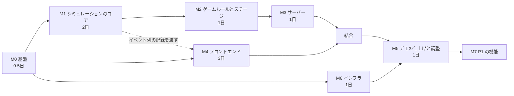

# 実装計画

| 項目 | 内容 |
|---|---|
| 版 | v0.1（仮決め版） |
| 状態 | Draft。ハッカソンの日程・人数が決まったら工数と並びを見直す（[Q-01](./09-assumptions-and-open-questions.md#q-01)） |

ドキュメントを読んだ人が、そのまま作業を始められるようにするための計画です。各タスクは GitHub Issue にそのまま転記できる粒度にしています。

---

## 1. マイルストーンと順番



- **クリティカルパス**: M0 → M1 → M2 → M3 → 結合 → M5（約 5.5 人日）
- フロントエンド（M4）とインフラ（M6）は M0 の後すぐ並行して始められます。M4 は、M1 の途中で `simcli record` が出すイベント列の記録を使い、サーバーなしで開発します
- 目安の工数は 1 人日 = 集中して作業できる 6〜8 時間。3 人チーム（サーバー 1・フロント 1・どちらも 1）なら 3〜4 日で M5 まで届く想定です

---

## 2. マイルストーンごとの完了条件

| M | 完了条件（Definition of Done） |
|---|---|
| M0 | `make test` / `make lint` がローカルと CI で通る。パッチを当てた `etcd-raft` が `replace` で使われ、上流のテストが通る |
| M1 | `simcli run --stage stage1 --bot greedy --seeds 1..1000` が不変条件の違反なしで終わる。同じシードを 2 回実行してトレースのハッシュが一致する。分断シナリオのテスト（V-1, V-2, V-4）が通る |
| M2 | Stage 1・Stage 2・demo のステージ定義が読み込める。`greedy` ボットで Stage 1 の★1 が 90% 以上のシードで取れる。`islands.json` が ETL で生成されている（データが未入手なら仮の CSV で） |
| M3 | ブラウザ以外のクライアント（Go のテスト）から、セッションを作って WS で 1 ラウンド遊び切れる。TS の型が生成される |
| M4 | 記録したイベント列で、マップ・船の移動・港の手紙・HUD・リザルトが表示される。積む・出航の操作がモックの WS に正しいコマンドを送る |
| 結合 | 本物のサーバーにつないで Stage 1 をクリアできる |
| M5 | デモ台本（[05-game-progression.md §8](./05-game-progression.md)）を本番環境で 3 回連続で通せる。非エンジニア 3 名のテストプレイを実施 |
| M6 | `main` への push で本番に自動デプロイされる。`https://<ドメイン>/api/healthz` が 200 を返す |

---

## 3. タスク一覧

### M0 基盤

| ID | タスク | 関連 | 目安 |
|---|---|---|---|
| T-001 | モノレポの雛形（`server/` `web/` `data/` `infra/`）、`.gitignore`、`Makefile`（`test` `lint` `dev` `gen` `sync-data` `demo-local`） | ADR-0014 | 1h |
| T-002 | `server/go.mod`（Go 1.26、`go.etcd.io/raft/v3 v3.7.0`）。`third_party/etcd-raft` に v3.7.0 を取り込み、乱数を注入するパッチを当て、`PATCHES.md` と `replace` を書く | ADR-0005 | 2h |
| T-003 | パッチの検証スクリプト（上流との差分がパッチだけであることを確認）と、パッチのテスト（`RandIntn` が使われる） | ADR-0005 | 1h |
| T-004 | `web/` を Vite + React + TS で作る。ESLint、Prettier、Vitest | ADR-0010 | 1h |
| T-005 | CI（`.github/workflows/ci.yml`）: Go の vet・`golangci-lint`（`forbidigo` で `time.Now` などを `internal/sim` 以下で禁止）・test、web の lint・typecheck・test | — | 2h |
| T-006 | `CLAUDE.md` / `CONTRIBUTING` の規約を実際の構成に合わせて更新 | — | 0.5h |

### M1 シミュレーションのコア（`server/internal/...`）

| ID | タスク | 関連 | 目安 |
|---|---|---|---|
| T-101 | **最初にやる**: 3 ノードの `RawNode` を即時配達で動かし、選挙 → Propose → Commit → 適用までを確かめる最小の例（`cluster` の土台） | DesignDoc §5 | 3h |
| T-102 | `sim`: `SimTime`、スケジューラ（`(At, Class, Seq)` の優先度キュー）、派生乱数 | §4, §9 | 2h |
| T-103 | `cluster`: `Node`（`RawNode` + `MemoryStorage` + 台帳）、Ready ループ（順序のテスト付き）、Bootstrap と開会式 | §5, V-5 | 4h |
| T-104 | `ledger`: コマンドの形式、適用（花火・屋台）、重複の判定、不変条件 | §7, V-3 | 2h |
| T-105 | `ferry`: 手紙、港キューと規則 R1〜R6、フェリーの状態遷移、航路と遮断 | §6, V-7 | 4h |
| T-106 | `sim.Engine`: 組み立て、`Apply` / `RunUntil` / `DrainEvents` / `Snapshot`、ドメインイベント、トレースとハッシュ | §4.3, §10 | 4h |
| T-107 | 不変条件 I-1〜I-7 の検査（テストモード） | §11 | 3h |
| T-108 | `simcli`: `run`（ボットで回す）、`replay`（入力ログを再生してハッシュを出す）、`record`（クライアント向けのイベント列を書き出す） | §13.5 | 3h |
| T-109 | ボット船長 `random` / `greedy` | §14 | 2h |
| T-110 | シナリオテスト: 分断で少数派が Commit できない / 復旧後にログが揃う / 古い手紙・重複した手紙 / 依頼の再送で二重に消費しない | V-1, V-2, V-4, FR-REQ-06 | 3h |
| T-111 | 決定性テスト（2 回実行・`RunUntil` の刻み方を変える） | V-6 | 1h |

### M2 ゲームルールとステージ

| ID | タスク | 関連 | 目安 |
|---|---|---|---|
| T-201 | `stage`: YAML の読み込みと検証、`islands.json` の読み込み、重みの計算 | データ仕様 §4, §5 | 3h |
| T-202 | `game`: 依頼の発生（台本・ランダム）、役場の `route`、再送、状態の判定 | DesignDoc §8 | 4h |
| T-203 | `game`: スコア・満足度・クリア判定・期限切れ | ゲームデザイン §5 | 2h |
| T-204 | `game`: 嵐（予報つき）。故障・ラッシュ・漂流瓶は P1 | ゲームデザイン §6 | 2h |
| T-205 | `islandsdata` ETL と `islands-select.yaml`、`data/raw/README.md` | データ仕様 §2 | 3h |
| T-206 | `data/curated/` に隠岐の計画書の要約（海上交通・気象）を出典ページ付きで書く | FR-DATA-03 | 2h |
| T-207 | `stage1.yaml` / `stage2.yaml` / `demo.yaml` を書き、`greedy` ボットで難易度を確認 | 進行表 §3, §4, §8 | 3h |
| T-208 | リザルトの統計と「今日の出来事」の文章（台本型） | DesignDoc §10.3 | 2h |

### M3 サーバー

| ID | タスク | 関連 | 目安 |
|---|---|---|---|
| T-301 | `protocol`: 型の定義と `tygo` による TS の生成（`make gen`） | プロトコル仕様 | 2h |
| T-302 | `server`: HTTP（healthz・stages・sessions）、WS（`coder/websocket`）、Origin の検査 | §12.1 | 3h |
| T-303 | セッションループ（ステップ・まとめて送信・一時停止・切断時の自動一時停止・再接続） | §12.2 | 3h |
| T-304 | セッションマネージャ（上限・寿命・レート制限） | §12.3 | 2h |
| T-305 | デモ操作（`DEMO_CONTROLS`） | FR-EVT-07 | 1h |
| T-306 | Dockerfile（マルチステージ、distroless、ARM64） | ADR-0011 | 1h |

### M4 フロントエンド

| ID | タスク | 関連 | 目安 |
|---|---|---|---|
| T-401 | 画面の骨組み（タイトル・ステージ選択・ステージ紹介・ゲーム・リザルト・クレジット） | FR-UI-01〜07 | 3h |
| T-402 | WS クライアント（再接続・`seq` の抜けの検出・ping）と、記録を再生するモック | §13.2, §13.5 | 3h |
| T-403 | zustand ストアと `applyEvent`（Vitest で記録を流してテスト） | §13.2 | 3h |
| T-404 | PixiJS のマップ: 海・島・航路・船（補間）・手紙の山・嵐 | §13.3 | 6h |
| T-405 | フェリー操作パネル（積み荷スロット・行き先・おまかせ・出航）と dnd-kit | ゲームデザイン §3.2 | 4h |
| T-406 | 島の詳細パネル・HUD・通知 | ゲームデザイン §7.2, §7.3 | 3h |
| T-407 | エンジニアパネル（ノード一覧・手紙の詳細） | FR-ENG-01〜03 | 3h |
| T-408 | リザルト画面と花火大会の演出 | ゲームデザイン §7.5 | 3h |
| T-409 | Stage 1 のチュートリアル | 進行表 §7 | 2h |

### M5 デモの仕上げと調整

| ID | タスク | 目安 |
|---|---|---|
| T-501 | パラメータの調整（`simcli` で多数のシードを回して★の取りやすさを確認 → 人がプレイして調整） | 4h |
| T-502 | デモ用のシードの選定とリハーサル | 2h |
| T-503 | 非エンジニアのテストプレイ（3 名）と修正 | 3h |
| T-504 | `make demo-local`（ノート PC でサーバーとフロントを起動する保険） | 1h |

### M6 インフラ

| ID | タスク | 目安 |
|---|---|---|
| T-601 | Terraform: ネットワーク（VPC・public subnet × 2）、ECR、ECS（クラスター・サービス・タスク定義）、ALB、S3、CloudFront（2 つのオリジンとビヘイビア）、ACM、Route 53（ドメインがあれば） | 4h |
| T-602 | GitHub Actions の OIDC 用 IAM ロール、`deploy.yml`（イメージのビルドと push → ECS の更新、web のビルド → S3 sync → キャッシュの無効化） | 3h |
| T-603 | CloudWatch のロググループ・メトリクスフィルタ・アラーム | 1h |
| T-604 | 本番でのスモークテスト（healthz と、WS で 1 ラウンド） | 1h |

### M7 P1（MVP の後）

Stage 3、積み替え（中継倉庫）、共有予算、故障・ラッシュ・漂流瓶、エンジニアモードのフル機能（ログ・Progress・分断・タイムライン）、リプレイと記録のダウンロード、速度変更、ステージの解放の保存、E2E テスト、夜間のファジング。

---

## 4. 最初の 1 時間でやること（M0 の具体的な手順）

```bash
mkdir -p server web data/{raw,curated,stages} infra/terraform
```

```bash
cd server && go mod init github.com/K-Kizuku/raft-game/server && go get go.etcd.io/raft/v3@v3.7.0
```

```bash
mkdir -p server/third_party && cp -r "$(cd server && go list -m -f '{{.Dir}}' go.etcd.io/raft/v3)" server/third_party/etcd-raft && chmod -R u+w server/third_party/etcd-raft
```

```bash
cd server && go mod edit -replace go.etcd.io/raft/v3=./third_party/etcd-raft
```

```bash
pnpm create vite web --template react-ts
```

パッチの内容は [ADR-0005](./adr/0005-deterministic-raft-rng-patch.md) にあります。

---

## 5. 開発の進め方

- ブランチ: `main` は常にデプロイできる状態。作業は `feat/…` `fix/…` ブランチで行い、PR でマージする
- PR には、関係する要件 ID（FR-…）またはタスク ID（T-…）を書く
- 仕様を変える場合は、**先にドキュメント（または ADR）を更新**し、同じ PR でコードを変える
- 新しい技術的な判断をしたら ADR を追加する（[adr/README.md](./adr/README.md)）
- ゲームの数値の変更はステージ定義だけで行い、変更の理由を PR に書く
