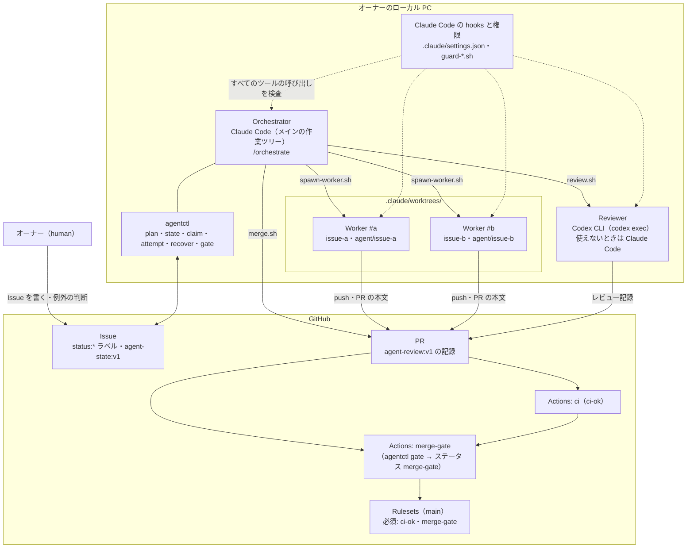

# AI エージェントによる並列開発（全体像）

| 項目 | 内容 |
|---|---|
| 対象 | このリポジトリを AI エージェント（Claude Code・Codex CLI）で並列に開発する仕組み |
| 判断の記録 | [ADR-0021](../adr/0021-hootl-agent-development.md)（エージェントの運用）、[ADR-0019](../adr/0019-parallel-local-development.md)（ローカル環境の分離） |
| 仕組みの実装 | #2（CI）・#3（Merge Gate）・#4（計画と状態）・#5（役割と hooks・スクリプト） |

この文書は全体像と、役割・強制の仕組みをまとめる。手順は次の 2 つに分ける。

| 文書 | 内容 |
|---|---|
| [workflow.md](./workflow.md) | Issue の書き方・状態と遷移・スケジューリング・実装からマージまでの流れ・レビュー・Merge Gate・Conflict の解消 |
| [operations.md](./operations.md) | 初期セットアップ・運用のコマンド・Worktree の管理・障害からの復旧・再試行・ロールバック・人間が介入する条件・検証の結果 |

ローカルのポート・`DEV_SLOT`・`cf` の状態の分け方は [ADR-0019](../adr/0019-parallel-local-development.md) に書いてあり、ここでは繰り返さない。日々の規約（禁止事項の一覧）は [CLAUDE.md](../../CLAUDE.md) にある。

---

## 全体像

- 人（オーナー）は Issue を書き、例外のときだけ判断する。ふだんの実装・レビュー・マージはエージェントが行う（human-out-of-the-loop）
- 1 Issue＝1 Worker＝1 Worktree＝1 ブランチ `agent/issue-<n>`＝1 PR
- 状態は GitHub の Issue のラベル `status:*` と、Issue のコメントの記録（`agent-state:v1`）に置く。ローカルの PC が止まっても、GitHub の状態から復旧できる
- マージしてよいかは、Merge Gate（`agentctl gate`）が GitHub の状態だけから決める。エージェントの自己申告では決めない
- すべてオーナーのローカル PC で動かす。GitHub Actions は CI と Merge Gate の判定だけを行い、AI を動かさない

## アーキテクチャとエージェントの構成

| 構成要素 | 実体 | 起動のしかた |
|---|---|---|
| Orchestrator | Claude Code。メインの作業ツリーで `AGENT_ROLE=orchestrator` | オーナーが起動し、[`/orchestrate`](../../.claude/skills/orchestrate/SKILL.md) で 1 周を回す |
| Worker | Claude Code。[.claude/agents/worker.md](../../.claude/agents/worker.md) の定義。`claude -p -w issue-<n>` | [scripts/agents/spawn-worker.sh](../../scripts/agents/spawn-worker.sh) |
| Reviewer | まず Codex CLI（`codex exec --sandbox read-only`）。使えないときだけ別セッションの Claude Code（[.claude/agents/reviewer.md](../../.claude/agents/reviewer.md) の本文） | [scripts/agents/review.sh](../../scripts/agents/review.sh) |
| agentctl | Go の CLI（[tools/agentctl](../../tools/agentctl/main.go)）。状態の遷移と判定の正本 | [scripts/agents/agentctl.sh](../../scripts/agents/agentctl.sh)（ビルドして実行） |
| 設定 | [.agents/config.json](../../.agents/config.json)（`max_workers`・`retry_limit`・必須のチェック・レビュー・保護されたパス） | — |
| CI | [.github/workflow-sources/ci.yml](../../.github/workflow-sources/ci.yml)。ジョブ `ci-ok` が必須のチェック | PR と push |
| Merge Gate | [.github/workflow-sources/merge-gate.yml](../../.github/workflow-sources/merge-gate.yml)。main のコードの `agentctl gate` でステータス `merge-gate` を付ける | PR・コメント・CI の完了 |

## 各エージェントの責務と権限

役割は環境変数 `AGENT_ROLE`（`orchestrator`・`worker`・`reviewer`・`human`）で決まる。未設定なら、リンクした Worktree の中は `worker`、それ以外は `orchestrator`（[.claude/hooks/lib.sh](../../.claude/hooks/lib.sh) の `detect_role`）。

| 役割 | 責務 | 書き込めるもの | 実行できるスクリプト | してはいけないこと |
|---|---|---|---|---|
| Orchestrator | 計画（`agentctl plan`）、Issue の補足、Worker の起動、状態の遷移、レビューの依頼、Merge Gate を通したマージ、Worktree の片付け、人への報告 | `.agents/`・`.claude/worktrees/` だけ（コード・テスト・ドキュメントは直接変えない） | `spawn-worker.sh`・`review.sh`・`merge.sh`・`wt.sh`・`status.sh`・`agentctl.sh` | `gh pr merge`（`merge.sh` を使う）、`install-workflows.sh`、全員の禁止事項 |
| Worker | 担当の Issue 1 つを、自分の Worktree とブランチ `agent/issue-<n>` で実装・テスト・コミット・push。PR の本文を書く | 自分の Worktree の中（`.git/` を除く）。保護されたパスは、Issue の変更予定ファイルに含まれるとき（`AGENT_ALLOW_PROTECTED=1`）だけ | なし（`merge.sh`・`review.sh`・`spawn-worker.sh`・`wt.sh` は拒否） | 自分のブランチ以外への push、状態を `merged`・`ready-to-merge` にする、`gh pr review`、全員の禁止事項 |
| Reviewer | PR の差分を読み、レビュー記録（verdict・summary・findings・protected_paths_ack）を返す | なし（すべての書き込みを拒否） | なし | ファイルの変更、`git push`・`commit` などの書き込み、インタプリタ、`gh` の書き込み、リダイレクト |
| human（オーナー） | Issue を書く、初期セットアップ、例外の判断、`human-approved` の付与、ワークフローの取り込み、Rulesets・シークレット | 制限しない | `install-workflows.sh`・`apply-repo-settings.sh` | — |

全員（`human` を含む）の禁止事項は [CLAUDE.md](../../CLAUDE.md) の「AI エージェントの役割と禁止事項」にある。

## 強制の仕組みの層

指示（プロンプト）だけに頼らず、外側の層ほど AI が迂回できないように重ねる。

| 層 | 何を強制するか | 実体 | 限界 |
|---|---|---|---|
| 1. GitHub の Rulesets | `main` への直接の push・force push・削除の禁止、PR 経由・squash だけ、必須のステータス `ci-ok`・`merge-gate`（ベースに追いついていること） | [.github/rulesets/main.json](../../.github/rulesets/main.json)。オーナーが [apply-repo-settings.sh](../../scripts/github/apply-repo-settings.sh) で反映 | **誰がマージを実行するかは制限できない。** AI とオーナーが同じ GitHub の認証情報を使うため、条件を満たした PR は AI でもマージできる。オーナーが適用するまで効かない |
| 2. ワークフローの権限 | 有効な CI と Merge Gate（`.github/workflows/`）を AI が書き換えられない | AI の認証に `workflow` 権限がない。正本は [.github/workflow-sources/](../../.github/workflow-sources/ci.yml)、人が [install-workflows.sh](../../scripts/github/install-workflows.sh) で取り込む | 取り込むまでは CI と Merge Gate が GitHub で動かない（[ブートストラップ](./operations.md#ブートストラップワークフローを取り込む前)） |
| 3. Merge Gate | Issue・AC・テスト・CI・レビュー・Conflict・変更の範囲・保護されたパスの 12 の条件（[C1〜C12](./workflow.md#merge-gate-の判定条件)） | `agentctl gate`。ワークフローは main のコードだけで判定し、PR の HEAD を実行しない | 判定の材料（PR の本文・レビュー記録）は AI が書く。記録が正直であることは、信頼する作者（`trusted_authors`）と再レビューに頼る |
| 4. Claude Code の hooks と権限 | 役割ごとの禁止事項（[下の表](#hooks-と権限が拒否する操作)）。`merge.sh` は Orchestrator だけ | [.claude/settings.json](../../.claude/settings.json)、[.claude/hooks/](../../.claude/hooks/guard-bash.sh) | **役割の分離は疑似的。** 同じ PC・同じ認証情報で動くので、hooks を通らない経路（スクリプトのファイルの中での書き込み、`cd` してからの相対パス、変数で組み立てたパス）は見分けられない。最後の砦は層 1〜3 とレビュー |
| 5. 指示 | Issue の仕様・Worker と Reviewer の定義・`/orchestrate` の手順・CLAUDE.md | [.claude/agents/](../../.claude/agents/worker.md)、[scripts/agents/prompts/](../../scripts/agents/prompts/worker-implement.md) | 守るかはモデル次第。上の層で検出できるようにしておく |

PR の中の変更でガードを弱められないように、次の 2 つを決めている。

- Merge Gate のワークフローは main をチェックアウトして判定する（PR の HEAD のコードを実行しない）
- Reviewer は main の `.claude/agents/reviewer.md`・`settings.json`・hooks で動かす（`--setting-sources user` と `--settings`。PR の中の定義を読まない）

### hooks と権限が拒否する操作

[guard-bash.sh](../../.claude/hooks/guard-bash.sh)（Bash）・[guard-write.sh](../../.claude/hooks/guard-write.sh)（Edit・Write・MultiEdit・NotebookEdit）・[guard-mcp.sh](../../.claude/hooks/guard-mcp.sh)（GitHub の MCP）と、`settings.json` の `permissions.deny` の内容。拒否は終了コード 2 と、標準エラーの `[guard] 拒否（AGENT_ROLE=…）: 理由`。hooks は fail-closed で、想定外のエラー（`set -e`・`set -u` での終了など）でも終了コード 2 と `[guard] 拒否（内部エラー）: …` を出す（Claude Code は終了コード 2 だけを拒否として扱うため。#107）。

| 対象 | 拒否する操作 | 役割 |
|---|---|---|
| push | `main` への push | 全員 |
| push | `--force`・`-f`・`+refspec`（`--force-with-lease` は `agent/issue-<数字>` へだけ許す）。`--all`・`--mirror`・`--branches`・ワイルドカードの refspec | 全員 |
| push | 自分のブランチ `agent/issue-<AGENT_ISSUE>` 以外への push。担当の Issue が分からないときの push | Worker |
| push | `git push` そのもの | Reviewer |
| GitHub | `gh pr merge`、`gh secret`・`gh variable`・`gh ruleset`、`gh api` でのマージ・Rulesets・ブランチ保護・シークレット・変数の操作（GraphQL の `mergePullRequest` なども） | 全員 |
| GitHub | ラベル `human-approved` を付ける（`--remove-label` は許す） | 全員 |
| GitHub | `curl`・`wget` での `api.github.com` への書き込み（`POST`・`PUT`・`PATCH`・`DELETE`・`-d` など） | 全員 |
| GitHub | `gh pr review` | Worker・Reviewer |
| GitHub | `gh issue`・`label`・`release`・`gist`、`gh pr comment`・`edit`・`create` など、`gh api` の書き込み | Reviewer |
| MCP | `merge_pull_request`・`enable_pr_auto_merge`・`update_pull_request_branch`・`pull_request_review_write` | Orchestrator 以外 |
| git | `git worktree remove --force`・`-f` | 全員 |
| git | `git -c alias.*`・`git config alias.*` の設定・`GIT_CONFIG_*` の環境変数（別名で判定をすり抜けられるため） | human 以外 |
| git | `commit`・`add`・`rebase`・`checkout` など書き込みにあたるサブコマンド、ブランチの作成・変更 | Reviewer |
| シェル | `eval` | human 以外 |
| シェル | `rm -r` で `/`・ホーム・リポジトリのルートを消す、`--no-preserve-root` | 全員 |
| シェル | インタプリタ（`python3`・`node` など）、ファイルを書き換えるコマンド（`cp`・`mv`・`tee`・`sed -i`・`awk` の `>` など）、リダイレクト `>` | Reviewer |
| スクリプト | `install-workflows.sh` | human 以外 |
| スクリプト | `merge.sh`・`review.sh`・`spawn-worker.sh`・`wt.sh` | Worker・Reviewer |
| スクリプト | `agentctl state … merged`・`ready-to-merge` | Worker・Reviewer |
| スクリプト | `agentctl` の書き込み（サブコマンド `comment`・`state`・`claim`・`attempt` と `gate` の `--comment`・`--set-status`）。字句の安全側の判定で、コマンドの文字列のどこかに agentctl の語（`agentctl.sh`・`.agents/bin/agentctl`・`tools/agentctl` など。単語 `go` と `run` の両方があるときも）と書き込みの語の両方があれば拒否する。`--dry-run` の例外はなく、シェルのコメントや引用符の中の語でも拒否する。行の継続（`\` と改行）と `$'...'`・`$"..."` の `$` を取り除いてから、改行・タブも区切りとして語を読み、正規化しきれない `$'...'` があるときは agentctl の語と書き込みの語のどちらか一方でもあれば拒否する。Worker がコミットメッセージや PR の本文に agentctl の語と書き込みの語を書くときは、`git commit -F <ファイル>` のようにファイルで渡す。読み取り（`plan`・`recover`・`review`・`pr view`・`pr codex-record`・`pr protected-files`・フラグのない `gate`）は通る。`comment` は信頼する作者の認証情報で PR に書くため | Worker・Reviewer |
| インフラ | `wrangler`、`cf deploy`（`--dry-run` を除く） | 全員 |
| ファイル | `.github/workflows/` への書き込み（Edit・Write、リダイレクト、`cp` などの Bash） | human 以外 |
| ファイル | すべての書き込み | Reviewer |
| ファイル | 自分の Worktree の外・`.git/` の中への書き込み | Worker |
| ファイル | 保護されたパス（`.agents/config.json` の `protected_paths`）への書き込み（Edit・Write と、Bash の書き込みのコマンド・リダイレクト・インタプリタのコードの中のパス）。`AGENT_ALLOW_PROTECTED=1` のときだけ許す | Worker |
| ファイル | `.agents/`・`.claude/worktrees/` 以外への書き込み。ただし、リポジトリの外では Claude Code のこのプロジェクトのメモリのディレクトリ `$HOME/.claude/projects/<キー>/memory/` の下にだけ書ける（`<キー>` はメインの作業ツリーの絶対パスの `/` を `-` に置き換えたもの。例: `/Users/me/work/raft-game` → `-Users-me-work-raft-game`）。別のキー・`memory/` の外（`projects/<キー>/` の直下など）・`..` を含むパス・シンボリックリンク（`<キー>`・`memory` 自身を含む）は拒否する | Orchestrator |
| 読み取り | `.env`・`.env.*`・`*.secrets*`（`permissions.deny`） | 全員 |

`AGENT_ALLOW_PROTECTED=1` は、Issue の変更予定ファイルが保護されたパスと重なるときに `spawn-worker.sh` が付ける。Merge Gate の C12 で、保護されたパスの変更はレビューで「確認した・ガードを弱めない」と記録されていなければ fail になる。

Claude Code は、`dontAsk` のエージェントのセッションから `.claude/` への書き込みをそもそも拒否する。`.claude/**` を変える Issue の扱いは [operations.md](./operations.md#claude-を変える-issue) にある。

## 関連

- [ADR-0021](../adr/0021-hootl-agent-development.md): この運用を選んだ理由と、選ばなかった選択肢
- [ADR-0019](../adr/0019-parallel-local-development.md): ローカル環境（ポート・`DEV_SLOT`・`cf` の状態・Docker）の分け方
- [実装計画 §5](../08-implementation-plan.md#5-開発の進め方): 開発の進め方
- [CLAUDE.md](../../CLAUDE.md): エージェントが守る規約とコマンド
