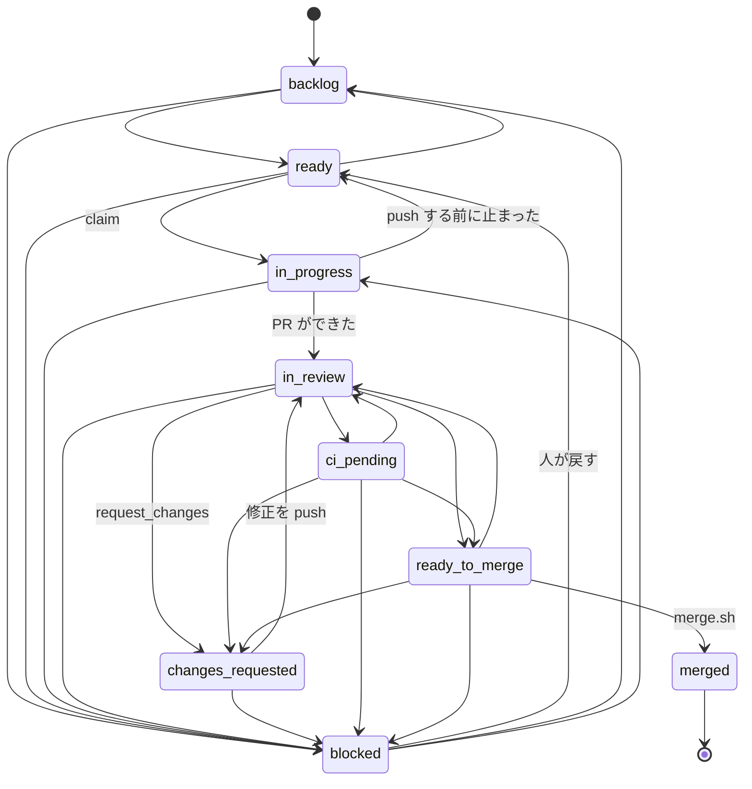
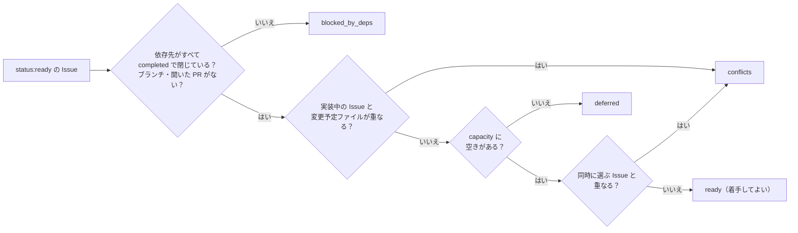
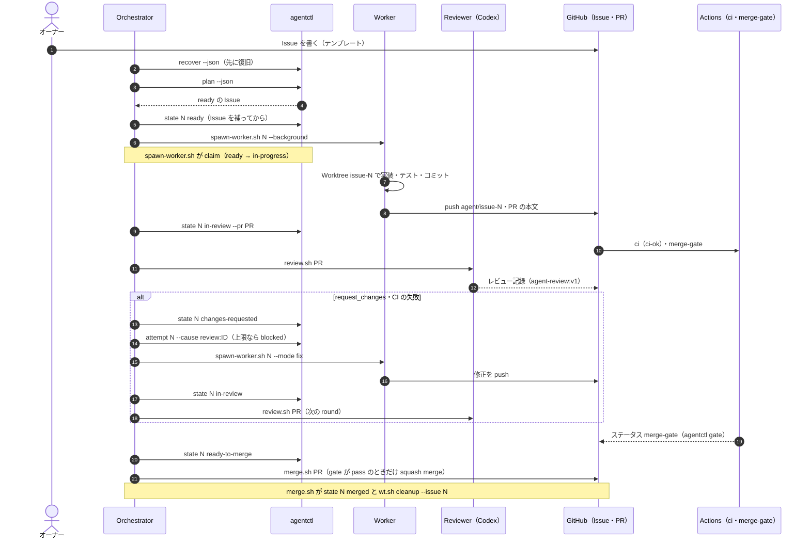
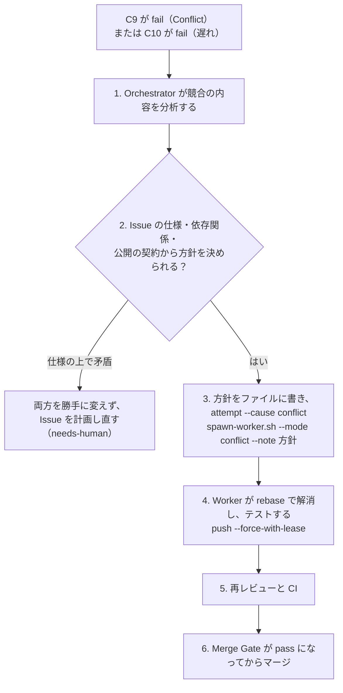

# 並列開発の流れ（Issue からマージまで）

全体像と役割は [README.md](./README.md)、コマンドと障害の対応は [operations.md](./operations.md) にある。この文書の表は、main のコード（[tools/agentctl](../../tools/agentctl/main.go)・[scripts/agents](../../scripts/agents/merge.sh)）に合わせている。食い違ったらコードが正。

---

## Issue の書き方とテンプレート

Issue は Worker にとって**タスクの唯一の正本**で、Merge Gate と `agentctl` がその書式を読む。テンプレートは [.github/ISSUE_TEMPLATE/agent-task.md](../../.github/ISSUE_TEMPLATE/agent-task.md)。

### 書式の約束

- 節は `## ` の見出しで分ける。見出しの名前を変えない（`agentctl` が名前で探す）
- コードブロックと HTML コメントの中は読まれない
- 本文の最初の行に `親: #<番号> ／ タスク ID: <ID> ／ 種類: <…>` を書く

### 各節の意味

| 節 | 書くこと | 読むもの |
|---|---|---|
| 背景・目的 | なぜ必要か | Worker・Reviewer |
| スコープ（対象・対象外） | やること・やらないこと。対象外は明記する | Worker・Reviewer |
| 実装仕様 | 振る舞い・書式・コマンド名など、公開の契約 | Worker・Reviewer |
| 技術方針・インターフェース | 使う技術、型、関数の形 | Worker |
| 変更予定ファイル | 変えてよいファイル。1 行に 1 つの glob をインラインコードで書く（`**` は 0 個以上のディレクトリ） | Merge Gate の C11、`agentctl plan` の競合の判定、`spawn-worker.sh`（保護されたパスとの重なり） |
| 変更禁止範囲 | 変えてはいけないファイル。書き方は変更予定ファイルと同じ | Merge Gate の C11 |
| 依存 Issue | `- #番号` の箇条書き。なければ `- なし` | `agentctl plan`・`claim`（依存先がすべて completed で閉じるまで着手しない） |
| エッジケースとエラー処理 | 異常系の扱い | Worker |
| テストケース | 追加するテスト | Worker・Reviewer |
| ドキュメント更新 | 更新する文書 | Worker |
| Acceptance Criteria | `- [ ] AC-1: …` のチェックボックス。検証できる形で書く | Merge Gate の C2（PR に同じ件数を転記し、すべてチェックする） |
| Definition of Done | 完了の条件 | 人・Orchestrator |

### 落とし穴

- 変更予定ファイルの glob の末尾を `/` にしない（Merge Gate の C11 が fail にする）。ディレクトリは `docs/agents/**` のように書く
- 変更予定ファイルの先頭をワイルドカード（`**/*.go` など）にすると、保護されたパスとの重なりを判定できない。`spawn-worker.sh` は警告を出して「重ならない」とみなす。具体的なパスから書く
- 変更予定ファイルがない Issue は、`agentctl plan` がすべてのファイルと重なる（`**`）とみなすので、ほかの Issue と並列にならない
- Epic（親の Issue）には `status:*` を付けない。`agentctl plan` が作業中として数え、容量を減らす
- Issue の本文に足りないものがあれば、Orchestrator が Issue のコメントに補足を書いてから `status:ready` にする。補足は実装仕様の一部として扱う

## 状態と遷移

状態は Issue のラベル `status:<状態>` で、ちょうど 1 つだけ付ける。遷移は `agentctl state <issue> <状態>` で行い、遷移表（[state.go](../../tools/agentctl/internal/state/state.go) の `transitions`）にない遷移は拒否される（終了コード 1）。遷移のたびに、Issue のコメントに記録（`<!-- agent-state:v1 {…} -->`）を付ける。



図の `in_progress` などは、ラベルでは `status:in-progress` のようにハイフンで書く。

| 状態（ラベル） | 意味 | 遷移できる先 |
|---|---|---|
| `backlog` | まだ着手しない | `ready`・`blocked` |
| `ready` | 着手してよい（Issue の本文が揃っている） | `in-progress`・`backlog`・`blocked` |
| `in-progress` | Worker が実装中 | `in-review`・`ready`・`blocked` |
| `in-review` | PR があり、レビュー中 | `changes-requested`・`ci-pending`・`ready-to-merge`・`blocked` |
| `changes-requested` | レビューか CI の指摘への対応中 | `in-review`・`blocked` |
| `ci-pending` | レビューは済み、CI の結果待ち | `ready-to-merge`・`changes-requested`・`in-review`・`blocked` |
| `ready-to-merge` | Merge Gate を通す直前 | `merged`・`in-review`・`changes-requested`・`blocked` |
| `merged` | マージ済み（終わり） | なし |
| `blocked` | 人の判断が必要 | `ready`・`backlog`・`in-progress` |

- `merged` へは、Issue に関係する（信頼する作者の）PR が実際にマージされているときだけ遷移できる
- `ready` → `in-progress` は `agentctl claim` で行う。前提（`status:ready`・依存が完了・ブランチ `agent/issue-<n>` と開いた PR がない）を満たさなければ終了コード 4。同じ worker と session での 2 回目は何もせず成功する
- Worker（と Reviewer）は、状態を `merged`・`ready-to-merge` にできない（hooks が拒否する）
- 記録は JSON で `from`・`to`・`actor`・`worker`・`branch`・`session`・`attempt`・`cause`・`reason`・`pr`・`at` を持つ。信頼する作者（`trusted_authors` か `AGENTCTL_BOT_LOGIN`、既定は `github-actions[bot]`）のコメントだけを読む

## 並列タスクのスケジューリング

`agentctl plan` が、開いている Issue（`status:*` のラベルを持つもの）の依存関係の DAG から、着手してよい Issue を選ぶ（[plan.go](../../tools/agentctl/internal/plan/plan.go)）。



| 項目 | 規則 |
|---|---|
| DAG | 「依存 Issue」の節から作る。循環か、存在しない依存先があれば終了コード 3（人が Issue を直す） |
| 容量 | `capacity = max_workers −（in-progress と changes-requested の数）`。`max_workers` は [.agents/config.json](../../.agents/config.json) で 5。同時に動く数を増やすと、CPU（`go test -race`・`pnpm install` の重なり）と API の利用量が増える |
| 順番 | クリティカルパス（後ろに続く依存の鎖の長さ）の長いものを先に、同じなら番号の小さいものを先に |
| 競合の回避 | 変更予定ファイルの glob の、最初のワイルドカードより前の部分が、一方が他方の前方一致なら「重なる」とみなす（控えめな判定）。実装中の Issue（`in-progress`〜`ready-to-merge`）と、同時に選ぶ Issue の両方と比べる |
| 追記だけのファイル | `shared_append_files`（`CLAUDE.md`・`docs/README.md`・`docs/adr/README.md`・`docs/08-implementation-plan.md`）だけの重なりは、競合にせず警告にする。マージの後の Conflict は [Conflict の解消](#conflict-の解消の手順) で扱う |
| 数える PR | 作者が `trusted_authors`（か `AGENTCTL_BOT_LOGIN`）のものだけ |

`spawn-worker.sh` も、動いている Worker（`.agents/run/issue-*.json` の pid が生きているもの）が `max_workers` 以上なら起動を拒否する。DAG の図は `agentctl plan --mermaid` で出せる。

## 実装からマージまでの流れ



- Orchestrator の 1 周の手順は [/orchestrate](../../.claude/skills/orchestrate/SKILL.md) にある
- Worker のプロンプトは、モードごとに [implement](../../scripts/agents/prompts/worker-implement.md)・[fix](../../scripts/agents/prompts/worker-fix.md)・[conflict](../../scripts/agents/prompts/worker-conflict.md)
- Worker は最後に、PR の本文の AC・「テスト」「ドキュメント」のチェックボックスを埋め、`## Orchestrator への報告` に仕様の問題を書く
- PR の本文に、閉じる Issue 以外の `Closes`・`Fixes`・`Resolves` と `#番号` の組を書かない（例として書いても C2 が数え、GitHub が別の Issue を閉じる危険がある）

## Codex レビューの実行方法とフォールバック

レビューは [scripts/agents/review.sh](../../scripts/agents/review.sh) で行う（Orchestrator だけが実行できる）。

```bash
scripts/agents/review.sh <pr>
```

```bash
scripts/agents/review.sh <pr> --no-post
```

| 手順 | 内容 |
|---|---|
| 1. 取り出し | PR の HEAD を一時的な Worktree に `--detach` で取り出す（終わったら必ず消す） |
| 2. 文脈 | Issue の本文（PR の本文の `Closes #N` から）・差分・前回のレビュー記録を渡す。round は前回の round ＋ 1（初回は 1） |
| 3. Codex | `codex exec --sandbox read-only --output-schema …` を `timeout`（既定 300 秒、`AGENT_CODEX_TIMEOUT`）付きで実行する |
| 4. 失敗の分類 | 標準エラーと終了コードから理由を決める（下の表）。4 つの理由に当たらない失敗とスキーマに合わない出力は、`retry_limit` 回まで Codex で再試行し、だめなら終了コード 5 |
| 5. フォールバック | 理由が 4 つのどれかで `allow_fallback` が true のときだけ、別セッションの Claude Code（`AGENT_ROLE=reviewer`）に切り替える。記録の `reviewer` は `claude-fallback`、`fallback_reason` に理由が入る |
| 6. 記録 | `agentctl review validate` で検証し、`agentctl review render` で本文にして PR にコメントする |

| `fallback_reason` | 判定のしかた |
|---|---|
| `not_installed` | `codex` のコマンドがない |
| `auth_error` | `not logged in`・HTTP 401/403・`authentication failed` など |
| `rate_limited` | HTTP 429・`rate limit exceeded`・`usage limit` |
| `service_unavailable` | 終了コード 124（タイムアウト）・HTTP 5xx・`ECONNREFUSED` など・`Proxy connection failed`・`stream disconnected` |

- ネットワークが遮断された環境では `codex exec` が終わらないので、タイムアウト（終了コード 124）で `service_unavailable` になってフォールバックする
- 標準エラーのうち、プロンプト（Issue の本文など）を echo した行は分類に使わない（Issue の本文の「auth」などの語に一致させない）
- フォールバックの Reviewer は、`--agent` を使わず、main の `reviewer.md` の本文（`--append-system-prompt`）とツール、main の `settings.json` と hooks（`--setting-sources user`・`--settings`）で動く。PR が自分のレビューのガードを書き換えられないようにするため
- `--reviewer codex` で Codex だけ、`--reviewer claude`（`AGENT_FALLBACK_REASON` に理由が必要）で Claude Code だけを使う

## レビュー記録の書式

PR のコメントに、目印 `<!-- agent-review:v1 -->` を 1 つと、言語 `json` のコードブロックを 1 つ含める（[review.go](../../tools/agentctl/internal/review/review.go)）。

```json
{
  "schema": "agent-review/v1",
  "pr": 12,
  "head_sha": "0123456789abcdef0123456789abcdef01234567",
  "base_sha": "89abcdef0123456789abcdef0123456789abcdef",
  "round": 2,
  "reviewer": "claude-fallback",
  "reviewer_version": "claude-code 2.x",
  "fallback_reason": "service_unavailable",
  "verdict": "approve",
  "summary": "round 1 の F1 は直っている。",
  "protected_paths_ack": { "reviewed": true, "weakens_guards": false },
  "findings": [
    {
      "id": "F1", "severity": "high", "category": "correctness",
      "file": "tools/agentctl/internal/plan/plan.go", "line": 120,
      "title": "…", "detail": "…", "status": "resolved", "resolution": "…"
    }
  ],
  "created_at": "2026-11-06T12:00:00Z"
}
```

| 項目 | 値 |
|---|---|
| `head_sha`・`base_sha` | 40 桁の 16 進（小文字） |
| `round` | 1 以上。同じ PR の記録は round で並べ、最新のものを判定に使う |
| `reviewer` | `codex` か `claude-fallback`。`codex` のとき `fallback_reason` は空、`claude-fallback` のときは必須 |
| `verdict` | `approve` か `request_changes` |
| `protected_paths_ack` | `reviewed` と `weakens_guards`（どちらも必須の真偽値） |
| `findings[].severity` | `critical`・`high`・`medium`・`low`・`info`。`blocking_severities`（`critical`・`high`）が重大な指摘 |
| `findings[].category` | `correctness`・`security`・`performance`・`concurrency`・`test-coverage`・`spec`・`maintainability` |
| `findings[].status` | `open`・`resolved`・`wont_fix` |
| 指摘の ID | 再レビューでは前回の ID を引き継ぎ、状態を更新する。重大な指摘は、最新の記録で `resolved` にしなければならない（C7） |

記録は手でも検証・表示できる。

```bash
go -C tools/agentctl run . review validate "$PWD/review.json"
```

```bash
go -C tools/agentctl run . review render "$PWD/review.json"
```

## Merge Gate の判定条件

`agentctl gate`（[gate.go](../../tools/agentctl/internal/gate/gate.go)）が、設定と GitHub の状態のスナップショットだけから判定する。1 つでも fail があれば **fail**、fail がなく pending があれば **pending**、すべて pass なら **pass**。終了コードは pass=0・fail=1・pending=2・内部エラー=3。

| ID | 条件 | pending になるとき | fail になるとき |
|---|---|---|---|
| G0 | 設定（`.agents/config.json`）が正しい | — | 設定がない・不正 |
| C1 | PR が開いていて draft ではなく、ベースが既定のブランチ（`main`）で、止めるラベルがない | — | マージ済み・閉じている・draft・ベースが違う・HEAD の SHA が不正・ラベル `status:blocked` か `needs-human` |
| C2 | Issue をちょうど 1 つ閉じ、AC がすべて転記・チェック済み | — | 本文の `Closes`・`Fixes`・`Resolves #N` が 1 つではない・Issue がない／番号が違う／PR である／開いていない・Issue に AC のチェックボックスがない・PR の AC の件数が Issue と違う・チェックされていない AC がある |
| C3 | 「テスト」「ドキュメント」のチェックボックスがすべてチェック済み | — | どちらかの節にチェックボックスがない・チェックされていないものがある |
| C4 | 必須のチェック（`ci-ok`）が HEAD で成功し、失敗したチェックがない | 必須のチェックが未実行・実行中 | 必須のチェックが成功していない・ほかの check run が `failure`・`cancelled`・`timed_out`・`action_required`・ほかのステータスが `failure`・`error`（`merge-gate` と `merge-gate-evaluate` 自身は数えない） |
| C5 | 信頼する作者（`trusted_authors`）のレビュー記録がある | 記録がない | — |
| C6 | 最新のレビュー記録が HEAD に対する `approve` | 記録がない・最新の記録が古い SHA のもの（再レビュー待ち） | 最新の記録の verdict が `approve` ではない |
| C7 | 重大な指摘が残っていない | 記録がない | 最新の記録に `open` の重大な指摘がある・前の round の重大な指摘が最新の記録にない、または `resolved` ではない |
| C8 | レビュー役が `codex` か、正しいフォールバック | 記録がない | `reviewer` が認めない値・`allow_fallback` が false なのに `claude-fallback`・`fallback_reason` が `fallback_reasons` にない |
| C9 | コンフリクトがない | `mergeable` が未計算 | `mergeable=false`・`mergeable_state=dirty` |
| C10 | ベースより遅れていない | — | 比較の結果がない・`main` より遅れている（`behind_by > 0`） |
| C11 | 変更ファイルが Issue の範囲に収まる（名前を変えたファイルは前の名前も見る） | — | Issue がない・変更ファイルの一覧が不完全・「変更予定ファイル」がない・glob が不正（末尾の `/` など）・変更予定ファイルの外か変更禁止範囲のファイルがある |
| C12 | 保護されたパス（`protected_paths`）の変更が確認済みで、ガードを弱めない | 保護されたパスの変更があり、記録がない | 最新の記録の `protected_paths_ack` が `reviewed: true`・`weakens_guards: false` ではない |

- レビュー記録は、信頼する作者のコメントで、目印と JSON が正しく、同じ PR のものだけを数える。最新の記録は round、`created_at`、コメントの作成日時、コメントの ID の順で決める
- Merge Gate のワークフロー（[merge-gate.yml](../../.github/workflow-sources/merge-gate.yml)）は、PR の変更・コメント・CI の完了のたびに判定し、PR の HEAD にコミットステータス `merge-gate` を付け、Merge Gate のコメントを更新する。`--set-status` と `--comment` はこのワークフローだけが使う
- `merge.sh` はマージの直前にもう一度 `agentctl gate` を実行し、pass のときだけ、判定した SHA を `--match-head-commit` に指定して squash merge する

ローカルでの判定（GitHub の状態で、またはスナップショットで）:

```bash
go -C tools/agentctl run . gate --repo K-Kizuku/raft-game --pr 12 --json
```

```bash
go -C tools/agentctl run . gate --repo K-Kizuku/raft-game --pr 12 --json --input "$PWD/tools/agentctl/internal/gate/testdata/pass.json"
```

## Conflict の解消の手順



1. Orchestrator が競合の内容を分析する（どのファイルの、どの変更どうしが衝突したか）
2. Issue の仕様・依存関係・既存の公開の契約に基づき、解消の方針を決める。**新しいコミットや先にマージされた側を、単純に勝ちにしない**
3. 方針をファイルに書き、`agentctl attempt <n> --cause conflict` で数えてから、`spawn-worker.sh <n> --mode conflict --note <方針のファイル>` で Worker に任せる
4. Worker が `git rebase origin/main` で解消し、テストする。方針にない判断が必要なら `git rebase --abort` で戻し、`## Orchestrator への報告` に書いて止める。push は `--force-with-lease`（自分の `agent/issue-<n>` へだけ）
5. 再レビュー（`review.sh`、新しい HEAD に対する round）と CI
6. Merge Gate を通ってからマージする

仕様の上で矛盾しているとき（両方の Issue の要求を同時に満たせないとき）は、両方を勝手に変えず、Issue を計画し直す（[人間が介入する条件](./operations.md#人間が介入する条件)）。

```bash
scripts/agents/agentctl.sh attempt <n> --cause conflict --repo K-Kizuku/raft-game
```

```bash
scripts/agents/spawn-worker.sh <n> --mode conflict --note .agents/run/conflict-<n>.md
```
