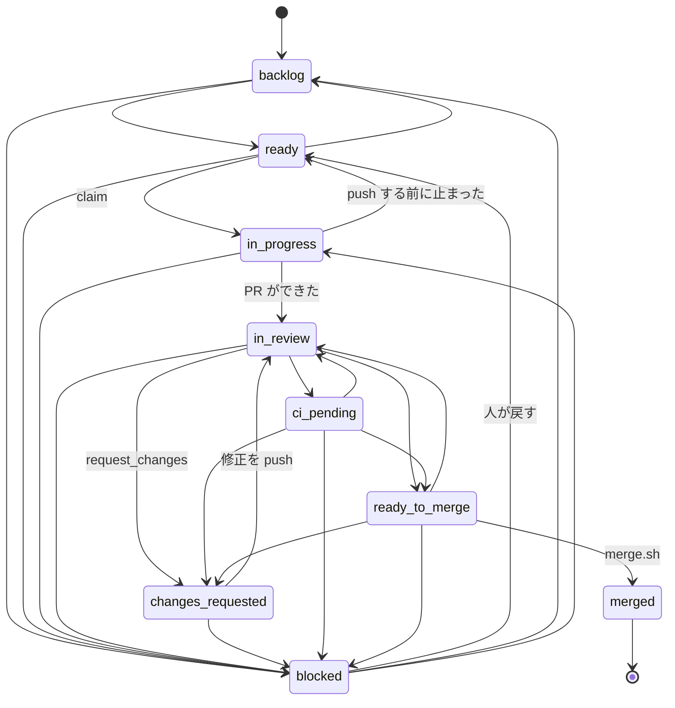
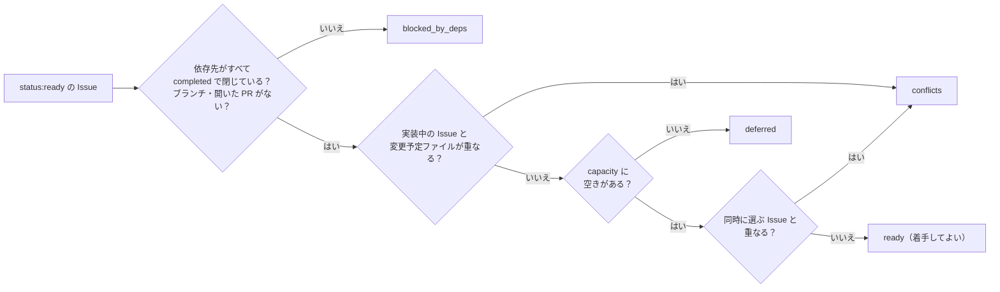
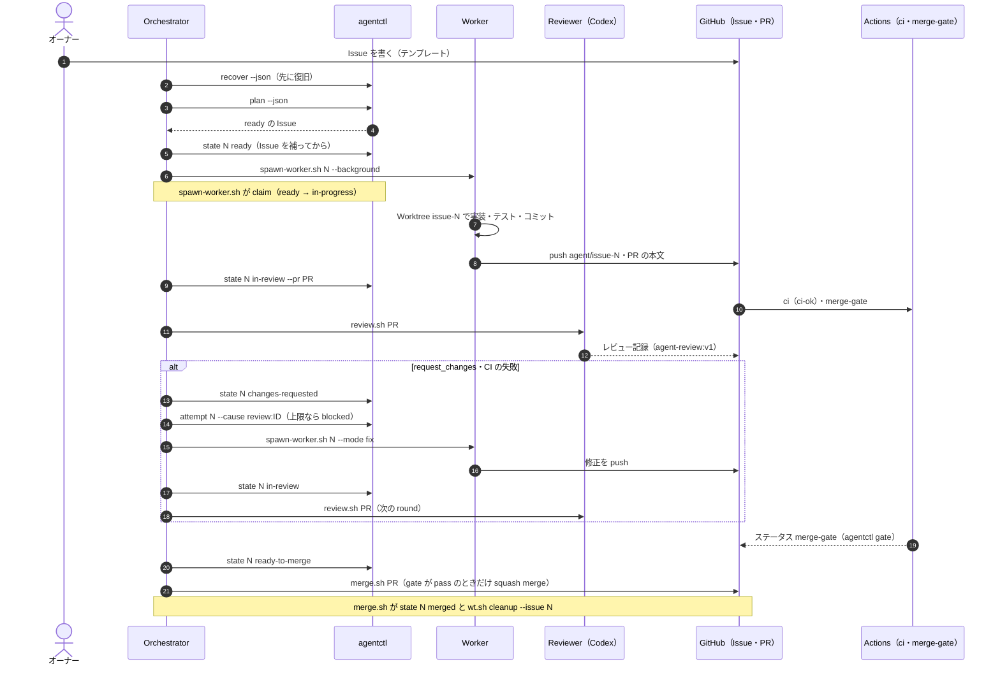
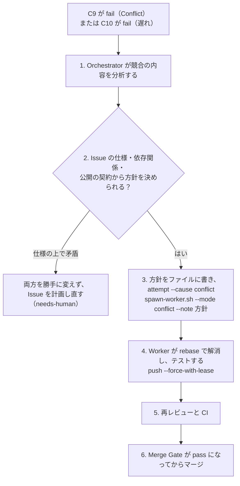

# 並列開発の流れ（Issue からマージまで）

全体像と役割は [README.md](./README.md)、コマンドと障害の対応は [operations.md](./operations.md) にある。この文書の表は、main のコード（[tools/agentctl](../../tools/agentctl/main.go)・[scripts/agents](../../scripts/agents/merge.sh)）に合わせている。食い違ったらコードが正。

---

## Issue の書き方とテンプレート

Issue は Worker にとって**タスクの唯一の正本**で、Merge Gate と `agentctl` がその書式を読む。テンプレートは [.github/ISSUE_TEMPLATE/agent-task.md](../../.github/ISSUE_TEMPLATE/agent-task.md)。

### 書式の約束

- 節は `## ` の見出しで分ける。見出しの名前を変えない（`agentctl` が名前で探す）
- コードブロックと HTML コメントの中は読まれない
- 本文の最初の行に `親: #<番号> ／ タスク ID: <ID> ／ 種類: <…>` を書く

### 各節の意味

| 節 | 書くこと | 読むもの |
|---|---|---|
| 背景・目的 | なぜ必要か | Worker・Reviewer |
| スコープ（対象・対象外） | やること・やらないこと。対象外は明記する | Worker・Reviewer |
| 実装仕様 | 振る舞い・書式・コマンド名など、公開の契約 | Worker・Reviewer |
| 技術方針・インターフェース | 使う技術、型、関数の形 | Worker |
| 変更予定ファイル | 変えてよいファイル。1 行に 1 つの glob をインラインコードで書く（`**` は 0 個以上のディレクトリ） | Merge Gate の C11、`agentctl plan` の競合の判定、`spawn-worker.sh`（保護されたパスとの重なり） |
| 変更禁止範囲 | 変えてはいけないファイル。書き方は変更予定ファイルと同じ | Merge Gate の C11 |
| 依存 Issue | `- #番号` の箇条書き。なければ `- なし` | `agentctl plan`・`claim`（依存先がすべて completed で閉じるまで着手しない） |
| エッジケースとエラー処理 | 異常系の扱い | Worker |
| テストケース | 追加するテスト | Worker・Reviewer |
| ドキュメント更新 | 更新する文書 | Worker |
| Acceptance Criteria | `- [ ] AC-1: …` のチェックボックス。検証できる形で書く | Merge Gate の C2（PR に同じ件数を転記し、すべてチェックする） |
| Definition of Done | 完了の条件 | 人・Orchestrator |

### 落とし穴

- 変更予定ファイルの glob の末尾を `/` にしない（Merge Gate の C11 が fail にする）。ディレクトリは `docs/agents/**` のように書く
- 変更予定ファイルの先頭をワイルドカード（`**/*.go` など）にすると、保護されたパスとの重なりを判定できない。`spawn-worker.sh` は警告を出して「重ならない」とみなす。具体的なパスから書く
- 変更予定ファイルがない Issue は、`agentctl plan` がすべてのファイルと重なる（`**`）とみなすので、ほかの Issue と並列にならない
- Epic（親の Issue）には `status:*` を付けない。`agentctl plan` が作業中として数え、容量を減らす
- Issue の本文に足りないものがあれば、Orchestrator が Issue のコメントに補足を書いてから `status:ready` にする。補足は実装仕様の一部として扱う

### Acceptance Criteria の転記と CI の AC

- Worker は、Issue の `## Acceptance Criteria` の `- [ ] AC-n: …` の行を、PR の本文に**一字一句そのまま**（同じ番号・同じ件数で）写し、満たしたものを `[x]` にする
- AC の下の補足の行（`  - …`）は、PR でもチェックボックスにしない（`  - [x] …` にしない）。チェックボックスにすると C2 が数える AC の件数が Issue より多くなる。Issue を書くときも、補足はチェックボックスでない `  - …` の行で書く
- CI の成否は Merge Gate の C4 が確かめる。AC に CI（「CI（`ci-ok`）が通る」など）を書くときは、Worker が PR を作った（fix・conflict では push した）あと、**チェック `ci-ok` だけ**の結果を待ってからチェックする。`gh pr checks <PR> --json name,bucket` で `name` が `ci-ok` の `bucket` を読み、`pending` の間（`ci-ok` がまだ現れない間も）は 30 秒ごとに読み直す（上限 20 分）。`pass` なら AC を `[x]` にし、`fail` なら原因を直して push する（同じ原因で 3 回まで）。上限を超えたら `[ ]` のまま「## Orchestrator への報告」に書く
  - 必須のステータス `merge-gate` は待たない・見ない。`merge-gate` は CI の AC が未チェックだと C2 で failure になり、レビューの前は pending のままなので、待つと循環する。そのため `gh pr checks` の `--watch`・`--required`・`--fail-fast` は使わない（Merge Gate の判定は変えない）
  - fix・conflict のモードでも同じ。push したあと、再レビューの記録は待たない（Orchestrator がレビューを依頼する）
- Worker は、web の依存（`web/node_modules`）がなければ最初に `pnpm install --frozen-lockfile` を実行する（web を触らない Issue でも `make test` に要る）
- Worker は終わる前に、`gh issue view` と `gh pr view` の AC の行を比べ、件数・文が一致し、すべて `[x]` であることを確かめる

## 状態と遷移

状態は Issue のラベル `status:<状態>` で、ちょうど 1 つだけ付ける。遷移は `agentctl state <issue> <状態>` で行い、遷移表（[state.go](../../tools/agentctl/internal/state/state.go) の `transitions`）にない遷移は拒否される（終了コード 1）。遷移のたびに、Issue のコメントに記録（`<!-- agent-state:v1 {…} -->`）を付ける。



図の `in_progress` などは、ラベルでは `status:in-progress` のようにハイフンで書く。

| 状態（ラベル） | 意味 | 遷移できる先 |
|---|---|---|
| `backlog` | まだ着手しない | `ready`・`blocked` |
| `ready` | 着手してよい（Issue の本文が揃っている） | `in-progress`・`backlog`・`blocked` |
| `in-progress` | Worker が実装中 | `in-review`・`ready`・`blocked` |
| `in-review` | PR があり、レビュー中 | `changes-requested`・`ci-pending`・`ready-to-merge`・`blocked` |
| `changes-requested` | レビューか CI の指摘への対応中 | `in-review`・`blocked` |
| `ci-pending` | レビューは済み、CI の結果待ち | `ready-to-merge`・`changes-requested`・`in-review`・`blocked` |
| `ready-to-merge` | Merge Gate を通す直前 | `merged`・`in-review`・`changes-requested`・`blocked` |
| `merged` | マージ済み（終わり） | なし |
| `blocked` | 人の判断が必要 | `ready`・`backlog`・`in-progress` |

- `merged` へは、Issue に関係する（信頼する作者の）PR が実際にマージされているときだけ遷移できる
- `ready` → `in-progress` は `agentctl claim` で行う。前提（`status:ready`・依存が完了・ブランチ `agent/issue-<n>` と開いた PR がない）を満たさなければ終了コード 4。同じ worker と session での 2 回目は何もせず成功する
- Worker（と Reviewer）は、状態を `merged`・`ready-to-merge` にできない（hooks が拒否する）
- 記録は JSON で `from`・`to`・`actor`・`worker`・`branch`・`session`・`attempt`・`cause`・`reason`・`pr`・`at` を持つ。信頼する作者（`trusted_authors` か `AGENTCTL_BOT_LOGIN`、既定は `github-actions[bot]`）のコメントだけを読む

## 並列タスクのスケジューリング

`agentctl plan` が、開いている Issue（`status:*` のラベルを持つもの）の依存関係の DAG から、着手してよい Issue を選ぶ（[plan.go](../../tools/agentctl/internal/plan/plan.go)）。



| 項目 | 規則 |
|---|---|
| DAG | 「依存 Issue」の節から作る。循環か、存在しない依存先があれば終了コード 3（人が Issue を直す） |
| 容量 | `capacity = max_workers −（in-progress と changes-requested の数）`。`max_workers` は [.agents/config.json](../../.agents/config.json) で 5。同時に動く数を増やすと、CPU（`go test -race`・`pnpm install` の重なり）と API の利用量が増える |
| 順番 | クリティカルパス（後ろに続く依存の鎖の長さ）の長いものを先に、同じなら番号の小さいものを先に |
| 競合の回避 | 変更予定ファイルの glob の、最初のワイルドカードより前の部分が、一方が他方の前方一致なら「重なる」とみなす（控えめな判定）。実装中の Issue（`in-progress`〜`ready-to-merge`）と、同時に選ぶ Issue の両方と比べる |
| 追記だけのファイル | `shared_append_files`（`CLAUDE.md`・`docs/README.md`・`docs/adr/README.md`・`docs/08-implementation-plan.md`）だけの重なりは、競合にせず警告にする。マージの後の Conflict は [Conflict の解消](#conflict-の解消の手順) で扱う |
| 数える PR | 作者が `trusted_authors`（か `AGENTCTL_BOT_LOGIN`）のものだけ |

`spawn-worker.sh` も、動いている Worker（`.agents/run/issue-*.json` の pid が生きているもの）が `max_workers` 以上なら起動を拒否する。DAG の図は `agentctl plan --mermaid` で出せる。

## 実装からマージまでの流れ



- Orchestrator の 1 周の手順は [/orchestrate](../../.claude/skills/orchestrate/SKILL.md) にある
- Worker のプロンプトは、モードごとに [implement](../../scripts/agents/prompts/worker-implement.md)・[fix](../../scripts/agents/prompts/worker-fix.md)・[conflict](../../scripts/agents/prompts/worker-conflict.md)
- Worker は最後に、PR の本文の AC・「テスト」「ドキュメント」のチェックボックスを埋め、`## Orchestrator への報告` に仕様の問題を書く
- PR の本文に、閉じる Issue 以外の `Closes`・`Fixes`・`Resolves` と `#番号` の組を書かない（例として書いても C2 が数え、GitHub が別の Issue を閉じる危険がある）

## Codex レビューの実行方法とフォールバック

レビューは [scripts/agents/review.sh](../../scripts/agents/review.sh) で行う（Orchestrator だけが実行できる）。正規の経路は **Codex の GitHub 連携**（`--via github`、既定）で、api.openai.com に接続できないクラウドのセッションでも使える（Issue #82）。

```bash
scripts/agents/review.sh <pr>
```

```bash
scripts/agents/review.sh <pr> --no-post
```

```bash
scripts/agents/review.sh <pr> --via local
```

### Codex の GitHub 連携（`--via github`、既定）

| 手順 | 内容 |
|---|---|
| 1. 依頼 | `agentctl pr view` で、依頼する前の要約のコメント（`codex_bot_authors` の `codex-review-state`）の `updated_at` を覚える。`agentctl comment` で PR に `@codex review` と書く（`--no-post` でも依頼は投稿する） |
| 2. 待つ | `agentctl pr codex-record --sha <HEAD> --after <依頼する前の updated_at>` を `AGENT_CODEX_GITHUB_POLL` 秒（既定 30）ごとに実行し、対象の SHA の `codex-review-state` の `code_review.status` が `completed` になり、要約のコメントが依頼する前より後に更新されるまで待つ（既定 900 秒、`AGENT_CODEX_GITHUB_TIMEOUT`）。同じ SHA の前のレビューの `completed` を、今回の結果と取り違えない |
| 3. 変換 | Codex の出力を `agent-review/v1` に変換する（下の表）。`agentctl review validate` で検証し、`--no-post` でなければ `agentctl comment` で PR に載せる |
| 4. 保護されたパス | 変更ファイルが `protected_paths` に当たるとき（`agentctl pr protected-files`。確かめられないときも同じ）は、Codex の GitHub 連携の記録に続けて、下のこれまでの経路のレビューも行い、`protected_paths_ack` を持つ記録を作る。両方の記録を出す（GitHub 連携の記録が先、これまでの経路の記録が round ＋ 1 で後。`--out` は後者） |
| 5. フォールバック | タイムアウト、または連携の不調（PR を読めない・`@codex review` を投稿できない・`agentctl` のエラーが `retry_limit` 回続く・変換した記録が不正）のときだけ、`service_unavailable` として下のこれまでの経路（ローカルの Codex CLI → Claude Code）に切り替える |

Codex が PR に書くもの（作者は `review.codex_bot_authors`。既定は `chatgpt-codex-connector[bot]`。ほかの作者の、似せたコメントは無視する）:

| 種類 | 目印 | 使い方 |
|---|---|---|
| 要約のコメント（Issue のコメント） | `<!-- codex-pull-request-review-summary -->` と `<!-- codex-review-state:v1 {…} -->` | `code_review.status == "completed"` のものだけを「レビュー記録」に数える。対象の SHA は `code_review.commit_sha`。新しいレビューのたびに同じコメントが更新されるので、日時は `updated_at`。JSON が壊れていれば無視して警告する |
| 行コメント | `<!-- codex-code-review-finding:v1 -->` と重大度のバッジ `` | 対象の SHA（`original_commit_id`、なければ `commit_id`）の行コメントを指摘とする。P0 → critical、P1 → high、P2 → medium、P3 → low。バッジがない指摘は high とみなす（fail closed） |
| PR のレビュー・指摘がないときのコメント | `<!-- codex-review-receipt:v1 -->` | 判定には使わない（要約のコメントがまだなければ、要約を待つ） |

変換した記録（`agentctl pr codex-record`）:

| 項目 | 値 |
|---|---|
| `reviewer`・`reviewer_version` | `codex`・`chatgpt-codex-connector (GitHub)` |
| `round` | 前回の記録（`--previous`、省略時は PR のコメントの最新のレビュー記録）の round ＋ 1 |
| `findings` | 対象の SHA の行コメントから。`id` は `C<コメントの ID>`、`status` は `open`、`category` は `correctness`、`title` は本文の 1 行目（P0〜P3 を前に付ける）。前回の記録の `open` の指摘で今回の指摘にないものは引き継ぐ。Codex の指摘と重大でない指摘は `resolved`（今回の SHA のレビューで指摘されなかった）にする。**Codex 以外の重大な指摘（critical・high）は、Codex のレビューでは `resolved` にできないので `open` のまま引き継ぐ**。Codex の指摘として扱うのは、`id` が信頼する作者（`codex_bot_authors`）の指摘の行コメント（`codex-code-review-finding:v1`）に対応する `C<コメントの ID>` だけ（ID の形だけでは判断しない。ほかのレビュー役の記録の `C123` などで、対応する行コメントがないものは Codex 以外の指摘）。前の SHA の Codex の指摘は、下の「前の SHA の Codex の指摘」に従う |
| `verdict` | P0・P1 の指摘、または引き継いだ `open` の重大な指摘があれば `request_changes`、なければ `approve` |
| `protected_paths_ack` | `reviewed: false`（Codex は保護されたパスの確認をしない）。保護されたパスを変える PR では C12 が fail になるので、これまでの経路のレビューも続けて行う（手順 4） |

前の SHA の Codex の指摘（Codex は、後のレビューで前の指摘を行コメントとして出し直すとは限らない。Merge Gate の C7 と `agentctl pr codex-record` で同じ扱い）:

- 最新の要約の `code_review.has_unresolved_findings` が `false` なら、それまでの SHA の Codex の指摘はすべて `resolved` とみなす
- `true` のあいだは、前の SHA の Codex の P0・P1（バッジのないものを含む）を `open` のまま引き継ぐ（C7 は fail、変換した記録の `verdict` は `request_changes`）。`resolved` にできるのは、その行コメントより後の `agent-review/v1` の記録（Codex の GitHub 連携の変換ではないもの）が、同じ `id`（`C<コメントの ID>`）を `resolved` にしたときだけ
- 前の SHA の P2・P3 は引き継がない（それだけが残っていてもマージを止めない）

同じ SHA の再レビュー: 最新の完了した要約の `code_review.has_any_findings` と `has_unresolved_findings` がどちらも `false` なら、その SHA の行コメントのうち要約の更新（`updated_at`）より前に作られたものは、前のレビューの指摘（Codex が取り下げた）として `resolved` とみなす（C7 と `pr codex-record` で同じ扱い）。要約の更新より後の行コメントと、作成日時が分からない行コメントは、そのまま判定に使う。

`agentctl pr codex-record` の終了コードは 0=成功・2=まだ終わっていない（対象の SHA の完了したレビューがない・`--after` より後に更新されていない）・3=内部エラー。`agentctl pr protected-files` は、PR の変更ファイル（名前を変えたファイルは前の名前も）のうち `protected_paths` に当たるものを 1 行ずつ出す（C12 と同じ判定）。`agentctl pr view` は PR の状態・コメント・レビュー・行コメントを `gate.Input` の形の JSON で出す（`codex-record --input` にそのまま渡せる）。どちらも REST だけを使い、`GITHUB_TOKEN` か `GH_TOKEN` が要る（`review.sh` は、どちらもなければ `gh auth token` を使う）。

### これまでの経路（`--via local`、または GitHub 連携が使えないとき）

| 手順 | 内容 |
|---|---|
| 1. 取り出し | PR の HEAD を一時的な Worktree に `--detach` で取り出す（終わったら必ず消す） |
| 2. 文脈 | Issue の本文（PR の本文の `Closes #N` から）・差分・前回のレビュー記録を渡す。round は前回の round ＋ 1（初回は 1） |
| 3. Codex | `codex exec --sandbox read-only --output-schema …` を `timeout`（既定 300 秒、`AGENT_CODEX_TIMEOUT`）付きで実行する |
| 4. 失敗の分類 | 標準エラーと終了コードから理由を決める（下の表）。4 つの理由に当たらない失敗とスキーマに合わない出力は、`retry_limit` 回まで Codex で再試行し、だめなら終了コード 5 |
| 5. フォールバック | 理由が 4 つのどれかで `allow_fallback` が true のときだけ、別セッションの Claude Code（`AGENT_ROLE=reviewer`）に切り替える。記録の `reviewer` は `claude-fallback`、`fallback_reason` に理由が入る |
| 6. 記録 | `agentctl review validate` で検証し、`agentctl review render` で本文にして `agentctl comment` で PR にコメントする |

| `fallback_reason` | 判定のしかた |
|---|---|
| `not_installed` | `codex` のコマンドがない |
| `auth_error` | `not logged in`・HTTP 401/403・`authentication failed` など |
| `rate_limited` | HTTP 429・`rate limit exceeded`・`usage limit` |
| `service_unavailable` | 終了コード 124（タイムアウト）・HTTP 5xx・`ECONNREFUSED` など・`Proxy connection failed`・`stream disconnected` |

- ネットワークが遮断された環境では `codex exec` が終わらないので、タイムアウト（終了コード 124）で `service_unavailable` になってフォールバックする
- 標準エラーのうち、プロンプト（Issue の本文など）を echo した行は分類に使わない（Issue の本文の「auth」などの語に一致させない）
- フォールバックの Reviewer は、`--agent` を使わず、main の `reviewer.md` の本文（`--append-system-prompt`）とツール、main の `settings.json` と hooks（`--setting-sources user`・`--settings`）で動く。PR が自分のレビューのガードを書き換えられないようにするため
- `--reviewer codex` で Codex だけ（GitHub 連携 → ローカルの Codex CLI。Claude Code に切り替えない）、`--reviewer claude`（`AGENT_FALLBACK_REASON` に理由が必要）で Claude Code だけを使う（GitHub 連携も使わない）

## レビュー記録の書式

PR のコメントに、目印 `<!-- agent-review:v1 -->` を 1 つと、言語 `json` のコードブロックを 1 つ含める（[review.go](../../tools/agentctl/internal/review/review.go)）。

```json
{
  "schema": "agent-review/v1",
  "pr": 12,
  "head_sha": "0123456789abcdef0123456789abcdef01234567",
  "base_sha": "89abcdef0123456789abcdef0123456789abcdef",
  "round": 2,
  "reviewer": "claude-fallback",
  "reviewer_version": "claude-code 2.x",
  "fallback_reason": "service_unavailable",
  "verdict": "approve",
  "summary": "round 1 の F1 は直っている。",
  "protected_paths_ack": { "reviewed": true, "weakens_guards": false },
  "findings": [
    {
      "id": "F1", "severity": "high", "category": "correctness",
      "file": "tools/agentctl/internal/plan/plan.go", "line": 120,
      "title": "…", "detail": "…", "status": "resolved", "resolution": "…"
    }
  ],
  "created_at": "2026-11-06T12:00:00Z"
}
```

| 項目 | 値 |
|---|---|
| `head_sha`・`base_sha` | 40 桁の 16 進（小文字） |
| `round` | 1 以上。同じ PR の記録は round で並べ、最新のものを判定に使う |
| `reviewer` | `codex` か `claude-fallback`。`codex` のとき `fallback_reason` は空、`claude-fallback` のときは必須 |
| `verdict` | `approve` か `request_changes` |
| `protected_paths_ack` | `reviewed` と `weakens_guards`（どちらも必須の真偽値） |
| `findings[].severity` | `critical`・`high`・`medium`・`low`・`info`。`blocking_severities`（`critical`・`high`）が重大な指摘 |
| `findings[].category` | `correctness`・`security`・`performance`・`concurrency`・`test-coverage`・`spec`・`maintainability` |
| `findings[].status` | `open`・`resolved`・`wont_fix` |
| 指摘の ID | 再レビューでは前回の ID を引き継ぎ、状態を更新する。重大な指摘は、最新の記録で `resolved` にしなければならない（C7） |

記録は手でも検証・表示できる。

```bash
go -C tools/agentctl run . review validate "$PWD/review.json"
```

```bash
go -C tools/agentctl run . review render "$PWD/review.json"
```

## Merge Gate の判定条件

`agentctl gate`（[gate.go](../../tools/agentctl/internal/gate/gate.go)）が、設定と GitHub の状態のスナップショットだけから判定する。1 つでも fail があれば **fail**、fail がなく pending があれば **pending**、すべて pass なら **pass**。終了コードは pass=0・fail=1・pending=2・内部エラー=3。

| ID | 条件 | pending になるとき | fail になるとき |
|---|---|---|---|
| G0 | 設定（`.agents/config.json`）が正しい | — | 設定がない・不正 |
| C1 | PR が開いていて draft ではなく、ベースが既定のブランチ（`main`）で、止めるラベルがない | — | マージ済み・閉じている・draft・ベースが違う・HEAD の SHA が不正・ラベル `status:blocked` か `needs-human` |
| C2 | Issue をちょうど 1 つ閉じ、AC がすべて転記・チェック済み | — | 本文の `Closes`・`Fixes`・`Resolves #N` が 1 つではない・Issue がない／番号が違う／PR である／開いていない・Issue に AC のチェックボックスがない・PR の AC の件数が Issue と違う・チェックされていない AC がある |
| C3 | 「テスト」「ドキュメント」のチェックボックスがすべてチェック済み | — | どちらかの節にチェックボックスがない・チェックされていないものがある |
| C4 | 必須のチェック（`ci-ok`）が HEAD で成功し、失敗したチェックがない | 必須のチェックが未実行・実行中 | 必須のチェックが成功していない・ほかの check run が `failure`・`cancelled`・`timed_out`・`action_required`・ほかのステータスが `failure`・`error`（`merge-gate` と `merge-gate-evaluate` 自身は数えない） |
| C5 | 信頼する作者（`trusted_authors`）のレビュー記録か、Codex の GitHub 連携（`codex_bot_authors`）の完了したレビューがある | どちらもない | — |
| C6 | 最新のレビュー記録が HEAD に対する `approve`（`main` の取り込みだけなら、前の SHA の記録を引き継ぐ。[レビュー記録の引き継ぎ](#レビュー記録の引き継ぎmain-の取り込みだけのとき)） | 記録がない・最新の記録が古い SHA のもので、引き継げない（再レビュー待ち） | 最新の記録の verdict が `approve` ではない |
| C7 | 重大な指摘が残っていない | 記録がない・最新が古い SHA の Codex のレビューで、引き継げない | 最新の記録に `open` の重大な指摘がある・前の round の重大な指摘が最新の記録にない、または `resolved` ではない・最新の Codex のレビューの SHA の行コメントに P0・P1 がある（指摘の 1 行目を出す）・最新の要約の `has_unresolved_findings` が `true` で、前の SHA の Codex の P0・P1 が Codex 以外の後の記録で `resolved` になっていない・Codex のレビューが最新でも、Codex の GitHub 連携の変換ではない最新の記録で、それまでの重大な指摘（Codex の指摘。信頼する作者の行コメントに対応する `C<コメントの ID>` を除く）が `resolved` になっていない |
| C8 | レビュー役が `codex` か、正しいフォールバック（Codex の GitHub 連携は `codex`） | 記録がない | `reviewer` が認めない値・`allow_fallback` が false なのに `claude-fallback`・`fallback_reason` が `fallback_reasons` にない |
| C9 | コンフリクトがない | `mergeable` が未計算 | `mergeable=false`・`mergeable_state=dirty` |
| C10 | ベースより遅れていない | — | 比較の結果がない・`main` より遅れている（`behind_by > 0`） |
| C11 | 変更ファイルが Issue の範囲に収まる（名前を変えたファイルは前の名前も見る） | — | Issue がない・変更ファイルの一覧が不完全・「変更予定ファイル」がない・glob が不正（末尾の `/` など）・変更予定ファイルの外か変更禁止範囲のファイルがある |
| C12 | 保護されたパス（`protected_paths`）の変更が確認済みで、ガードを弱めない | 保護されたパスの変更があり、記録がない | 最新の記録の `protected_paths_ack` が `reviewed: true`・`weakens_guards: false` ではない・最新が Codex の GitHub 連携のレビュー（確認をしない） |

- レビュー記録は、信頼する作者のコメントで、目印と JSON が正しく、同じ PR のものだけを数える。最新の記録は round、`created_at`、コメントの作成日時、コメントの ID の順で決める
- Codex の GitHub 連携のレビュー（`codex_bot_authors` の要約のコメントで `code_review.status == "completed"`）も、レビュー記録の 1 つとして数える。`agent-review/v1` の最新の記録の `created_at` と、Codex の要約のコメントの `updated_at` のうち新しい方を「最新」とする。Codex が最新なら、その SHA が HEAD と一致すれば C6 は pass（古ければ C6・C7 は pending）、その SHA の行コメントに P0・P1 があれば C7 が fail。Codex のレビューでは前の指摘を `resolved` にできないので、Codex が最新でも（最新の記録が Codex の GitHub 連携の変換でも）、それより前の `agent-review/v1` の記録の重大な指摘が、Codex の GitHub 連携の変換ではない最新の記録で `resolved` になっていなければ C7 が fail
- Merge Gate のワークフロー（[merge-gate.yml](../../.github/workflow-sources/merge-gate.yml)）は、PR の変更・コメント・CI の完了のたびに判定し、PR の HEAD にコミットステータス `merge-gate` を付け、Merge Gate のコメントを更新する。`--set-status` と `--comment` はこのワークフローだけが使う
- `merge.sh` はマージの直前にもう一度 `agentctl gate` を実行し、pass のときだけ、判定した SHA を `--match-head-commit` に指定して squash merge する

ローカルでの判定（GitHub の状態で、またはスナップショットで）:

```bash
go -C tools/agentctl run . gate --repo K-Kizuku/raft-game --pr 12 --json
```

```bash
go -C tools/agentctl run . gate --repo K-Kizuku/raft-game --pr 12 --json --input "$PWD/tools/agentctl/internal/gate/testdata/pass.json"
```

### レビュー記録の引き継ぎ（`main` の取り込みだけのとき）

C10 があるので、PR を 1 つマージすると、ほかの開いた PR はすべて遅れる。`main` を取り込むと HEAD の SHA が変わるが、PR の自分の変更が変わっていなければ、レビューをやり直さず、前の SHA（以下 S）の最新のレビューを HEAD のものとして使う（Issue #120）。C6・C7・C12 が使う「最新のレビュー」を S のもので代えるのは、次を**すべて**確かめられたときだけ:

1. HEAD から最初の親をたどると S に着き、その間のコミットはすべてマージコミットで、2 番目以降の親は `main` の履歴に含まれる（S のあとに PR の作者が自分の変更のコミットを足していない）
2. PR の自分の変更（`main` とのマージベースから S までの差分と、マージベースから HEAD までの差分）が、正規化した patch-id で一致する。正規化は `git patch-id --stable` と同じ考え方で、ハンクの見出しの行番号と空白の違いだけを無視し、ファイル名と、ハンクの区切り・見出しの残り（関数名など）・文脈の行・変更行（`+`・`-`）の中身と順番で比べる（文脈の行も比べるので、変更行が同じでも変更の場所が違えば一致しない）。ファイルの一覧（追加・削除・名前の変更を含む）と、ファイルのモード（実行権限など。差分の両端のマージベースと先端のそれぞれ）も一致する。`patch` がない（大きすぎる・バイナリ・中身の変更がない）・ハンクの形が読めない（見出しの行数と中身が合わないなど）・モードを確かめられないファイルがあれば引き継がない
3. S の最新のレビュー（`agent-review/v1` の記録か、Codex の GitHub 連携のレビュー）が `approve`（Codex なら重大な指摘がない）で、C7 と C8 を満たす
4. PR が保護されたパス（`protected_paths`。名前を変えたファイルは前の名前も）を変えていない。保護されたパスを変える PR は、今までどおり HEAD での新しい記録を求める
5. 設定 `.agents/config.json` の `review.carry_over_on_base_merge` が `true`（既定は `false`）

- 引き継ぐのは**最新の**レビューだけ。それより新しい `request_changes` があれば、古い `approve` は使わない（HEAD のものなら C6 が fail、古い SHA のものなら pending）
- コンフリクトを解消したマージコミットは、2 番目の親が `main` にあっても、差分が変われば条件 2 で引き継がない。PR が変えたファイルの、変更から離れた場所に `main` の変更が入った（行番号だけが変わった）なら引き継ぎ、新しい HEAD で C4（CI）が通ることで確かめる。変更のすぐ近く（差分の文脈の行）に `main` の変更が入ったときは、引き継がない（変更の場所が同じだと確かめられないので、レビューし直す）
- 判定に要る材料（S から HEAD までのコミットとその親・マージベースから S までの差分・変更ファイルのモード）は、`agentctl gate` が GitHub の API（`git/commits`・`compare`・`git/trees`）から集め、スナップショットの `carry_over` 欄に入れる（`--input` でも判定できる。例は [carry-over.json](../../tools/agentctl/internal/gate/testdata/carry-over.json)）。集めるのに失敗した・材料が足りないときは引き継がない（C6 は fail ではなく pending）
- 引き継いだときは、C6 の詳細（JSON とコメント）に「round N（S）を引き継いだ: main の取り込みだけ」のように出る。引き継がなかったときは、その理由が notes に出る
- C4（CI）・C9（コンフリクト）・C10（遅れ）の判定は変わらない
- `agentctl recover` は、`in-review` で HEAD のレビュー記録がなくても、同じ条件で引き継げる PR には `request-review` を出さない

### マージは 1 つずつ

並列に開いた PR は、1 つずつマージする。1 つマージしたら、ほかの PR は C10 が fail（遅れ）になるので、次のようにする。

1. 遅れた PR のブランチに `main` を**マージで**取り込む（`git merge origin/main`、または GitHub の「Update branch」のマージ）。rebase すると S が HEAD の祖先でなくなり、引き継げない
2. 新しい HEAD で CI（C4）と Merge Gate が動くのを待つ。上の条件を満たせば、C6 はレビューをやり直さずに pass する。Orchestrator は `review.sh` を呼ばない（`agentctl recover` も `request-review` を出さない）
3. C6 が pending のまま（notes に引き継がない理由が出る）なら、今までどおり `review.sh` で新しい HEAD をレビューする
4. Merge Gate が pass になったら `merge.sh` でマージし、次の PR に進む

## Conflict の解消の手順



1. Orchestrator が競合の内容を分析する（どのファイルの、どの変更どうしが衝突したか）
2. Issue の仕様・依存関係・既存の公開の契約に基づき、解消の方針を決める。**新しいコミットや先にマージされた側を、単純に勝ちにしない**
3. 方針をファイルに書き、`agentctl attempt <n> --cause conflict` で数えてから、`spawn-worker.sh <n> --mode conflict --note <方針のファイル>` で Worker に任せる
4. Worker が `git rebase origin/main` で解消し、テストする。方針にない判断が必要なら `git rebase --abort` で戻し、`## Orchestrator への報告` に書いて止める。push は `--force-with-lease`（自分の `agent/issue-<n>` へだけ）
5. 再レビュー（`review.sh`、新しい HEAD に対する round）と CI
6. Merge Gate を通ってからマージする

仕様の上で矛盾しているとき（両方の Issue の要求を同時に満たせないとき）は、両方を勝手に変えず、Issue を計画し直す（[人間が介入する条件](./operations.md#人間が介入する条件)）。

```bash
scripts/agents/agentctl.sh attempt <n> --cause conflict --repo K-Kizuku/raft-game
```

```bash
scripts/agents/spawn-worker.sh <n> --mode conflict --note .agents/run/conflict-<n>.md
```
