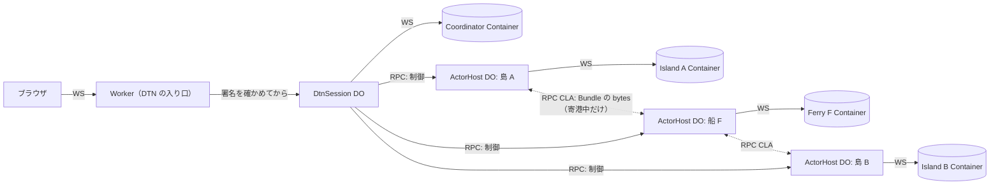
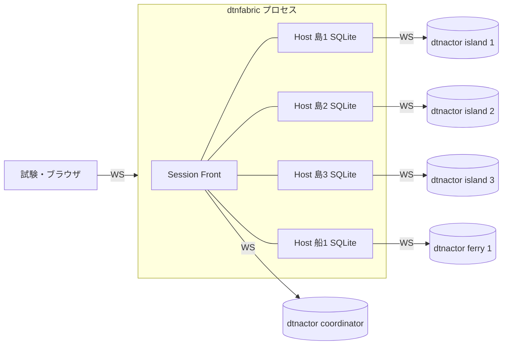
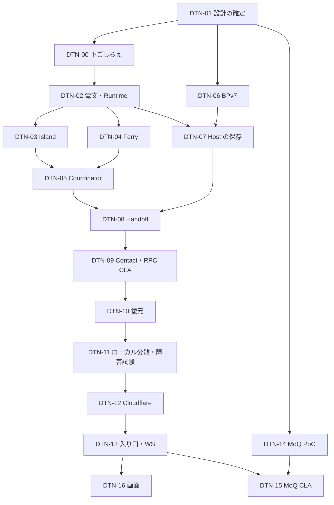

# 構成要素・責務・経路

判断は [ADR-D001](./adr/D001-architecture.md)。

## 1. 構成要素

| 要素 | 数 | Cloudflare での置き場所 | ローカルでの置き場所 | 責務 |
|---|---|---|---|---|
| **Session Front** | 1 / ゲーム | Durable Object `DtnSession` | `dtnfabric` プロセスの中 | ブラウザの WS の終端・署名とトークンの確認・Coordinator の Container の起動と停止・Coordinator の電文の中継（dispatch）・Coordinator の journal の保存 |
| **Coordinator** | 1 / ゲーム | Container（`dtnactor`、`ROLE=coordinator`） | `dtnactor` プロセス | CoordinatorCore（仮想時計・全体のイベント・航路・船の時刻表・依頼の帳簿・スコア・手紙のメタデータと所有権の台帳）。ブラウザへのイベントを作る |
| **Island Actor** | 島の数 | Container（`ROLE=island`） | `dtnactor` プロセス | IslandCore を 1 つ（1 つの `RawNode`・台帳・港・積み替えの倉庫・依頼の窓口と再送） |
| **Ferry Actor** | 船の数 | Container（`ROLE=ferry`） | `dtnactor` プロセス | 1 隻の状態と Cargo（Bundle の実データ） |
| **Actor Host** | 島の数＋船の数 | Durable Object `ActorHost`（1 Actor に 1 つ） | `dtnfabric` の中の Go の SQLite adapter（Actor ごとに別のファイル） | Actor の Container の起動・停止・epoch・journal・inbox・outbox・Bundle の保存（正本）・RPC CLA の受け口 |
| **CLA** | — | Actor Host の間の Durable Object の呼び出し（`fetch` ハンドラ、ADR-0023。初期）、MoQ（DTN-15） | `dtnfabric` の中の呼び出し、MoQ | 寄港中の Bundle の bytes の運搬 |

- Container の image は 1 つ（`server/cmd/dtnactor`）で、環境変数 `ROLE` で役割を変える。今の `server` の image とは別にする
- Container の外向きの通信は今と同じく禁止する（`enableInternet: false`）。Container から Durable Object を呼ぶことはしない。Durable Object が Container の `/ws` に WebSocket をつなぐ（今の `GameSession` と同じ向き）
- Coordinator は Actor に直接つながらない。Coordinator が `dispatch` を Session Front に送り、Session Front が Actor Host を呼ぶ

## 2. 今の `sim.Engine` の責務の振り分け

| 今の責務（main `ffd8720`） | 分散版の持ち主 | 方法 |
|---|---|---|
| `RaftTick`（全ノードを ID 順に Tick）＋ `retryWaits` | 島 | 各島が自分のノードだけ Tick し、自分の待っている依頼だけを再試行する |
| `afterStep` の全ノードの `Process` | 島 | 入力のあった島だけが `Process` する（入力がなければ `Process` は何もしないので同じ） |
| `afterStep` の `node.state` の差分 | 島 | 島が自分の差分を出力する |
| `afterStep` の `refreshRequests`・`refreshScore`・`Reclaim` | Coordinator | 島の出力（メタデータ）から計算する |
| 依頼の計画（`PlanRequests`） | Coordinator | `init` で、その島が発生元の依頼を島に渡す |
| 依頼の発生・窓口（`route`）・再送 | 島 | `game.Decide` の材料（自分が Leader か・Leader は誰か）はその島だけなので、島の中で決まる |
| 依頼の手紙を受けた島の転送 | 島 | 依頼の手紙のペイロードに、台帳のコマンドを入れて運ぶ（[bpv7-profile.md §4](./bpv7-profile.md#4-ペイロード)） |
| 台帳への適用の観察（`observeApplied`） | 島 → Coordinator | 島が `applied{reqId, outcome}` を出力し、Coordinator が「最初の適用 → Committed」「発生元での適用 → 結果」を決める |
| 港（`PostRaft`・`PostRequest`・R1〜R6） | 島 | 島が自分の港の手紙の Bundle を作り、規則で捨てる |
| 積み替えの倉庫（`Relay`） | 島 | 倉庫の Bundle の持ち主はその島（Raft では処理しない） |
| 船の状態・Cargo | 船 | Cargo の正本は船の Actor Host |
| 積む・下ろす・倉庫から積む・出航・到着 | Coordinator が決め、Handoff で実行 | [handoff-and-contact.md](./handoff-and-contact.md) |
| 自動の積み込み（`autoload`）の選択 | Coordinator | 手紙のメタデータの写しと航路の表（`NextHop`）で選び、ふつうの積み込みとして実行する |
| 古い手紙の検出（`emitStale`） | Coordinator | 島が報告する Term の変化と、手紙のメタデータの `msgTerm` で判定する |
| 航路の表・嵐 | Coordinator | 今のまま |
| 手紙の ID（`Transport.lastID`） | 島 | `islandId × 10^9 + n`（[simulation-time.md §5.1](./simulation-time.md#51-手紙の-iddtn-00)） |
| イベントの連番（`Engine.seq`） | Coordinator | ブラウザへ出す順で振る。正規化トレースでは比べない |
| 開幕式（`cluster.Opening`） | 各島・Coordinator | 各自が手元で再計算する（[simulation-time.md §4](./simulation-time.md#4-開幕式)） |
| 漂流瓶・故障・ラッシュ・欠航 | 対象外 | [simulation-time.md §6](./simulation-time.md#6-対象外のイベント) |

## 3. コードの置き場所（`dtn/main`）

| パッケージ | Issue | 内容 |
|---|---|---|
| `server/internal/islandcore` | DTN-00 | IslandCore。参照モデルと島の Actor が共有する |
| `server/internal/coordcore` | DTN-00 | CoordinatorCore。参照モデルと Coordinator が共有する |
| `server/internal/simtrace` | DTN-00 | 正規化トレースと比較 |
| `server/internal/sim` | DTN-00 | 参照モデル。IslandCore と CoordinatorCore を今と同じ順序で呼ぶ |
| `server/internal/dtn/protocol` | DTN-02 | Actor の電文の型と検証 |
| `server/internal/dtn/runtime` | DTN-02 | Actor の共通の Runtime（直列化・結果のキャッシュ・epoch） |
| `server/internal/dtn/island` | DTN-03 | Island Actor |
| `server/internal/dtn/ferryactor` | DTN-04 | Ferry Actor |
| `server/internal/dtn/coordinator` | DTN-05 | Coordinator（上限のループ・dispatch の interface・メモリの中の Actor） |
| `server/internal/dtn/bpv7` | DTN-06 | BPv7 の Codec |
| `server/internal/dtn/host` | DTN-07 | Actor Host の契約と Go の SQLite adapter、契約テストの fixture |
| `server/internal/dtn/handoff` | DTN-08 | Handoff の状態機械 |
| `server/internal/dtn/contact`・`server/internal/dtn/cla/rpc` | DTN-09 | Contact と RPC CLA |
| `server/internal/dtn/recovery` | DTN-10 | 復元 |
| `server/internal/dtn/fabric`・`server/cmd/dtnfabric` | DTN-11 | ローカルの Session Front と Actor Host |
| `server/cmd/dtnactor` | DTN-02〜05 | Actor の Container のエントリ（`ROLE`）。`island`・`ferry` は DTN-03・04、`coordinator` と Session Front との枠組み（[actor-protocol.md §1](./actor-protocol.md#1-経路と符号化)）は DTN-05 |
| `web/worker/dtn/` | DTN-12・13 | `DtnSession`・`ActorHost`・DTN の入り口 |
| `server/internal/dtn/cla/moq`・`spike/dtn-moq/` | DTN-14・15 | MoQ |

Issue の元の案にあった `server/internal/distributed/**`・`server/internal/actor/**` は、`server/internal/dtn/**` にまとめた。

## 4. 制御の経路とデータの経路

### 4.1 Cloudflare

- **制御**（上限・コマンド・Handoff の指示・結果）は Coordinator → DtnSession → ActorHost → Actor
- **データ**（Bundle の bytes）は ActorHost どうしの間だけを、寄港中の島と船の組でだけ動く。DtnSession と Coordinator は Bundle の bytes を持たない（メタデータと digest だけ）
- 島 A → 島 B の直接の経路はない（D-1）

### 4.2 ローカル（DTN-11）

- Actor と Coordinator は別々の OS のプロセス（PID が別）。ポートは `:0` で開き、標準出力で知らせる（固定のポートを使わない）
- Host は 1 つの `dtnfabric` プロセスにまとめてよい。Host の障害は「SQLite を開き直す」で模擬する

## 5. 外部への契約

- ブラウザとの WS の電文（[06-protocol.md](../06-protocol.md)）は変えない。Coordinator が、今の `snapshot`・`events`・`ack`・`node.detail` を作る
- `internal.*` の電文は、今と同じくブラウザから届いたら捨てる。Actor の電文は、ブラウザから届かない経路（Durable Object の間の呼び出し・Container の WS）にだけ置く
- 例外: DTN-16 のエンジニアモードの表示のために、`dtn.*` のイベント（[§6](#6-画面dtn-16)）を足す。DTN の環境でだけ出す

## 6. 画面（DTN-16）

エンジニアモードに「分散」のパネルを足す。DTN の環境でだけ出す。

- Actor ごとの状態: 役割・ID・epoch・Container の状態（起動中・稼働・復元中・停止）・最後に処理した上限
- Bundle の所在と所有者: 手紙ごとに、どの Actor Host が正本を持っているか・Handoff の途中か（Prepare・Persisted・Committed）
- Handoff の進み: 寄港ごとの transfer の一覧
- 障害の注入（DTN の環境で、管理用のトークンを持つ人だけ）: 指定した Actor の Container を止める。復元して続きから遊べることを見せる

足すイベント（`dtn.actor`・`dtn.bundle`・`dtn.transfer`）の形は DTN-16 で [06-protocol.md](../06-protocol.md) と同じ書き方で決め、`docs/dtn/` に書く。Cargo の実データ・内部のトークンはブラウザに出さない。

## 7. 実装の順序と Issue

- DTN-01（この文書群のレビューと Accepted）は今すぐできる。DTN-00 は MVP の凍結（`main` のタグ）の後、`dtn/main` に `main` を取り込んでから始める
- DTN-06 と DTN-14 は、DTN-01 の後なら他と並行できる。DTN-02 が手紙の符号化の interface（`LetterCodec`）と試験用の偽物を用意し、DTN-03・04 はそれを使う。DTN-06 が本物を実装したら差し替える
- DTN-17（対象外のイベント）は、DTN-11 の後の後続
