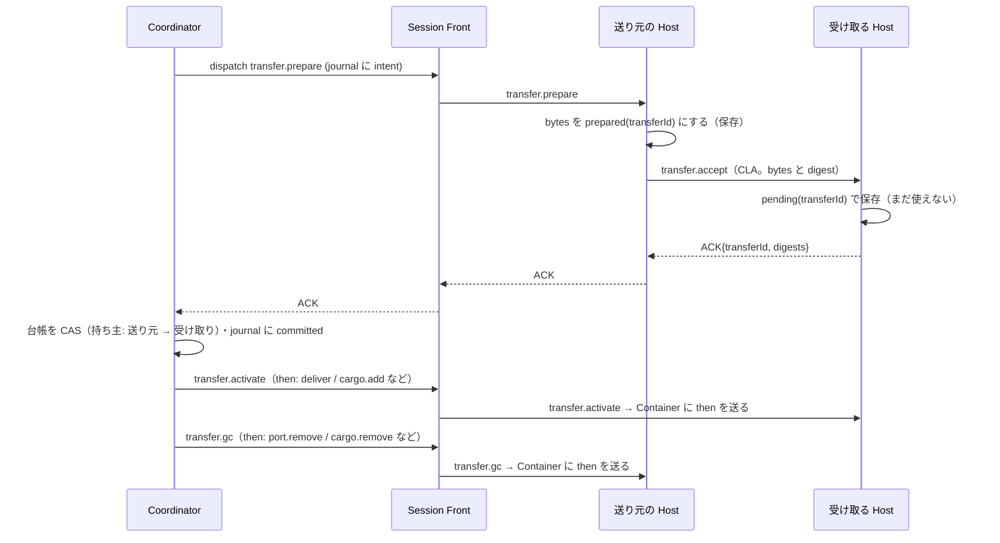

# 寄港（Contact）と所有権の引き渡し（Handoff）

DTN-08（#165）・DTN-09（#166）・DTN-15（#172）の契約。判断は [ADR-D001](./adr/D001-architecture.md)（所有権は Coordinator の台帳で確定する）。

## 1. 用語

| 用語 | 意味 |
|---|---|
| `letterId` | ゲームの手紙の ID（`islandId × 10^9 + n`）。Bundle の一生を通じて変わらない |
| `bundleId` | BPv7 の Bundle の識別（送信元の EID と作成時刻の組。[bpv7-profile.md](./bpv7-profile.md)）。`letterId` と 1 対 1 |
| `transferId` | 1 回の引き渡し（送り元 → 受け取り）の ID。`x<eventSeq>` |
| `contactId` | 1 回の寄港の ID。`k<eventSeq>` |
| 論理的な持ち主 | Coordinator の台帳が記録する、その手紙の持ち主（`island:X/port`・`island:X/relay`・`ferry:F/cargo`・`delivered`・`dropped`）。常に 1 つ |
| 物理的な写し | Actor Host に保存された bytes。引き渡しの途中は 2 つあってよい |

## 2. Contact（寄港）

### 2.1 形

```json
{
  "contactId": "k1207",
  "sessionId": "s_…",
  "island": 2,
  "ferry": 1,
  "islandEpoch": 1,
  "ferryEpoch": 2,
  "openedAt": 12500,
  "sig": "base64url(HMAC-SHA256(DTN_CONTACT_KEY, 正準の JSON))"
}
```

- Coordinator が開く・閉じることを決め、Session Front が `DTN_CONTACT_KEY`（DTN の環境のシークレット。ローカルは起動ごとの乱数）で署名する。ブラウザの入力から直接は作らない
- 開く: 船が島に着いたとき（到着のイベント）と、ゲームの開始時に島に停泊している船
- 閉じる: 出航のコマンドを適用するとき。閉じてから船を `Sailing` にする
- Session Front は、開く・閉じるを両方の Actor Host に知らせる（`contact.open`・`contact.close`）。Host は、閉じた Contact の ID を保存し、それを使う転送を `contact_closed` で断る
- Actor の epoch が上がったら（Container の作り直し）、Coordinator は同じ寄港の Contact を新しい epoch で開き直す

### 2.2 Host が確かめること

`transfer.prepare`・`transfer.accept` を受けた Host は、次をすべて確かめる。1 つでも違えば断る。

1. 署名が正しい
2. `sessionId` が自分のもの
3. 自分が `island` か `ferry` のどちらかで、相手がもう一方
4. 自分の epoch が Contact の epoch と同じ
5. Contact が閉じられていない
6. （送り元）対象の手紙をすべて自分が持っていて、別の transfer の途中でない

これで、島から島への転送・船から船への転送・別のゲームへの転送・航行中の転送・古い世代からの転送が通らない（D-1・D-2・D-7）。

## 3. Handoff（所有権の引き渡し）

### 3.1 手順



| 段階（Coordinator の台帳） | 起きたこと | 次へ進む条件 |
|---|---|---|
| `proposed` | Coordinator が journal に intent を書いた | 送り元の Host が `transfer.prepare` を保存した |
| `persisted` | 受け取る Host が bytes を保存し ACK した | Coordinator が CAS した |
| `committed` | 論理的な持ち主が受け取り側になった | 受け取る Host が `activate` を適用した |
| `activated` | 受け取り側の Actor が使えるようになった | 送り元の Host が `gc` を適用した |
| `collected` | 送り元の写しが不要になった | — |

- `committed` の前は、受け取り側はその bytes を使わない（配達・積み込み・Raft への適用をしない）
- `committed` の後は取り消さない。送り元の写しは `collected` まで消さない（D-5）
- 取り消し（`transfer.abort`）は `committed` の前だけ。起きるのは、確認（§2.2）で断られたとき（バグか古い世代）と、ゲームを終えるときだけ
- 仮想時間は、Handoff が `collected` になるまで止める。だから途中で港の規則や出航が割り込むことはない

### 3.2 ゲームの操作と Handoff

Coordinator は、今の `Transport` と同じ確認（停泊中か・Contact が開いているか・積載の上限・倉庫の上限・手紙がそこにあるか）を、メタデータで先に行う。すべて通ったときだけ Handoff を始める（全部か無しか）。

| 操作 | 送り元 → 受け取り | 受け取り側の `then` | 送り元の `then` |
|---|---|---|---|
| 積む（`cmd.ferry.load`・`autoload`） | 島 X の港 → 船 F | `cargo.add` | `port.remove` |
| 下ろす（自島の手紙） | 船 F → 島 X の港 | `port.return`（R1〜R6 をかけ直す） | `cargo.remove` |
| 下ろす（他島の手紙） | 船 F → 島 X の倉庫 | `relay.store` | `cargo.remove` |
| 倉庫から積む（`cmd.relay.load`） | 島 X の倉庫 → 船 F | `cargo.add` | `relay.remove` |
| 到着の配達 | 船 F → 島 X（宛先が X の手紙。Cargo の順） | `deliver` | `cargo.remove` |

1 つの下ろす操作に自島と他島の手紙が混ざるときは、2 つの transfer に分け、自島 → 他島の順に行う（今の `Unload` の処理の順）。

### 3.3 止まったときの回復

| 止まった場所 | 回復 |
|---|---|
| `transfer.prepare` の保存の前 | Session Front が同じ `eventSeq` で送り直す |
| 送り元の保存の後、`accept` の前 | 同上。送り元の Host は保存済みの prepared を見て、`accept` を送り直す |
| 受け取り側の保存の後、ACK が届く前 | 同上。受け取り側は同じ transferId に同じ ACK を返す（中身が違えば `conflict`） |
| ACK の後、CAS の前（Coordinator が止まった） | Coordinator の復元で、intent があって committed がない transfer を `transfer.status` で照会する。受け取り側が保存済みなら CAS する |
| CAS の後、`activate` の前 | `activate` を送り直す（冪等） |
| `activate` の後、`gc` の前 | `gc` を送り直す（冪等） |

- **配達の重複を防ぐ（D-4）**: 島は配達した `letterId` を覚え、同じ手紙の 2 回目の `deliver` を `invalid` で断る。Host の `eventSeq` の冪等（[actor-protocol.md §5](./actor-protocol.md#5-冪等と順序)）と二重に守る
- **Raft の再送とは混同しない**: Raft が同じ内容を送り直したものは、別の `letterId` の別の手紙。宛先で捨てない

## 4. RPC CLA（初期）

- `transfer.accept` を、送り元の Actor Host が受け取る Actor Host の DO RPC で呼ぶ（`ACTOR_HOST.get(idFromName("<sessionId>/<actor>"))`）。ローカルは `dtnfabric` の中の関数呼び出し
- bytes は Actor Host の間だけを動く。Session Front と Coordinator は digest だけを見る
- Container の外向きの通信は使わない（`enableInternet: false` のまま）

## 5. MoQ CLA（DTN-15）

DTN-14 の PoC で採用と決めたときだけ実装する。CLA だけを差し替え、§2・§3 の契約は変えない。

- 送り元の Host（または PoC で決めた接続の主体）が、Track `dtn/<sessionId>/<contactId>` に、1 つの transfer を 1 つの Group、1 つの Bundle を 1 つの Object として publish する
- 受け取り側は Contact が開いている間だけ subscribe し、§2.2 の確認と digest の確認をしてから保存する。ACK は RPC の経路で返す（MoQ の配信の成功を ACK とみなさない）
- Relay は永続の正本にしない。閉じた Contact の Object が後から届いても使わない
- RPC CLA は残し、どちらを使うかはセッションの作成時に決めて記録する。障害時に自動で切り替えない
